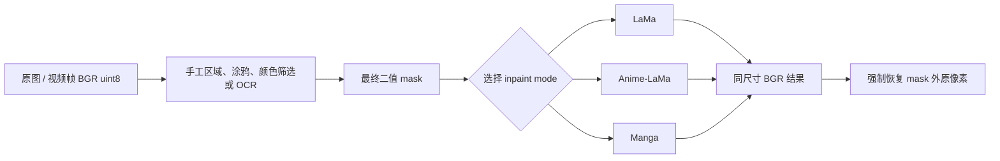
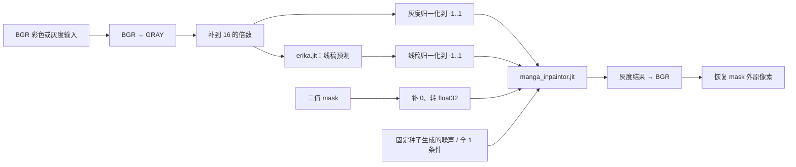

+++
date = '2026-10-22T20:00:00+08:00'
draft = false
title = '项目实战：LaMa、Anime-LaMa 与 Manga 图像修复模型详解'
math = true
+++

CleanCanvas Studio 的 `lama`、`anime_lama` 与 `manga` 都出现在“去文字 / 去符号”功能中，也都接收一张图片和一张 mask。但它们不是同一个模型换了皮肤：LaMa 与 Anime-LaMa 使用相同的双输入 TorchScript 推理外壳、不同领域的权重；Manga 则是“线稿预测器 + 漫画修复器”的双模型流程，且会主动将图片转成灰度。若只记住“都能去字”，很容易把彩色动画交给 Manga，或在复杂照片上误以为 Anime-LaMa 必然更好。

本篇沿着当前项目的 `backend/inpaint/engine.py` 讲解三种 AI 模式的职责、数据流、使用步骤与边界。重点是**可靠地使用已有权重**，不是从零训练这些模型。它们生成的是视觉上合理的补全，不是被遮挡像素的历史备份；这一点不先说清，后面的“效果好不好”就无从讨论。

## 先给出选择结论

三种模式都需要先准备 mask：白色/非零区域表示允许修改，其他区域表示必须保持。模型不会自行判断“这段文字是不是该删”；它只根据图像上下文填补已经由 mask 指定的洞。

| 模式 | 模型输入与输出 | 最适合的内容 | 不适合或需要警惕的内容 |
| ---- | -------------- | ------------ | ---------------------- |
| `lama` | 彩色整图 + 单通道 mask → 彩色整图 | 照片、自然背景、普通图片中的文字、水印、小物体 | 长视频会逐帧独立生成，可能闪烁；复杂人物细节无法保证真实恢复 |
| `anime_lama` | 彩色整图 + 单通道 mask → 彩色整图 | 彩色动漫插画、动画画面中的文字、logo、碍眼符号 | 不是“任何二次元都无条件完美”；运动视频同样没有时序约束 |
| `manga` | 灰度图 + 线稿 + mask + 条件张量 → 灰度图 | 黑白漫画、灰度线稿、对话气泡文字、拟声文字 | 彩色插画、彩色动画、需要保留 mask 内原颜色的图；mask 内色相和饱和度会丢失 |

选择的第一依据不是“哪个名字更像 AI”，而是**图像的视觉域和你是否需要保留颜色**：

- 普通照片或真实场景优先从 `lama` 开始；
- 彩色动漫画面优先比较 `anime_lama`，必要时再与 `lama` 对照；
- 黑白/灰度漫画和线稿才选择 `manga`；
- 文字压在人脸、手部、发丝、建筑线条等不可替代结构上时，先做小范围预览。三个模型都可能生成“连贯却不真实”的细节。

OpenCV Telea 也是项目可选模式，但它是传统算法，不属于本篇的神经网络路径。它在纯色背景、小字幕、连续纹理上可能更快且更稳定；AI 模型的价值主要在于较复杂的上下文补全，并非每一种情况都自动胜出。

## 三种模式共享的业务链路

从调用者视角看，三个 AI 模式遵守同一份接口：

```python
def inpaint(self, image_bgr: np.ndarray, mask: np.ndarray) -> np.ndarray:
    ...
```

这份接口比模型名更重要。调用方传入 OpenCV 的 BGR `uint8 [H, W, 3]` 图片和 `uint8 [H, W]` mask，得到同尺寸的 BGR `uint8 [H, W, 3]` 结果；它不必知道内部究竟调用了一个还是两个 TorchScript 模型。



`ContentRepairProcessor._repair()` 的逻辑可以概括为：先由已确认的 mask 计划或动态 OCR 为当前帧生成 mask；mask 全为 0 时直接返回原图；只有存在待修复像素时才懒加载并复用当前模型引擎。也就是说，模型不会在用户刚打开图片时就占用显存或下载权重，更不会在没有待修复区域时做无意义的前向计算。

三个引擎都在最后执行同一类产品级保护：

```python
result_bgr[binary_mask == 0] = image_bgr[:, :, :3][binary_mask == 0]
```

神经网络可能轻微改动整张输出图的未遮罩区域；这行确定性代码则保证 mask 外的像素与原图逐像素一致。因此，模型能看见完整图像以利用上下文，不等于它被允许修改完整图像。这个区别相当重要，不能因为代码短就把它忽略掉。

## 使用前：先把 mask 做对

无论选择哪一模型，先确认以下四件事：

1. **mask 覆盖完整文字及其抗锯齿边缘。** 对白字、半透明水印或阴影，通常应在字形外多留约 1–2 个像素；只覆盖笔画中心容易留下灰边。
2. **mask 不要无故吞掉重要结构。** 框住人物五官、发丝、气泡边框或密集线稿，等于要求模型重新“编造”这些细节，风险自然上升。
3. **mask 外确实是不能改的区域。** 最终像素保护会保证这一点，因此如果目标漏在 mask 外，模型也不会替你擅自修掉。
4. **先用一张代表性图片或 5–10 秒视频片段验证。** 视频模式逐帧调用图像修复模型，并没有自动的跨帧时序一致性；单帧很漂亮，不表示连续播放不会闪烁。

项目支持手工矩形、涂鸦、颜色筛选与 OCR 等方式构建 mask。首次排查时，手工矩形最容易复现，因为其坐标和覆盖范围完全可控。例如下列命令的四个数字是 `XMIN XMAX YMIN YMAX`：

```bash
python -m backend.main \
  --input input.png \
  --output output.png \
  --manual-area 120 620 560 710 \
  --mode anime_lama \
  --device auto
```

它表示先建立横向 `[120, 620)`、纵向 `[560, 710)` 的矩形 mask，再以 `anime_lama` 修复。将 `--mode` 改为 `lama` 或 `manga`，任务入口、mask 计划和输出路径不变，只有底层引擎不同。`--device auto` 会真实尝试 CUDA 初始化，失败后再尝试 CPU；显式写 `cuda` 或 `cpu` 则不会静默切换设备。

命令能够结束只说明工程链路没有报错，不说明视觉结果可靠。至少核对：输出是否与输入同尺寸、mask 外像素是否未变、mask 内是否有残字/断线/异常纹理，以及视频是否在运动场景中闪烁。

## LaMa：面向通用彩色场景的整图修复

LaMa 的全称通常写作 *Resolution-robust Large Mask Inpainting*。它要解决的是**图像修复（inpainting）**，不是文字识别或目标检测：输入是完整图像 $I$ 与 mask $M$，输出是补全后的完整图像 $\hat I$。mask 只规定哪里可以重建，洞外的图像内容才是它推测洞内纹理、边缘和物体结构的依据。

```text
完整 RGB 图像：提供墙面、天空、人物、边缘和纹理的上下文
二值 mask：    规定哪些像素允许重新生成
LaMa：         根据周边与远处信息产生整张候选结果
后处理：       裁回原尺寸，并把 mask 外像素恢复为原图
```

这解释了为何项目不会先把文字框裁成小图片再交给 LaMa。孤立的小框几乎看不到外部上下文；对于天空、衣服纹理、建筑边缘或水印后的背景，完整画面提供的信息才是修复质量的基础。

### LaMa 的项目输入契约

项目中的 `TorchScriptLaMaEngine` 会取得 `big-lama.pt`，再用 `torch.jit.load()` 恢复可调用的 TorchScript 模块。权重下载、MD5 校验、CPU 读取、迁移到实际 device、`eval()` 切换推理状态等步骤由引擎负责；调用者不需要重写 LaMa 的 Python 网络类。

一次前向前后的张量流如下：

| 阶段 | 图像 | mask | 为什么这样做 |
| ---- | ---- | ---- | ------------ |
| OpenCV 入口 | BGR `uint8 [H,W,3]`，值域 `0..255` | `uint8 [H,W]` | 这是项目统一的媒体边界 |
| 颜色/二值化 | RGB `uint8 [H,W,3]` | 非零变 `0/1` | 与权重的颜色、条件语义对齐 |
| 尺寸补齐 | 对称 padding 至 8 的倍数 | 常量 0 padding 至相同尺寸 | 满足网络的空间尺度约束；虚拟边缘不能被当作待修复区域 |
| Tensor 输入 | `float32 [1,3,Hp,Wp]`，值域 `0..1` | `float32 [1,1,Hp,Wp]`，值域 `0/1` | 满足 TorchScript 模型签名 |
| 输出与收尾 | RGB Tensor → 裁回原高宽 → BGR `uint8` | 保留原 mask | 将结果还给 OpenCV，同时强制保持 mask 外像素 |

关于 RGB/BGR、NCHW、补到 8 的倍数和裁回原图的逐行推导，请先阅读[图像如何变成模型张量](05-image-tensor-preprocessing-and-inpainting.md)。这里要记住的是：padding 只是让网络可以计算，绝不表示最终图片应变大；任何遗漏裁回的实现都是输出协议错误。

### LaMa 适合什么，不能承诺什么

LaMa 通常适合普通图片、照片、自然纹理或复杂背景上的文字、水印和小物体。它擅长根据周边连续性生成“看起来合理”的内容；例如水印遮在天空、墙面、草地或重复纹理上时，洞外信息足以约束一个较自然的延续。

但“视觉合理”不等于“历史真实”。若文字遮住了人物眼睛、手指、独一无二的 logo 或建筑文字，模型无法从已丢失的像素中读取真相，只能生成符合训练分布的猜测。要么缩小 mask，只去除可安全补的部分；要么接受人工修图仍不可替代——这不是模型不努力，而是输入信息本来已经被遮挡了。

对于视频，LaMa 每帧独立推理。即使同一行字幕位置固定，帧间的轻微纹理变化也可能使生成结果跳动；字幕位置变化时还需要动态 OCR 或逐帧 mask，而不是把第一帧的矩形机械复用到全片。

## Anime-LaMa：相同输入形式，不同的视觉域

Anime-LaMa 在项目中并不是另一套预处理逻辑。它与 LaMa 共用 `TorchScriptLaMaEngine`，同样接收 RGB `0..1` 图像和单通道二值 mask，同样补到 8 的倍数、同样在 `inference_mode()` 中执行，并同样在最后恢复 mask 外像素。真正不同的是加载的权重工件：

| 模式 | TorchScript 工件 | 训练域带来的偏好 | 首选内容 |
| ---- | ---------------- | ---------------- | -------- |
| `lama` | `big-lama.pt` | 更偏通用图像、自然场景与复杂背景 | 照片、真实场景、通用图片 |
| `anime_lama` | `anime-manga-big-lama.pt` | 更贴近动漫插画的色块、描边、角色与画面构成 | 彩色动漫插画、动画画面、字幕/符号 |

“权重不同、代码相同”是深度学习工程中很常见的情形：网络签名仍是 `model(image, mask)`，但参数是在不同数据分布上训练出来的，所以它们对同一洞的补全偏好不同。不要把 Anime-LaMa 理解为额外的风格滤镜；它仍然执行修复，只是更可能把二次元画面的平坦色块和线条统计当作熟悉的上下文。

### 为什么 Anime-LaMa 对气泡文字常有额外收尾

LaMa 类模型有时会在“浅色平坦气泡底 + 稀疏深色文字”中留下浅灰色幽灵笔画。项目对此加入了一个保守后处理，而非粗暴地把所有结果模糊掉：

1. 将 mask 分成连通区域；
2. 在每个区域周围取一个未遮罩的采样环；
3. 在 Lab 色彩空间检查该采样环是否足够接近同一底色；
4. 检查原 mask 内像素是否明显比周边底色更暗、因而更像文字/线条；
5. 只有上述条件成立时，才用原图邻域的中位背景色清理残笔。

因此，这个收尾只适合稳定的白色或浅色气泡底；渐变、纹理、彩色物体和大面积涂鸦不会触发，避免把真实细节错误地填平。它是项目代码用确定性规则约束特定失败模式，不是 Anime-LaMa 本身“保证去字干净”的魔法。

### Anime-LaMa 的使用建议

- 对彩色动漫画面，先用只覆盖文字与抗锯齿边缘的小 mask；不要轻易覆盖气泡边框、角色轮廓或大面积背景。
- 气泡底色平坦却有残笔时，先检查 mask 是否漏掉细线，必要时增加 1–2 像素描边扩张；不要先把矩形扩大到吞没整个气泡。
- 线条断裂或人物细节异常时，分别对 `anime_lama` 与 `lama` 做同一 mask 的小图对照；“动漫模型”不是质量绝对更高的同义词。
- 用在视频上时，先导出短片段观察闪烁。Anime-LaMa 没有跨帧状态或光流约束，不能从单帧好看推出连续画面稳定。

## Manga：两份 TorchScript 模型协作的黑白线稿修复

Manga 不是把 Anime-LaMa 换成黑白输出。项目的 `MangaEngine` 同时加载两个 TorchScript 工件：`erika.jit` 负责从灰度图提取线稿先验，`manga_inpaintor.jit` 则在灰度、线稿、mask、噪声和条件张量共同约束下生成修复结果。



### 为什么 Manga 必须是黑白/灰度漫画

Manga 路径开头就执行 `BGR → GRAY`，所以进入模型的不是三个彩色通道，而是单通道灰度 `float32 [1,1,Hp,Wp]`。推理完成后，结果同样是单通道灰度图，再通过 `GRAY → BGR` 扩成三个数值相同的通道。

这意味着一个不可绕过的事实：**mask 内被修复的区域不保留原始色相与饱和度。** 如果把彩色动漫、照片或插画交给 Manga，结果可能发灰或发白，不是模型“没加载成功”，而是颜色信息在第一步已经被主动丢弃。mask 外像素最终会被恢复为原图，所以你可能看到“框外仍是彩色、框内变成灰度”的现象；这正是该模型的输入输出语义。

漫画的主要视觉信息通常是黑白明暗、大面积留白和清晰线稿。让模型显式接收线稿先验，有助于在气泡、网点和轮廓附近生成更符合线条结构的结果。这不表示它能准确复原被文字遮住的人物线条，只表示它拥有比通用彩色修复更贴近漫画域的条件信息。

### Manga 的输入为何比 LaMa 多

两者的 Tensor 契约并不相同：

| 输入 | Manga 中的 shape / 值域 | 职责 |
| ---- | ----------------------- | ---- |
| 灰度图 | `[1,1,Hp,Wp]`，由 `0..255` 缩放至 `-1..1` | 提供原始明暗结构 |
| 线稿 | `[1,1,Hp,Wp]`，由线稿模型输出后缩放至 `-1..1` | 提供边缘和笔画先验 |
| mask | `[1,1,Hp,Wp]`，`0/1` | 指定待生成的区域 |
| 噪声 | 与 mask 同 shape | 给生成过程提供随机输入 |
| 全 1 条件 | 与 mask 同 shape | 满足该导出模型的条件输入签名 |

项目将 Manga 高宽补齐到 16 的倍数，而 LaMa 类补到 8 的倍数；这不是“漫画更高级”的等级差，而是各自网络结构的空间尺度契约不同。二者推理后都必须裁回原始 `[H,W]`。

代码会在每次 Manga 修复前固定 Python、NumPy 与 Torch 的随机种子为 `42`，并把 `torch.randn_like(mask_tensor)` 作为噪声输入。这使同一环境下的结果更容易复查；但驱动、硬件、PyTorch 版本和底层算子仍可能使跨环境结果不保证逐位完全一致。固定种子减少随机变量，不等于承诺所有机器输出完全相同。

### Manga 的使用建议

- 仅对黑白漫画、灰度线稿或最终允许变成黑白的内容选择 `manga`。
- 文字位于气泡留白中时，用紧贴文字、略含抗锯齿边缘的 mask；不要把整块气泡边框一起圈进来。
- 文字压在密集网点、发丝或人物轮廓上时，先检查修复后的线条连续性；必要时缩小 mask 或保留人工修补。
- 看到彩色区域在 mask 内发灰时，应切换到 `anime_lama` 或 `lama`，而不是反复调 device、dtype 或 CUDA。

## 从模式名到实际加载：模型文件、设备与复用

三种模式的权重都由 `ModelStore` 管理：缓存文件存在时先校验 MD5；需要下载时先写入临时 `.download` 文件，校验通过后再原子移动为正式文件。这样中断下载不会留下一个名字正确、内容却不完整的模型文件。

加载路径可概括为：

```text
用户选择 mode
  → create_inpaint_engine(mode, device, model_dir)
  → 确定所需模型工件并校验/下载
  → torch.jit.load(..., map_location='cpu')
  → .to(cuda 或 cpu).eval()
  → 首次修复后缓存同一个引擎，后续图片/视频帧复用
```

`auto` 不只检测“是否看见 GPU”，而是按 CUDA、CPU 的顺序真正尝试初始化模型；CUDA 驱动、显存和模型加载都可能在 `torch.cuda.is_available()` 返回真后才失败。显式选择 `cuda` 则会把错误直接暴露给用户，显式选择 `cpu` 则不会偷偷跳去 GPU。对于视频，模型实例在任务内复用，绝不会每一帧重新下载权重、反序列化 TorchScript 或迁移设备。

若你在 Python 代码中调用，而非通过 GUI/CLI，应将业务输入仍然保持在统一接口上：

```python
from backend.inpaint.engine import create_inpaint_engine

engine = create_inpaint_engine(
    mode='anime_lama',
    device='auto',
    model_dir=None,
)
result_bgr = engine.inpaint(image_bgr, mask)
```

其中 `image_bgr` 必须是三通道 OpenCV BGR `uint8` 数组，`mask` 必须与其高宽一致。不要绕过引擎，直接将 JPEG 字节、PIL 图像或未经二值化的随机数组喂给 TorchScript；`torch.jit.load()` 能恢复模型，并不会替调用者猜测颜色空间、shape 或值域。

## 结果不理想时，按边界排查

| 现象 | 更可能的原因 | 首先尝试的处理 |
| ---- | ------------ | -------------- |
| 文本没被删除或有灰边 | mask 未覆盖抗锯齿、阴影或描边 | 增加 1–2 px 的描边扩张；先在小图验证，不要无节制扩大矩形 |
| 人脸、发丝、线条被修坏 | mask 覆盖了真实复杂结构，模型只能猜测 | 缩小 mask；比较 `lama` 与 `anime_lama`；必要时人工修图 |
| 彩色区域在修复区变灰 | 选择了 `manga`，颜色在灰度预处理时丢失 | 对彩色内容切换到 `anime_lama` 或 `lama` |
| 图片单帧可用，视频播放闪烁 | 模型逐帧独立生成，无时序一致性 | 用短片段预览；改进动态 OCR/mask，必要时选择更稳定的传统模式 |
| `Expected all tensors to be on the same device` | 模型和输入未在同一 device | 使用项目引擎；自定义调用时让所有输入与模型共同迁移 |
| CUDA 显存不足 | 图片/选区过大或 GPU 可用显存不足 | 先缩小分辨率/选区或改用 CPU；不要期待 `empty_cache()` 让无法容纳的前向突然可行 |
| 模型下载或加载失败 | 网络、磁盘、缓存损坏、PyTorch 环境或模型文件不匹配 | 查看具体错误；删除校验失败缓存后重试，确认 PyTorch 安装与 device 设置 |

排查顺序应当是：**先确认 mask，再确认模式与图像域匹配，再检查颜色/shape/device 契约，最后才讨论模型质量。** 一开始就换权重、改半精度或扩大矩形，通常只是在把本来可定位的问题变得更难复现。

## 小结

- LaMa、Anime-LaMa 与 Manga 都是 mask 引导的图像修复模式：模型不负责决定删什么，mask 才决定允许修改的区域。
- `lama` 与 `anime_lama` 共用彩色双输入 TorchScript 数据流，差别主要在通用图像权重与二次元图像权重；彩色动漫优先试 Anime-LaMa，照片和通用场景优先试 LaMa。
- `manga` 使用线稿模型和漫画修复模型协作，输入输出本质是灰度；它适合黑白漫画，不应处理需要保留 mask 内颜色的彩色画面。
- 三种模式都会在最后恢复 mask 外原像素；“模型可以看到整图”不等于“模型可以修改整图”。
- 评价结果时，应先检查 mask 覆盖、图像域与模式的匹配、输出尺寸和 mask 外不变性，再判断生成内容是否足够自然。模型名称并不替你承担这些判断，遗憾的是，它们从来没有这项义务。
