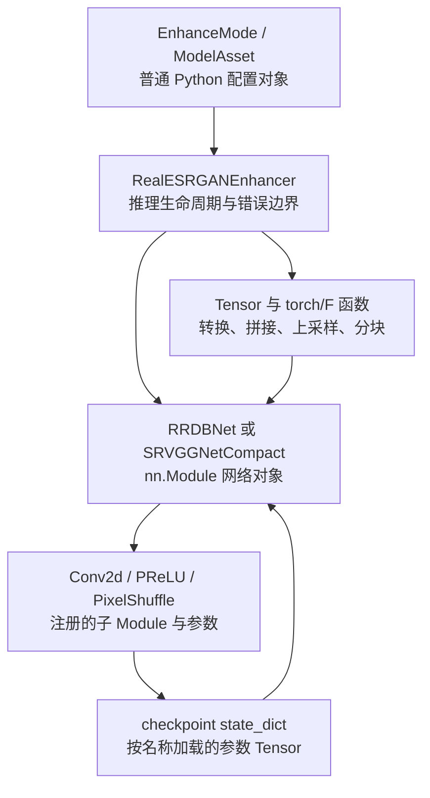

+++
date = '2026-10-15T20:00:00+08:00'
draft = false
title = '从 PyTorch 基础读懂 Real-ESRGAN：网络类、张量算子、权重与分块推理'
math = true
+++
上一章说明了模型如何加载。本章沿着 [CleanCanvas Studio](https://github.com/Yukino-insect/clean-canvas-studio) 的 `backend/enhance/realesrgan.py` 继续追踪：一张 OpenCV 的 BGR `uint8` 图像怎样成为网络输入、Anime/General 为什么不能共用权重、显存不足时 tile 怎样裁剪和拼回去。

不过，直接从 `RRDBNet`、`torch.cat` 和 `PixelShuffle` 开始读，和让刚学会字母的人分析长句没有多大区别。本章会先建立足以阅读该文件的 PyTorch 基础：Tensor 的四个维度、`nn.Module` 为什么能保存层和权重、带参数的层与无参数函数如何分工、卷积与激活函数怎样改变数据；然后才进入 RRDB、SRVGG、checkpoint、设备精度和分块推理。目标不是背下类名，而是能够从函数签名、shape、dtype、device 和副作用读懂一条真实推理链。

## 阅读这份文件前，先分清三层对象

`realesrgan.py` 同时使用了普通 Python 对象、PyTorch 网络对象和 Tensor 运算。把它们混成一个模糊的“模型代码”，后面任何一行都容易显得神秘。它们的关系是：



| 层次 | 本文件中的例子 | 解决的问题 | 是否含可训练参数 |
| ---- | -------------- | ---------- | ---------------- |
| 普通 Python | `EnhanceMode`、`ModelAsset`、`RealESRGANEnhancer` | 选择模式、保存文件信息、组织推理步骤和异常 | 不一定；它们不是神经网络层 |
| `nn.Module` | `RRDBNet`、`RRDB`、`ResidualDenseBlock`、`Conv2d`、`PReLU` | 定义可调用的网络计算，并登记子层和参数 | 视模块而定；卷积、PReLU 有参数 |
| Tensor / 函数 | `torch.cat`、`torch.zeros`、`F.interpolate`、`view`、`permute` | 保存数值并执行一次具体计算或形状变换 | 通常不保存参数，除非函数显式接收参数 |

例如 `EnhanceMode.REAL_ESRGAN_ANIME` 是 `Enum` 的一个枚举值，用于选择“Anime 权重配 RRDBNet”；它本身既不是 Tensor 也不参与卷积。`RealESRGANEnhancer` 则是项目的服务对象：它下载/校验权重、选择 CPU 或 CUDA、创建网络并暴露 `enhance()`。真正把 `[1,3,H,W]` 变成 `[1,3,4H,4W]` 的，是其中保存的 `self.model`，也就是一个 `nn.Module`。

## 第一个基础：图像 Tensor 到底是什么

PyTorch 中的 **Tensor** 是带有数值、形状（`shape`）、数据类型（`dtype`）和设备（`device`）的多维数组。视觉网络通常采用 **NCHW**：

```text
[N, C, H, W]
 │  │  │  └─ 宽度 width
 │  │  └──── 高度 height
 │  └─────── 通道 channel：RGB 是 3
 └────────── batch：一次有几张图片
```

因此一张 `16×20` 的 RGB 图像进入模型前通常是 `[1,3,16,20]`，而不是 OpenCV/NumPy 的 `[16,20,3]`。这里的 `1` 不代表图像只有一个颜色，而是“这次 batch 内只有一张图片”。把 NCHW、RGB 和 `float32 [0,1]` 三件事混在一起，是视觉推理里最常见也最安静的错误来源。

先运行下面这段和项目无关的小代码。它展示了第 07 篇后面所有网络层共同遵守的输入契约：

```python
import torch

image = torch.rand(1, 3, 16, 20, dtype=torch.float32)

print(image.shape)   # torch.Size([1, 3, 16, 20])
print(image.dtype)   # torch.float32
print(image.device)  # cpu
print(float(image.min()), float(image.max()))  # 位于 [0, 1) 的随机数
```

`torch.rand` 在此只用于构造一个值域为 `[0,1)` 的假图片，不表示真实读取图片的方式。项目真实输入先经过 `cv2.cvtColor(..., cv2.COLOR_BGR2RGB)`、`.astype(np.float32) / 255.0`，再由 `torch.from_numpy` 包装。`from_numpy` 在 CPU 上通常与 NumPy 共享底层内存；只有执行 `.to('cuda')` 才会把数据复制到 GPU。这个边界解释了为何“创建 Tensor”和“把 Tensor 送进模型所在设备”是两步。

### 形状方法：`size`、`view`、`permute`、`reshape` 不是同义词

源码里的 `_pixel_unshuffle()` 虽然当前 Real-ESRGAN 的两条路径没有调用，但它是理解 Tensor 维度操作的好教材：

```python
batch, channels, height, width = x.size()
return x.view(batch, channels, height // scale, scale, width // scale, scale).permute(
    0, 1, 3, 5, 2, 4
).reshape(batch, channels * (scale ** 2), height // scale, width // scale)
```

- `x.size()` 读取各维长度，等价于常用的 `x.shape`，这里把四个整数解包；
- `view(...)` 只按既有连续内存重新解释形状，不交换元素位置，因此总元素数必须不变；
- `permute(0,1,3,5,2,4)` 真正改变“哪一维排在前面”，把每个 `scale×scale` 小格移动到通道附近；
- `reshape(...)` 得到最终所需的 `[N,C×scale²,H/scale,W/scale]`。当输入内存不连续时，`reshape` 可以在必要时复制；`view` 则要求布局可直接解释。

以 `scale=2`、输入 `[1,3,8,10]` 为例，输出会是 `[1,12,4,5]`：高和宽各缩小 2，通道数乘上 $2^2=4$，总元素数量完全相同。它是 `PixelShuffle(2)` 的反向重排思路，不是卷积，也不会产生任何新图像细节。

## 第二个基础：`nn.Module` 如何把 Python 类变成网络

`torch.nn.Module` 是 PyTorch 神经网络模块的基类。继承它的类在 `__init__()` 中把子层赋给 `self`，在 `forward()` 中规定数据流。由于 `Module` 会登记这些子层，随后调用 `model.parameters()`、`model.state_dict()`、`model.to(device)`、`model.eval()` 时，操作会递归传递到整棵网络树。

这里的“赋给 `self` 就会被登记”是 `nn.Module` 的核心约定，而不是普通 Python 类自动具备的能力；可对照 [PyTorch `Module` 文档](https://docs.pytorch.org/docs/stable/generated/torch.nn.Module.html)。

```python
import torch
from torch import nn

class TinyFeatureNet(nn.Module):
    def __init__(self):
        super().__init__()
        self.conv = nn.Conv2d(3, 8, kernel_size=3, padding=1)
        self.act = nn.LeakyReLU(negative_slope=0.2)

    def forward(self, x):
        return self.act(self.conv(x))

model = TinyFeatureNet()
input_tensor = torch.rand(1, 3, 16, 20)
output_tensor = model(input_tensor)  # 调用 Module 的 __call__()，再进入 forward()

print(output_tensor.shape)  # [1, 8, 16, 20]
print(tuple(model.conv.weight.shape))  # [8, 3, 3, 3]
```

`nn.Conv2d(3,8,3,padding=1)` 中的 `3 → 8` 表示输入通道 3、输出通道 8；它不是将图片“切成八份”。`model.conv.weight` 的 `[8,3,3,3]` 意味着有 8 个输出特征，每个特征都用一组覆盖全部 3 个输入通道的 `3×3` 卷积核计算。`padding=1` 在四周补一个像素，使 stride 为 1 的 `3×3` 卷积保持高宽不变。

CleanCanvas 的 `_build_rrdb_net()` 将 `ResidualDenseBlock`、`RRDB`、`RRDBNet` 定义在函数内部，不是语法上的花活：它让文件在用户只使用 OpenCV 功能时不必导入 PyTorch。**类定义位置不改变它们仍是 `nn.Module` 的事实**；一旦调用 `_build_rrdb_net(6)`，就会创建一棵由卷积、激活和容器模块组成的网络树。

### 带状态的层与无状态函数：为什么代码同时写 `nn.Conv2d` 与 `F.interpolate`

`torch.nn` 中的层通常以 `Module` 形式出现，因为它们要保存参数或运行状态；`torch.nn.functional`（源码中别名为 `functional` 或常见的 `F`）则提供一次性函数。不能因为两者都能写在 `forward()` 中，就认为它们可随意替换。

| 写法 | 本文件例子 | 是否保存到 `state_dict()` | 本质作用 |
| ---- | ---------- | ------------------------- | -------- |
| `nn.Conv2d(...)` | `conv_first`、`conv_up1` | 是，保存卷积核 `weight` 和通常的 `bias` | 可学习局部变换 |
| `nn.PReLU(64)` | General 网络的激活层 | 是，保存每通道可学习的负半轴斜率 | 可学习激活 |
| `nn.LeakyReLU(0.2)` | Anime 网络的激活层 | 否，斜率固定为 0.2 | 无参数激活；Module 形式便于嵌入网络 |
| `functional.interpolate(...)` | 两次 2×最近邻放大、4×跳连基线 | 否 | 依固定规则改变空间尺寸 |
| `torch.cat(...)` | 稠密块收集旧特征 | 否 | 沿指定维连接 Tensor |
| `torch.zeros(...)` | tile 路径的总输出画布 | 否 | 在指定 device/dtype 分配全零 Tensor |

`LeakyReLU` 的数学形式是 $f(z)=z$（$z\geq0$）或 $f(z)=az$（$z<0$）；项目把固定 $a=0.2$ 传给 `negative_slope`。`PReLU` 也保留负半轴，但斜率 $a$ 是参数，`nn.PReLU(num_parameters=64)` 因而为 64 个通道各保留一个可学习斜率。两者都不是“让网络自动学会任何非线性”的万能开关；它们只提供分段线性变换，使多层卷积的组合不退化为一个大线性函数。

### `Sequential` 和 `ModuleList`：都注册模块，却不替你做同一件事

源码中有两种容器，差别很重要：

```python
def _make_layer(block, count, **kwargs):
    return nn.Sequential(*(block(**kwargs) for _ in range(count)))

self.body = nn.ModuleList(body)
```

`nn.Sequential` 不但注册其中的 Module，还定义了按顺序执行的 `forward()`：输入自动经过第 1 层、第 2 层直到最后一层。因此 RRDBNet 的 `self.body(feat)` 是合法的。`nn.ModuleList` 只负责注册一组 Module，**自身没有“自动把输入穿过全部层”的前向语义**；SRVGG 明确写出 `for layer in self.body: output = layer(output)`，于是能控制循环、分支或调试点。若误把普通 Python `list` 用来保存动态创建的卷积层，参数不会被 Module 正确登记，`state_dict()` 与 `.to(device)` 都可能漏掉它们。

## 第三个基础：卷积、激活与上采样怎样组成超分网络

一层二维卷积不是“识别物体”的黑盒。它对每个局部窗口做带权求和再加偏置。忽略 batch 和输出通道编号，一处输出可理解为：

$$
y_{i,j}=b+\sum_{c=1}^{C_{in}}\sum_{u=0}^{K-1}\sum_{v=0}^{K-1}w_{c,u,v}\,x_{c,i+u-P,j+v-P}
$$

其中 $x$ 是输入特征图，$w$ 是会从 checkpoint 加载的卷积核，$b$ 是偏置，$C_{in}$ 是输入通道数，$K$ 是卷积核边长，$P$ 是 padding。`Conv2d(64,64,3,1,1)` 表示将 64 个输入通道局部混合为 64 个输出通道，kernel 为 3、stride 为 1、padding 为 1；它保持空间尺寸，却会改变每一个位置的 64 维特征表示。

`functional.interpolate(feat, scale_factor=2, mode='nearest')` 则没有可学习参数。最近邻 2×只是复制邻近像素，把 `[N,64,H,W]` 变为 `[N,64,2H,2W]`；紧跟的 `conv_up1` 才利用训练好的卷积把放大后仍很粗糙的特征变得适合后续图像重建。两次这样的“固定放大 → 可学习卷积”形成 4×空间尺度。它与 `PixelShuffle` 一样都负责改变形状，但学习细节的参数仍在卷积里。

`Conv2d` 的参数、输入输出 shape 约定可查 [PyTorch `Conv2d` 文档](https://docs.pytorch.org/docs/stable/generated/torch.nn.Conv2d.html)；`interpolate` 的 `mode` 与 `scale_factor` 语义可查 [PyTorch `functional.interpolate` 文档](https://docs.pytorch.org/docs/stable/generated/torch.nn.functional.interpolate.html)。实际项目必须以权重训练时的选择为准，不能因为另一个插值模式“看起来更平滑”就自行替换。


## 超分辨率学习什么，又不能证明什么

低分辨率图像 $x$ 经模型参数 $\theta$ 变为预测结果：

$$
\hat y=f_\theta(x)
$$

训练时用成对的低/高分辨率图像调整 $\theta$；推理时只有 $x$，所以 $\hat y$ 是符合训练分布的合理细节，不是对丢失真实像素的取证。项目也明确区分 Anime 与 General：前者优先二次元线条，后者面向普通图像，但文字和关键线条仍须人工复核。

当前两个网络的原生倍率都是 4：`[1,3,H,W] → [1,3,4H,4W]`。界面虽然可请求 1×至4×，但非 4×的实现并不是换一个相应倍率模型，而是先产生 4×结果，再以 Lanczos 插值缩到请求尺寸。

## 工程入口：`enhance()` 的参数、返回值与数据流

`RealESRGANEnhancer.enhance(image_bgr, scale=2.0)` 是推理的公开边界：

| 项目 | 约定 | 实际处理 |
| --- | --- | --- |
| `image_bgr` | NumPy `[H,W,>=3]`，通常 `uint8` BGR | 拒绝非彩色输入，只取前三通道 |
| `scale` | 1 到 4 的浮点数 | 超范围抛 `InpaintError` |
| 内部数组 | `[H,W,3]` / `float32` / RGB / `[0,1]` | BGR→RGB，除 255 |
| 模型 Tensor | `[1,3,H,W]`，CUDA 时可能 FP16 | HWC→CHW、加 batch、迁移设备 |
| 返回值 | `[round(H*scale),round(W*scale),3]` / `uint8` BGR | 截断值域、转回 BGR，必要时再缩放 |

预处理的这行包含多个不能互换的语义：

```python
rgb = cv2.cvtColor(image_bgr[:, :, :3], cv2.COLOR_BGR2RGB).astype(np.float32) / 255.0
```

- `[:, :, :3]` 不把 alpha 或额外通道混入卷积输入；
- `cvtColor` 改变通道含义。OpenCV 默认 BGR，而发布权重按 RGB 训练，`astype` 不会交换红蓝；
- `float32` 与 `/255.0` 将 `uint8` 的 `[0,255]` 映射到模型约定的 `[0,1]`。

输出采取反向数据流：去掉 batch 维、转 float32、复制到 CPU、非原地 `clamp(0,1)`、CHW→HWC、乘255、四舍五入、转 `uint8`、RGB→BGR。最后的 `clamp` 是生成模型的防线：最后一层输出不必天然在图像值域中，直接转 `uint8` 会让越界值造成错误颜色。

## 模式、网络结构与 checkpoint 必须三者配对

项目没有根据文件名猜结构，而是在 `_asset_and_model()` 中显式映射：

```python
if self.mode is EnhanceMode.REAL_ESRGAN_ANIME:
    return ANIME_ASSET, _build_rrdb_net(num_block=6)
return GENERAL_ASSET, _build_srvgg_net()
```

| 模式 | 下载文件 | 代码创建的 `nn.Module` | 原生输出 |
| --- | --- | --- | --- |
| `realesrgan_anime` | `RealESRGAN_x4plus_anime_6B.pth` | 6 个 RRDB 的 `RRDBNet` | RGB，4× |
| `realesrgan_general` | `realesr-general-x4v3.pth` | `SRVGGNetCompact` | RGB，4× |

随后 `_load_model()` 才以 `strict=True` 将 checkpoint 载入此结构。`.pth` 本身不足以让程序猜出要创建哪一个类；真正可执行的兼容性检查是参数键、数量和 shape。

### 从 `EnhanceMode` 到 `self.model`：构造器做的是准备，不是超分

这一文件最外层的 `RealESRGANEnhancer` 不是网络层，而是**推理器**。它把配置、资源、网络、设备与错误翻译组织为一个可以由 GUI 或视频任务复用的对象。其初始化顺序可简化为：

```text
EnhanceMode（选择 Anime / General）
        ↓
_asset_and_model()（返回 ModelAsset 与一个空 nn.Module）
        ↓
ModelStore.ensure(asset)（查缓存、下载、校验权重文件）
        ↓
依次尝试候选设备 CUDA → CPU
        ↓
_load_model()（读取 checkpoint、严格装入参数、to(device)、eval、必要时 half）
        ↓
self.model：可供 enhance() 重复调用的已准备网络
```

`EnhanceMode` 是 `str, Enum` 的子类，所以它既有受限制的枚举语义，又能方便地作为字符串配置值保存；`ModelAsset` 是另一个模块中定义的不可变 dataclass，保存 `filename`、下载 URL 和 MD5。两者都不参与 Tensor 运算。`ModelStore.ensure()` 也不运行网络：它负责“权重文件存在且哈希正确”这一 I/O 前置条件，下载到临时文件、校验通过后再移动到缓存位置，避免一个中途取消的文件被误当作可加载权重。

真正将参数装进网络的是当前项目的 `_load_model()`：

```python
checkpoint = self.torch.load(str(path), map_location='cpu', weights_only=True)
state = checkpoint.get('params_ema', checkpoint.get('params', checkpoint))
model.load_state_dict(state, strict=True)
loaded = model.to(device).eval()

if device == 'cuda':
    loaded = loaded.half()
```

每一行都有不同的职责：

1. `torch.load(..., map_location='cpu')` 先把 checkpoint 的 Tensor 映射到 CPU，避免模型文件被强制恢复到训练机曾使用、当前可能不存在的 GPU；`weights_only=True` 则限制加载目标为权重一类数据，减少加载不受信任 pickle 对象的范围。
2. 有些训练脚本把指数滑动平均参数放在 `params_ema`，有些只保存 `params`，最简单的文件则直接是 state dict。`dict.get` 的嵌套回退兼容这三种外层字典形状；它不是说三份参数会同时叠加。
3. `load_state_dict(state, strict=True)` 按**参数名**将 Tensor 拷贝到已构造 Module 中。若 `conv_first.weight` 的名称、形状或网络层数对不上，立刻报错。关闭严格模式而继续运行，通常只会把“加载错误”延后为难以解释的画面错误。
4. `.to(device)` 递归迁移 Module 已登记的参数和 buffer；`.eval()` 设置整个模块树的推理模式。当前两个网络没有 Dropout/BatchNorm，但这是通用推理契约，换权重或换结构时仍应保留。
5. `.half()` 仅在 CUDA 路径把参数转为 `float16`；因此 `_infer()` 必须把输入也转为 half。CPU 保持 `float32`，不能把“半精度更省内存”误读为所有 CPU 算子都适合半精度。

`device='auto'` 时，构造器并不只看一次 `torch.cuda.is_available()`。它会真的尝试 `resolve_device('cuda')` 和模型加载；失败后，才使用一个**新建的** Module 尝试 CPU。失败的 `.to()` 或部分加载可能改变先前对象的状态，重建网络能避免把这种半初始化状态带进回退路径。这也是代码中 `candidate_model = model if not errors else self._asset_and_model()[1]` 的理由，而不是无意义的重复创建。

## Anime 网络：从 `forward()` 跟踪每一层的 shape

`RRDBNet` 的主干可读为：

```text
RGB [N,3,H,W]
  → conv_first: [N,64,H,W]
  → 6 个 RRDB + conv_body，并与浅层特征相加
  → 最近邻上采样 ×2 + conv_up1
  → 最近邻上采样 ×2 + conv_up2
  → conv_hr + conv_last
  → RGB [N,3,4H,4W]
```

项目的真实 `forward()`：

```python
feat = self.conv_first(x)
feat = feat + self.conv_body(self.body(feat))
feat = self.lrelu(self.conv_up1(functional.interpolate(feat, scale_factor=2, mode='nearest')))
feat = self.lrelu(self.conv_up2(functional.interpolate(feat, scale_factor=2, mode='nearest')))
return self.conv_last(self.lrelu(self.conv_hr(feat)))
```

若 `x` 是 `[1,3,16,20]`，`Conv2d(3,64,3,1,1)` 输出 `[1,64,16,20]`。卷积高的计算式为：

$$
H_{out}=\left\lfloor\frac{H+2P-K}{S}\right\rfloor+1
$$

其中 $H$ 是输入高，$P$ 是 padding，$K$ 是卷积核尺寸，$S$ 是 stride。代入 $H=16,P=1,K=3,S=1$ 得 16；两次 2×上采样后尺寸依次为 `32×40`、`64×80`，所以最终是 `[1,3,64,80]`。

`feat + ...` 是残差连接，左右 shape 必须完全相同；因此 `conv_body` 仍保持 64 通道与原高宽。它让深层分支学习“相对已有特征要补什么”，也提供较短的信息路径。

把同一轮前向展开为表格，会更容易看出“通道数变化”和“空间尺寸变化”是两条独立的线：

| 步骤 | 对应 Module / 函数 | 输入 shape | 输出 shape | 发生了什么 |
| ---- | ----------------- | ---------- | ---------- | ---------- |
| 1 | `conv_first` | `[1,3,16,20]` | `[1,64,16,20]` | 将 RGB 像素编码为 64 个特征通道，空间尺寸不变 |
| 2 | `body` | `[1,64,16,20]` | `[1,64,16,20]` | 6 个 RRDB 深加工特征；每个残差加法要求 shape 一致 |
| 3 | `conv_body` 与外层 `+` | `[1,64,16,20]` | `[1,64,16,20]` | 将深层分支结果加回浅层 `feat` |
| 4 | `interpolate(..., 2)` + `conv_up1` | `[1,64,16,20]` | `[1,64,32,40]` | 空间先固定放大 2×，再由卷积修复特征 |
| 5 | `interpolate(..., 2)` + `conv_up2` | `[1,64,32,40]` | `[1,64,64,80]` | 第二次 2×放大，总倍率成为 4× |
| 6 | `conv_hr`、`conv_last` | `[1,64,64,80]` | `[1,3,64,80]` | 将特征解码回 RGB 三通道 |

`_make_layer(RRDB, num_block, ...)` 生成的 `nn.Sequential` 让第 2 步等价于 `rdb6(rdb5(...rdb1(feat)))`。`num_block=6` 不表示“六层卷积”；每个 `RRDB` 内有 3 个 `ResidualDenseBlock`，每个稠密块又有 5 个卷积。因此 Anime 的主体既深又宽，正因如此才需要残差缩放和 tile 控制显存。

### RRDB 的稠密连接：`torch.cat(..., 1)` 为什么沿通道拼接

一个 `ResidualDenseBlock` 的关键部分如下：

```python
x1 = lrelu(conv1(x))
x2 = lrelu(conv2(torch.cat((x, x1), 1)))
x3 = lrelu(conv3(torch.cat((x, x1, x2), 1)))
x4 = lrelu(conv4(torch.cat((x, x1, x2, x3), 1)))
return conv5(torch.cat((x, x1, x2, x3, x4), 1)) * 0.2 + x
```

`dim=1` 是图像 Tensor `[N,C,H,W]` 的通道维，不是在高宽方向拼图。默认 `num_feat=64`、`num_grow_ch=32`：

- `x` 为64通道，`x1` 为32通道，故 `conv2` 输入是 `64+32=96`；
- `x2` 仍是32通道，`conv3` 输入变为128；
- `conv5` 接收 `64+4×32=192` 通道，再压回64，才可与原始 `x` 相加。

这正是稠密连接：后面层能直接取得较早的特征。`*0.2+x` 是缩放残差，减小新分支幅度以帮助深层网络稳定；三个此类块再组成一个 `RRDB`，六个 RRDB 由 `nn.Sequential` 注册到网络。

`LeakyReLU(negative_slope=0.2, inplace=True)` 为卷积间加入非线性，并尽量原地改写中间激活以节省内存。这个 `inplace=True` 是网络层的局部内存选择，和 `torch.inference_mode()` 的 autograd 状态并不是同一概念，不能据此随意将所有操作改为原地。

## General 网络：`PixelShuffle(4)` 如何得到四倍图像

`SRVGGNetCompact` 用卷积/PReLU 把 3 通道特征变为 `3*4*4=48` 通道，之后执行：

```python
self.upsampler = nn.PixelShuffle(4)
return self.upsampler(output) + functional.interpolate(x, scale_factor=4, mode='nearest')
```

`PixelShuffle(4)` 将 `[N,48,H,W]` 重排为 `[N,3,4H,4W]`。它不生成新元素：`48=3×4²`，每个输出通道的 4×4 子像素来自输入的不同通道。视觉细节来自前面卷积学习出的数值；PixelShuffle 只负责把数值放到空间位置。加号右边是固定最近邻 4×基线，网络学习对这个基线的修正。

若上采样倍率为 $r$，输入为 `[N,C\times r^2,H,W]`，PixelShuffle 输出 `[N,C,H\times r,W\times r]`。可将通道索引理解为输出通道与子像素坐标的组合：

$$
\operatorname{out}[n,c,hr+i,wr+j]
=\operatorname{in}[n,c\,r^2+i\,r+j,h,w]
$$

其中 $0\leq i,j<r$。对本项目的 $r=4$，每个输出 RGB 通道需要 16 个输入通道来填满一个 `4×4` 子像素格，所以最后一层卷积必须产生 `3×16=48` 通道。若误把它改成 `nn.Conv2d(64, 3, 3, 1, 1)` 再接 `PixelShuffle(4)`，会立刻因通道数不是 $3\times4^2$ 而报错；这不是 PyTorch 的任性限制，而是重排所需元素数量决定的。

`return upsampled + nearest_4x_input` 中的加法同样要求 shape 完全一致。左边是网络预测的高分辨率残差，右边是固定最近邻放大基线。若卷积学习到的残差暂时接近 0，网络至少仍能输出一张尺寸正确的放大图；它要学习的是如何在这个基线上修复边缘、纹理与颜色，而不是从零构造每一个像素。

`PixelShuffle` 的通道数约束与形状变换可对照 [PyTorch `PixelShuffle` 文档](https://docs.pytorch.org/docs/stable/generated/torch.nn.PixelShuffle.html)。文档描述的是算子的一般规则；这里的 `48`、4×以及与最近邻基线相加，则是 CleanCanvas 当前 General 网络和权重共同决定的具体架构。

## `_infer()`：device、dtype、`eval()` 与 `inference_mode()` 的最小闭环

`_infer(image)` 接收预处理后的 RGB `float32 [H,W,3]`：

```python
tensor = torch.from_numpy(image.transpose(2, 0, 1)).float().unsqueeze(0).to(self.device)
if self.use_half:
    tensor = tensor.half()
with torch.inference_mode():
    return self.model(tensor)
```

1. `from_numpy` 在 CPU 与 NumPy 共享内存，并未复制到 GPU。
2. `transpose(2,0,1)` 与 `unsqueeze(0)` 得到模型需要的 `[1,3,H,W]`。
3. `.to(self.device)` 才可能复制到 CUDA；输入必须和模型权重同 device。
4. `self.use_half` 仅当实际加载到 CUDA 时为真。模型在加载时已经 `.half()`，因此输入也必须 `.half()`；CPU 路径保持 float32。
5. `.eval()` 在加载模型时已执行，控制层的推理行为；`inference_mode()` 控制本次前向不记录 autograd 图。两者缺一不可。

`enhance()` 的外层也用了 `inference_mode()`，所以 `_infer_tiled()` 与输出 `clamp` 处于嵌套推理上下文。内层保证 `_infer()` 单独调用也安全，外层保证 inference tensor 的后处理保持在相同语义边界内，并用非原地 `clamp` 避免修改模型输出。

## tile 降低的是什么内存，不能降低什么内存

4×放大使像素数变为 $4^2=16$ 倍，深层卷积又会产生特征图。tile 一次只运行一个输入块，使一次前向的**中间激活**随 tile 面积而非整图面积增长。

但它不让内存归零：当前代码会先在目标 device 分配完整输出 `torch.zeros((1,3,4H,4W))`。所以 tile 显著降低的是中间激活峰值，不会消除最终输出自身的显存；超大图仍可能在输出分配或结果转换时 OOM。

`tile_size` 是输入中心区域的最大边长：当其为 0，或图像最大边不超过它，代码直接整图推理；否则才分块。构造器将负值归零。`MediaEnhancer` 公开传入 `tile_size`，而 `tile_pad` 当前通过 `create_enhancer()` 使用默认值 10；若要改重叠量，需要直接构造 `RealESRGANEnhancer` 或扩展工厂接口。

## 逐行推导：带重叠边缘的切分、裁剪与写回

真实实现的核心是：

```python
left, top = tile_x * tile_size, tile_y * tile_size
right, bottom = min(left + tile_size, width), min(top + tile_size, height)
pad_left, pad_top = max(left - tile_pad, 0), max(top - tile_pad, 0)
pad_right, pad_bottom = min(right + tile_pad, width), min(bottom + tile_pad, height)

tile_output = infer(image[pad_top:pad_bottom, pad_left:pad_right])
crop_left, crop_top = (left - pad_left) * 4, (top - pad_top) * 4
crop_right = crop_left + (right - left) * 4
crop_bottom = crop_top + (bottom - top) * 4
output[:, :, top*4:bottom*4, left*4:right*4] = \
    tile_output[:, :, crop_top:crop_bottom, crop_left:crop_right]
```

Python 切片右边界排他，故 `left:right` 精确表示中心 tile。`min`/`max` 使图像边缘的 pad 自动缩短且不越界。

例如输入宽 1000，`tile_size=512`、`tile_pad=10`。第二列 tile 中心横向为 `[512,1000)`，送入模型的实际范围扩为 `[502,1000)`。模型输出宽 `498×4=1992`；其中开头 `10×4=40` 个像素对应左侧重叠 pad，不能写作本 tile 的中心。因此代码从 `tile_output` 取 `[40,40+488×4)`，写到完整输出 `[512×4,1000×4)`。

重叠不是重复计算的浪费。卷积靠邻居像素获得上下文；每块若只有中心，边界会缺真实上下文并产生网格接缝。项目让每块带 `tile_pad` 推理，再丢弃该块的 pad 输出，只写回自己的中心。每个中心像素只写一次，因此不需要平均融合。

## 模型复用与异常边界

`MediaEnhancer.run()` 一次创建 `enhancer = self._enhancer()`；图片调用一次 `enhance()`，视频循环则对每帧复用同一个 `enhancer.enhance(frame, self.scale)`。因此不会逐帧下载权重、重建网络或迁移参数。

- 初始化阶段会暴露模式错误、PyTorch 缺失、下载/MD5 失败、权重不匹配和两个设备都无法加载等问题；
- `auto` 真实尝试 CUDA 后才回退 CPU，并将失败原因写入任务日志；显式 `cuda`/`cpu` 不会偷偷换设备；
- 推理中的 CUDA OOM 被翻译为可执行建议：降低 tile、缩小图像或切换 CPU；其他 `RuntimeError` 也会保留为明确的推理失败；
- 输出转换不会修改输入数组；请求非4×时 `cv2.resize` 产生一张最终尺寸的新图。

tile 不能解决权重结构不匹配、BGR/RGB 混用或 FP16 dtype 不匹配；它只在输入契约正确时降低单次网络前向的激活内存。

## 小结

- CleanCanvas 将 OpenCV BGR `uint8` 明确转为 RGB `[0,1]` Tensor，并在同一 device/dtype 下以 `eval()` + `inference_mode()` 推理，最后还原 BGR `uint8`。
- Anime 的 RRDBNet 与 General 的 SRVGGNetCompact 是不同 `nn.Module`，必须与各自 checkpoint 严格配对。
- RRDB 的 `cat` 沿通道汇集历史特征，残差要求 shape 对齐；PixelShuffle 重排48通道为3通道的4×空间输出。
- tile 用重叠输入保留卷积边界上下文，裁掉 pad 输出后写回中心；它降低中间激活峰值，而非神奇地消除完整输出的显存成本。
