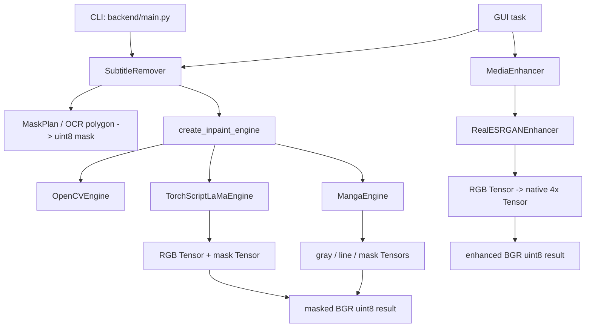

+++
date = '2026-10-15T20:00:00+08:00'
draft = false
title = '项目实战收束：沿 CleanCanvas Studio 调用链读懂 PyTorch 推理与调试'
+++

学完张量、自动求导、模型状态和预训练权重后，真正容易卡住的往往不是某一个 API，而是“这张图片到底在哪里变成 Tensor、权重何时被加载、模型的输出又在哪里变回图片”。如果只看到一行 `model(x)`，人就很容易把读取文件、掩膜、模型、GPU、保存结果混成一个黑盒。

本章以 [CleanCanvas Studio](https://github.com/Yukino-insect/clean-canvas-studio) 当前后端为例，沿着真实代码的调用路径读一次推理流程。它有两条相关但不同的链路：**图像修复**使用 OpenCV 或 LaMa 类模型按掩膜移除内容；**画质增强**使用 Real-ESRGAN 做超分辨率。两者都使用 PyTorch 推理，但输入契约、模型加载形式和输出保证并不相同。

阅读时请记住一个边界：下文解释的是项目的**推理**部分。它不会调用 `loss.backward()` 或优化器；权重已经在训练阶段产生，当前程序只负责验证权重、载入模型、执行前向计算并把结果交给产品流程。

## 先把两个真实调用链分开

项目的命令行入口是 [`backend/main.py`](https://github.com/Yukino-insect/clean-canvas-studio/blob/main/backend/main.py)，不是 HTTP 服务。它通过 [`backend/tools/args_handler.py`](https://github.com/Yukino-insect/clean-canvas-studio/blob/main/backend/tools/args_handler.py) 解析参数，构造 `SubtitleRemover`，再调用 `run()`。图形界面走的也是相同的 `SubtitleRemover` 编排器，只是参数和进度回调来自 GUI。

画质增强则由 [`backend/enhance/media_enhancer.py`](https://github.com/Yukino-insect/clean-canvas-studio/blob/main/backend/enhance/media_enhancer.py) 的 `MediaEnhancer` 调度；实际 PyTorch 网络和权重加载封装在 [`backend/enhance/realesrgan.py`](https://github.com/Yukino-insect/clean-canvas-studio/blob/main/backend/enhance/realesrgan.py)。因此，读到 `inpaint` 时不要误以为它会自动进入 Real-ESRGAN，读到 `enhance` 时也不要期待它接收 mask。



这张图不是抽象的“理想架构”，而是当前代码的职责边界：`SubtitleRemover` 和 `MediaEnhancer` 负责媒体、掩膜、进度、视频编码与输出；引擎类才负责把 NumPy 数组转换成模型输入并执行 `model(...)`。

## 从命令行进入修复任务

下面是最小的**手工选区**命令。它比直接上 OCR 更适合首次验证，因为输入区域完全可控；四个数字的顺序是 `XMIN XMAX YMIN YMAX`。

```bash
python -m backend.main --input sample.png --manual-area 100 420 80 160 --mode lama --device auto
```

这个例子并不表示“只要提供一张图，模型就知道删什么”。`--manual-area` 被转换为 `MaskPlan`；`run()` 会拒绝没有最终掩膜、也没有启用视频动态 OCR 的任务。对于图片，当前 CLI 的 `--subtitle-area-coords` 是 OCR 候选区域，不等价于最终 mask；想做一个可重复的最小实验时，应优先用 `--manual-area`。

入口在 `main.py` 的 `if __name__ == "__main__"` 分支，关键赋值可概括为：

```python
args = parse_args()
remover = SubtitleRemover(args.input)
remover.mask_plan = MaskPlan(...).to_dict()  # 来自 --manual-area
remover.inpaint_mode = args.mode             # opencv / lama / anime_lama / manga
remover.ai_device = args.device              # auto / cuda / cpu
remover.model_dir = args.model_dir
remover.run()
```

这里没有 PyTorch 张量。此时 `SubtitleRemover` 只是任务编排对象：它保存输入媒体的宽高、输出路径、掩膜计划和用户选择的模式。把业务参数留在这个层面，能避免底层 LaMa 引擎知道命令行、GUI 或 FFmpeg 的细节。

### `run()` 到 `_repair()`：先有业务区域，才有模型

对单张图片，`run()` 最终调用 `remove_image_subtitles()`；该方法读取 OpenCV BGR 图像，再调用 `_repair(original_frame)`。对视频，`remove_video_subtitles()` 逐帧读取，每一帧同样进入 `_repair(frame)`。因此图像和视频共享了“单帧修复”的核心逻辑。

`_repair()` 的顺序很重要：

```python
mask = self._mask(frame)
if not np.any(mask):
    return frame

repaired = self._engine().inpaint(frame, mask)
return repaired
```

- `_mask()` 将手工矩形、确认后的 OCR 多边形或动态 OCR 结果转换为二维 `uint8` 掩膜；`0` 表示保留，非零值表示需要修复。
- 空 mask 直接返回原帧，既节省模型计算，也避免“没有指定区域却改坏整张图”。
- `_engine()` 才会按模式创建引擎。结果缓存在 `self._inpaint_engine` 中，所以一个图片任务或一个视频任务不会为每帧重新下载权重、重建网络、占用一次新的显存。

这里的“只初始化一次”是**每个 `SubtitleRemover` 任务实例一次**，不是进程全局的永久单例；创建新的任务对象仍可能重新加载模型。这种措辞比笼统地说“模型只加载一次”更准确。

## 修复引擎：接口统一，模型约定不同

[`backend/inpaint/engine.py`](https://github.com/Yukino-insect/clean-canvas-studio/blob/main/backend/inpaint/engine.py) 用 `InpaintEngine` 协议规定了公共接口：

```python
class InpaintEngine(Protocol):
    def inpaint(self, image_bgr: np.ndarray, mask: np.ndarray) -> np.ndarray: ...
```

这不是 PyTorch 的 `nn.Module`，而是 Python `Protocol`：它描述“任何修复引擎都必须能接收 BGR 图片和 mask，并返回图片”。`OpenCVEngine`、`TorchScriptLaMaEngine` 和 `MangaEngine` 因而可以被上层以同一种方式调用。这个抽象解决的是**替换后端算法**的问题；`nn.Module` 解决的才是**组织可学习神经网络层和参数**的问题，两者不要混淆。

| 模式 | 实际后端 | 是否使用 PyTorch | 输入侧的关键约定 |
| ---- | -------- | ---------------- | ---------------- |
| `opencv` | `cv2.inpaint` / Telea | 否 | BGR 图像与二值 mask |
| `lama`、`anime_lama` | TorchScript 模型 | 是 | RGB、`0..1` 浮点图、单通道 mask、边长补齐到 8 的倍数 |
| `manga` | 两个 TorchScript 模型 | 是 | 灰度图、线稿、mask，边长补齐到 16 的倍数 |

### LaMa：从 BGR `uint8` 到两个模型 Tensor

`TorchScriptLaMaEngine.inpaint()` 的代码可按下面几步阅读；这是根据真实实现删去异常包装后的等价片段。

```python
height, width = image_bgr.shape[:2]
rgb = cv2.cvtColor(image_bgr[:, :, :3], cv2.COLOR_BGR2RGB)
binary_mask = (mask > 0).astype(np.uint8)

padded_image = _pad_to_modulo(rgb, 8)
padded_mask = _pad_to_modulo(binary_mask, 8, constant=True)[:, :, 0]

image_tensor = torch.from_numpy(
    padded_image.transpose(2, 0, 1).astype(np.float32) / 255.0
)
mask_tensor = torch.from_numpy(padded_mask[np.newaxis].astype(np.float32))

with torch.inference_mode():
    result = self.model(
        image_tensor.unsqueeze(0).to(self.device),
        mask_tensor.unsqueeze(0).to(self.device),
    )
```

逐项对照它的输入/输出形状：

| 名称 | shape | dtype / 值域 | 为什么这样做 |
| ---- | ----- | ------------ | ------------ |
| `image_bgr` | `[H,W,3]` | `uint8`，`0..255` | OpenCV 读图和视频帧的格式 |
| `binary_mask` | `[H,W]` | `uint8`，`0` 或 `1` | 明确哪些像素允许模型修复 |
| `image_tensor` | `[3,Hpad,Wpad]` | `float32`，`0..1` | `transpose(2,0,1)` 将 HWC 改为 PyTorch 卷积常用的 CHW |
| 传给模型的图像 | `[1,3,Hpad,Wpad]` | 与模型所在 `device` 相同 | `unsqueeze(0)` 添加 batch 维，即使只处理一张图也是 batch 1 |
| 传给模型的 mask | `[1,1,Hpad,Wpad]` | `float32`，`0` 或 `1` | 与图像空间尺寸对齐，但只有一个语义通道 |
| `result` | 通常 `[1,3,Hpad,Wpad]` | 模型输出的 RGB 浮点像素 | 后续裁回原始尺寸并转回 BGR |

`_pad_to_modulo` 不是为了“凑一个看起来好看”的分辨率。卷积网络中的下采样和上采样通常要求空间边长可被网络的步长链整除；这里将图像和 mask 同时补到 8 的倍数，前向后只取 `[:height, :width]`，所以产品的输出尺寸仍与输入相同。若只补图像不补 mask，两个 Tensor 的空间维无法对齐；若忘了裁回，输出又会比原图大。

`self.model` 来自 `torch.jit.load(...)`，是保存后的 **TorchScript 模型**，而不是在本进程重新定义 Python 网络类后再调用 `load_state_dict()`。`map_location="cpu"` 先将文件安全地读到 CPU，`.to(self.device)` 再迁移模型，`.eval()` 将 Dropout、BatchNorm 等可能依赖训练状态的层切换到推理行为。`torch.inference_mode()` 则让本次前向不建立自动求导图；它不替代 `eval()`，两者职责不同。

模型输出之后，代码会执行 `result[0].permute(1, 2, 0)`，将 `[3,Hpad,Wpad]` 还原为 `[Hpad,Wpad,3]`，再乘回 255、裁剪、转 `uint8` 并用 `cv2.COLOR_RGB2BGR` 回到项目统一的图像格式。最后还有一条很关键的业务保护：

```python
result_bgr[binary_mask == 0] = image_bgr[:, :, :3][binary_mask == 0]
```

它表示“网络即使轻微改动了未遮罩区域，也必须恢复原像素”。这是一条针对 AI 修复模式的产品不变量，不是所有生成模型天生保证的性质。

### Manga：同样是推理，输入却不是三通道 RGB

`MangaEngine` 先将 BGR 图像转为灰度，加载 `inpaintor` 和 `line` 两个 TorchScript 模型。`line(gray_tensor)` 产生线稿先验；灰度和线稿从 `0..255` 线性缩放到 `-1..1`，再与二值 mask、`torch.randn_like(mask_tensor)` 产生的噪声、`torch.ones_like(mask_tensor)` 一起传给修复网络。

这说明“PyTorch 推理输入一定是 `[1,3,H,W]` 的 RGB 图”是错误的经验。真正应该问的是：**这个权重训练时定义的函数签名是什么？每一个 Tensor 的形状、值域和语义是什么？** Manga 模型要求 `[1,1,Hpad,Wpad]` 的灰度和 mask，并额外依赖线稿和噪声；把 LaMa 的三通道预处理硬套进去，即使不报错也会得到不可信的结果。

## 权重、设备与模型状态：故障通常发生在前向之前

修复和超分都使用 `ModelStore` 管理模型资源。它先检查缓存文件的 MD5；缺失时把下载内容放到临时文件，校验通过后才移动到正式文件。网络中断或下载到错误文件不会被静默当作权重加载。这就是“模型权重”和业务代码的关系：权重是参数数据，`ModelStore` 负责可信地交付文件，引擎负责用匹配的模型格式解释它。

设备选择也不是简单的 `torch.cuda.is_available()`：`device="auto"` 会按 CUDA、CPU 的顺序**真正尝试加载模型**。驱动、CUDA 运行时、显存或 checkpoint 迁移都可能在“CUDA 看起来可用”之后失败；自动模式会继续尝试 CPU，并在两者都失败时把两次原因组合进 `InpaintError`。显式传 `--device cuda` 则不会静默回退，方便用户明确发现 CUDA 配置问题。

调试模型状态时，至少应同时观察输入和参数，而不是只打印 `torch.cuda.is_available()`：

```python
def describe_tensor(name, x):
    print(
        f"{name}: shape={tuple(x.shape)}, dtype={x.dtype}, "
        f"device={x.device}, range=({x.min().item():.4f}, {x.max().item():.4f})"
    )

def describe_model(model):
    first_parameter = next(model.parameters(), None)
    print("training:", model.training)
    print("parameter device:", None if first_parameter is None else first_parameter.device)
    print("parameter dtype:", None if first_parameter is None else first_parameter.dtype)
```

对普通 `nn.Module` 或部分 ScriptModule，上述辅助函数足以暴露最常见的错配：模型在 `cuda:0`、输入仍在 CPU；模型已经 `.half()`、输入仍是 `float32`；模型还处于 `training=True`。若 TorchScript 模型不暴露可迭代参数，也不要为了打印它而改变模型；应直接记录引擎保存的 `self.device`、输入 Tensor 属性和已执行的 `.eval()`。

## Real-ESRGAN：从 checkpoint 到逐帧结果

超分链路不是 `SubtitleRemover` 的一部分。`MediaEnhancer.run()` 在一次图片或视频任务开始时创建一个 `RealESRGANEnhancer`，随后 `_run_image()` 调用一次 `enhancer.enhance(...)`，`_run_video()` 则对每一帧调用它。网络实例在本次 `run()` 中复用，避免视频每帧重新加载 checkpoint。

### 为什么 `.pth` 不能直接执行

Real-ESRGAN 的 `.pth` 文件通常保存 `state_dict` 或包含 `params` / `params_ema` 的 checkpoint 字典；它是一组按名字映射的参数 Tensor，不是“自己知道网络结构的模型程序”。当前实现先按模式构建匹配的网络：动漫模型使用 RRDBNet，通用模型使用 SRVGGNetCompact；再执行：

```python
checkpoint = torch.load(path, map_location="cpu", weights_only=True)
state = checkpoint.get("params_ema", checkpoint.get("params", checkpoint))
model.load_state_dict(state, strict=True)
loaded = model.to(device).eval()

if device == "cuda":
    loaded = loaded.half()
```

这里每一行都在维护契约：

- `torch.load(..., weights_only=True)` 读取权重数据，且先落在 CPU，避免 checkpoint 内原设备不可用。
- `params_ema` 是指数滑动平均参数，若 checkpoint 提供它则优先使用；否则退回 `params` 或整个字典。
- `strict=True` 要求参数名和 shape 完全匹配。报出 missing/unexpected key 时，优先检查“模型结构/模式是否选对、权重是否下载完整”，不要把 `strict=False` 当作通用修复。
- `.to(device)` 迁移模型参数；`.eval()` 固定推理状态。
- GPU 路径把模型转成 `float16`，所以输入也必须转成 `float16`；CPU 路径保持 `float32`。这正是 `Expected scalar type Half but found Float` 的直接原因。

### `enhance()` 的数据流与分块

`RealESRGANEnhancer.enhance(image_bgr, scale)` 接收三通道 BGR `uint8`，先验证 `1 <= scale <= 4` 和通道数，再转换：

```python
rgb = cv2.cvtColor(image_bgr[:, :, :3], cv2.COLOR_BGR2RGB)
rgb = rgb.astype(np.float32) / 255.0

tensor = torch.from_numpy(rgb.transpose(2, 0, 1)).float()
tensor = tensor.unsqueeze(0).to(self.device)
if self.use_half:
    tensor = tensor.half()

with torch.inference_mode():
    output = self.model(tensor)
```

若输入为 `[H,W,3]`，传入模型的是 `[1,3,H,W]`；网络原生输出是 `[1,3,4H,4W]`。注意项目的 `scale=2` 并不是让网络运行“原生 2×模型”：当前权重始终先产生 4×，然后使用 Lanczos 缩放到 `2H × 2W`。因此调试时应该分别打印模型原始输出和最终输出；不要据最终 `2H` 的图片错误地断言模型只输出 2×。

当图片边长超过 `tile_size`（默认 512）时，`_infer_tiled()` 将输入分块，并在每块四周扩出 `tile_pad`（默认 10 像素）的重叠边缘。网络对带边缘的块做 4×推理后，再按 `4` 倍坐标裁出中间有效区域写入总输出：

```python
tile_output = self._infer(image[pad_top:pad_bottom, pad_left:pad_right])
crop_left = (left - pad_left) * 4
crop_top = (top - pad_top) * 4
output[:, :, top * 4:bottom * 4, left * 4:right * 4] = (
    tile_output[:, :, crop_top:crop_bottom, crop_left:crop_right]
)
```

这个 `* 4` 是超分坐标换算的核心。忘记它，切片会尺寸不匹配或在拼接处错位；去掉重叠边缘，又可能看到 tile 接缝。降低 `tile_size` 能降低单次推理显存峰值，但会增加循环次数和耗时，不能把它理解为“更小一定更好”。

## 用最小实验检查边界，而不是先怀疑模型

真实图片包含 OCR、视频解码、文件路径和用户选区，变量太多。排查前先在没有权重的条件下验证颜色、shape、值域和 mask；下面实验复刻 LaMa 输入准备中最关键的部分。

```python
import cv2
import numpy as np
import torch

# OpenCV/BGR 中第三个通道为红色；构造 4 x 6 的纯红测试图。
bgr = np.zeros((4, 6, 3), dtype=np.uint8)
bgr[:, :, 2] = 255
mask = np.zeros((4, 6), dtype=np.uint8)
mask[1:3, 2:5] = 255

rgb = cv2.cvtColor(bgr, cv2.COLOR_BGR2RGB)
image = torch.from_numpy(rgb.transpose(2, 0, 1).copy()).float().div(255).unsqueeze(0)
mask_tensor = torch.from_numpy((mask > 0)[None].astype(np.float32)).unsqueeze(0)

print(image.shape, image.dtype, image.min().item(), image.max().item())
print(mask_tensor.shape, mask_tensor.dtype, mask_tensor.unique())
print(image[0, :, 0, 0])  # tensor([1., 0., 0.])，验证红色没有被颠倒
```

应看到图像为 `[1,3,4,6]`、`float32`、值域 `0..1`，mask 为 `[1,1,4,6]`。若最后一行是 `[0., 0., 1.]`，说明 RGB/BGR 转换缺失或方向错误；若 mask 仍是 `[0,255]` 浮点值，也应先统一为 `0/1` 再交给模型。这个实验验证不了权重质量，但能在模型前排除最普遍的边界错误。

对于真实引擎，可在**调用模型前**临时记录如下信息，确认后再删除日志或放入调试开关，避免视频逐帧刷屏：

```python
print("image:", tuple(image_tensor.shape), image_tensor.dtype, image_tensor.device)
print("mask:", tuple(mask_tensor.shape), mask_tensor.dtype, mask_tensor.device)
print("model:", self.device, "training=", self.model.training)
```

不要为消除报错随手使用 `.squeeze()`。当 batch size 为 1 时，`.squeeze()` 可能删除本应保留的 batch 或 channel 维；应只在你能说明“第 0 维一定是 batch 且只用于后处理”时，像当前 Real-ESRGAN 代码那样使用 `.squeeze(0)`。

## 按故障边界定位，而不是按感觉改代码

下表将项目已有的错误边界与可操作检查对应起来。先根据现象定位到某一层，再查看那一层的输入、输出和异常链，效率远高于反复更换权重或随机加类型转换。

| 现象 | 首先检查的位置 | 针对性结论或动作 |
| ---- | -------------- | ---------------- |
| 一开始就提示没有可修复区域 | `SubtitleRemover.run()`、`mask_plan`、`video_dynamic_ocr` | 图片最小复现使用 `--manual-area`；确认 mask 内确实有非零像素 |
| 下载失败或 MD5 不匹配 | `ModelStore.ensure()`、模型目录、网络/代理/磁盘 | 不要复用临时 `.download` 文件；重新下载并保留期望哈希校验 |
| `load_state_dict` 有 missing / unexpected keys | `RealESRGANEnhancer._asset_and_model()` 与 checkpoint 文件名 | 确认动漫/通用模式与权重配套；不要直接用 `strict=False` 跳过错误 |
| `Expected all tensors to be on the same device` | 模型参数、`image_tensor.device`、`mask_tensor.device` | 模型和每个输入都必须是同一设备；只迁移图像而漏迁移 mask 仍会失败 |
| `Expected scalar type Half but found Float` | `use_half`、输入 `.dtype`、模型参数 dtype | CUDA 路径中模型和输入同时 `float16`；CPU 保持 `float32` |
| 颜色明显偏蓝或偏红 | BGR/RGB 转换前后、纯红最小实验 | OpenCV 边界使用 BGR，模型输入/输出转换处使用 RGB；只转换一次且方向正确 |
| shape 不匹配或输出边缘错位 | HWC/CHW、batch 维、padding、tile 坐标 | 写出每维含义；LaMa 图像和 mask 同补齐，超分 tile 裁剪坐标要乘 4 |
| 同样输入每次画面不同 | `model.training`、`eval()`、Manga 的随机种子 | 检查推理模式；Manga 引擎已固定 Python、NumPy、Torch 的随机种子，但生成模型仍不保证所有环境的逐位一致 |
| CUDA out of memory | 输入分辨率、`tile_size`、并发任务、实际设备 | 超分先降低 `tile_size`；LaMa 可缩小分辨率/选区或切 CPU；不要靠无限次重试解决 |
| 修复区外被改动 | LaMa/Manga 的最终 mask 外像素恢复、mask 是否正确 | 对 AI 修复结果做 mask 外逐像素比较；若 OpenCV 行为也需绝对保证，应单独加入同样的业务断言 |
| 视频画面已处理但没有原音频 | `merge_audio_to_video()` / `MediaEnhancer._merge_audio()` 的日志 | 项目会尽量回封装音频，失败时仍保留无音频画面；这是媒体封装问题，不是模型推理失败 |

显存问题尤其要分层。`torch.cuda.empty_cache()` 最多释放当前进程未再引用的缓存，不会让一个本身装不下的 Tensor 突然装下，也不能替代缩小 tile、释放并发模型实例或选择 CPU。先记录输入的 `H,W`、tile 数、模型 dtype 和设备，才能判断峰值来自哪一个环节。

## 把质量要求写成可验证的不变量

视觉结果必须肉眼复核，但基础契约可以自动测试。对 LaMa/Manga 的修复结果，mask 外像素完全保持不变是项目代码主动维护的要求，可以写成：

```python
outside = mask == 0
assert np.array_equal(result[outside], original[outside])
assert result.shape == original.shape
assert result.dtype == np.uint8
```

对 Real-ESRGAN，若输入尺寸为 `(H, W)`、请求倍率为 `s`，最终 BGR 输出应为 `(round(H * s), round(W * s), 3)`；它不意味着“每个新像素都等于真实世界中丢失的细节”，超分模型只能根据训练分布推测高频内容。对视频还可验证：每帧输出尺寸一致、写入帧数等于读到的帧数，且取消任务不会被标记为成功。

不变量的价值在于把“看起来怪”拆成明确的问题：是输入通道错了、输出尺寸错了、mask 漏了，还是模型在允许修改的区域生成了不理想的纹理。只有最后一种才主要是模型质量或任务适配问题。

## 代码评审或面试时怎样完整说明

面对这个项目，可以按以下顺序说明，而不是只说“我调用了一个 AI 模型”：

1. **任务与入口**：`main.py` 的 CLI 或 GUI 任务先创建 `SubtitleRemover`；修复与超分是独立的两条业务链路。
2. **输入契约**：修复层接收 OpenCV BGR `uint8` 图像和二维 mask；LaMa 转为 RGB 的 `[1,3,H,W]` 浮点 Tensor，mask 转为 `[1,1,H,W]`。超分同样从 BGR 转 RGB，但不接收 mask，输出原生 4×。
3. **模型与状态**：LaMa/Manga 是 `torch.jit.load` 得到的 TorchScript 模型；Real-ESRGAN 是先构建 `nn.Module` 网络、再用严格 `load_state_dict` 注入 checkpoint。两者都 `.eval()`，每次前向都在 `torch.inference_mode()` 中执行。
4. **设备与精度**：权重先在 CPU 读取，再迁移到实际设备；`auto` 会真实尝试 CUDA 后回退 CPU。Real-ESRGAN 在 CUDA 上同步使用模型/输入 `float16`，CPU 使用 `float32`。
5. **输出与可靠性**：结果被裁回、转换回 BGR `uint8`；AI 修复额外恢复 mask 外的原像素，超分大图通过带重叠的 tile 控制显存，视频最后由 FFmpeg 编码并尝试回封装音频。
6. **调试顺序**：先做纯色最小张量实验，再按 mask、shape、dtype、device、值域、颜色、模型状态、权重格式和后处理不变量逐项检查。

## 本章应带走的能力

- 能从入口一路追到 `model(...)`，区分业务编排器、引擎适配器、权重文件和 PyTorch 模型各自的职责。
- 能为任何视觉模型写出输入/输出的 shape、dtype、device、值域、通道顺序与状态，而不是只记住一段转换代码。
- 能解释为什么 `eval()` 与 `inference_mode()` 要同时出现，为什么 checkpoint 必须匹配网络结构，为什么 GPU 的半精度模型需要半精度输入。
- 能在真实项目里区分“模型推理问题”与掩膜、视频 I/O、颜色空间、权重下载、音频封装等工程边界问题。

后续学习 Transformer、embedding、RAG 或重排序模型时，调用栈会改变，但排查方法不变：先定义输入契约，再确认权重和模型结构匹配，检查前向计算的状态与设备，最后验证输出是否满足业务不变量。只要这条链不断，陌生项目也就不再是不可解释的黑盒。
