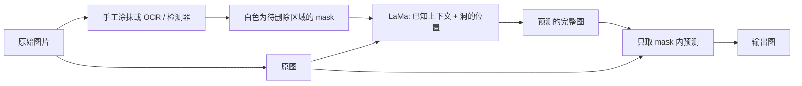

+++
date = '2026-11-13T16:00:00+08:00'
draft = false
title = 'LaMa 图像修复：从快速傅里叶卷积到文字去除的完整实践'
math = true
+++

给一张照片和一张遮罩（mask），让程序把文字、路人或水印所在的位置补成看起来自然的背景，这件事叫作**图像修复**（image inpainting）。LaMa 是这类任务中很有代表性的卷积神经网络：它并不先识别“这是文字”再删除，而是由用户或上游检测器明确指定要改的区域，再依据洞外的像素生成一个视觉上连贯的填补结果。

这一点是理解 LaMa 的钥匙。它不是像素历史记录的恢复器，也不是文字检测器；它是在条件 `原图 + mask` 下估计“这里最可能是什么”的生成模型。LaMa 论文的全名是 *Resolution-robust Large Mask Inpainting with Fourier Convolutions*，核心设计是把快速傅里叶卷积（FFC）放进生成器，使一部分特征能在一次频域变换中拥有整张图的感受野。[论文摘要](https://arxiv.org/abs/2109.07161) 明确把“大缺失区域、复杂几何结构和高分辨率”列为传统修复网络的难点。

本文只讨论原始 LaMa 及其官方实现。若目标是动漫、漫画或超分辨率，应分别使用对应领域的 Anime-LaMa、Manga 或 Real-ESRGAN 模型；同样叫“图像处理”，网络、权重和输入契约并不相同。先把问题分清，远比把模型名称堆在一起显得可靠。

## 先建立正确的问题模型

设原始 RGB 图像为 $I\in[0,1]^{3\times H\times W}$，二值 mask 为 $M\in\{0,1\}^{1\times H\times W}$。本文约定：`1`（白色）是**允许模型改写的洞**，`0`（黑色）是必须保留的已知区域。送入生成器的不是完整原图，而是：

$$
X=\operatorname{concat}(I\odot(1-M), M)
$$

其中 $\odot$ 是逐元素乘法，`concat` 在通道维连接。因此 $X$ 有四个通道：前三个通道是洞内被置零的 RGB 图，最后一个通道明确告诉网络“零值究竟是黑色内容，还是缺失位置”。生成器输出候选图 $P=G(X)$ 后，产品代码应再合成：

$$
I_{out}=M\odot P+(1-M)\odot I
$$

这个最后的合成步骤很重要：它从数学上保证 mask 外的像素仍来自原图，而不是听任生成器轻微改色。

| 张量 | 典型 shape | 含义 |
| ---- | ---------- | ---- |
| `image` | `[N, 3, H, W]` | RGB `float32`，通常缩放到 0–1 |
| `mask` | `[N, 1, H, W]` | 0 表示保留，1 表示待修复 |
| `masked_image` | `[N, 3, H, W]` | `image * (1 - mask)` |
| `generator_input` | `[N, 4, H, W]` | `masked_image` 与 `mask` 的通道拼接 |
| `prediction` | `[N, 3, H, W]` | 网络估计出的完整 RGB 图 |
| `inpainted` | `[N, 3, H, W]` | 只替换 mask 内后的最终图 |

### 为什么它能“精确找到”要去掉的文字

严格地说，LaMa **不能自己精确找到文字**。精确的空间定位来自 mask，而非 LaMa 的语义检测能力。一个去字应用通常有两段流程：



例如，OCR 给出文字框后，应用把框内文字、阴影和抗锯齿边缘涂白；LaMa 知道白色洞周围是墙面、天空或地板，便学习用这些上下文续写纹理。文字框稍小，残留笔画便不在可编辑区域；框过大，人物边缘、栏杆或线稿也被要求重新生成。模型的“准确”主要是两个因素叠加：**mask 的边界控制改动范围，网络的上下文建模控制洞内内容**。把这两件事混为一谈，只会让排错失去方向。

## 卷积网络原本解决了什么，又缺少什么

卷积神经网络（CNN）适合图像，是因为同一个小卷积核可以在不同位置寻找相同局部模式，例如边缘、角点和纹理。对特征图 $x$，一个 $3\times3$ 卷积在位置 $(i,j)$ 的输出只依赖邻域：

$$
y_{c_o,i,j}=b_{c_o}+\sum_{c_i}\sum_{u=-1}^{1}\sum_{v=-1}^{1}
w_{c_o,c_i,u,v}\,x_{c_i,i+u,j+v}
$$

这有三个实际好处：局部平移后仍能识别同类图案、参数量可控、层层叠加后能抽取更抽象的特征。普通 CNN 已能修补一小块天空或墙皮，因为洞边缘附近就有足够的证据。

但大洞要求跨越很远的依赖。要补全被文字盖住的一段百叶窗，左边条纹的间距和右边条纹的相位都相关；要延续地砖，也必须知道远处的重复周期。若只堆叠小卷积，感受野虽会扩大，却需要许多层才能让相距很远的像素相互影响，路径长、计算重，而且训练中可能没有真正学会长程规律。这正是 LaMa 引入频域全局分支的理由，不是什么神秘的“傅里叶魔法”。

## 从傅里叶变换到 FFC

### 频域怎样表达全局结构

二维离散傅里叶变换（DFT）把一个特征图从空间坐标变成频率坐标：

$$
\hat{x}(u,v)=\sum_{h=0}^{H-1}\sum_{w=0}^{W-1}
x(h,w)e^{-2\pi i(uh/H+vw/W)}
$$

低频描述缓慢变化的大致明暗和颜色，高频通常对应边缘、细节和周期较短的纹理。这并不是说“低频就是背景、高频就是前景”——真实图像的语义不会如此整齐；它说明频率系数的一个改动会经由逆变换影响整个空间图。在频域对整张特征图做处理后再变回空间域，自然就得到图像范围的通信。

LaMa 所用 FFC 的全局分支近似执行下面的链条：

```text
全局特征 [N, C, H, W]
  -> rFFT2（复数频谱）
  -> 实部、虚部分为 2C 个实数通道
  -> 1×1 卷积 + 归一化 + ReLU（可学习地混合频率通道）
  -> 重新组成复数频谱
  -> irFFT2
  -> 全局更新后的特征 [N, C', H, W]
```

`rfft2` 适合实数输入；由于频谱的共轭对称性，它只保存一半频率，宽度变为 `W // 2 + 1`。PyTorch 的复数张量不能直接套常规 `Conv2d`，所以官方实现将实部和虚部临时展成通道维；处理后再组回复数并做逆变换。这里的 `1×1` 指的是频谱网格上的局部操作，但逆变换会把结果投射回整张图，所以空间感受野仍是全局。

### FFC 不是“把所有卷积换成 FFT”

Fast Fourier Convolution 将特征通道分成局部流 $x_l$ 与全局流 $x_g$，并允许四条信息路径：

$$
\begin{aligned}
y_l &= f_{l\rightarrow l}(x_l) + f_{g\rightarrow l}(x_g) \\
y_g &= f_{l\rightarrow g}(x_l) + f_{g\rightarrow g}^{FFT}(x_g)
\end{aligned}
$$

- $l\rightarrow l$ 是常规空间卷积，保留局部边缘与纹理；
- $g\rightarrow g$ 是频域全局变换，使远距离结构直接交互；
- 两条交叉路径把局部细节交给全局流，也把全局规律带回局部流；
- 某些配置还为交叉路径学习门控系数，防止两种信息不加选择地相互污染。

因此 FFC 是“局部归纳偏置 + 全局通信”的分工，而不是宣称 FFT 天生更懂图像。LaMa 的预训练生成器配置采用 `ffc_resnet_075`，其中 `0.75` 是全局通道比例相关的配置名；不要把它误读成 75% 的修复成功率。

### 可运行的最小 Fourier Unit

下列程序不是 LaMa 权重，也不能修图；它刻意删去了局部频率单元、门控、残差块和训练，只保留一次“FFT → 学习频谱表示 → iFFT”的最小神经网络。保存为 `minimal_fourier_unit.py` 后运行 `python minimal_fourier_unit.py`，只依赖 `torch`。

```python
import torch
from torch import nn


class MinimalFourierUnit(nn.Module):
    """用可学习的 1×1 卷积混合实部和虚部，再回到空间域。"""

    def __init__(self, channels: int):
        super().__init__()
        self.mix = nn.Sequential(
            nn.Conv2d(channels * 2, channels * 2, kernel_size=1, bias=False),
            nn.BatchNorm2d(channels * 2),
            nn.ReLU(inplace=True),
        )

    def forward(self, x: torch.Tensor) -> torch.Tensor:
        # x: [N, C, H, W]，空间域实数特征
        spectrum = torch.fft.rfft2(x, norm="ortho")
        # [N, C, H, W//2+1] 复数 -> [N, 2C, H, W//2+1] 实数
        packed = torch.cat([spectrum.real, spectrum.imag], dim=1)
        packed = self.mix(packed)
        real, imag = packed.chunk(2, dim=1)
        learned_spectrum = torch.complex(real, imag)
        # s 必须给出原高宽；否则 rFFT 的原始宽度无法唯一恢复。
        return torch.fft.irfft2(learned_spectrum, s=x.shape[-2:], norm="ortho")


if __name__ == "__main__":
    torch.manual_seed(7)
    feature = torch.randn(2, 8, 32, 48)
    layer = MinimalFourierUnit(channels=8)
    result = layer(feature)

    print("input :", tuple(feature.shape), feature.dtype)
    print("output:", tuple(result.shape), result.dtype)
    assert result.shape == feature.shape
    assert torch.isfinite(result).all()
```

第一次运行时参数是随机的，输出当然没有语义。训练通过损失的梯度调整 `mix` 的权重，才令这些频谱混合服务于“在洞内生成合理内容”这个任务。也请注意 `BatchNorm2d`：真正推理应调用 `model.eval()`，否则它会使用当前批次统计量，单张图片的输出可能不稳定。

## LaMa 的生成器与训练目标

### 网络如何把部件串起来

官方仓库中的 `FFCResNetGenerator` 可以概括为：

```text
4 通道输入（被遮住的 RGB + mask）
  -> 7×7 FFC 起始层
  -> 3 次下采样 FFC 层（扩大感受野、增加通道）
  -> 9 个 FFC-ResNet 残差块（局部 / 全局双流反复交换）
  -> 拼接双流
  -> 3 次转置卷积上采样
  -> 7×7 卷积 + Tanh
  -> 3 通道预测图
```

残差块学习的是对输入特征的增量 $F(x)$，输出为 $x+F(x)$。这让深层网络不必从头复制已有结构，梯度也更容易跨层传播。LaMa 的全局通信主要发生在瓶颈部分的 FFC-ResNet 块；解码阶段再逐步还原空间分辨率。官方实现使用反射填充，能够减轻边界处把零填充误当成真实黑边的影响。

训练时，完整图 $I$ 被随机 mask 人为遮住，模型的目标却仍是原始完整图。这使得训练数据天然包含监督信号：遮住前的像素就是答案。官方默认训练配置会拼接 mask，并使用对抗损失、特征匹配损失以及高感受野感知损失；论文还强调大面积训练 mask 让模型真正练习“远距离补洞”，而不是只会临摹边缘。

可以用抽象损失写成：

$$
\mathcal{L}=\lambda_{adv}\mathcal{L}_{GAN}+\lambda_{fm}\mathcal{L}_{feature}
+\lambda_{hrpl}\mathcal{L}_{high\text{-}receptive\text{-}field}
+\lambda_{recon}\mathcal{L}_{recon}
$$

其中判别器促使结果整体看起来像真实图像，特征匹配让中间统计量接近真实图，感知项关注人眼更在意的结构而非逐像素平均误差。仅最小化 L1/L2 往往会把多个合理答案平均成一片模糊；仅靠 GAN 又可能编出锐利但与上下文不一致的细节。组合损失是在“像原图”和“像自然图”之间建立约束，并没有保证它找回现实中曾被遮住的真相。

### 官方代码中的关键实现，可如何对照阅读

[官方 `DefaultInpaintingTrainingModule`](https://github.com/advimman/lama/blob/main/saicinpainting/training/trainers/default.py) 的核心逻辑几乎就是下列简化代码。这里明确展示合成步骤，便于检查 mask 方向是否颠倒：

```python
import torch
from torch import nn


class TinyInpaintGenerator(nn.Module):
    """教学用的极小 4->3 CNN；结构不是 LaMa。"""

    def __init__(self):
        super().__init__()
        self.net = nn.Sequential(
            nn.Conv2d(4, 32, 3, padding=1),
            nn.ReLU(inplace=True),
            nn.Conv2d(32, 32, 3, padding=1),
            nn.ReLU(inplace=True),
            nn.Conv2d(32, 3, 3, padding=1),
            nn.Sigmoid(),
        )

    def forward(self, x):
        return self.net(x)


if __name__ == "__main__":
    image = torch.rand(1, 3, 64, 64)
    mask = torch.zeros(1, 1, 64, 64)
    mask[:, :, 20:44, 16:48] = 1.0

    masked_image = image * (1.0 - mask)
    network_input = torch.cat([masked_image, mask], dim=1)
    prediction = TinyInpaintGenerator()(network_input)
    output = mask * prediction + (1.0 - mask) * image

    print("network_input:", tuple(network_input.shape))
    print("prediction   :", tuple(prediction.shape))
    # mask 外必须逐元素等于原图；这是推理管线可测试的业务约束。
    assert torch.equal(output[mask.expand_as(output) == 0],
                       image[mask.expand_as(image) == 0])
```

这段网络未经训练，图片不会好看；它证明的是张量契约和“只改 mask 内”的机制。将它替换为预训练 LaMa 后，结构先验来自权重，代码的输入、输出与合成原则不会改变。

## 用官方预训练模型完成一次推理

### 权重、环境与目录约定

LaMa 作者维护的 [官方仓库](https://github.com/advimman/lama) 的 Inference 小节给出下载和预测命令。其 README 当前将最佳 `big-lama` 模型指向 [Hugging Face 的 ZIP 地址](https://huggingface.co/smartywu/big-lama/resolve/main/big-lama.zip)，同时保留包含更多模型的 Google Drive 链接。权重下载是一次外部依赖：下载后应检查文件大小、解压是否成功，并保留来源和版本记录；不要把网上任意同名 `.ckpt` 当成可替换的官方权重。

原始项目使用的是较旧的 PyTorch 依赖组合，最稳妥的复现路径是 Linux 或 WSL2 中按仓库的 `requirements.txt` / `conda_env.yml` 建隔离环境。下面脚本严格使用官方的文件命名规则：图片 `photo.png` 对应 mask `photo_mask001.png`，两个文件放同一目录。`predict.py` 会根据 `_mask` 前缀匹配它们，输出目录由命令指定。

首先准备一张图片，并用下面的完整脚本生成一个白色矩形 mask。实际去字时，把矩形换成手工涂抹或 OCR 框。为使读者不需要额外下载示例素材也能走通命令，脚本在 `input/photo.png` 不存在时会自己绘制一张带深色“待删除条”的测试图；若你预先把真实照片放到同一路径，它不会覆盖原图，只会按矩形生成 mask。保存为 LaMa 仓库根目录的 `make_demo_input.py`。

```python
from pathlib import Path
from PIL import Image, ImageDraw


source = Path("input/photo.png")
target = Path("input/photo_mask001.png")
source.parent.mkdir(parents=True, exist_ok=True)

# 没有真实输入时生成一个可复现的测试图，保证本节命令可以完整运行。
if not source.exists():
    width, height = 768, 512
    demo = Image.new("RGB", (width, height), "#b9d8ed")
    demo_draw = ImageDraw.Draw(demo)
    for x in range(0, width, 48):
        demo_draw.line((x, 0, x, height), fill="#9dc4dc", width=2)
    for y in range(0, height, 48):
        demo_draw.line((0, y, width, y), fill="#9dc4dc", width=2)
    demo_draw.rectangle((120, 80, 520, 180), fill="#222222")
    demo.save(source)
    print(f"未找到原图，已创建测试图 {source}")

with Image.open(source) as opened:
    width, height = opened.size

# L 是单通道灰度图：黑色 0 保留，白色 255 要求 LaMa 修复。
mask = Image.new("L", (width, height), color=0)
draw = ImageDraw.Draw(mask)

# 把这四个坐标改成待删除文字及其阴影的外接区域。
# 坐标必须位于图片范围内，且右下角大于左上角。
left, top, right, bottom = 120, 80, 520, 180
if not (0 <= left < right <= width and 0 <= top < bottom <= height):
    raise ValueError(f"矩形超出图像范围：图片为 {width}×{height}")

draw.rectangle((left, top, right, bottom), fill=255)
target.parent.mkdir(parents=True, exist_ok=True)
mask.save(target)
print(f"已写入 {target}，尺寸为 {width}×{height}")
```

然后在 Bash、WSL2 或 Linux 终端执行以下命令。它包含克隆、环境安装、模型下载与预测，因而是可独立执行的一条官方路线；CUDA 环境可把 `device=cpu` 改为默认的 CUDA 配置。实际生产环境应固定 commit 和依赖版本，而不是在无测试的机器上随意升级旧项目的 Torch。

```bash
git clone https://github.com/advimman/lama.git
cd lama

python3 -m venv .venv
source .venv/bin/activate
python -m pip install --upgrade pip
pip install torch==1.8.0 torchvision==0.9.0
pip install -r requirements.txt

export TORCH_HOME="$(pwd)"
export PYTHONPATH="$(pwd)"

curl -LJO https://huggingface.co/smartywu/big-lama/resolve/main/big-lama.zip
unzip big-lama.zip

mkdir -p input
# 若 input/photo.png 不存在，脚本会先创建测试图；存在时则为你的图片生成 mask。
python make_demo_input.py

python3 bin/predict.py \
  model.path="$(pwd)/big-lama" \
  indir="$(pwd)/input" \
  outdir="$(pwd)/output" \
  device=cpu
```

原始默认配置把输入 pad 到 8 的倍数，推理结束后再裁回原尺寸；因此不要自行先把图片强行拉伸到固定正方形。输出的文件名和格式由预测脚本与配置决定，运行后应打开 `output/` 逐张核验，而不是只以“命令退出码为 0”作为成功标准。

#### 不要把官方 checkpoint 与 TorchScript 端口混用

上面的路线使用的是作者仓库的 `big-lama.zip`、Hydra 配置和 `best.ckpt`，属于**原始 LaMa 项目的 checkpoint 推理链**。它和许多桌面软件或二次封装中常见的 `big-lama.pt` 不是同一个文件格式，也不应混用加载方式。

例如 IOPaint 曾发布便于应用调用的 `big-lama.pt` 与 `anime-manga-big-lama.pt`：其 [LaMa 实现](https://github.com/Sanster/IOPaint/blob/main/iopaint/model/lama.py) 用 `torch.jit.load` 加载后直接调用 `model(image, mask)`，其中 `image`/输出为 RGB 数组、mask 为二维数组。那是第三方项目转换和封装的 **TorchScript 端口**，其下载地址、MD5、预处理与运行时依赖由 IOPaint 维护，并非作者仓库的原始 `best.ckpt`。IOPaint 仓库当前已归档，故更应固定版本、校验哈希，并将它当作独立部署目标。

换言之：想复现论文仓库，就使用本节的 `big-lama` 目录和 `bin/predict.py`；想嵌入某个声明支持 TorchScript 的应用，则严格遵循该应用对 `.pt` 的输入/输出契约。不要把 `.pt` 喂给原仓库的 checkpoint 加载器，也不要假设两个端口在所有图片上的输出逐像素一致。

### 输入与输出到底是什么

官方数据加载器会把 RGB 图片转换成 `[3,H,W]`、`float32`、0–1，把灰度 mask 转换成 `[1,H,W]`。预测时再添加 batch 维，成为 `[1,3,H,W]` 与 `[1,1,H,W]`。配置中的 `pad_out_to_modulo: 8` 解释了为何图片和 mask 必须共同 padding；两者若尺寸不同，空间位置便不再对应。

LaMa 的网络输出的是一幅完整的预测 RGB 图，不只是洞里的小块；但最终 `inpainted` 按前文公式把洞外部分换回原图。可以把这个行为理解为两个层次：网络有自由利用整张图做上下文推理，产品输出却只允许它修改用户授权的区域。这样的边界应由代码强制保证，不能寄望模型“自觉”。

## 让结果更可靠的操作准则

### 先提升 mask 质量

1. **完整覆盖目标及边缘。** 文字抗锯齿、描边、投影和半透明水印常比肉眼看到的字形大 1–3 像素；漏掉它们，模型不会主动越界删除。
2. **只扩张到合理范围。** 可用轻微膨胀覆盖残边，但别把人眼、发丝、表格线或气泡边框一并涂掉。被 mask 的真实结构越多，需要凭空生成的内容越多。
3. **保持二值、同尺寸和正确方向。** 保存单通道 PNG 最稳妥；确认白色是洞、黑色是保留。透明 PNG 的 alpha、灰度渐变和 JPEG mask 都容易制造难以看见的边缘问题。
4. **让检测器与生成器各司其职。** OCR/文本检测负责框选文字，LaMa 负责补背景；复杂排版可先人工校正检测框，再交给修复模型。

下面脚本把灰度 mask 二值化并轻微膨胀，适合消除文字外沿。保存为 `refine_mask.py`，需要 `pip install opencv-python`。它不会猜测文字位置，只会规范化你已有的 mask。

```python
import cv2
import numpy as np


mask = cv2.imread("input/photo_mask001.png", cv2.IMREAD_GRAYSCALE)
if mask is None:
    raise FileNotFoundError("找不到 input/photo_mask001.png")

# 大于 0 的像素一律视为待修复区域，避免半透明灰边含义不确定。
binary = (mask > 0).astype(np.uint8) * 255

# 3×3 椭圆核通常只扩大约一个像素；不要盲目把它调大。
kernel = cv2.getStructuringElement(cv2.MORPH_ELLIPSE, (3, 3))
refined = cv2.dilate(binary, kernel, iterations=1)

cv2.imwrite("input/photo_mask001.png", refined)
print("已写回二值化并轻微扩张后的 mask")
```

### 根据失败模式调整，而不是盲目重跑

| 现象 | 更可能的原因 | 优先处理方式 |
| ---- | ------------ | ------------ |
| 留下文字残笔或白边 | mask 漏掉抗锯齿、阴影、描边 | 轻微扩张 mask，再次推理 |
| 人脸、线条被重画 | mask 覆盖了重要结构 | 缩小/拆分 mask；必要时改为人工修图 |
| 栅栏、瓷砖的周期接不上 | 洞太大、边缘证据不足或领域差异 | 为洞保留更多边界上下文；尝试分区修复 |
| 动漫颜色或线条不自然 | 通用照片权重与目标域不匹配 | 改用面向动漫/漫画的专用模型 |
| 输出周围色调不一致 | 未按模型约定归一化，或未做洞外合成 | 检查 RGB/BGR、0–255/0–1、最终合成 |
| 大图显存不足 | 特征图与 FFT 的空间尺寸过大 | 降低分辨率或改用有重叠和融合策略的分块方案 |

分块不是没有代价的“显存开关”。LaMa 的长程结构依赖正来自整图全局分支，粗暴切 tile 会削弱这一优势，并在块边界产生接缝。若必须分块，应给每块足够重叠、只取中心区域或加权融合，并优先让整个待修复洞及其关键上下文落在同一块中。

## 适用边界、伦理与小结

LaMa 在大 mask、周期纹理和较高分辨率上有突出的设计动机，但它仍可能生成错误物体、虚构文字后的内容或破坏严格几何。对于合同、医学影像、取证照片、工程图纸等要求事实准确的图像，生成式修复不能被当作数据恢复或证据处理手段。去除他人水印、版权标识或身份信息也可能涉及法律、平台规则与隐私义务；技术可行并不构成使用授权。

读完本文，应当能够清楚地区分以下结论：

- LaMa 是以 FFC-ResNet 为核心的**条件图像修复生成器**，不是文字检测器。
- mask 给出“改哪里”，周围可见像素给出“可依据什么补”，预训练权重给出“哪些补法更像自然图”。
- FFC 让局部空间卷积与整图频域通信并存，针对的是大洞和长程/周期结构的上下文问题。
- 正确推理不止是加载 checkpoint：还要保证 RGB、值域、shape、mask 方向、共同 padding 和洞外合成全部符合模型契约。
- 最有效的调优常常不是多跑一次模型，而是让 mask 更准确、更少吞掉真实结构，并为不同视觉域选择合适权重。

进一步阅读可直接对照 [LaMa 官方仓库](https://github.com/advimman/lama)、[官方 FFC 实现](https://github.com/advimman/lama/blob/main/saicinpainting/training/modules/ffc.py) 与 [LaMa 论文](https://arxiv.org/abs/2109.07161)。代码会变，但“输入是什么、哪些区域允许变化、网络利用了哪些上下文、输出如何被合成”的因果链，不会因为换了一个模型名就失效。
