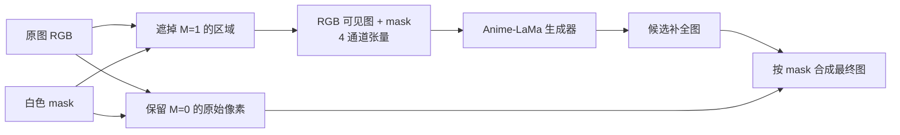

+++
date = '2026-11-13T16:00:00+08:00'
draft = false
title = 'Anime-LaMa 图像修复：从掩码、傅里叶卷积到可运行推理'
math = true
+++

给一张动漫图片和一张标出文字的 mask，Anime-LaMa 往往能把文字所在区域补成与背景相连的色块、线条或纹理。这件事看上去像它先“认出了文字”，再把文字擦掉；这种理解并不准确。**Anime-LaMa 通常不负责检测文字，也不会自行决定哪里应该删除。** `mask` 先把可改区域明确交给模型，模型再利用整张图的上下文，为这个洞合成一个视觉上合理的内容。

本文将 Anime-LaMa 视为一个工程上常见的称呼：它是以 Big LaMa 为基础、用动漫和漫画风格数据微调的图像修复权重，而不是 LaMa 论文作者发表的另一篇同名模型论文。模型卡公开说明，`lama_large_512px.ckpt` 是用约 30 万张动漫/漫画风格数据微调的 Big LaMa；原始 LaMa 则是 *Resolution-robust Large Mask Inpainting with Fourier Convolutions* 论文及其开源实现。把这两个来源区分清楚，后续加载权重、判断能力边界时才不会混淆。[AnimeMangaInpainting 模型卡](https://huggingface.co/dreMaz/AnimeMangaInpainting) [LaMa 论文](https://arxiv.org/abs/2109.07161) [LaMa 原始实现](https://github.com/advimman/lama)

本文先用一个小型 CNN 做出可以亲手训练的“带 mask 补图”网络，再说明它与实际 Anime-LaMa 的 FFC（Fast Fourier Convolution）生成器有什么差别，最后给出从下载兼容 TorchScript 权重到保存结果的完整推理程序。小网络用于理解；预训练模型用于实际效果。两者不能互相冒充——否则只是用一段看似聪明的演示，掩盖了数据与规模的差距，未免太敷衍了。

## 先建立正确的问题定义

设原始 RGB 图片为 $I\in[0,1]^{3\times H\times W}$，二值掩码为 $M\in\{0,1\}^{1\times H\times W}$。这里约定：

- `M = 1`（白色）表示需要修复、允许模型重画的像素；
- `M = 0`（黑色）表示应保留的像素。

先将洞内像素盖掉，得到可见图像：

$$
I_{\text{visible}} = I \odot (1 - M)
$$

再把三通道可见图像和一通道 mask 拼接为四通道输入：

$$
X = \operatorname{concat}(I_{\text{visible}}, M)\in\mathbb{R}^{4\times H\times W}
$$

生成器 $G_\theta$ 输出候选图 $P=G_\theta(X)$。产品代码通常还会做一次确定性的合成：

$$
I_{\text{out}} = M\odot P + (1-M)\odot I
$$

最后这一步很重要：即使神经网络给出整张图片，也只采用 mask 内的预测，mask 外逐像素复制原图。它既避免未遮罩区域的轻微色偏，也回答了一个常见疑问：**模型之所以能“准确找到”文字，并不是它凭空定位了文字；是 mask 已经告诉它文字在哪里，而最后的合成又禁止它改动其他地方。**



因此，“去文字”实际上由两个阶段组成：OCR、分割模型或人工画笔负责**定位**并生成 mask；Anime-LaMa 负责**补全**。如果 mask 把角色眼睛也圈进去了，模型只会尽力编造一只合理的眼睛，不能恢复已被文字遮挡的真实像素。信息已经不存在，网络并没有读心功能。

## Anime-LaMa、LaMa 与扩散式修复的边界

| 名称 | 核心任务 | 条件输入 | 更适合的内容 |
| ---- | -------- | -------- | ------------ |
| LaMa / Big LaMa | 通用大洞图像修复 | 图片 + 二值 mask | 照片、自然纹理、一般背景 |
| Anime-LaMa | Big LaMa 的动漫/漫画域微调 | 图片 + 二值 mask | 彩色动漫帧、插画、漫画文字区域 |
| 文本条件扩散修复 | 按提示词替换/生成内容 | 图片 + mask + 文本提示等 | 希望“改成某物”而非只删除 |

Anime-LaMa 仍是前馈式、一次前向计算的修复网络；它没有 prompt，也不保证按语义替换一个指定物体。它的优势是速度快、输入直接，且微调数据使平涂色块、描边、网点和二次元构图更接近它的训练分布。它的输出是“上下文允许的一种合理延续”，而非被遮住区域的唯一历史真相。

## 先亲手做一个最小的带 mask CNN

### 普通卷积网络要解决什么问题

最朴素的卷积层用一个小窗口扫描图片。它擅长抓局部边缘、颜色变化和纹理，但一个 $3\times3$ 窗口只能看见相邻像素。叠很多层、下采样再上采样后，网络才能让一个位置间接接触较远的上下文。

对于修复任务，这会产生一个具体困难：洞很大时，洞中心附近的局部像素全是“未知”，而真正决定内容的线索可能在远处——例如从画面另一侧延续过来的窗格、头发走向或背景水平线。小 CNN 不是不能修复，只是它要靠更深的网络慢慢传播这些信息。

下面的程序刻意不用任何预训练权重。它随机生成有条纹和渐变的合成图片，再随机遮住一个矩形，训练一个很小的编码器—解码器 CNN。它完整展示了四通道输入、mask 内损失、反向传播与最终合成；在 CPU 上也可运行。它不会得到 Anime-LaMa 的质量，正因为真实模型需要更复杂的网络、大量真实训练图像和更强的训练目标。

安装依赖：

```powershell
python -m venv .venv
.\.venv\Scripts\Activate.ps1
python -m pip install --upgrade pip
pip install torch pillow
```

保存为 `toy_masked_inpainting.py` 后直接运行：

```python
import math
from pathlib import Path

import torch
from PIL import Image
from torch import nn
from torch.nn import functional as F


class TinyInpaintNet(nn.Module):
    """输入是被遮住的 RGB 图和单通道 mask，输出 RGB 候选补全图。"""

    def __init__(self) -> None:
        super().__init__()
        self.encoder = nn.Sequential(
            nn.Conv2d(4, 32, 5, padding=2),
            nn.ReLU(inplace=True),
            nn.Conv2d(32, 64, 3, stride=2, padding=1),
            nn.ReLU(inplace=True),
            nn.Conv2d(64, 96, 3, stride=2, padding=1),
            nn.ReLU(inplace=True),
        )
        self.decoder = nn.Sequential(
            nn.ConvTranspose2d(96, 64, 4, stride=2, padding=1),
            nn.ReLU(inplace=True),
            nn.ConvTranspose2d(64, 32, 4, stride=2, padding=1),
            nn.ReLU(inplace=True),
            nn.Conv2d(32, 3, 3, padding=1),
            nn.Sigmoid(),
        )

    def forward(self, visible_image: torch.Tensor, mask: torch.Tensor) -> torch.Tensor:
        # 两者形状分别为 [N, 3, H, W] 和 [N, 1, H, W]。
        return self.decoder(self.encoder(torch.cat([visible_image, mask], dim=1)))


def make_synthetic_batch(batch_size: int, size: int, device: torch.device):
    """生成有长程结构的玩具图片及矩形洞，所有值均在 [0, 1]。"""
    y, x = torch.meshgrid(
        torch.linspace(0, 1, size, device=device),
        torch.linspace(0, 1, size, device=device),
        indexing="ij",
    )
    images = []
    masks = []
    for _ in range(batch_size):
        # 三个不同频率/方向的连续图案；它们使“从两侧补回来”有可学习的规律。
        phase = torch.rand(3, 1, 1, device=device) * math.tau
        frequency = torch.rand(3, 1, 1, device=device) * 5 + 2
        diagonal = 0.65 * x + 0.35 * y
        image = 0.5 + 0.25 * torch.sin(frequency * diagonal + phase)
        image = image + 0.15 * torch.stack([x, y, 1 - x], dim=0)
        images.append(image.clamp(0, 1))

        mask = torch.zeros(1, size, size, device=device)
        height = int(torch.randint(size // 5, size // 2, ()).item())
        width = int(torch.randint(size // 5, size // 2, ()).item())
        top = int(torch.randint(0, size - height + 1, ()).item())
        left = int(torch.randint(0, size - width + 1, ()).item())
        mask[:, top : top + height, left : left + width] = 1.0
        masks.append(mask)

    return torch.stack(images), torch.stack(masks)


def save_triptych(original: torch.Tensor, visible: torch.Tensor, result: torch.Tensor) -> None:
    """将三张 [3,H,W] 图片横向保存，方便肉眼检查。"""
    canvas = torch.cat([original, visible, result], dim=2).clamp(0, 1)
    array = (canvas.permute(1, 2, 0).cpu().numpy() * 255).round().astype("uint8")
    Image.fromarray(array).save("toy_inpaint_result.png")


def main() -> None:
    torch.manual_seed(7)
    device = torch.device("cuda" if torch.cuda.is_available() else "cpu")
    model = TinyInpaintNet().to(device)
    optimizer = torch.optim.Adam(model.parameters(), lr=2e-3)

    model.train()
    for step in range(300):
        original, mask = make_synthetic_batch(batch_size=16, size=64, device=device)
        visible = original * (1 - mask)
        prediction = model(visible, mask)

        # 只让损失监督洞内，避免大量已知背景淹没修复误差。
        loss = (torch.abs(prediction - original) * mask).sum() / (mask.sum() * 3)
        optimizer.zero_grad()
        loss.backward()
        optimizer.step()
        if (step + 1) % 50 == 0:
            print(f"step={step + 1:03d}, masked_l1={loss.item():.4f}")

    model.eval()
    with torch.inference_mode():
        original, mask = make_synthetic_batch(batch_size=1, size=64, device=device)
        visible = original * (1 - mask)
        prediction = model(visible, mask)
        result = prediction * mask + original * (1 - mask)
    save_triptych(original[0], visible[0], result[0])
    print(f"saved: {Path('toy_inpaint_result.png').resolve()}")


if __name__ == "__main__":
    main()
```

输出图从左到右依次为原图、带洞输入和补全结果。值得检查的不是“它是否神奇”，而是以下因果关系：

- 去掉 `torch.cat(..., mask)` 后，网络不知道黑色区域究竟是内容还是洞，训练会变得含混；
- 把 `loss` 改为整图平均后，已知像素占多数时模型会更在意复现背景，较少在意洞内；
- 最后的 `prediction * mask + original * (1 - mask)` 让洞外严格保持原图；
- 这个网络只能从 $64\times64$ 的合成条纹中学习，遇到角色眼睛、线稿、文字阴影时当然没有足够的视觉知识。

## 从普通 CNN 到 LaMa 的 FFC 网络

LaMa 不是上面的小网络简单加深。论文针对的正是“大洞、高分辨率、远距离结构”问题：普通卷积的有效感受野增长太慢，洞中心可能只见到缺失像素。LaMa 的生成器是全卷积、ResNet 风格的网络，关键层采用 FFC；论文还结合了大面积训练 mask、高感受野感知损失与对抗训练。[LaMa 论文的方法部分](https://arxiv.org/abs/2109.07161)

### FFC 怎样让远处信息更早参与计算

FFC 将特征通道分成局部分支和全局分支，并让局部/全局之间互相传递：

```text
局部特征 ──普通卷积──→ 局部特征
   │                        ▲
   └──普通卷积──────────────┤
                            │
全局特征 ──频域变换 + 频域卷积 + 逆变换──→ 全局特征
   │                                            │
   └────────────普通卷积───────────────────────┘
```

全局分支的简化过程为：对空间特征做二维实数 FFT（`rfft2`），把复数的实部、虚部表示为实值通道，在频域施加可学习的卷积/归一化/激活，再以逆 FFT 回到空间域。频域的一个系数与整张特征图有关，所以这个分支能在较早层获得图像级感受野；局部分支则保留边缘、细线等局部归纳偏置。两者融合，避免“只会全局、不擅长局部”的另一种极端。

请注意两个容易被过度解读的点：

1. FFT 不是“把图片变清晰”的魔法滤镜。它只是一种让网络混合全局信息的可微计算方式；修复质量仍来自训练数据、损失和网络参数。
2. FFC 的全局感受野并不等于模型知道被遮挡的历史内容。它只能在整个可见图上寻找约束，产生更符合上下文的猜测。

LaMa 的训练目标也不是单纯逐像素 MSE。面对一个大洞，可能有多种视觉上合理的填法；若强迫网络对每个像素求平均，结果容易发糊。论文使用具有较大感受野的感知损失来约束全局结构，并配合对抗损失和特征匹配，让结果更像自然图像的局部纹理。训练时刻意生成较大、形状不规则的遮罩，迫使网络真正使用远处信息，而不是只复制洞边的一圈像素。

### Anime-LaMa 到底改了哪里

公开的 AnimeMangaInpainting 模型卡只明确说明：`lama_large_512px.ckpt` 是 Big LaMa 在约 30 万张动漫/漫画风格数据上的微调，并称它较早期 `lama_mpe` 更适合漫画。它没有像 LaMa 论文那样完整公开数据清洗、训练轮数、损失权重和全部超参数。因此，不能把网上猜测的训练流程当作既定事实。[模型卡原文](https://huggingface.co/dreMaz/AnimeMangaInpainting)

能够可靠地说明的是：**输入协议和 Big LaMa 相同，参数分布不同。** 仍然是“RGB 图片 + 一通道 mask”到 RGB 图片的前馈 FFC 生成器；只是权重在动漫/漫画域继续训练后，更常见平坦色块、黑色描边、网点、气泡和角色轮廓的统计规律被写进了参数。这也解释了为何同一 mask 下它往往比通用 LaMa 更适合动漫画面，却未必更适合照片。

如果你要自行微调，合理的工程方案是收集有授权的目标风格图片，在线随机生成接近实际文字形状和大小的自由形状 mask，以 `image, mask → image` 训练；保留验证集，分别检查平涂背景、密集线条、角色脸部和大洞。不要只用矩形白块训练，然后期待它在半透明字幕、描边字和不规则水印上自动完美。这里是在提出可复现的训练设计，并非声称原作者完整采用了这些未公开细节。

## 权重来源、格式与输入输出契约

“官方权重在哪里”这个问题需要一点克制。LaMa 论文团队在其 GitHub 仓库提供 Big LaMa 下载说明；而 Anime-LaMa 并非论文团队的官方名称或权重。可追溯的动漫/漫画微调源 checkpoint 是 `dreMaz/AnimeMangaInpainting` 中的 `lama_large_512px.ckpt`。IOPaint 的 `AnimeLaMa` 引擎也提供名为 `anime-manga-big-lama.pt` 的部署工件和下载逻辑，但这是 IOPaint 的工程发布，不应误标为 LaMa 论文作者发布。[LaMa 权重说明](https://github.com/advimman/lama#inference) [IOPaint 的 AnimeLaMa 加载代码](https://github.com/Sanster/IOPaint/blob/main/iopaint/model/lama.py)

原始 `.ckpt` 需要匹配的 Big LaMa Python 网络类和配置，不能直接拿 `torch.jit.load()` 加载。为了让本文的示例真正独立可运行，下面使用的是对同一 `dreMaz` checkpoint 所做的**第三方 TorchScript 导出** `TareHimself/AnimeMangaInpainting-torchscript`。其模型卡公开了 `forward(image, mask)` 合约及从原 checkpoint 导出的脚本；这很适合学习和部署实验，但生产环境应固定仓库 revision、核验文件哈希，并先按自己的授权和安全流程审核权重来源。[TorchScript 导出与接口说明](https://huggingface.co/TareHimself/AnimeMangaInpainting-torchscript)

该导出的接口如下：

| 项目 | 要求 |
| ---- | ---- |
| `image` | `float32`，shape 为 `[N, 3, H, W]`，RGB，值域 `[0,1]` |
| `mask` | `float32`，shape 为 `[N, 1, H, W]`，值域 `[0,1]`，`>=0.5` 表示修复 |
| 高宽 | `H`、`W` 必须是 8 的倍数；调用方负责 padding 和裁回 |
| 输出 | `float32`，shape `[N, 3, H, W]`，RGB，值域 `[0,1]` |

OpenCV 默认读入的是 BGR `uint8 [H,W,3]`，与上述契约正好相反：颜色顺序、布局和数值范围都不同。把数组“能塞进 Tensor”误认为“预处理正确”，是此类模型最常见、也最不值得原谅的错误之一。

## 完整运行 Anime-LaMa TorchScript 推理

先安装依赖。CPU 可以直接运行；若要 CUDA，请按照 [PyTorch 官方安装页](https://pytorch.org/get-started/locally/) 选择与本机驱动匹配的安装命令，再安装其余包。

```powershell
python -m venv .venv
.\.venv\Scripts\Activate.ps1
python -m pip install --upgrade pip
pip install torch opencv-python numpy huggingface_hub
```

准备两份同尺寸文件：`input.png` 是 RGB/RGBA 或常规彩色图片，`mask.png` 是灰度或彩色 mask。mask 中白色或任意亮度不低于 `128` 的位置会修复，黑色位置保持。透明通道不会作为模型输入；若你的 mask 存在 alpha，请先导出一张显式灰度图。

将下列完整程序保存为 `anime_lama_infer.py`，再执行 `python anime_lama_infer.py --input input.png --mask mask.png --output output.png`。首次运行会从 Hugging Face 下载导出的模型，后续使用本地缓存。

```python
import argparse
from pathlib import Path

import cv2
import numpy as np
import torch
from huggingface_hub import hf_hub_download


REPOSITORY = "TareHimself/AnimeMangaInpainting-torchscript"
FILENAME = "anime_manga_lama.pt"


def pad_right_bottom(array: np.ndarray, modulo: int, border_type: int) -> tuple[np.ndarray, int, int]:
    """仅在右/下补齐，使 H、W 成为 modulo 的倍数，并返回原高宽。"""
    height, width = array.shape[:2]
    padded_h = (height + modulo - 1) // modulo * modulo
    padded_w = (width + modulo - 1) // modulo * modulo
    padded = cv2.copyMakeBorder(
        array,
        0,
        padded_h - height,
        0,
        padded_w - width,
        border_type,
        value=0,
    )
    return padded, height, width


def load_inputs(image_path: Path, mask_path: Path):
    bgr = cv2.imread(str(image_path), cv2.IMREAD_COLOR)
    mask = cv2.imread(str(mask_path), cv2.IMREAD_GRAYSCALE)
    if bgr is None:
        raise FileNotFoundError(f"无法读取输入图片：{image_path}")
    if mask is None:
        raise FileNotFoundError(f"无法读取 mask：{mask_path}")
    if bgr.shape[:2] != mask.shape[:2]:
        raise ValueError(f"尺寸不一致：image={bgr.shape[:2]}，mask={mask.shape[:2]}")

    rgb = cv2.cvtColor(bgr, cv2.COLOR_BGR2RGB)
    binary_mask = (mask >= 128).astype(np.uint8)
    rgb, height, width = pad_right_bottom(rgb, modulo=8, border_type=cv2.BORDER_REFLECT_101)
    # 补出来的虚拟边缘绝不能被当作待修复区域。
    binary_mask, _, _ = pad_right_bottom(binary_mask, modulo=8, border_type=cv2.BORDER_CONSTANT)
    return rgb, binary_mask, height, width


def to_tensors(rgb: np.ndarray, binary_mask: np.ndarray, device: torch.device):
    image = torch.from_numpy(rgb.copy()).permute(2, 0, 1).unsqueeze(0)
    image = image.to(device=device, dtype=torch.float32) / 255.0
    mask = torch.from_numpy(binary_mask.copy()).unsqueeze(0).unsqueeze(0)
    mask = mask.to(device=device, dtype=torch.float32)
    return image, mask


def main() -> None:
    parser = argparse.ArgumentParser(description="Anime-Manga Big LaMa TorchScript 推理")
    parser.add_argument("--input", required=True, type=Path, help="原始图片")
    parser.add_argument("--mask", required=True, type=Path, help="同尺寸灰度 mask；白色为修复区")
    parser.add_argument("--output", required=True, type=Path, help="输出 PNG/JPG 路径")
    parser.add_argument("--device", choices=["auto", "cpu", "cuda"], default="auto")
    args = parser.parse_args()

    if args.device == "cuda" and not torch.cuda.is_available():
        raise RuntimeError("请求了 CUDA，但当前 PyTorch 没有可用 CUDA 设备")
    device_name = "cuda" if args.device == "cuda" or (args.device == "auto" and torch.cuda.is_available()) else "cpu"
    device = torch.device(device_name)

    model_path = hf_hub_download(repo_id=REPOSITORY, filename=FILENAME)
    model = torch.jit.load(model_path, map_location=device).eval()
    rgb, mask_np, original_h, original_w = load_inputs(args.input, args.mask)
    image, mask = to_tensors(rgb, mask_np, device)

    with torch.inference_mode():
        predicted = model(image, mask)
        # 即使导出模型内部已经做过合成，也再次显式保证 mask 外像素不变。
        result = predicted * mask + image * (1 - mask)

    result_rgb = result[0].permute(1, 2, 0).detach().cpu().numpy()
    result_rgb = np.clip(result_rgb[:original_h, :original_w] * 255.0, 0, 255).round().astype(np.uint8)
    result_bgr = cv2.cvtColor(result_rgb, cv2.COLOR_RGB2BGR)
    args.output.parent.mkdir(parents=True, exist_ok=True)
    if not cv2.imwrite(str(args.output), result_bgr):
        raise OSError(f"写入失败：{args.output}")
    print(f"device={device}; input={original_w}x{original_h}; saved={args.output.resolve()}")


if __name__ == "__main__":
    main()
```

这段程序的输入、输出和保护范围是明确的：输入图片与 mask 必须同尺寸；输出与原图同尺寸；白色 mask 内为网络补全结果，黑色 mask 外是原图像素。若你需要批处理，应将多张补齐到相同尺寸的图片堆叠成 batch，或逐张处理；不要把尺寸不同的图片直接 `torch.stack()`。

## 怎样画 mask 才会更好

模型质量无法弥补错误的约束。对去字幕、logo 或水印，mask 的优先级通常高于“再换一个模型”。

### 覆盖完整字形，但不要贪大

- 覆盖文字笔画、抗锯齿灰边、描边和投影；对白字或半透明字，向外扩张约 1–3 像素后先在小图验证。
- 不要用一个巨大的矩形吞掉文字附近的人脸、手、气泡边框或发丝。洞越大、可见约束越少，结果越是合理猜测而非可靠恢复。
- 文字紧贴清晰线稿时，宁可分别处理几小段，也要保留未被文字覆盖的线段作为上下文。

下面是一个可选的 mask 扩张脚本。它不会识别文字，只将已有白色 mask 向外扩张；将它保存为 `dilate_mask.py` 后执行 `python dilate_mask.py mask.png mask_dilated.png --pixels 2`。

```python
import argparse

import cv2
import numpy as np


parser = argparse.ArgumentParser()
parser.add_argument("input_mask")
parser.add_argument("output_mask")
parser.add_argument("--pixels", type=int, default=2)
args = parser.parse_args()

mask = cv2.imread(args.input_mask, cv2.IMREAD_GRAYSCALE)
if mask is None:
    raise FileNotFoundError(args.input_mask)
if args.pixels < 0:
    raise ValueError("pixels 必须非负")

binary = (mask >= 128).astype(np.uint8) * 255
kernel_size = args.pixels * 2 + 1
kernel = np.ones((kernel_size, kernel_size), np.uint8)
dilated = cv2.dilate(binary, kernel, iterations=1)
if not cv2.imwrite(args.output_mask, dilated):
    raise OSError(f"无法写入 {args.output_mask}")
```

扩张并非数值越大越好。它能清掉残字边缘，也会吞掉更多真实画面；对角色轮廓、细密网点和小字号，过度扩张常比残留一丝边缘更难修。

### 按视觉域选择权重，并保留对照

对彩色动漫插画，先试 Anime-LaMa；对真实照片或自然场景，优先用通用 LaMa；对黑白漫画，动漫/漫画微调权重通常更自然，但仍须逐图检查网点和线条。不要因为模型名字含有 `anime`，就假设它能更好地重画每个角色细节。

最实用的做法是固定同一张输入和同一张 mask，输出两份结果作并排对照。模型只能根据洞外信息推测：文字若遮住角色瞳孔、独特服装纹样或原本就不存在的背景，任何“看起来通顺”的答案都可能与原图不同。

### 大图、视频和透明图的额外边界

- LaMa 类模型具有一定分辨率泛化能力，但显存和 FFT 工作区仍会随面积增长。超大图先在副本上测试；必要时用有重叠的分块策略，并注意块边缘会缺少全局上下文，拼接线也需要单独处理。
- 对视频逐帧修复会造成闪烁：每一帧是独立输入，Anime-LaMa 没有时间状态或光流一致性约束。固定字幕可复用经过校验的 mask 位置，但镜头运动、缩放和角色遮挡时应跟踪/重新生成 mask。
- 本文脚本用 `cv2.IMREAD_COLOR` 读取图片，alpha 会被丢弃。需要保留透明通道时，单独读取和保存 alpha，并确认 mask 内透明区域的业务含义；不要悄悄把它当作 RGB 第四通道送进此模型。

## 常见错误的诊断顺序

| 现象 | 先检查什么 | 典型处理 |
| ---- | ---------- | -------- |
| 输出几乎没有变化 | mask 是否真有白色像素、白/黑语义是否写反 | 将 mask 另存为二值图并肉眼打开 |
| mask 外颜色变了 | 是否直接保存了网络整图输出 | 按 `prediction * mask + input * (1-mask)` 合成 |
| 图片偏蓝/偏红 | OpenCV BGR 与模型 RGB 是否转换 | 输入用 `BGR2RGB`，输出用 `RGB2BGR` |
| 报高宽不匹配或形状异常 | 输入与 mask 尺寸、是否补至 8 的倍数 | 同尺寸读取；图片反射 padding、mask 补 0，再裁回 |
| 留下文字灰边 | mask 是否漏了抗锯齿、阴影和描边 | 小幅 dilation 后比较，不要一次扩大整块区域 |
| 角色/线条被重画得不对 | mask 覆盖了不可替代内容，或洞过大 | 缩小/拆分 mask；保留人工修图或采用有语义条件的工具 |
| CUDA 显存不足 | 原图像素数和设备实际可用显存 | 改 CPU、小图测试或使用谨慎的分块方案 |

## 小结

- Anime-LaMa 是动漫/漫画域的 Big LaMa 微调权重的常用称呼，不是 LaMa 论文另一个同名官方模型；权重的来源和导出格式需要分别核对。
- 它的核心网络仍是 LaMa 的 FFC、ResNet 风格前馈生成器：普通卷积保留局部结构，频域全局分支让远处上下文更早参与补全。
- 白色 mask 是“允许重画的位置”，不是模型自己检测出的文字。正确的预处理和最后的 mask 合成共同保证了修复范围。
- 一个小 CNN 足以理解四通道输入、mask 内损失和反向传播；实际动漫修复效果则来自大规模领域数据、预训练权重和严谨的图像预处理。
- 使用预训练权重时，先确认 RGB/BGR、`[N,C,H,W]`、`float32 [0,1]`、8 倍数 padding 与 mask 语义。任何一项错位，模型都不会替你猜对。
