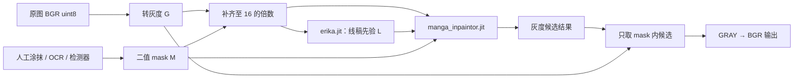

+++
date = '2026-11-13T16:00:00+08:00'
draft = false
title = 'Manga 漫画修复：从线稿先验、灰度卷积到双模型推理实践'
math = true
+++

这里的 `manga` 不是一个泛指“能处理漫画的 AI”的营销词，而是本项目使用的一条**黑白漫画修复管线**：先由 `erika.jit` 预测线稿结构，再由 `manga_inpaintor.jit` 在灰度图、线稿和 mask 的共同条件下补全被遮住的位置。它适合清除黑白漫画的对白、拟声词或小瑕疵；输入即使是彩色图，也会先被转成灰度。因此它不是彩色动漫插画的通用去字模型，更不能承担照片修复任务。

这一篇特意不把来源说得比证据更确定。`erika.jit` 与 `manga_inpaintor.jit` 是 IOPaint 发布的部署工件；公开的可用接口能够确认它们组成“线稿预测 + 漫画修复”的两阶段流程，但 TorchScript 二进制并没有附带一篇可以逐层对应的统一论文或完整训练配置。可以解释可观察到的输入、输出和工程原理；不能诚实地从文件名推导出它的每一层卷积、数据集或损失函数。模型不透明时，保留边界比编造结构更有价值。

## 先确定：它到底解决什么问题

设灰度漫画页为 $G\in[0,1]^{1\times H\times W}$，白色为待替换区域的二值 mask 为 $M\in\{0,1\}^{1\times H\times W}$。漫画修复希望得到 $\hat G$：

$$
G_{out}=M\odot\hat G+(1-M)\odot G
$$

这里有一个容易被忽略但很重要的因果关系：**mask 决定“哪里允许改”，模型决定“那里画什么”**。如果文字被 mask 完整覆盖，修复器看到的是“这一块可以重画”，再参考气泡底色、网点、衣服阴影和附近线条生成候选内容；它没有必要先精确识别汉字、日文或英文。若文字的一小段在 mask 外，最后的合成会把该像素原封不动地放回去，模型也不会越界替你删除它。



最后一步不是装饰。生成网络常输出完整图片，哪怕洞外只有极轻微色偏也会被放大成页面闪烁或线稿抖动；产品代码应明确把 mask 外恢复为原灰度图。因而，用户问“为什么它能准确找到要去掉的文字”时，答案并不神秘：**精确性首先来自正确的 mask，网络只负责在已授权的洞中补画。**

## 为什么漫画修复要把线稿当作条件

黑白漫画的主要信息不是自然照片里的连续颜色，而是清晰的墨线、气泡轮廓、网点和大面积留白。若只把被遮挡区域涂成附近像素的平均值，白色气泡也许会干净，却会切断衣服褶皱、边框或速度线。普通局部卷积还会遇到感受野问题：洞左侧的一条线与洞右侧的哪条线应当接上，往往要看远处结构。

线稿先验可以把问题拆成两层：

- `erika.jit` 从完整灰度输入预测一张强调边缘和轮廓的线稿图 $L$；它告诉修复器“这里附近有哪些应该连续的结构”。
- `manga_inpaintor.jit` 以 $G$、$L$、$M$，以及部署工件需要的噪声/条件张量为输入，生成洞内灰度内容。它不是把线稿简单覆盖回原图，而是把线稿作为条件，使生成纹理时更不容易无视结构。

这属于条件图像生成的一般思想：图像本身提供外观，结构图提供几何约束，mask 提供可修改范围。线稿不是事实保证；当文字刚好遮住角色眼睛或独一无二的机械细节，模型仍只能生成看起来连贯的猜测。

## 基础网络：卷积怎样学习灰度补图

一层二维卷积让一个小核在图上滑动，学习“深色边缘附近通常如何变化”之类的局部模式。给修复网络输入四个通道——被遮住后的灰度图、mask、线稿近似和坐标/常数条件——卷积便知道零值究竟是原本的黑线，还是被 mask 挖出的洞。编码器用 stride 2 卷积扩大感受野，解码器上采样回原尺寸；跳跃连接将高分辨率的边缘细节交给解码端。

下面是一个**可独立运行**的最小例子。它不试图复刻未公开结构，而是用 Sobel 边缘作可解释的“线稿条件”，以合成的漫画式页面训练一个小型 U-Net。保存为 `train_tiny_manga_inpaint.py`，先安装 `pip install torch pillow numpy`，再执行 `python train_tiny_manga_inpaint.py`。它会保存 `tiny_manga_result.png`；真实修复质量当然需要真实漫画数据与预训练权重，演示的目标是把输入、损失和 mask 外保护讲清楚。

```python
from pathlib import Path

import numpy as np
from PIL import Image
import torch
from torch import nn
from torch.nn import functional as F


torch.manual_seed(7)
device = torch.device("cuda" if torch.cuda.is_available() else "cpu")
size = 96


def make_batch(batch_size: int) -> tuple[torch.Tensor, torch.Tensor]:
    """生成白底、黑线与网点组成的简化漫画页，以及矩形文字 mask。"""
    yy, xx = torch.meshgrid(torch.arange(size), torch.arange(size), indexing="ij")
    images, masks = [], []
    for _ in range(batch_size):
        image = torch.ones(1, size, size)
        slope = torch.randint(-2, 3, ()).item()
        line_y = size // 2 + slope * (xx - size // 2) // 8
        image[0, (yy - line_y).abs() <= 1] = 0.05
        dots = ((xx % 12 == 2) & (yy % 12 == 2))
        image[0, dots] = 0.35
        left = torch.randint(22, 42, ()).item()
        top = torch.randint(34, 48, ()).item()
        mask = torch.zeros(1, size, size)
        mask[:, top:top + 18, left:left + 34] = 1.0
        images.append(image)
        masks.append(mask)
    return torch.stack(images).to(device), torch.stack(masks).to(device)


def sobel_line(gray: torch.Tensor) -> torch.Tensor:
    kernel_x = torch.tensor([[-1., 0., 1.], [-2., 0., 2.], [-1., 0., 1.]], device=gray.device)
    kernel_y = kernel_x.t()
    x = F.conv2d(gray, kernel_x.view(1, 1, 3, 3), padding=1)
    y = F.conv2d(gray, kernel_y.view(1, 1, 3, 3), padding=1)
    return torch.tanh(torch.sqrt(x.square() + y.square()))


class TinyMangaNet(nn.Module):
    def __init__(self) -> None:
        super().__init__()
        self.enc1 = nn.Sequential(nn.Conv2d(3, 32, 3, padding=1), nn.ReLU(), nn.Conv2d(32, 32, 3, padding=1), nn.ReLU())
        self.enc2 = nn.Sequential(nn.Conv2d(32, 64, 3, stride=2, padding=1), nn.ReLU(), nn.Conv2d(64, 64, 3, padding=1), nn.ReLU())
        self.up = nn.ConvTranspose2d(64, 32, 2, stride=2)
        self.out = nn.Sequential(nn.Conv2d(64, 32, 3, padding=1), nn.ReLU(), nn.Conv2d(32, 1, 1), nn.Sigmoid())

    def forward(self, gray: torch.Tensor, mask: torch.Tensor, line: torch.Tensor) -> torch.Tensor:
        masked = gray * (1 - mask)
        skip = self.enc1(torch.cat([masked, mask, line], dim=1))
        deep = self.enc2(skip)
        predicted = self.out(torch.cat([self.up(deep), skip], dim=1))
        return predicted * mask + gray * (1 - mask)


model = TinyMangaNet().to(device)
optimizer = torch.optim.Adam(model.parameters(), lr=2e-3)
for step in range(300):
    target, mask = make_batch(24)
    line = sobel_line(target)
    output = model(target, mask, line)
    # 仅在洞内计算重建损失；洞外已由前向合成严格保留。
    loss = ((output - target).abs() * mask).sum() / mask.sum().clamp_min(1)
    optimizer.zero_grad()
    loss.backward()
    optimizer.step()

    if step % 100 == 0:
        print(f"step={step}, masked_l1={loss.item():.4f}")

model.eval()
with torch.inference_mode():
    target, mask = make_batch(1)
    result = model(target, mask, sobel_line(target))
    assert torch.equal(result[mask == 0], target[mask == 0])
    Image.fromarray((result[0, 0].cpu().numpy() * 255).round().astype(np.uint8)).save("tiny_manga_result.png")
print("saved tiny_manga_result.png")
```

这个例子中 Sobel 不是 `erika.jit`，小 U-Net 也不是 `manga_inpaintor.jit`。它恰好说明为何不能把“功能相似”写成“网络相同”：前者是固定边缘算子，后者则是两个已训练的 TorchScript 网络。

## 项目模型的具体实现与输入契约

当前管线加载两个文件：

| 工件 | 已知职责 | 不能从文件名断言的内容 |
| --- | --- | --- |
| `erika.jit` | 灰度图到线稿/结构预测 | 训练集、逐层网络、损失函数 |
| `manga_inpaintor.jit` | 结合灰度、线稿、mask、噪声和条件张量生成灰度修复 | 是否等同某篇论文的完整实现 |

实现会将 BGR `uint8 [H,W,3]` 转为灰度，再共同补齐图像和 mask 到 16 的倍数。灰度和线稿通常归一化到 `[-1,1]`，mask 为 `[1,1,H,W]` 的 `0/1`，最后把输出从 `[-1,1]` 还原为 `uint8` 灰度。为何是 16？下采样网络常连续缩小空间尺寸；若高宽不能整除总步幅，跳跃连接和上采样就可能对不齐。补齐不是缩放：推理后必须裁回原尺寸。

Manga 的另一个本质边界是颜色：输入一开始已执行 `BGR → GRAY`，输出再用 `GRAY → BGR` 扩成三个相同通道。因此给彩色插画使用它会丢失 mask 内的色相和饱和度；此时应比较 [Anime-LaMa](10-anime-lama-inpainting-from-network-to-practice.md)，而不是期待灰度模型替你保留颜色。

## 正确使用预训练模型

最可靠的完整使用入口是 IOPaint 的 `manga` 模型封装：它负责下载 `erika.jit` 与 `manga_inpaintor.jit`、校验工件、准备五个输入张量和后处理，而不是让用户凭猜测调用两个不公开签名的二进制。权重 URL 可在 [IOPaint Manga 源码](https://github.com/Sanster/IOPaint/blob/main/iopaint/model/manga.py) 中核对；该仓库已归档，实际部署应固定版本和 hash。其当前维护分支也列出了两个工件的[下载地址与 `manga` 模型入口](https://github.com/czz120/IOPaint)。

下面路径从安装到保存结果均可运行。它使用交互界面手工涂白 mask，适合第一次确认 mask 和视觉效果；在页面中打开图片、用画笔涂白要删除的文字、选择 **Manga**、点击运行并下载结果即可。CPU 能运行但很慢，CUDA 安装应遵循 PyTorch 的平台选择器。

```powershell
python -m venv .venv
.\.venv\Scripts\Activate.ps1
python -m pip install --upgrade pip
pip install iopaint
iopaint start --model manga --device cuda --port 8080 --inbrowser
```

如果没有 CUDA，将最后一行改为 `iopaint start --model manga --device cpu --port 8080 --inbrowser`。首次启动会下载模型；离线环境必须先在有网络的受控机器下载并校验，再使用该工具所支持的模型缓存目录。不要从不明网盘取得同名 `.jit` 文件：`torch.jit.load` 会反序列化模型工件，来源与校验和属于安全边界。

对于需要自动化批处理的场景，`manga-image-translator` 提供了更上层的、完整的检测 → OCR → 掩码扩张 → 修复链路。下面命令会把输入文件或目录处理到同级输出目录，适合“先擦字再翻译”的工作流；其当前 README 指明 `lama_large` 是推荐 inpainter，并说明高分辨率页面应提高 `inpainting_size`。

```powershell
git clone https://github.com/zyddnys/manga-image-translator.git
cd manga-image-translator
python -m venv .venv
.\.venv\Scripts\Activate.ps1
pip install -r requirements.txt
python -m manga_translator local -v -i .\input\page.png
```

这里不能把自动检测当作绝对正确的 mask：漏检会留下原字，误检会让模型重画真实线条。批处理前先用 `-v` 保存中间结果，抽样检查检测框、OCR、mask 与修复后的图像。该项目也建议在高分辨率图提高 `inpainting_size`，以及通过 `mask_dilation_offset` 扩展文本掩码；这些参数应在少量代表性页面上逐步调整，而不是对整本漫画盲目放大。

## 让结果更好的可执行原则

1. **先选对视觉域。** 只在黑白/灰度漫画、网点和线稿页面上优先选 Manga；彩色动漫用 Anime-LaMa，照片用 LaMa。模型域不对，后续参数再多也只是更快地产生错误风格。
2. **mask 覆盖抗锯齿和描边。** 文字通常不止纯黑笔画，还包含灰边、描边和投影。先轻度扩张 1–3 像素，再检查是否吞掉气泡框或人物线条。
3. **小洞优于大洞。** 遮住一根线时，模型只能猜接法；把整个对话框涂掉时，约束更少。能只涂文字，就不涂整个气泡。
4. **保持原始分辨率并检查补齐后的裁切。** 下采样、再放大或错误地把长页压到很小，会让网点和细线不可逆地消失。大页显存不足时分区或调小处理尺寸，但要用重叠区并检查接缝。
5. **对视频不要期待时序一致性。** 两个模型逐帧推理，没有光流或跨帧状态；静态帧干净并不意味着播放时不会闪烁。

## 常见错误与结论

| 现象 | 优先排查 | 合理处理 |
| --- | --- | --- |
| 还有残字 | mask 漏掉抗锯齿、检测漏框 | 先可视化 mask，再小幅膨胀 |
| 线条被抹断 | mask 覆盖关键结构，或领域不匹配 | 缩小 mask；必要时人工补线 |
| 输出变成灰色 | 这是 Manga 路径的定义 | 改用 Anime-LaMa 或 LaMa 处理彩色图 |
| 尺寸/shape 报错 | 图、mask 未同尺寸或未共同补齐 | 同步补到 16 的倍数，输出后裁回 |
| 运行时不安全或加载失败 | 工件来源、PyTorch 版本、CPU/GPU 不匹配 | 固定工具与权重版本，校验 hash，不要关闭错误检查 |

应记住的结论只有三条：Manga 修复的核心不是“识别文字”，而是由 mask 授权的条件生成；线稿先验使黑白漫画的结构连续性更可控；而两个 `.jit` 工件的公开程度有限，可靠使用应优先走维护者提供的封装和可核验的模型来源。对模型不确定的地方明确说“不知道”，远比用几个名词假装已经理解网络更接近工程上的可靠性。
