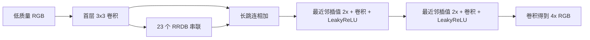
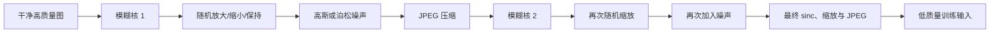

+++
date = '2026-11-13T16:00:00+08:00'
draft = false
title = 'Real-ESRGAN：从 RRDB 网络、真实退化训练到可运行的超分辨率实践'
math = true
+++

把一张模糊的小图放大四倍，并不等于「把像素拉开」。双三次插值只能平滑地补齐网格；Real-ESRGAN 则会根据它从大量图像中学到的统计规律，**推测**边缘、纹理和噪声应该怎样分布。因此它很擅长让压缩、轻度模糊或低分辨率的照片看起来更自然，却不能证明生成出来的睫毛、文字笔画或砖墙纹理在现实中本来就存在。

这篇文章只讨论一个主题：怎样理解并正确使用 Real-ESRGAN。读完后应能回答四个问题：它用什么网络？为什么训练时不直接把高清图缩小四倍？一份 `.pth` 权重为何不能单独运行？以及当大图显存不足或结果过度锐化时，究竟应改什么参数。原论文是 [Real-ESRGAN: Training Real-World Blind Super-Resolution with Pure Synthetic Data](https://arxiv.org/abs/2107.10833)，下面的权重名和命令均以[官方仓库](https://github.com/xinntao/Real-ESRGAN)当前脚本为准。

## 一、先把任务边界说清楚

设观测到的低质量图像为 $y$，未知的理想高质量图像为 $x$。一个简化的成像模型是：

$$
y = ((x * k) \downarrow_s + n)_{\mathrm{JPEG}}
$$

其中 $k$ 是模糊核，$\downarrow_s$ 是缩小采样，$n$ 是传感器或传输噪声，最后还可能经历 JPEG 压缩。超分辨率网络学习的是一个近似逆映射 $G_\theta(y)$，使输出在视觉上接近 $x$。

这里有一个无法回避的事实：下采样已丢掉高频信息，同一张 $16×16$ 的图可能对应许多不同的 $64×64$ 真实图。故而问题不是「找回被可靠保存的细节」，而是在已知图像分布的前提下，选择一个合理的高分辨率候选。身份证、病理切片、仪表读数、合同文字等要求事实精确的场景，必须保留原图并让人工复核；不要把超分结果当作取证材料。

Real-ESRGAN 面向的是**盲真实图像超分辨率**：推理时不知道输入到底被何种相机、压缩软件或缩放链路损坏。它的主要部件如下。

| 部件 | 使用的神经网络／技术 | 要解决的问题 |
| --- | --- | --- |
| 生成器 $G$ | ESRGAN 的 `RRDBNet` | 从低质 RGB 图预测 2× 或 4× RGB 图 |
| 判别器 $D$ | 带谱归一化的 U-Net 判别器 | 约束输出的局部纹理更像真实照片，并稳定对抗训练 |
| 特征监督 | 预训练 VGG 的感知损失 | 避免只按逐像素平均而得到过分平滑的结果 |
| 数据合成 | 两阶（high-order）随机退化 | 缩小训练图和真实手机／网络图片之间的退化域差异 |
| 工程推理 | 重叠分块、半精度、任意 `outscale` | 控制大图显存，得到可保存的图像 |

它**不接收 mask**，也不会定位或移除指定文字；那是 LaMa 一类图像修复模型的输入契约。Real-ESRGAN 的输入是一张完整图，输出是放大后的完整图。若先用修复模型删掉文字，再用它提升观感，顺序也不能让被删除区域的内容变成历史事实。

## 二、基础网络：卷积为何能做超分辨率

### 1. 卷积从邻域提取模式

彩色批量图像在 PyTorch 中通常是 `[N, C, H, W]`：批大小、RGB 通道、高、宽。一个 `3×3` 卷积核在每个位置读取周围 $3×3$ 邻域，并对所有通道加权求和：

$$
z_{o,i,j}=b_o+\sum_{c,u,v}W_{o,c,u,v}x_{c,i+u,j+v}
$$

早期卷积层可学习边缘、方向和颜色变化；多层叠加后，感受野扩大，网络才能结合更远处的轮廓判断一小段纹理更像头发、草地还是文字。`ReLU` 或 LeakyReLU 引入非线性，否则多层线性卷积仍可合并成单层线性变换，表达能力不会真正增加。

直接用转置卷积上采样有时会产生棋盘格。常见的替代方案之一是「卷积产生更多通道 + PixelShuffle 重排」：若倍率为 $r$，先输出 $C r^2$ 个通道，再把它们重新排成 $C×(rH)×(rW)$。这不是凭空制造信息；它只是让网络可为每个高分辨率子像素预测不同的值。**但官方 x4 RRDBNet 实际采用的是两次最近邻 2×插值，再各接卷积和 LeakyReLU，而不是 PixelShuffle。** 两种方案的共同点是：先在低分辨率特征空间完成大部分昂贵计算，再把特征变到高分辨率。

```text
低分辨率特征 [C, H, W]
       │  卷积，通道数变为 C × r²
       ▼
[C × r², H, W] ── PixelShuffle(r) ──> [C, rH, rW]
```

### 2. 残差连接：让深网络更容易优化

若一个模块学习目标映射 $H(x)$，残差块改为学习残差 $F(x)=H(x)-x$，输出写成 $x+F(x)$。当某层暂时没有有用变换时，令 $F(x)$ 接近零即可近似恒等映射；梯度也有一条直接经过加法的路径。这是 RRDB 能够堆叠许多卷积层而仍可训练的重要原因之一。

密集连接（Dense Connection）进一步让第 $l$ 层读到先前所有层的特征：

$$
x_l=H_l([x_0,x_1,\ldots,x_{l-1}])
$$

方括号表示沿通道拼接而非相加。早期的边缘特征不必反复「忘记后再学回」，但通道会增长，所以每层只增长较少的 `grow_ch`。

### 3. 最小、完整、可运行的超分网络

以下脚本**不是 Real-ESRGAN 的替代品**，而是把超分的卷积、残差、PixelShuffle 和训练循环缩小到一页可运行的教学版本。它有意使用 PixelShuffle 来展示一种常见上采样层；真实 RRDBNet 的上采样方式会在下一节准确说明。脚本在运行时随机画出高分辨率几何图形，双线性缩小为低分辨率输入，训练一个 2× 网络；不需下载数据集。保存为 `tiny_sr.py`，安装 `pip install torch pillow numpy` 后执行 `python tiny_sr.py`，会产生 `tiny_sr_result.png`。

```python
from pathlib import Path
import random

import numpy as np
from PIL import Image, ImageDraw
import torch
from torch import nn
from torch.nn import functional as F


torch.manual_seed(7)
random.seed(7)
device = "cuda" if torch.cuda.is_available() else "cpu"


def make_hr_batch(batch_size: int, side: int = 64) -> torch.Tensor:
    """随机生成 [N, 3, 64, 64]、值域 [0, 1] 的目标高清图。"""
    images = []
    for _ in range(batch_size):
        image = Image.new("RGB", (side, side), (18, 22, 30))
        draw = ImageDraw.Draw(image)
        for _ in range(10):
            x0, y0 = random.randrange(side), random.randrange(side)
            x1, y1 = random.randrange(side), random.randrange(side)
            color = tuple(random.randrange(40, 256) for _ in range(3))
            draw.line((x0, y0, x1, y1), fill=color, width=random.randrange(1, 4))
        array = np.asarray(image, dtype=np.float32) / 255.0
        images.append(torch.from_numpy(array).permute(2, 0, 1))
    return torch.stack(images)


class ResidualBlock(nn.Module):
    def __init__(self, channels: int) -> None:
        super().__init__()
        self.body = nn.Sequential(
            nn.Conv2d(channels, channels, 3, padding=1),
            nn.ReLU(inplace=True),
            nn.Conv2d(channels, channels, 3, padding=1),
        )

    def forward(self, x: torch.Tensor) -> torch.Tensor:
        return x + self.body(x)


class TinySR(nn.Module):
    """教学用 2× SR：特征提取 -> 残差块 -> 子像素上采样。"""
    def __init__(self) -> None:
        super().__init__()
        self.head = nn.Conv2d(3, 48, 3, padding=1)
        self.trunk = nn.Sequential(ResidualBlock(48), ResidualBlock(48), ResidualBlock(48))
        self.up = nn.Sequential(
            nn.Conv2d(48, 3 * 2 * 2, 3, padding=1),
            nn.PixelShuffle(2),
            nn.Sigmoid(),
        )

    def forward(self, low_res: torch.Tensor) -> torch.Tensor:
        feature = self.head(low_res)
        return self.up(feature + self.trunk(feature))


model = TinySR().to(device)
optimizer = torch.optim.Adam(model.parameters(), lr=2e-3)
model.train()
for step in range(800):
    target = make_hr_batch(16).to(device)
    low_res = F.interpolate(target, scale_factor=0.5, mode="bilinear", align_corners=False)
    prediction = model(low_res)
    loss = F.l1_loss(prediction, target)
    optimizer.zero_grad(set_to_none=True)
    loss.backward()
    optimizer.step()
    if (step + 1) % 100 == 0:
        print(f"step={step + 1:4d}, L1={loss.item():.5f}")

model.eval()
with torch.inference_mode():
    target = make_hr_batch(1).to(device)
    low_res = F.interpolate(target, scale_factor=0.5, mode="bilinear", align_corners=False)
    bicubic = F.interpolate(low_res, scale_factor=2, mode="bicubic", align_corners=False)
    restored = model(low_res)


def to_pil(tensor: torch.Tensor) -> Image.Image:
    array = tensor[0].detach().cpu().clamp(0, 1).permute(1, 2, 0).numpy()
    return Image.fromarray((array * 255).round().astype(np.uint8))


# 左：低分辨率的最近邻放大；中：双三次；右：小网络输出；下：目标图。
nearest = F.interpolate(low_res, scale_factor=2, mode="nearest")
canvas = Image.new("RGB", (64 * 3, 64 * 2))
for index, tensor in enumerate((nearest, bicubic, restored, target)):
    canvas.paste(to_pil(tensor), ((index % 3) * 64, (index // 3) * 64))
canvas.save(Path("tiny_sr_result.png"))
print(f"saved tiny_sr_result.png; device={device}")
```

这个示例只优化 $L_1=\lVert G(y)-x\rVert_1$，目标明确却倾向于平均所有可能细节，因而结果可能偏软。真实 Real-ESRGAN 用更大的 RRDBNet、真实退化模拟和感知／对抗约束解决这一缺口。

## 三、Real-ESRGAN 的 RRDBNet：生成器具体做了什么

### 1. RRDB 不是一个神秘名字

`RRDB` 是 Residual-in-Residual Dense Block：一个 RRDB 内含 3 个残差稠密块（RDB），每个 RDB 有 5 层卷积和层内残差；外层再将三个 RDB 的输出与输入相加。ESRGAN 版本移除了 Batch Normalization。

去掉 BN 并不是一般规律，而是超分任务的工程选择：BN 的批统计量会改变特征尺度并耗用显存，且可能引入与单张推理不一致的伪影；在低层视觉恢复中，精确的范围和颜色同样重要。残差分支还会乘一个较小系数（常见实现为 `0.2`），让很多嵌套残差在训练初期不至于数值过强。



官方 `RealESRGAN_x4plus` 的生成器正是 `RRDBNet(3, 3, 64, 23, 32, 4)`：3 入／3 出通道，64 个主特征，23 个 RRDB，每层密集增长 32 通道，原生 4×。动漫权重 `RealESRGAN_x4plus_anime_6B` 结构相同但只放 6 个 RRDB，所以**网络构造参数也必须变成 6**。官方推理代码明确写出了这些对应关系；权重中的参数名字和形状不匹配时，`load_state_dict` 应报错，而不该以 `strict=False` 掩盖错误。[官方推理脚本](https://github.com/xinntao/Real-ESRGAN/blob/master/inference_realesrgan.py)也列出了 `x2plus` 和更小的 VGG 风格 `realesr-general-x4v3`。

### 2. 为什么还需要感知损失与 GAN

仅逐像素逼近会惩罚任何「猜错但看起来真实」的纹理，网络的安全策略便是平均化，输出常比照片软。感知损失把输出和目标输入预训练 VGG，在若干特征层比较：

$$
L_{percep}=\sum_l w_l\left\|\phi_l(G(y))-\phi_l(x)\right\|_1
$$

这样更关注结构和视觉特征而非每个像素严格对齐。GAN 再训练一个判别器 $D$，要求它区分真实高清图与生成图；生成器试图骗过它。Real-ESRGAN 使用**带谱归一化的 U-Net 判别器**：U-Net 同时有下采样语义路径和上采样定位路径，能给出空间位置相关的真伪判断；谱归一化限制每层的 Lipschitz 常数，抑制判别器过强而令对抗训练更稳定。这正是论文摘要强调的两项改动之一。

常见的总目标可概念化为：

$$
L_G=\lambda_{pix}L_1+\lambda_{percep}L_{percep}+\lambda_{gan}L_{GAN}
$$

GAN 的代价是：它鼓励逼真的细节，却也更可能生成不存在的高频纹理。因此「锐利」不是无条件等于「正确」。原论文报告使用纯合成数据、两阶退化模型，并用 U-Net 判别器和谱归一化提升实际退化图像上的视觉表现；请将其理解为该训练分布上的经验结果，而非对所有图片的真实性保证。[论文摘要](https://arxiv.org/abs/2107.10833)对此有简明说明。

## 四、关键不在网络本身：两阶真实退化训练

若训练对只是 `高清图 → 固定 bicubic 缩小 4 倍`，模型会非常适应这种干净输入；手机夜拍、社交平台二次压缩、截屏再缩放的输入却来自另一种分布。Real-ESRGAN 的核心贡献之一是在线合成更复杂的退化链，使干净图 $x$ 产生多样的 $y$。

### 1. 一条训练样本怎样被合成

可把官方思想概括为下列流程。每一个算子与参数都随机采样；两阶并非机械复制，末端的 `sinc` 和 JPEG 顺序也会随机变化。



- **模糊核**：随机采样各向同性／各向异性高斯、generalized Gaussian、plateau 核，另用 sinc 核模拟截断频率响应。它们比「一个固定高斯模糊」覆盖更多镜头、运动和锐化后振铃的形态。
- **随机 resize**：每一阶都可能上采样、下采样或不变，且用不同插值方式。现实世界的图常被多次转存，尺寸链路并不恰好是 4 倍。
- **噪声与 JPEG**：混合高斯噪声和泊松噪声；JPEG 质量随机采样。第二阶末尾随机选择 `resize → JPEG` 或 `JPEG → resize`，因为操作顺序会改变伪影的形状。
- **USM 锐化与目标**：训练配置会对 GT／感知／GAN 目标按需要使用 unsharp mask，避免把模糊的训练目标误当作唯一理想答案。具体损失权重和数据范围应以仓库对应 YAML 为准，不应只复制论文中的概念段落就声称可复现。

这解释了 Real-ESRGAN 为什么能处理许多「不知道退化参数」的普通图片：并非它在推理时准确识别出某台相机，而是训练时看过足够多的合成退化组合，学到一个对这些组合相对稳健的先验。若输入来自训练范围外的极端马赛克、强运动模糊或生成图，效果仍可能失败。

## 五、官方预训练模型、输入和输出

### 1. 该选哪一个权重

下表是官方 Python 脚本公开支持的常用模型；发行页会随版本增加模型，部署时请以仓库 `inference_realesrgan.py` 的模型分支为准。

| 模型名 | 原生倍率／网络 | 合适输入 | 说明 |
| --- | --- | --- | --- |
| `RealESRGAN_x4plus` | 4×，23 RRDB | 普通照片与通用图片 | 最常用的通用质量模型 |
| `RealESRNet_x4plus` | 4×，23 RRDB | 需要较少 GAN 风格化时 | 同 RRDB 网络的 RealESRNet 权重 |
| `RealESRGAN_x2plus` | 2×，23 RRDB | 只需 2× 的常规放大 | 原生 2×，避免先 4×再缩小 |
| `RealESRGAN_x4plus_anime_6B` | 4×，6 RRDB | 线稿、赛璐璐动漫 | 更小的动漫专用模型，不是照片万能模型 |
| `realesr-general-x4v3` | 4×，32 层 SRVGG | 速度／体积优先的通用场景 | 支持 `-dn` 调节去噪强度 |

官方 README 给出了 [通用 4× 权重](https://github.com/xinntao/Real-ESRGAN/releases/download/v0.1.0/RealESRGAN_x4plus.pth)和[动漫 6B 权重](https://github.com/xinntao/Real-ESRGAN/releases/download/v0.2.2.4/RealESRGAN_x4plus_anime_6B.pth)的直接下载地址。完整的发行资产应从 [GitHub Releases](https://github.com/xinntao/Real-ESRGAN/releases) 获取。下载 `.pth` 后还需要匹配的 Python 网络定义；它通常是参数字典或 checkpoint，并不是一个自己知道如何处理 PNG 的可执行程序。

默认图像接口是 OpenCV 读出的 `H×W×3` BGR 数组，内部转换为 RGB、`float32`（CUDA 可转半精度）、归一化到 `[0,1]`，再变为 `[1,3,H,W]`。模型原生输出 `[1,3,4H,4W]`（或 2×模型的相应尺寸），最终转回可保存的 `uint8` 图像。官方脚本还处理灰度、RGBA 和 16-bit 图；若要保留透明通道，应输出 PNG，且要注意 alpha 通道可选择 Real-ESRGAN 或 bicubic 的独立上采样方式。

`--outscale 3.5` 不会令 4× RRDB「原生学会 3.5×」：官方先得到原生 4×输出，再用 Lanczos4 做一次廉价 resize。因此对质量最敏感的任务，优先选择原生倍率最接近目标的权重。[README 的参数说明](https://github.com/xinntao/Real-ESRGAN#-quick-inference)明确说明了这一行为。

### 2. 最短的官方命令行路径

以下命令从空目录开始，使用官方仓库，因而是最少维护成本的可运行方案。PyTorch 的 CUDA 安装命令随驱动和平台不同，请先按 [PyTorch 官方选择器](https://pytorch.org/get-started/locally/)安装；CPU 环境也能运行，只是慢得多。

```bash
git clone https://github.com/xinntao/Real-ESRGAN.git
cd Real-ESRGAN
python -m venv .venv
# Windows PowerShell: .\.venv\Scripts\Activate.ps1
# macOS/Linux: source .venv/bin/activate
python -m pip install --upgrade pip
pip install basicsr
pip install -r requirements.txt
python setup.py develop

# 输入既可以是单张文件，也可以是目录；首次运行会按模型名下载官方权重。
python inference_realesrgan.py -n RealESRGAN_x4plus -i inputs/photo.jpg -o results
```

若 CUDA 显存不足，先从较保守的分块开始：

```bash
python inference_realesrgan.py -n RealESRGAN_x4plus -i inputs/large.png -o results --tile 512 --tile_pad 16
```

若 `fp16` 在旧 GPU 上报精度或算子错误，加 `--fp32`。对线稿选动漫模型；对 `realesr-general-x4v3`，`--denoise_strength` 在 0 到 1 间平衡保噪和去噪，例如 `-dn 0.3`。它只对这一 general-v3 模型生效，给别的模型加它不会产生预期魔法，遗憾但这正是参数边界。

## 六、把官方推理逻辑写成可复用程序

命令行适合一次性任务；下面脚本适合嵌入自己的 Python 项目。把它保存为官方仓库根目录下的 `run_one_image.py`，完成上一节安装后执行：

```bash
python run_one_image.py inputs/photo.jpg results/photo_4x.png --model RealESRGAN_x4plus --tile 512
```

它复用了官方的 `RRDBNet` 与 `RealESRGANer`，首次缺权重时从官方 Release 下载，正确读取 checkpoint 中的 EMA 参数；不是一个看似简短、实则错配网络的伪代码版本。

```python
import argparse
from pathlib import Path

import cv2
import torch
from basicsr.archs.rrdbnet_arch import RRDBNet
from basicsr.utils.download_util import load_file_from_url
from realesrgan import RealESRGANer
from realesrgan.archs.srvgg_arch import SRVGGNetCompact


ASSETS = {
    "RealESRGAN_x4plus": {
        "scale": 4,
        "url": "https://github.com/xinntao/Real-ESRGAN/releases/download/v0.1.0/RealESRGAN_x4plus.pth",
        "build": lambda: RRDBNet(3, 3, 64, 23, 32, scale=4),
    },
    "RealESRGAN_x4plus_anime_6B": {
        "scale": 4,
        "url": "https://github.com/xinntao/Real-ESRGAN/releases/download/v0.2.2.4/RealESRGAN_x4plus_anime_6B.pth",
        "build": lambda: RRDBNet(3, 3, 64, 6, 32, scale=4),
    },
    "realesr-general-x4v3": {
        "scale": 4,
        "url": "https://github.com/xinntao/Real-ESRGAN/releases/download/v0.2.5.0/realesr-general-x4v3.pth",
        "build": lambda: SRVGGNetCompact(3, 3, 64, 32, upscale=4, act_type="prelu"),
    },
}


def main() -> None:
    parser = argparse.ArgumentParser()
    parser.add_argument("input", type=Path)
    parser.add_argument("output", type=Path)
    parser.add_argument("--model", choices=ASSETS, default="RealESRGAN_x4plus")
    parser.add_argument("--outscale", type=float, default=4.0)
    parser.add_argument("--tile", type=int, default=0, help="0 表示整图；显存不足时试 512、256")
    parser.add_argument("--fp32", action="store_true", help="禁用 GPU 半精度")
    args = parser.parse_args()

    if args.outscale <= 0:
        raise ValueError("outscale 必须为正数；非原生倍率会在网络输出后额外缩放")
    image = cv2.imread(str(args.input), cv2.IMREAD_UNCHANGED)
    if image is None:
        raise FileNotFoundError(f"cannot read: {args.input}")
    if image.ndim != 3 or image.shape[2] not in (3, 4):
        raise ValueError("请提供三通道 BGR 或四通道 BGRA 图像")

    asset = ASSETS[args.model]
    weights_dir = Path(__file__).resolve().parent / "weights"
    weights_dir.mkdir(exist_ok=True)
    model_path = weights_dir / Path(asset["url"]).name
    if not model_path.is_file():
        model_path = Path(load_file_from_url(asset["url"], str(weights_dir), progress=True))

    upsampler = RealESRGANer(
        scale=asset["scale"],
        model_path=str(model_path),
        model=asset["build"](),
        tile=args.tile,
        tile_pad=10,
        pre_pad=0,
        # CPU 与主动要求 FP32 的场景均不能把权重转为半精度。
        half=torch.cuda.is_available() and not args.fp32,
    )
    try:
        output, _ = upsampler.enhance(image, outscale=args.outscale)
    except RuntimeError as error:
        if "out of memory" in str(error).lower() and args.tile == 0:
            raise RuntimeError("显存不足：请重新运行并传入 --tile 512 或更小数值") from error
        raise

    args.output.parent.mkdir(parents=True, exist_ok=True)
    if not cv2.imwrite(str(args.output), output):
        raise OSError(f"cannot write: {args.output}")
    print(f"{image.shape} -> {output.shape}; saved {args.output}")


if __name__ == "__main__":
    main()
```

有两点实现细节值得保留。第一，`tile_pad` 不是给 tile 填零，而是让每个中心块额外读取周围真实像素；模型处理后只取中心输出，所以相邻块的感受野不会在接缝处突然截断。第二，`half=True` 只适合支持 FP16 的 CUDA 路径；CPU 或老显卡上用 `--fp32` 更稳。不要为了「消灭报错」把权重加载改成非严格模式，也不要把 BGR 的 OpenCV 数组自行当作 RGB Tensor 喂进另一个实现。

## 七、效果调优、局限与排错

### 1. 先用正确的输入和倍率

- 先保留原始文件，优先输入未被多次社交软件转发的版本；模型不能恢复压缩链路外的真实信息。
- 照片通常从 `RealESRGAN_x4plus` 开始，动漫线稿用 `RealESRGAN_x4plus_anime_6B`。把照片丢给动漫模型，常出现不自然的平涂边缘；反过来则会把干净线条处理得像噪点。
- 最终只需 2×时，优先试 `RealESRGAN_x2plus`；若只能用 4×模型，再令 `--outscale 2`，要知道后一步是插值缩小。
- 文字、二维码和规则 UI 不是该模型的强项。先使用原始矢量／高分导出文件；放大后若要 OCR，仍以原图识别结果为准。

### 2. 大图与性能的取舍

推理峰值显存大致随 tile 的面积增长，而非只随边长增长。`--tile 0` 整图最快但最占显存；从 `512` 降到 `256` 通常显著降低峰值，却增加循环、重叠和耗时。`tile_pad` 太小可在块边缘出现接缝，太大只会重复计算更多上下文；官方默认值是 10，可从 10 或 16 开始，不要把它当成锐化强度。

批量处理时先挑十张代表性图片对比：人脸、天空、细密织物、文字、低照度和 JPEG 重压缩图至少各一张。只在一张「效果惊艳」的示例上调参，很容易把失真也一并当作提升。

### 3. 常见症状对照

| 症状 | 常见原因 | 处理方式 |
| --- | --- | --- |
| `CUDA out of memory` | 整图或 tile 过大、同时运行多个任务 | 降低 `--tile`，关闭并发；仍不足则 CPU 或更小模型 |
| `size mismatch` / 缺少键 | 权重与网络或模型名不匹配 | 用官方模型名和对应 `.pth`；保持严格加载 |
| 输出有块状接缝 | 分块缺少上下文，或自行拼接坐标错误 | 使用官方 `RealESRGANer`；适当增大 `tile_pad` |
| 颜色异常 | RGB/BGR、`uint8`／`[0,1]` 约定混乱 | 统一库边界；OpenCV 读写是 BGR |
| 放大后「假细节」很多 | 原图退化极重，GAN 纹理先验被过度触发 | 降低目标倍率，换更干净源图，或选择保守流程 |
| 透明 PNG 变黑／丢透明 | 使用 JPEG 或忽略第四通道 | 输出 PNG，检查 alpha 处理策略 |

## 八、总结：正确期待模型，才谈得上正确使用

- Real-ESRGAN 的经典生成器是无 BN 的 **RRDBNet**：密集连接和嵌套残差负责特征提炼；官方 x4 结构用两次最近邻 2×插值加卷积得到原生 4×输出。
- 真正让它适应普通受损图片的关键，是两阶随机模糊、resize、噪声、JPEG 和 sinc 组成的**高阶退化建模**；U-Net 谱归一化判别器与感知／对抗损失则让结果更有真实纹理感。
- `.pth` 是权重数据，不是完整应用。必须以匹配的网络构造、输入颜色顺序、数值范围、设备精度和后处理加载它。
- `--tile` 是显存控制工具，`tile_pad` 是上下文重叠；`--outscale` 小于原生倍率时会先原生超分再缩放。
- 最重要的边界仍然是：它生成的是视觉上合理的高频细节，而不保证还原了历史上真实存在的细节。对事实敏感内容，原图永远是证据。

进一步研究训练或自建数据集时，应从官方 [训练指南](https://github.com/xinntao/Real-ESRGAN/blob/master/docs/Training.md) 和 `options/train_realesrgan_x4plus.yml` 起步，固定数据版本、保存验证集和退化参数范围。只复制网络结构却省略退化模型与评估集，最后得到的通常不是「自己的 Real-ESRGAN」，而是一个无法解释何时会失真的放大器。
