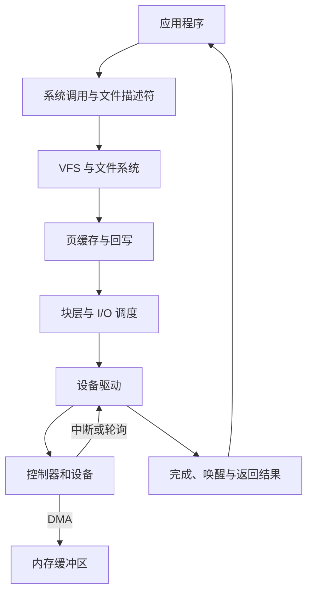

+++
date = '2026-10-22T10:00:00+08:00'
draft = false
title = 'I/O 子系统：从系统调用到设备完成的完整协作'
+++

一个程序调用 `read`、`write` 或 `send` 时，表面上只是请求“读一点数据”或“写一点数据”。但 CPU 并不会认识文件路径、网卡连接或键盘按键；SSD、网卡和显示器也不会理解文件描述符。把这些彼此不同的对象变成统一、可保护、可并发使用的服务，正是 **I/O（Input/Output）子系统**的工作。

可以先记住结论：**I/O 子系统不是一条从应用直达硬件的单线通道，也不是某个神秘的硬件队列；它是一组分层机制。上层提供对象、权限和等待语义，下层把请求翻译成控制器命令，并让设备通过 DMA、中断或轮询完成数据传输。**

## 一、为什么需要 I/O 子系统

不同设备的差异大得近乎不讲道理：键盘一次产生少量事件，磁盘按块读写，网卡处理报文，GPU 接受命令流；它们的速度、失败方式、并发能力和硬件寄存器协议也各不相同。如果应用直接操作每种设备，应用不仅要认识具体型号，还必须处理 DMA 地址、中断、缓存一致性和并发竞争。那样的“通用程序”大概只适合在某一台机器上孤独地活着。

操作系统用一组抽象隔开这种差异：

| 面向对象 | 常见抽象 | 程序看到的操作 |
| -------- | -------- | ---------------- |
| 普通文件、目录 | 文件描述符、路径、文件对象 | `open`、`read`、`write`、`close` |
| 终端、串口、键盘 | 字符设备、输入事件 | `read`、控制命令、事件读取 |
| SSD、磁盘 | 块设备、逻辑块 | 文件系统读写、块请求 |
| 网卡、连接 | socket、报文队列 | `send`、`recv`、`poll` |
| 定时器、异步完成 | 就绪事件、完成事件 | `poll`、`epoll`、回调、完成队列 |

“统一”不表示所有对象都完全相同。对文件调用 `seek` 有意义，对 TCP socket 或键盘未必有意义；目录可以枚举条目，却通常不能当作普通字节流任意写入。统一接口提供共同骨架，具体对象仍保留自己的语义边界。

## 二、I/O 子系统的层次

以读取文件为例，可以把协作关系看成下图：



不是每次 I/O 都完整经过图中的每一层。例如，页缓存命中时不需要访问 SSD；发送网络报文不经过文件系统；简单设备也可能没有复杂的块层。图表达的是职责分工，而不是不许例外的流水线。

### 1. 用户接口：请求“做什么”，而不是“如何驱动硬件”

应用使用库函数和系统调用表达意图：

```c
char buf[4096];
int fd = open("report.log", O_RDONLY);
ssize_t n = read(fd, buf, sizeof buf);
close(fd);
```

`fd` 是进程私有的文件描述符编号。内核根据它找到已经打开的文件对象、当前文件偏移和访问模式，并检查调用者是否有权限。它不是磁盘块号，也不是某个 SSD 寄存器地址。

系统调用还定义可见语义：读到多少字节算成功、文件末尾怎样表示、暂时没有数据是阻塞还是返回 `EAGAIN`、被信号打断如何处理。**设备协议负责“怎么执行”，系统调用负责“应用能得到什么结果”。**

### 2. 对象层：把名称和描述符解释为正确对象

对于文件，虚拟文件系统（VFS）把路径和文件描述符统一为文件对象操作，并把具体文件系统差异留给 ext4、NTFS、tmpfs 等实现。路径解析会经过目录项和文件元数据；后续用 `fd` 读取时，通常不必再逐段解析路径。

对于 socket，网络栈维护协议状态、接收缓冲和发送缓冲；对于终端，终端层可能先处理行编辑、回显和控制字符。它们都能提供“读取”，但读取的对象和就绪条件不同。

### 3. 缓冲与缓存层：先回答能否不碰设备

绝大多数普通文件读取优先查 **页缓存（page cache）**。若目标文件页已经在 RAM，内核只需确认权限和范围，再把数据复制或映射给应用，无须让磁盘参与。写入时，内核也常先修改缓存页、标记为脏页，之后由回写机制批量落盘。

这并不等于 `write` 已经保证断电后仍保存。应用若需要明确持久化边界，必须理解 `fsync`、文件系统日志和设备缓存的语义。缓存提高吞吐和延迟表现，却不会替业务凭空定义“何时绝不丢失”。

### 4. 通用 I/O 层：组织请求、合并与排队

缓存未命中时，文件系统把“文件偏移”转换为设备逻辑块范围，再向块层提交请求。块层可以合并相邻请求、拆分不符合设备限制的大请求，并在多个请求之间安排提交顺序。现代 SSD 和 NVMe 控制器内部已经有很强的并发与调度能力，因此具体策略会因设备和内核而异；无论如何，它的目标不是让应用认识设备细节。

网络 I/O 也有对应的缓冲、队列和协议处理，只是单位从“逻辑块”换成了“报文或字节流”。所以 I/O 子系统应理解为一套模式，不要狭隘地等同于磁盘 I/O。

### 5. 驱动与硬件层：描述工作，而非让 CPU 搬运每个字节

驱动将通用请求翻译为特定控制器认可的命令。高速设备常使用内存中的提交队列和完成队列：

| 队列 | 生产者 | 消费者 | 典型内容 |
| ---- | ------ | ------ | -------- |
| 提交队列 | CPU/驱动 | 设备 | 操作类型、地址、长度、请求标识 |
| 完成队列 | 设备 | CPU/驱动 | 请求标识、状态、实际长度 |

队列项大多是描述符，不是大块文件内容。驱动准备好可供设备访问的内存页和 DMA 描述符，设备再通过 **DMA** 在设备与 RAM 之间传输数据。CPU 的职责主要是准备、提交和收尾，不必逐字节复制。

驱动可能用 MMIO 写入“门铃”寄存器通知控制器有新命令。设备完成后，通常触发中断；在高吞吐场景，内核也可能使用轮询或中断与轮询结合，避免每个小完成都制造一次中断开销。

## 三、一次 `read` 的两条路径

下面以 `read(fd, user_buf, 4096)` 为例。真实内核细节更多，但两条主路径足以建立正确直觉。

### 1. 缓存命中：主要是内存访问

```text
应用进入内核
  -> 检查 fd、权限和用户缓冲区范围
  -> 找到页缓存中的目标文件页
  -> 按 read 语义复制数据到 user_buf，或建立受控映射
  -> 更新文件偏移并返回字节数
```

这里仍有用户态/内核态切换、地址校验和内存复制等成本，但没有新的磁盘 I/O。CPU 最终通过普通加载/存储访问 RAM；不要因为数据最初来自磁盘，就把这次访问误称为“CPU 正在读 SSD”。

### 2. 缓存未命中：需要设备完成

```text
应用进入内核
  -> 文件系统由文件偏移定位逻辑块
  -> 分配或锁定页缓存页，发起块 I/O 请求
  -> 驱动将命令放入设备提交队列
  -> 设备 DMA 把数据写入这些 RAM 页
  -> 设备报告完成，驱动确认状态
  -> 内核唤醒等待者，向用户缓冲区交付数据
```

发起请求的线程在等待期间通常会睡眠，调度器可以运行其他线程。这就是“阻塞 I/O”在软件层面的含义；底层设备仍然可以同时处理许多异步命令。

## 四、完成不等于“把线程立即叫醒”

设备完成一个请求后，内核还要处理一段完成路径：确认错误码和传输长度、解除页面或请求的占用、更新缓存状态、唤醒等待线程，或把结果投递到异步完成队列。不同接口让应用取得结果的方式不同：

- **阻塞 I/O**：调用线程等待，完成后继续执行；
- **非阻塞 I/O**：暂时不能完成时立即返回，例如 `EAGAIN`；
- **I/O 多路复用**：`poll`、`epoll` 等等待多个对象的“可能读/写”状态；
- **异步 I/O**：提交操作后稍后通过回调、事件或完成队列收取结果。

特别要分清 **就绪（readiness）** 与 **完成（completion）**。socket “可读”常意味着接收缓冲区已有数据，随后调用 `read` 仍要实际取走它；一个异步磁盘读的“完成”则表示那次指定读请求已有结果。名字相近，语义并不可以随便互换。

## 五、I/O 子系统还必须处理的四类边界

### 1. 保护：设备不能任意读写内存

DMA 的“直接”是免去 CPU 逐字节搬运，不是设备获得整台机器的无限权限。内核负责选择并锁定 DMA 缓冲区；有 IOMMU 时，还能建立设备可访问地址到物理页的受限映射。完成前就释放或复用这段内存，会使设备写入新所有者的数据，后果不需要夸张也足够糟糕。

### 2. 并发：同一个对象可能被多人使用

多个线程可同时读写一个文件、socket 或设备。内核需要定义或协调偏移更新、原子追加、缓存页锁、请求生命周期和取消逻辑。并发不是给每个 I/O 请求排一条队就结束；还要保证同一份状态不会在完成、超时、关闭和重试交错时被重复释放或错误唤醒。

### 3. 缓存一致性：CPU 与设备看到的内容必须对得上

在某些架构或内存类型上，CPU Cache 与设备 DMA 并不天然自动一致。驱动必须按平台规则进行 DMA 映射、同步和内存屏障，并保证“先把描述符写完，再通知设备”。这些细节通常藏在 DMA API 中，正是因为不应该让普通应用逐条处理。

### 4. 错误与恢复：I/O 从不只会成功

设备可能超时、掉线、返回介质错误，网络可能重传或断开，用户还可能在请求进行中关闭文件。I/O 子系统需要将硬件和协议错误翻译成上层可处理的错误结果，并避免已失败请求永久占住页面、队列槽位或等待线程。可靠性不是只在成功路径上写得漂亮。

## 六、容易混淆的几个说法

| 常见说法 | 更准确的理解 |
| -------- | ------------ |
| “CPU 通过 I/O 队列访问内存” | CPU 访问普通 RAM 用 load/store；设备 I/O 队列主要用于驱动和控制器之间协作。 |
| “DMA 绕过内核” | DMA 绕过 CPU 的逐字节搬运；内核仍建立请求、授权缓冲区并处理完成。 |
| “`write` 返回就已经落盘” | 普通写入常先进入页缓存；是否持久化取决于同步、回写、日志和设备缓存语义。 |
| “异步 I/O 没有等待” | 调用者可以不在提交点等待，但资源、内核和设备仍要经历请求到完成的生命周期。 |
| “所有 I/O 都经过文件系统” | 文件 I/O 会经过文件系统；网络、输入设备和很多控制操作不会。 |

## 七、总结

- I/O 子系统用系统调用、对象抽象、缓存、通用请求层、驱动和硬件协议，把异构设备组织成可编程服务。
- 文件描述符和路径是内核对象模型的一部分，不是设备地址；文件系统、网络栈和字符设备层各自解释它们的 I/O 语义。
- 高速设备通常由驱动把命令描述符放入队列，再通过 DMA 搬运大数据，以中断或轮询报告完成。
- 一次 `read` 可能完全命中 RAM 中的页缓存，也可能触发从文件系统到块层、驱动和设备的一整条路径。
- 保护、并发、缓存一致性、错误处理与完成通知同样属于 I/O 子系统；只谈“把数据搬过来”并不完整。

若想继续追踪硬件队列的具体形态，可阅读[操作系统 I/O 接口是什么：系统调用、设备驱动与提交完成队列](/computerorganization/03-operating-systems/操作系统-i_o-接口是什么系统调用设备驱动与提交完成队列/)。理解 I/O 子系统之后，再看那些提交队列和 doorbell 寄存器，就不至于把它们误认为整个操作系统都在围着的一张队列表了。
