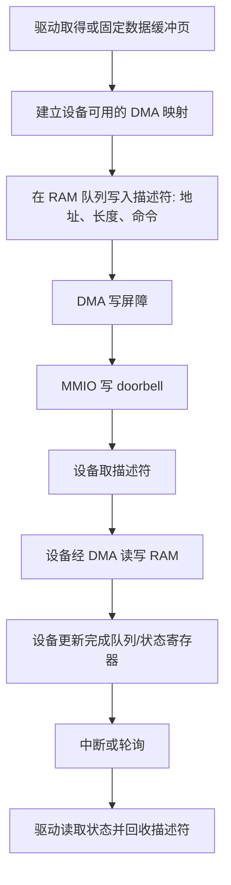

+++
date = '2026-10-20T14:00:00+08:00'
draft = false
title = '设备 MMIO 如何工作：地址译码、寄存器访问、内存屏障与 DMA 协作'
+++

驱动代码里常能看到一段看似普通的读写：向一个地址写入数值、再轮询另一个地址的状态位。若把它当成“修改了一块内存”，就已经偏离了设备 MMIO（memory-mapped I/O）的核心：**CPU 使用 load/store 形式的指令访问一个地址，但该地址经硬件译码后抵达的是设备寄存器，而非普通 DRAM**。一次写入可能敲响门铃、启动 DMA；一次读取也可能确认中断、弹出 FIFO 数据。

这篇文章讨论驱动与设备控制器之间的寄存器接口。它不把 MMIO 误称为“把设备内存当 RAM”，也不把 `volatile` 当作万能同步工具。读完后，你应能解释一份驱动文档中的寄存器基址、offset、doorbell、write-one-to-clear、memory barrier 和 DMA 描述符各自解决什么问题。

## 一、先把三种“地址”分开

MMIO 相关资料最容易混淆的，是下表中的对象：它们都可能写成十六进制数，却处在不同层。

| 名称 | 示例 | 谁使用 | 含义 |
| ---- | ---- | ------ | ---- |
| CPU 虚拟地址 | 内核中的 `regs + 0x20` | CPU、页表 | 当前代码实际执行 load/store 时使用的地址 |
| 总线/物理资源地址 | PCI BAR 给出的区间 | 固件、总线、设备 | 平台将这段地址路由到哪个设备 |
| 寄存器偏移 | `0x20` | 驱动、设备规范 | 该设备寄存器相对基址的位置 |
| DMA 地址 | 描述符中的 buffer 地址 | 设备、IOMMU | 设备获准访问缓冲区时使用的地址 |

例如 PCIe 设备可能通过 BAR（Base Address Register）声明一个控制寄存器窗口，固件和内核将其安排在某段物理地址。驱动不会凭空猜测这个地址；它从枚举结果或平台描述中取得资源，并把这段资源映射到自己的内核虚拟地址空间。之后才有类似 `regs + 0x20` 的访问。

```text
驱动源代码中的 regs + 0x20
        │
        ▼
内核页表给出的 MMIO 虚拟映射
        │
        ▼
总线/物理地址区间（由 BAR 或平台资源给出）
        │
        ▼
地址译码命中设备控制器
        │
        ▼
设备寄存器 offset 0x20
```

普通 RAM 的物理地址会经过内存控制器抵达 DRAM；MMIO 区间则由片上互连、PCIe root complex 或其他总线逻辑路由到控制器。形式相同不代表对象相同。CPU 只是发起了一次地址事务，最终由地址译码决定谁来响应。

## 二、寄存器是协议字段，不是可随意读写的变量

设备规范会为每个 offset 定义访问宽度、可读写性、位含义和副作用。把寄存器当作普通 C 变量读改写，很容易踩到协议陷阱。

| 常见类型 | 合法操作 | 典型含义 | 常见误用 |
| -------- | -------- | -------- | -------- |
| RO（只读） | 读取 | 状态、版本、完成索引 | 向它写入“清零” |
| RW（读写） | 按规定宽度读写 | 配置、使能位 | 无意覆盖保留位 |
| WO（只写） | 写入 | 命令、doorbell | 先读再写，读值没有意义 |
| W1C | 写 `1` 清对应位 | 中断状态 | 写回读取值时误清其他事件 |
| FIFO/数据口 | 每次读/写都消费或提交 | 收发数据 | 为调试而额外读取一次 |

假设某状态寄存器采用“write-one-to-clear”语义：位为 `1` 表示某事件已发生，向该位写 `1` 才确认它。若驱动为了修改某一位而做“读取当前值，再写回修改后的值”，就可能顺带清除在读取后新出现的事件。对普通内存而言无害的 read-modify-write，在这里可能正好破坏设备协议。

访问宽度也必须精确。例如规范要求 32 位写入的 doorbell，拆成两个 16 位写入未必等价；某些设备甚至会把不支持的宽度视为未定义行为。驱动应使用设备文档要求的 `8/16/32/64` 位访问接口，而不是让编译器“看起来应该会处理”。

## 三、为什么内核需要专门的 MMIO 映射与 accessor

用户进程通常不能任意映射设备寄存器。内核先确认资源归属，再建立适合该体系结构和设备类型的映射。映射除了翻译地址，还会选择**内存属性**：普通可缓存 RAM、不可缓存 MMIO、写合并窗口等并不具有相同语义。

以 Linux 名称举例，驱动常通过资源管理接口取得寄存器范围，再用 `ioremap` 一类机制建立映射，并用 `readl`、`writel` 等 accessor 访问。具体 API 会随内核版本和架构变化；真正值得记住的是它们所表达的约束：

- 该指针指向 I/O 空间，不能与普通对象指针等同对待；
- 访问宽度和字节序遵循设备协议；
- 编译器不能把多次访问偷偷合并、删除或缓存为寄存器值；
- 平台可以在 accessor 内实现所需的 I/O 访问序列。

下面是仅用于理解顺序的伪代码，不是可直接复制到任意内核的驱动模板：

```c
// 先在普通 RAM 中准备描述符，再通知设备检查队列。
descriptor->dma_addr = buffer_dma_addr;
descriptor->length = length;
descriptor->command = READ;

dma_wmb();                 // 让描述符内容先对设备可见
writel(new_tail, regs + DOORBELL);

// 中断/轮询路径中读取设备更新的完成项。
status = readl(regs + STATUS);
```

`volatile` 只解决其中极小的一部分问题：它约束的是 C 编译器不能把该对象访问当成普通可优化内存访问。它**不自动**保证多个 CPU 的同步，也不保证此前写入 RAM 的描述符已经以设备可见的顺序到达互连，更不知晓寄存器的字节序、访问宽度或读取副作用。因此，驱动代码需要遵循操作系统提供的 MMIO/DMA 接口与设备规范，不能因为指针加了 `volatile` 就宣布万事大吉。那种宣布多少带有一点过早的乐观。

## 四、缓存与写合并：为什么不能把寄存器当作普通内存缓存

CPU cache 的目标是加速可重复读取的 RAM 数据；设备寄存器的值却可能由硬件随时改变，读取还可能具有动作。若把它们按普通可缓存内存处理，CPU 可能反复看到旧值，或把多次写延后、合并，设备协议就失去明确的边界。

大多数控制寄存器因此使用不可缓存的设备映射。也有例外：显示帧缓冲、某些高速数据窗口可能适合 write-combining。写合并允许 CPU 暂存并合并连续写入，以提高吞吐，但它不适合要求每次写立刻触发动作的 doorbell 寄存器。

所以“MMIO 不缓存”只是常见简化，不能当作不变定律；正确答案来自平台页表属性和设备文档。控制寄存器、帧缓冲和 DMA 缓冲区的访问模式不同，映射策略也应不同。

## 五、三类顺序问题：别把它们混成一个“屏障”

设备驱动同时面对编译器、CPU 和设备。它们各自可能让观察顺序不同，因此需要先说明究竟在约束谁。

### 1. 编译器顺序

C/C++ 编译器会在不改变语言可观察结果的前提下重排、消除或合并普通内存访问。MMIO accessor、`volatile` 语义和编译器屏障可阻止特定优化，但它们不自动决定硬件事务抵达设备的顺序。

### 2. CPU 与普通 RAM 的可见顺序

多核 CPU 可能允许对普通内存的读写以不同于源代码的时机被其他观察者看到。提交 DMA 工作时，关键约束往往是：**设备看到 doorbell 前，必须先能看到完整描述符和缓冲区内容**。适用的 DMA 写屏障或平台同步原语负责建立这种先后关系。

反方向也存在：设备 DMA 写入完成项后，CPU 必须在读取完成项内容前取得正确可见性。不同平台的缓存一致性、DMA API 与同步原语会影响具体写法，不能把某个架构上的一条汇编指令机械照搬到所有机器。

### 3. MMIO 写入是否已经抵达设备

CPU 已按顺序发出 MMIO 写，不一定意味着设备已在此刻处理它。PCIe 等互连可能存在 posted write：写请求可以先被接受、稍后抵达设备，而不必立即返回完成响应。某些协议在必须确认前一写已生效时，会要求驱动读取同一设备的特定寄存器、使用规定的 flush 方法，或等待状态变化。

这三件事可以按时间线理解：

```text
CPU 写普通 RAM 描述符
        │  DMA 可见性/写屏障
        ▼
CPU 写 MMIO doorbell
        │  必要时按设备协议确认 posted write
        ▼
设备读取描述符并启动 DMA
```

一个“内存屏障”不必同时解决所有箭头。应查明设备协议、体系结构与操作系统 DMA API 所规定的原语；盲目插入屏障可能掩盖错误，也会无谓损失性能。

## 六、MMIO 与 DMA 怎样协作

MMIO 大多传递控制信息，DMA 大多传递数据。这种分工是高吞吐设备不让 CPU 被逐字节搬运绑住的原因。

以网卡发送或 NVMe 读取为例，简化流程如下：



描述符所在的 RAM 并不天然能被设备安全访问。驱动要处理页面固定、物理不连续、DMA 地址转换和缓存同步；有 IOMMU 时还要建立 I/O 页表，使设备只能访问获授权的范围。DMA 地址可能等于物理地址，也可能经过 IOMMU 或总线地址转换，因此不应把 CPU 虚拟指针直接塞进设备寄存器。

MMIO doorbell 的作用通常只是“队列已有新条目”。真正的命令描述符在 RAM；真正的大块数据也在 RAM 缓冲区。这能解释为什么一次很小的寄存器写能够启动一笔很大的磁盘读写或网络传输。

## 七、一次寄存器访问的排查清单

驱动访问异常时，先不要把问题统称为“地址不对”。按下面顺序确认，通常更有效：

1. 资源是否真由这个驱动拥有，BAR/平台资源的大小是否覆盖目标 offset？
2. 是否建立了正确的内核 MMIO 映射，而不是把物理地址强转成普通指针？
3. 访问宽度、字节序、保留位和读写副作用是否符合设备手册？
4. 配置、描述符写入和 doorbell 之间是否满足设备所需顺序？
5. DMA 缓冲区是否已正确映射、同步，并在 I/O 期间保持有效？
6. 设备是否需要对 posted write 做读回或其他确认？
7. 读取状态寄存器是否会清中断、弹出 FIFO 或改变设备状态？

调试打印本身也可能造成行为改变：多读一次带副作用的寄存器，就不再是在观察同一个系统。这是 MMIO 调试比普通内存调试更容易显得“玄学”的原因之一；不过它不是玄学，只是观察动作也属于协议的一部分。

## 八、总结

- MMIO 让 CPU 以 load/store 形式访问设备寄存器；地址译码的终点是控制器而非 DRAM。
- BAR/平台资源地址、内核虚拟映射、寄存器 offset 与 DMA 地址属于不同层，不能互相替换。
- 寄存器是有访问宽度、保留位和读写副作用的硬件协议字段；普通变量式的读改写可能出错。
- `volatile` 只限制编译器优化，不能替代 MMIO accessor、内存属性、DMA 同步或 CPU/设备间的顺序保证。
- 典型路径是“RAM 中准备描述符 → 保证设备可见 → MMIO doorbell → 设备 DMA → 完成通知”，而不是 CPU 把大块数据写进寄存器。

理解 MMIO 的关键不是记住某个寄存器的数字，而是始终追问：这次访问的接收者是谁、读写是否有副作用、前后数据是否已经对对方可见。把这三点保持清醒，设备驱动的地址与顺序问题就不再只是一串沉默的十六进制数。
