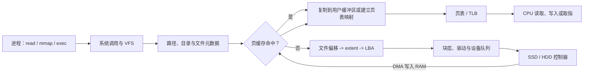

+++
date = '2026-10-19T09:00:00+08:00'
draft = false
title = '操作系统的内存、文件与 I/O：先建立一张不混淆的地图'
+++

很多关于操作系统的提问会被简化成一句话："CPU 怎么知道文件在磁盘的哪里，又怎样读取它？" 这句话同时问到了**命名**、**存储定位**、**内存访问**和**设备 I/O**。它们由不同组件回答；如果把它们都叫作“地址映射”，结论当然会越说越含糊。

本课程从一条实际链路出发：进程打开一个文件、读取其中的字节，或执行磁盘上的程序。目标不是记住若干名词，而是能在任意一步指出：此时使用的是什么坐标、由谁保存映射、CPU 是否正在直接访问设备，以及数据究竟在哪一层缓存中。

## 一、先给出四个不能混为一谈的结论

- **虚拟内存管理的是 CPU 可访问的虚拟地址到物理内存页的映射与权限。** CPU 执行 load、store 和取指时使用虚拟地址；MMU、TLB 和页表把它翻译为 RAM 中的物理地址。虚拟内存并不替文件系统管理普通文件的磁盘空间。
- **文件系统管理的是名字、文件偏移、元数据和已分配的逻辑块。** 路径解析把名称找到文件对象；文件元数据再把文件内偏移转换为块设备的逻辑块范围。它不把路径直接翻译成 CPU 可以 load 的地址。
- **磁盘是 I/O 设备，CPU 不能对某个 LBA 执行普通的 load/store。** CPU 配置驱动和设备队列；控制器通常使用 DMA 把数据搬运到 RAM；完成后内核通过中断或轮询获知结果。
- **页缓存把文件数据留在 RAM，但它不等于“所有文件都映射到用户虚拟内存”。** 普通 `read` 多数经过页缓存并复制到用户缓冲区；`mmap` 才会把文件页以虚拟内存映射的方式暴露给进程。二者可以复用同一批缓存页。

一句话概括：**文件系统解决“文件的第 N 个字节在哪些设备逻辑块”，虚拟内存解决“本次 CPU 访问的虚拟地址对应哪一页 RAM”，I/O 子系统解决“如何把设备中的块传到那页 RAM”。**

## 二、一次读取中出现的坐标

以 `read(fd, buf, 4096)` 为例，至少会出现下列对象：

| 名称 | 例子 | 谁使用它 | 它不是什么 |
| ---- | ---- | -------- | ---------- |
| 文件描述符 | `fd = 3` | 当前进程和内核 | 磁盘地址 |
| 文件偏移 | 第 `8192` 个字节 | 打开文件状态、文件系统 | 用户虚拟地址 |
| 文件逻辑块 | 文件内第 2 块 | 文件系统 | 控制器最终介质位置 |
| 设备 LBA | 分区中的第 `123456` 块 | 块层、驱动、设备 | CPU 指针 |
| 用户虚拟地址 | `buf` 的地址 | CPU、MMU、进程页表 | 一定连续的物理内存 |
| 物理/DMA 地址 | 一个页框或 DMA 映射 | 内存控制器、IOMMU、设备 | 文件偏移 |

同一个“位置”在不同层使用不同坐标，这不是故意增加复杂度，而是隔离、可移植性和设备抽象的结果。例如 SSD 控制器还会把 LBA 映射到会不断变化的 NAND 闪存位置；主机和文件系统通常不需要、也不应知道这一层细节。

## 三、课程阅读顺序

下面的文章按依赖关系编号。可以从头读；有问题时也可以按表中的“先修”倒查。

1. [地址、文件与设备：三套抽象如何协作](01-addresses-files-and-devices.md)：建立完整边界，解释匿名页、文件页和交换空间的区别。
2. [CPU 如何通过页表访问内存：虚拟地址、物理页与缺页](02-virtual-memory-and-page-tables.md)：只讨论 CPU—RAM 的地址翻译，不偷渡文件系统概念。
3. [CPU 为什么不能直接读磁盘：块设备、DMA、队列与完成通知](03-block-io-dma-and-completion.md)：解释 CPU 如何发起而非亲自搬运磁盘 I/O。
4. [文件系统如何定位文件数据：路径、目录、inode、extent 与空闲空间](04-file-system-metadata-and-blocks.md)：解释名字和文件偏移怎样抵达 LBA。
5. [一次 `read` 到底发生了什么：页缓存、缺页与用户缓冲区](05-read-path-and-page-cache.md)：把前面三层串成一条读取路径。
6. [文件映射与写回：`mmap`、脏页、`fsync` 与崩溃一致性](06-mmap-writeback-and-durability.md)：解释“映射”真实发生的位置，以及修改如何可靠落盘。
7. [可执行文件怎样从磁盘跑到 CPU：ELF、按需装载与取指](07-executable-loading-and-execution.md)：把文件页、页表、DMA 和 CPU 取指收束为程序启动链路。

## 四、总览流程

以下图中的箭头表示控制流或数据流；请注意，CPU 发出请求和设备搬运数据是两件事。

`mmap` 的路径看似不同：它先为文件建立虚拟内存区域，真正访问某个页时再触发文件缺页。内核仍需要通过文件系统定位该页，并在缓存未命中时提交设备 I/O。所谓“映射文件”，不是把磁盘地址焊到 CPU 上；它只是让一个进程的虚拟页在准备好后指向页缓存中的物理页。

## 五、阅读时反复自检的五个问题

读到任何机制时，都可以问：

- 现在讨论的是文件名、文件偏移、LBA、虚拟地址还是物理地址？
- 哪个组件保存这一层到下一层的映射？
- 数据此刻是在设备、页缓存、用户页、CPU Cache 还是寄存器中？
- CPU 是在执行普通内存访问，还是在配置/等待 I/O？
- 如果现在断电，数据是仅在缓存中、已交给设备，还是已经满足应用要求的持久化语义？

能稳定回答这些问题，之后再看 `read`、`mmap`、swap、DMA、ELF 或 `fsync`，就不会被相同的“地址”“缓存”“映射”三个词牵着兜圈子。概念本身并不故意难懂；只是它们各自站在不同的层次，而混在一起时才显得像一道恶作剧。
