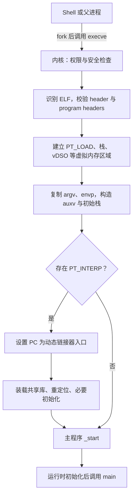

+++
date = '2026-10-28T20:00:00+08:00'
draft = false
title = '操作系统如何加载并启动一个程序：ELF 解析、内存映射、初始栈与第一条指令'
+++

在终端中执行 `./hello`，看起来像是“把程序加载进内存，然后 CPU 开始运行”。这句话并非错误，只是把许多关键步骤塞进了“加载”两个字里。内核既不会把整个文件复制到 CPU，也不会预先为程序申请一整块连续的 RAM；它创建的是一个带页表、虚拟内存映射、初始栈和寄存器状态的**进程执行上下文**。

本文以 Linux 上执行 ELF 程序为主线。PE/Windows、Mach-O/macOS 的格式与接口不同，但“验证格式 → 建立地址空间 → 准备初始状态 → 设置入口 PC → 进入用户态”的骨架相同。

先给出核心结论：**操作系统装载程序的产物不是一份已经完整拷贝进内存的文件，而是一个可以被 CPU 恢复和运行的进程映像。** CPU 之后从入口虚拟地址取指；需要的文件页若尚未在 RAM，再由缺页机制按需调入。

## 一、从 shell 到 `execve`：谁请求了装载

shell 执行外部命令时，常见模型是 `fork` 后由子进程调用 `execve`：

```text
shell
  ├─ fork()：得到子进程
  └─ 子进程 execve("/path/hello", argv, envp)
       └─ 当前子进程的旧程序映像被新程序映像替换
```

`execve` 接受可执行文件路径、参数向量 `argv` 和环境变量向量 `envp`。成功时它**不会返回**到调用点：进程 PID 通常不变，但原来的代码、数据、堆、用户栈和用户态映射会被新映像替换。只有文件不存在、权限不足或格式无效等失败情形，系统调用才会返回错误。

因此，`execve` 不是“创建进程”；它是“给当前进程换一套程序映像”。`fork + execve` 才是“创建子进程并让它运行另一个程序”的经典组合。加载器也并非毫无准备地接收任意文件，它首先要完成：

- 路径解析、文件存在性和执行权限检查；
- 参数与环境变量总大小的限制检查；
- set-user-ID / set-group-ID、挂载选项和 LSM 等安全策略检查；
- 文件开头识别和相应装载器选择；
- 新地址空间的数据结构准备。

脚本也可以被“执行”，但不是 CPU 直接执行脚本字符。内核识别 `#!/usr/bin/env python3` 这类 shebang 后，会把解释器作为真正要装载的程序，并重写参数，让解释器得到脚本路径。

## 二、内核怎样解析 ELF

ELF 是 Linux 和许多类 Unix 系统中常用的可执行文件、共享库与目标文件格式。可以先用工具观察一个二进制文件：

```bash
readelf -hW ./hello
readelf -lW ./hello
```

`readelf -h` 显示 ELF header；`readelf -l` 显示 program header table。对于运行时装载，**program header 比 section header 更关键**：编译器和链接器会关心 `.text`、`.data`、`.rela.dyn` 等 section，而内核主要依据 segment 建立映射，因为 segment 描述了哪些文件范围要以何种权限出现在虚拟地址空间。

### 1. ELF header：确认文件真的能在这里运行

ELF header 包含魔数、位数、字节序、目标机器架构、文件类型、入口地址，以及 program header table 的位置和大小。装载器至少会验证：

- 文件以 `0x7f 45 4c 46`，即 `\x7fELF` 开头；
- 32/64 位形式、字节序和目标 CPU 架构相容；
- program header table 的偏移、数量和大小没有越过文件边界；
- 文件类型为普通可执行文件 `ET_EXEC`，或可重定位装载的 `ET_DYN`。

这些检查当然不是多余的仪式。文件格式是来自磁盘的输入数据；若任意偏移、长度和权限都被盲目信任，错误文件就可能破坏内核或进程隔离。

### 2. `PT_LOAD`：将文件范围变成带权限的虚拟内存段

每个可装载的 `PT_LOAD` program header 大致给出以下关系：

| 字段 | 含义 | 装载时的用途 |
| ---- | ---- | ------------ |
| `p_offset` | 段在文件中的偏移 | 找到对应文件字节 |
| `p_vaddr` | 链接时指定的虚拟地址 | 确定映射位置 |
| `p_filesz` | 文件中实际存在的字节数 | 建立文件后备页范围 |
| `p_memsz` | 运行时应占用的内存大小 | 多出的部分逻辑上零初始化 |
| `p_flags` | `R`、`W`、`E/X` 权限 | 设置 VMA 和页表权限 |
| `p_align` | 对齐要求 | 保证文件页与虚拟页能正确对应 |

典型代码段是 `R E`，只读常量段是 `R`，可写数据段是 `R W`。如果 `p_memsz` 大于 `p_filesz`，差额就是未初始化全局变量所在的 `.bss`：文件中无需保存同等长度的零字节，内核会让其初值表现为零，并在第一次写入时按需得到可写物理页。

```text
PT_LOAD #1
  文件 [0x0000, 0x3000)  -> 虚拟地址 [0x400000, 0x403000)，R-X

PT_LOAD #2
  文件 [0x3000, 0x3800)  -> 虚拟地址 [0x403000, 0x403800)，RW-
  额外零填充             -> 虚拟地址 [0x403800, 0x404800)，RW-  (.bss)
```

请注意，这不是简单地将“文件偏移加上内存地址”。文件偏移由文件系统解释，虚拟地址由 CPU 和页表解释；program header 只是记录两套坐标之间的对应关系。

### 3. `PT_INTERP`：动态程序最先运行的为何不是应用代码

动态链接的 ELF 通常包含 `PT_INTERP`，其内容形如：

```text
/lib64/ld-linux-x86-64.so.2
```

它要求内核继续装载动态链接器。此时内核将用户态的初始 PC 设置为**动态链接器入口**，而不是直接进入主程序 ELF 的 `e_entry`。动态链接器会装载共享库、完成必要的重定位、建立线程本地存储并运行必要初始化，最后才跳转到主程序入口。内核通过 auxiliary vector 中的 `AT_ENTRY` 等信息，将主程序的入口信息交给它。

所以，动态程序中“ELF header 记录的应用入口”与“CPU 回到用户态后最先执行的地址”可能不同。静态链接程序没有这个中间人，通常直接从自身入口开始。

## 三、建立地址空间：映射先于复制

通过格式检查后，内核为该进程建立新的虚拟内存映像。典型 64 位进程可抽象为：

```text
高地址
┌─────────────────────────────┐
│ 内核映射（用户态不可访问）  │
├─────────────────────────────┤
│ 用户栈：参数、环境、auxv    │  向低地址增长
├─────────────────────────────┤
│ vDSO / vvar 等内核辅助映射  │
├─────────────────────────────┤
│ mmap 区：共享库、匿名映射等 │
├─────────────────────────────┤
│ 堆：`brk` 管理的增长区域    │  向高地址增长
├─────────────────────────────┤
│ .data / .bss：可写数据      │
├─────────────────────────────┤
│ .rodata：只读常量           │
├─────────────────────────────┤
│ .text：机器指令             │
└─────────────────────────────┘
低地址
```

布局不是固定比例尺；架构、链接方式、内核版本、资源限制和地址空间布局随机化（ASLR）都会改变具体地址。

### 1. VMA 与页表：先描述区域，再按需提供物理页

内核先为代码、数据、栈、共享库等范围建立虚拟内存区域（Linux 中常称 VMA），记录它的权限、范围和后备对象；页表则让具体虚拟页可被 MMU 翻译。两者必须区分：

- **VMA** 描述“一段地址允许怎样访问，以及由文件还是匿名内存支持”；
- **页表项** 描述“某个虚拟页当前是否驻留 RAM、映射到哪个物理页、可否读写执行”。

建立 `PT_LOAD` 映射不代表立刻把全部 `.text`、`.data` 读入物理内存。常见情况下，内核只建立文件后备映射；CPU 首次触及尚未驻留的页时，发生缺页异常，内核经页缓存、文件系统和块 I/O 把相应页读入 RAM，更新页表后重试访问。这就是**按需分页**。

因此，程序启动不必等待整个可执行文件进入 RAM，更不意味着它已经进入 CPU Cache。起步阶段只会装入入口路径实际触及的少量页。

### 2. 权限如何成为隔离边界

装载器把 `PT_LOAD` 权限落实到虚拟内存权限。代码页常不可写，数据页常不可执行；从不可执行页取指或向只读页写入，MMU 都会拒绝。这既是正确性约束，也是安全边界：只读代码页可在多个进程之间共享，可写私有页则借助私有映射、写时复制等机制维持隔离。

物理内存里的内容始终只是字节。“代码”和“数据”的区别来自文件格式、CPU 的访问方式和页权限，而不是某种神秘的物质属性。

### 3. ASLR、PIE 与装载基址

传统 `ET_EXEC` 的段位置较固定；位置无关可执行文件（PIE）常以 `ET_DYN` 出现，内核可以为其选择随机 load bias，共享库也会映射到随机位置。可粗略写成：

```text
运行时虚拟地址 = ELF 中的相对虚拟地址 + 本次装载基址
```

ASLR 让代码、库、栈和堆的位置难以被预先猜中。它不改变程序的相对布局，只要求装载器和动态链接器在需要处处理装载基址与重定位。

## 四、堆和栈是如何初始化的

“分配堆栈”容易让人想象内核一次申请两块固定大小的 RAM。更精确的说法是：内核建立可增长的虚拟地址区域和必要的初始内容；物理页通常在访问相应虚拟页时才分配或调入。

### 1. 初始用户栈：参数、环境和 auxv 的交接处

内核在用户地址空间高处建立栈映射，并复制 `execve` 获得的参数与环境变量字符串。随后它按 ABI 约定组织初始栈。以 Linux x86-64 为概念模型：

```text
高地址
  参数和环境变量的字符串内容
  随机字节、平台信息等辅助数据
  对齐填充
  auxiliary vector（auxv）键值对
  envp[] 指针数组，以 NULL 结束
  argv[] 指针数组，以 NULL 结束
  argc
低地址  <- 初始 RSP 指向附近
```

auxv 是内核交给 C 运行时和动态链接器的键值对，可包含页大小、程序头表位置、主程序入口 `AT_ENTRY`、随机数位置和 vDSO 地址等。不同 CPU 的精确寄存器与排列略有差异，但核心不变：启动代码从内核准备好的初始状态中取得参数和运行环境。

栈通常有保护页，并可在限制范围内向低地址扩展。递归过深或局部数组过大时，访问到不可扩展范围，便会得到 `SIGSEGV`。所谓栈溢出，本质上是触碰了无效或受保护的虚拟地址，而不是某个物理“栈盒子”突然装满。

### 2. 堆：设置起点，不是预付全部内存

可写数据与 `.bss` 之后通常是传统 `brk` 堆的起点。C 运行时的 `malloc` 可以推动 `brk` 扩大连续逻辑区域，也常通过 `mmap` 单独建立较大的映射。因此应区分：

- **堆**是动态分配器对应用交付内存时的抽象；
- `brk` 是相邻增长的虚拟地址边界；
- `mmap` 是另一条独立建立映射的途径；
- 两者的物理页都可能在首次访问后才实际兑现。

`malloc(1 GiB)` 成功并不必然表示已经立即占用 1 GiB RAM。内核的 overcommit 策略、映射类型和后续是否真正写入每一页都会影响结果；但这不是免费内存，真正触碰页面时仍可能遇到回收压力或 OOM。

### 3. 什么保留，什么重置

`execve` 替换的是程序映像，并非把进程的一切格式化：

| 项目 | `execve` 成功后的常见语义 |
| ---- | ------------------------- |
| PID、父子关系 | 通常保留同一个进程身份 |
| 代码、用户栈、堆、原用户映射 | 被新程序映像替换 |
| 文件描述符 | 通常保留；设置 `FD_CLOEXEC` 的会关闭 |
| 当前工作目录、根目录 | 通常保留 |
| 环境变量 | 由调用者传入的 `envp` 决定 |
| 信号处理器 | 多数自定义处理器恢复默认 |
| 凭据 | 可能受 set-user-ID、挂载与安全策略影响 |

多线程进程调用 `execve` 后，新程序只从调用线程延续，其他原线程不再以原样存在。这一边界与 `fork` 后、`exec` 前的多线程安全问题同样值得格外谨慎对待。

## 五、第一条指令地址如何设置

内存映射和初始栈准备完毕后，内核还要构造一个能够被调度器恢复的用户态寄存器上下文，其中最关键的是：

- **PC/IP**：下一条待取指令的用户虚拟地址；
- **SP/RSP**：指向 ABI 规定的初始用户栈；
- **处理器状态字**：进入用户态所需的权限状态；
- **页表根**：让 MMU 使用该进程的地址空间。

入口选择分为两种：

1. 静态链接程序：PC 通常设为主 ELF 的 `e_entry` 加上适用的装载偏移。
2. 动态链接程序：PC 先设为动态链接器入口；它完成共享库装载与重定位后，才跳转到主程序入口。

即使到了主程序入口，也通常还不是你写的 `main`。编译和链接阶段提供的启动代码通常叫 `_start`；它从初始栈取得 `argc`、`argv`、`envp` 和 auxv，完成 C 运行时初始化，调用必要的构造与初始化逻辑，最后才调用 `main`。因此，将 `main` 当成内核直接跳转的硬件入口，是把语言运行时边界误当成操作系统边界。



“设置 PC”不意味着内核已经同步执行完用户代码。`execve` 成功后，内核从系统调用返回路径恢复用户态，或稍后由调度器把任务切换到某个 CPU；CPU 加载该任务的页表根和寄存器上下文后，才尝试从 PC 指向的虚拟地址取指。

## 六、第一条机器指令如何真正到达 CPU

CPU 从 PC 取得的是**虚拟地址**。MMU 先查指令 TLB，未命中时遍历当前进程页表；若该页已存在并有执行权限，CPU 才能从内存层次取到机器码并送入取指、译码与执行流水线。

若入口页尚未驻留 RAM，就会发生文件缺页异常。内核确认该访问属于合法的可执行文件映射后，通过页缓存查找对应文件页；缓存未命中时，文件系统将文件偏移解析到设备块，块层和驱动发起 I/O，设备通常通过 DMA 将页写入 RAM。完成后内核更新页表，CPU 返回异常现场并**重试同一条取指**。

```text
PC（入口虚拟地址）
  -> ITLB / 页表翻译
  -> 页不在内存？文件缺页
  -> 页缓存 / 文件系统 / 块 I/O / DMA
  -> 建立可执行页表项
  -> 重试取指
  -> 指令 Cache、译码、执行
```

这解释了两个事实：按需装载不需要预读整个可执行文件；多个进程运行同一未改动程序时，可以共享只读代码页，而栈、堆和私有可写数据保持各自独立。

## 七、用工具对照真实程序

下面命令能验证文章中的关键对象。输出随发行版、编译选项和 ASLR 状态变化，应关注结构而不要死记某个地址。

```bash
# 文件类型、入口地址和可装载段
readelf -hW ./hello
readelf -lW ./hello

# 动态链接器与共享库
readelf -lW ./hello | grep INTERP
ldd ./hello

# 观察运行中进程的实际映射
./hello &
pid=$!
cat /proc/$pid/maps
wait $pid
```

`/proc/<pid>/maps` 中通常能看到可执行文件的 `r-xp`、可写数据的 `rw-p`、`[heap]`、共享库、`[vvar]`、`[vdso]` 和 `[stack]`。短命令可能在读取前已经退出；可让示例程序等待输入，或改用长时间运行的程序。

还可以查看入口附近的反汇编：

```bash
readelf -hW ./hello | grep 'Entry point'
objdump -d ./hello | less
```

入口附近通常是 `_start` 或与之关联的启动桩。动态程序在那之前还可能首先进入动态链接器；显然，事情并不会因为我们习惯从 `main` 开始阅读源码，就体贴地从 `main` 开始发生。

## 八、常见误解

### 1. “内核会把整个可执行文件读进内存”

不必然。内核先建立文件后备映射，实际页面可在首次取指或访问时才经缺页装入。预读和页缓存会影响细节，但“映射先于完整复制”才是主线。

### 2. “堆和栈启动时就各占固定大小的物理内存”

不准确。它们首先是虚拟地址空间中的区域；栈可按规则扩展，堆可借 `brk` 或 `mmap` 扩大，物理页通常按需兑现。保护页和资源限制决定何时不能继续增长。

### 3. “ELF section 就是内核的装载单位”

不准确。section 主要服务于编译、链接、调试和分析；内核运行时主要依据 program header 中的 `PT_LOAD` 等 segment。一个 segment 可以覆盖多个 section。

### 4. “入口地址就是 `main` 的地址”

通常不是。入口多是 `_start`；动态链接时，最先执行的还可能是动态链接器。`main` 是 C/C++ 运行时调用的应用级入口，而不是内核唯一直接跳转的地址。

### 5. “ELF 里的地址就是物理地址”

不是。`p_offset` 是文件坐标，`p_vaddr` 是进程虚拟地址，物理地址由当时的页表和驻留页决定。PIE、ASLR、共享映射与换页都会让“固定物理地址”的想象失效。

## 九、总结

一次 Linux ELF 程序启动可按以下顺序理解：

1. 调用者通过 `execve` 交付路径、`argv` 与 `envp`；成功后当前进程获得新程序映像。
2. 内核验证文件、权限和安全策略，识别 ELF，并根据 program header 建立 `PT_LOAD` 映射。
3. 新地址空间包含代码、数据、`.bss`、栈、动态链接器与辅助映射；它们拥有不同的权限和后备来源。
4. 内核在初始栈放入 `argc`、`argv`、`envp` 与 auxv；堆只有起点与可增长的地址空间，并不会无条件预占全部物理页。
5. 内核构造用户态寄存器上下文，把 PC 设为程序入口或动态链接器入口，把 SP 设为初始栈位置。
6. 任务被调度运行后，CPU 依据页表从入口虚拟地址取指；若页不在 RAM，先按需分页和文件 I/O，再重试取指。
7. 动态链接器和 `_start` 完成运行时工作，最终才调用 `main`。

以后再遇到“程序装载到哪里了”这类问题，不妨先问清楚它指的是文件偏移、ELF 段、虚拟地址区域、已驻留物理页，还是 CPU 当前的 PC。将这几个对象分开，装载过程就不再是黑箱，只是一条分工明确的协作链路而已。

如需复习虚拟地址、页表、页缓存与文件缺页的基础，可从本课程的[地址、文件与设备：三套抽象如何协作](01-addresses-files-and-devices.md)开始阅读；想单独深入 ELF 中的地址记录与入口含义，可阅读[ELF 中记录的是什么地址：文件偏移、虚拟地址、页表与程序入口]()。
