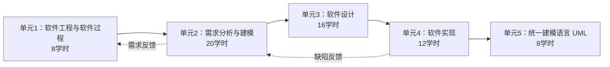

+++
date = '2026-11-25T09:00:00+08:00'
draft = false
title = '软件工程课程导读：从过程模型到 UML 综合建模'
+++
《软件工程》不是“把程序写出来”这件事的放大版，而是一门研究**如何认识问题、组织开发、控制质量并交付可维护软件**的工程课程。它承接 Java 程序设计和计算机操作实习中已经接触过的编程、算法与小项目经验，继续回答三个问题：项目应该怎样推进，需求怎样被准确表达，设计和实现怎样被验证。

本系列严格按课程的五个教学单元组织，共 64 学时。每篇文章都围绕一个可以交付、检查或复用的工程产物展开，读者应当在学完后能够把自然语言需求逐步转换为需求模型、设计模型、程序和测试证据，而不是只记住若干名词。课程结束后，这些基础会继续支撑软件体系结构、需求分析与建模、软件测试技术等后续课程。

## 一、课程目标与学习成果

| 课程目标 | 学习重点 | 学完后的可观察成果 |
| -------- | -------- | ------------------ |
| 目标 1 | 软件危机、软件工程概念、生命周期与过程模型 | 能解释软件危机的原因，比较瀑布、原型、增量、螺旋和喷泉模型，并为项目选择过程模型 |
| 目标 2 | 结构化需求分析、面向对象分析、需求规格与 UML | 能与用户澄清需求，建立 DFD、数据字典、E-R 图、状态模型、对象/动态/功能模型，并写出可验证的需求规格 |
| 目标 3 | 结构化设计、面向对象设计、实现与测试 | 能从分析模型得到软件结构，完成算法和接口设计，编写规范代码，设计测试用例并调试 |

课程目标还要求工程决策考虑社会、健康、安全、法律和文化因素。例如，借阅系统不能只讨论“能否借书”，还要说明个人信息访问权限、借阅记录保留、无障碍使用和异常责任边界。这些因素不是额外的口号，而是需求、设计和验收条件的一部分。

## 二、课程目标与毕业要求的支撑

课程目标与毕业要求的对应关系决定了学习时不能只记定义，还要能完成分析、设计和工程决策：

| 毕业要求 | 指标点 | 主要支撑课程目标 | 强度 / 建议占比 |
| -------- | ------ | ---------------- | --------------- |
| 3 设计/开发解决方案 | 3.1 掌握复杂工程问题的设计开发方法和技术，并了解影响方案的各种因素 | 目标 3 | H / 50%–60% |
| 6 工程与社会 | 6.2 评价工程实践对社会、健康、安全、法律和文化的影响并理解责任 | 目标 2 | M / 20%–25% |
| 11 项目管理 | 11.1 理解系统设计开发生命周期及项目管理和经济决策的一般方法 | 目标 1 | H / 20%–25% |

因此，文章中的需求模型会讨论隐私、权限、可访问性和责任边界；设计与实现会比较方案、接口和质量属性；过程模型会说明生命周期、评审、变更和资源约束。

## 三、五个教学单元的路线

| 单元 | 学时 | 课程目标 | 教学方式 | 本系列对应文章 | 主要产物 |
| ---- | ---- | -------- | -------- | -------------- | -------- |
| 软件工程与软件过程 | 8 | 1 | 课堂讲授、案例教学 | 01、02 | 生命周期任务表、过程模型选择依据 |
| 软件需求分析与建模 | 20 | 2 | 课堂讲授、案例教学 | 03、04、05 | 需求陈述、SRS、DFD、数据字典、E-R 图、状态图、对象/动态/功能模型 |
| 软件设计 | 16 | 3 | 课堂讲授、案例教学 | 06、07、08 | 模块结构图、接口说明、流程图、N-S 图、PDL、类与子系统设计 |
| 软件实现 | 12 | 3 | 课堂讲授、案例教学 | 09、10 | 编码规范、代码评审记录、测试策略、测试用例、缺陷报告 |
| UML | 8 | 2、3 | 课堂讲授、案例教学 | 11、12 | 用例图、类图、顺序图、状态图、活动图、构件图和部署图 |
| 综合练习 | — | 案例复盘 | 13 | 从需求到设计和测试的完整案例 |

总学时为 64 学时，全部为讲授，实验（上机）为 0 学时。案例练习用于课堂分析和课后复盘，不改变课程的学时构成。

“项目管理”和“维护”会作为过程选择、实现控制和综合案例中的工程约束穿插说明；它们服务于本课程的目标，不会取代五个教学单元的主线。

## 四、贯穿案例：图书借阅系统

后续文章使用同一个小型案例，避免每篇都重新学习业务背景：

> 读者提交借书或还书请求，管理员可以代办。系统验证读者资格、借阅上限、欠费和图书库存；借阅成功后登记记录并更新副本状态。还书时计算逾期罚金。读者可以查询借阅状态，管理员可以维护图书资料并生成统计报表。

同一个需求会在不同阶段呈现为不同模型：需求分析阶段关注“有哪些数据和业务规则”，设计阶段关注“如何分解模块和对象”，实现阶段关注“怎样编码并验证”，UML 阶段则用统一符号表达系统的静态、动态和物理视图。**模型不同，不代表需求不同**；它们必须保持术语、边界和约束的一致。

## 五、建议的学习方式

1. 先读 00 篇，明确每个单元的任务和产物，再按文件名顺序学习。
2. 每学一个模型，都用贯穿案例画一遍，并写出“该模型不表达什么”。例如 DFD 不表达控制时序，流程图不表达数据存储关系。
3. 设计阶段保留从需求到模块、从模块到测试的追踪关系；发现矛盾时回到需求，而不是用代码掩盖歧义。
4. 最后完成 13 篇综合案例，检查是否同时覆盖课程目标 1、2、3，以及安全、法律和文化等工程约束。

读完本系列，至少应能回答：软件危机为什么需要工程化过程；一个需求如何被建模和验证；分析模型如何转化为设计和代码；测试如何提供证据；UML 如何把这些视图统一起来。这才是本课程要求掌握的“过程、工具、方法和项目管理”能力。
