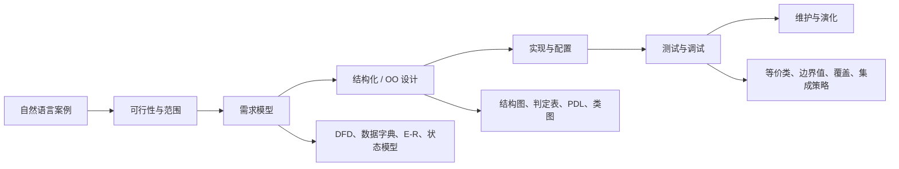

+++
date = '2026-11-20T09:00:00+08:00'
draft = false
title = '软件工程考试教程：从画对数据流图到完成案例设计'
math = true
+++

软件工程考试并不主要考察“团队里应该勤于沟通”这类没有可判定边界的经验话。真正容易形成大题的，是把一段自然语言需求转换为可检查的模型：数据流图（DFD）、数据字典、E-R 图、状态图、模块结构图、判定表、测试用例、网络计划图，以及由这些模型导出的设计结论。

本课程以教材中常见的**传统生命周期、结构化方法、面向对象方法、测试维护和项目管理**为骨架，但会把篇幅放在可得分的分析和设计动作上。你最终应能做到：看到案例先识别外部实体、处理和数据存储；画出的上下文图与分层 DFD 保持平衡；从 DFD 导出模块；针对边界、条件组合和路径给出测试；计算 CPM/PERT、成本效益和基本规模估算。

## 一、课程的总路线

不要把这张图理解成绝对单向的瀑布。需求变更会回到前面的模型，测试缺陷也会暴露需求遗漏。不过，考试题通常要求你在某个阶段给出一个明确产物，因此必须先知道每个阶段“交付什么”。

| 阶段 | 核心问题 | 常见可评分产物 |
| ---- | -------- | -------------- |
| 可行性研究 | 值不值得做、能否做 | 成本—效益、风险、候选方案 |
| 需求分析 | 系统必须做什么 | DFD、数据字典、E-R 图、规格说明 |
| 总体设计 | 怎样划分系统 | 模块结构图、体系结构、数据库方案 |
| 详细设计 | 模块内部怎样做 | 判定表、判定树、流程图、PDL |
| 测试 | 如何证明或发现问题 | 用例、覆盖率、桩模块、驱动模块 |
| 管理 | 何时完成、投入多少 | WBS、Gantt、PERT/CPM、风险表 |

## 二、一套贯穿案例：图书借阅系统

后续多数文章使用下面的题干。它足够小，能在考场上画完；又覆盖了借阅、归还、预约、罚款、报表等常见信息系统元素。

> 读者持读者证借书。管理员录入读者编号和图书编号，系统验证读者资格和图书库存；若可借，则登记借阅记录、减少可借册数并打印借书凭条。还书时，系统依据借阅记录计算逾期天数和罚金，更新库存和借阅记录。读者可查询自己的借阅与预约状态；管理员按月取得借阅统计报表。

题干里每一个动词都不是同一种模型元素：

- “读者”“管理员”是**外部实体**；他们在系统边界外。
- “验证”“登记”“计算”“更新”“生成”通常是**处理**；处理必须有数据输入或输出，不能只是名词。
- “读者资料”“图书库存”“借阅记录”是**数据存储**；它们保存数据，不主动执行逻辑。
- “读者编号”“借书请求”“借书凭条”“月报”是**数据流**；名称应是数据名词，而非“处理借书”。

这套分类是结构化分析最重要的第一步。若一开始把“图书库存”画成处理，后面无论箭头画得多漂亮，答案也只是被精致包装的错误。

## 三、考试作答的一般顺序

面对长案例，推荐在草稿上按以下顺序拆解：

1. 画系统边界，列出系统外的人员、组织或相邻系统。
2. 圈出进入或离开系统的信息，先写数据流名称。
3. 找出会转换数据、做判断或更新状态的动词短语，形成处理。
4. 找出需要长期保留且会被多次读取/写入的数据集合，形成数据存储。
5. 先完成顶层 DFD，再逐层分解；每次分解都检查输入输出是否守恒。
6. 对每条模糊的数据流在数据字典中定义组成、来源、去向、取值限制。
7. 从业务规则中选出条件组合，使用判定表；从状态变化中选出状态图；从实体关系中画 E-R 图。
8. 最后才进入模块划分、测试用例和工期计算。直接跳到代码或类图，通常只是把尚未理解的需求藏了起来。

## 四、学习与复盘方式

每篇文章有“经典题型”和“作答检查”。建议先遮住答案，自己画一遍，再核对以下问题：

- DFD 是否出现了外部实体到数据存储的直接连线、数据存储之间的直接连线，或“黑洞处理”（有输入无输出）？
- 下层图的输入输出，是否与被分解的父处理完全一致？
- 图中的每个数据流、数据存储和处理，是否都能在文字定义中找到？
- 设计模块之间传递的是数据，还是不恰当地共享了全局控制细节？
- 测试数据是否覆盖了“刚好在边界上”的值，而非仅给出一个正常例子？

从下一篇开始，课程按照考试常见的生命周期顺序展开。先建立总体框架是必要的；否则 DFD、判定表和测试技术会像一串孤立术语，记得再多也无法在案例题中拼成答案。

