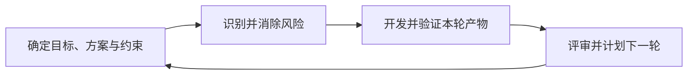

+++
date = '2026-11-20T09:01:00+08:00'
draft = false
title = '软件工程概述：软件危机、生命周期与过程模型'
+++

软件工程是用系统化、规范化、可度量的方法开发、运行和维护软件。这里的关键词不是“写程序”，而是**在约束下交付可维护的软件产品及其过程产物**。需求规格、设计文档、测试报告、配置基线都属于软件工程的工作成果；只交付可执行文件，通常无法支撑后续变更。

## 一、软件危机与软件工程的目标

软件危机表现为项目延期、超支、质量低、难维护以及需求变更后失控。它的直接原因常包括规模增大、需求不清、缺乏过程控制和文档，但不要把它误答成“程序员不够努力”。软件工程以过程、方法和工具协同应对：过程规定阶段和产物，方法规定分析/设计/测试如何进行，工具辅助建模、构建、测试和配置管理。

常考的软件质量属性如下：

| 属性 | 含义 | 题目中的线索 |
| ---- | ---- | ------------ |
| 正确性 | 满足已说明的需求 | 结果是否符合业务规则 |
| 可靠性 | 在规定条件下持续正确运行 | 故障率、平均无故障时间 |
| 效率 | 使用时间、空间、网络等资源的程度 | 响应时间、吞吐量、内存限制 |
| 完整性 | 防止未授权访问或修改 | 权限、审计、加密 |
| 可维护性 | 易于定位、修改和验证 | 模块独立、文档、低耦合 |
| 可移植性 | 易迁移到其他环境 | 平台、数据库、浏览器差异 |

“系统能在 2 秒内返回查询结果”是可验证的性能需求；“界面友好、运行稳定”若没有可度量标准，仍是模糊表达。需求阶段应该把后一类话继续追问成可验收条件。

## 二、生命周期与过程模型

### 1. 瀑布模型

瀑布模型将工作依次组织为可行性、需求、设计、实现、测试、运行维护。优点是阶段边界和文档清楚，适合需求相对稳定、合规要求强的项目；缺点是用户较晚才能看到可运行系统，需求变化的回退成本高。

考试中的陷阱是把瀑布理解为“前一阶段永不返回”。实际模型允许反馈，只是后期反馈代价更高。它强调的是**阶段化控制**，不是禁止修改。

### 2. 原型模型

原型用于澄清不确定需求，特别是用户界面、交互流程和新技术可行性。演化型原型逐步发展为最终产品；抛弃型原型只用于学习和确认需求。经典判断题常问：原型的首要目的不是快速交付正式系统，而是降低需求理解风险。

### 3. 增量、迭代与螺旋模型

增量模型每次交付一组可用功能，先交付核心能力；迭代模型在多轮反馈中改进已有产物。螺旋模型每一圈依次确定目标与约束、分析风险、开发验证、计划下一轮，因此其核心是**风险驱动**，而不是画成螺旋形的瀑布。



### 4. 喷泉模型与敏捷方法

面向对象活动常迭代、交叉、反复，因此喷泉模型以“喷泉”描述分析、设计、实现之间的迭代和无间隙。敏捷开发强调短迭代、可运行软件、频繁反馈和持续协作，但它不意味着不要设计、不写测试或不留任何文档。题干若强调“需求频繁变更、每两周反馈、持续交付”，优先考虑敏捷/迭代；若强调“高风险的新技术、每轮先做风险分析”，优先考虑螺旋。

## 三、统一过程与阶段产物

无论名称如何变化，考试需要你区分“做什么”与“产出什么”：

```text
可行性研究 -> 可行性报告、候选方案
需求分析   -> SRS、DFD、数据字典、E-R 图
总体设计   -> 总体结构、模块结构图、数据库/接口设计
详细设计   -> 流程图、判定表、判定树、PDL
编码       -> 源程序、构建脚本、代码说明
测试       -> 测试计划、用例、缺陷报告、测试报告
维护       -> 变更申请、版本、维护记录
```

注意 DFD 描述的是**逻辑功能和数据变换**，并不规定“使用 Java”“数据库表有几张”“模块部署在哪台服务器”。这些属于后续设计或实现决策。把逻辑模型提前写成技术方案，是案例分析题中非常常见的层次错误。

## 四、经典选择题辨析

1. “为了尽快让用户确认报表格式，先制作可点击界面。”答案倾向原型法，目的为需求确认。
2. “每轮先评估支付接口不确定性和法规风险，再决定是否投入开发。”答案是螺旋模型的风险分析。
3. “需求在合同签订后不得变化。”这不是瀑布模型的定义，只是一种不现实的管理约束；瀑布允许受控变更。
4. “敏捷开发不需要文档。”错误。敏捷只反对没有价值的过量文档，验收条件、接口契约和关键设计记录仍然必要。
5. “软件质量仅由测试保证。”错误。质量在需求、设计、实现、评审和测试中共同构建；测试只能发现缺陷，不能证明不存在全部缺陷。

## 五、作答检查

- 过程模型题先找题干中的不确定性来源：需求、技术、风险还是交付节奏。
- 质量属性题先问“评价的对象是什么”：功能正确、连续运行、资源占用、安全边界还是修改成本。
- 阶段产物题不要把 DFD、结构图和流程图混用：它们分别服务于需求、总体设计和详细设计。

这些基础概念本身不难。难的是在一段看似平常的项目描述中，准确挑出它指向的过程问题；概念的边界一旦清楚，选择题自然失去装腔作势的空间。
