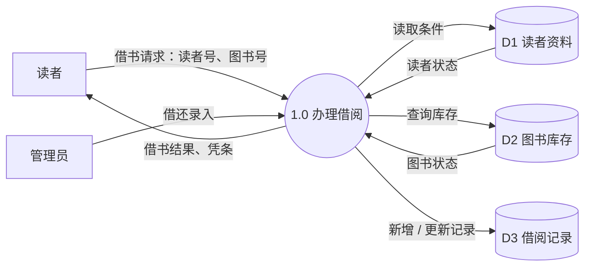
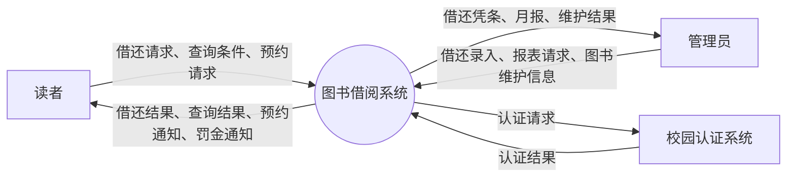
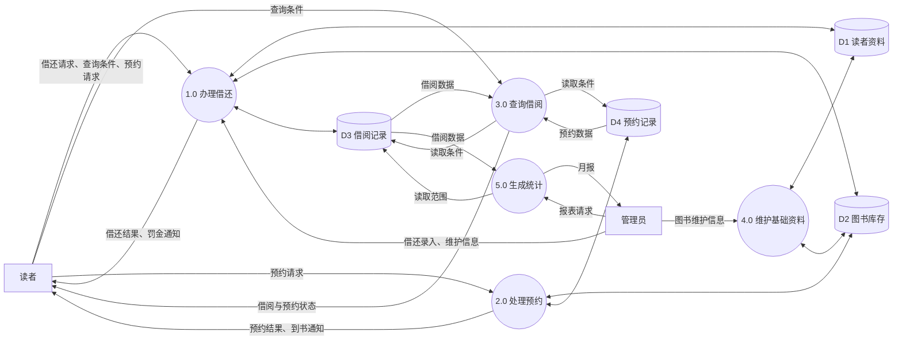
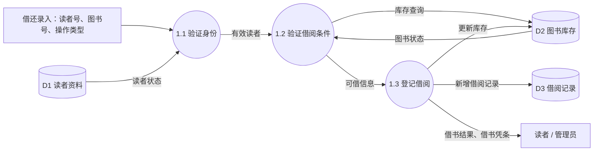

+++
date = '2026-11-20T09:03:00+08:00'
draft = false
title = '需求分析与数据流图：从自然语言题干画出平衡的分层 DFD'
+++

数据流图（Data Flow Diagram，DFD）是结构化分析的核心工具。它从**数据如何进入系统、被哪些处理转换、存入何处、输出给谁**的角度描述逻辑需求。它不表现时间先后、循环次数、程序模块、数据库表字段或 UI 页面；这些分别有状态图、流程图、结构图、E-R 图和界面原型来承担。先把一种图能表达什么说清楚，才不会把所有符号塞进同一张图里。

## 一、DFD 的四种元素与命名

传统 DFD 的符号可能随教材使用圆形、圆角矩形、开口矩形而略有差异，但语义稳定：

| 元素 | 含义 | 规范命名 | 图书系统示例 |
| ---- | ---- | -------- | ------------ |
| 外部实体 | 系统边界之外的数据源或终点 | 名词 | 读者、管理员、校园认证系统 |
| 处理 | 将输入数据转换为输出数据的逻辑活动 | 动宾短语 | 验证借阅资格、登记借阅 |
| 数据流 | 在实体、处理、存储之间移动的数据 | 名词短语 | 借书请求、资格结果、借阅记录 |
| 数据存储 | 被系统保存、可被处理读取或写入的数据集合 | 名词 | D1 读者资料、D2 图书库存 |

下面的 Mermaid 图用于阅读；在纸笔考试中请按试卷指定的 DFD 图形符号绘制。箭头文字是数据流，方括号表示外部实体，圆柱近似表示数据存储。



图中“办理借阅”是处理；“图书库存”是存储；“查询库存”是数据流。把箭头写成“查询”也并非绝对错误，但它遮蔽了传递的数据内容。考试中优先写“查询条件”“库存状态”等名词，答案更清楚。

## 二、从题干抽取 DFD：五步法

以课程导读的借阅题干为例：

1. **定边界**：本系统内部包含借还、预约、查询和报表；读者、管理员、认证系统在边界外。
2. **列输入输出**：借书请求、还书信息、查询条件进入；借书凭条、罚金通知、查询结果、月报离开。
3. **列持久数据**：读者资料、图书库存、借阅记录、预约记录、罚款记录。
4. **找数据变换**：办理借阅、办理归还、处理预约、查询借阅、生成统计。
5. **按层次组织**：先画上下文图，再画 0 层图；只对复杂处理继续分解为 1 层图。

这是一种分析顺序，不是格式主义。没有边界，外部实体会无限膨胀；没有数据流，处理只是一些好听的功能名；没有数据存储，又无法解释状态为何能跨一次请求保存。

## 三、上下文图：整个系统只有一个处理

上下文图（也称顶层图）把系统视为唯一处理，只表现它与外部实体的数据交换。**上下文图通常不画内部数据存储和内部处理**，因为那些属于下一层。



画完先做一项机械但关键的检查：把系统圆外的每一种输入和输出列成清单。后面的 0 层图必须仍能在系统边界上看到这些数据流，名称可分拆或合并，但不能凭空消失。

## 四、0 层图：把系统分解为主要处理

0 层图是对上下文图中“图书借阅系统”的分解。它显示主要处理和数据存储。为保持图的可读性，以下图用 `1.0` 至 `5.0` 编号；编号表示分解关系，不表示执行顺序或优先级。



真实答卷不必把每一条双向访问画成双向箭头；常用做法是分成“查询条件”和“资料/记录”，明确读取与写入。上图只是为了压缩版面。更重要的是，不允许以下直接连接：

```text
外部实体 <-> 数据存储        错：外部实体必须经过处理
数据存储 <-> 数据存储        错：数据移动/转换由处理完成
外部实体 <-> 外部实体        通常不属于本系统的数据加工
处理只有输入没有输出        黑洞（black hole）
处理只有输出没有输入        奇迹（miracle）
处理输入明显不足以产生输出  灰洞（gray hole）
```

## 五、1 层图与平衡原则

若把 `1.0 办理借还`继续分解，则子图可有 `1.1 验证身份`、`1.2 验证借阅条件`、`1.3 登记借阅`、`1.4 办理归还与罚款`。父处理对外的输入输出是它的接口；子图可以加入内部数据流和内部存储访问，但**穿过子图边界的净输入输出必须与父处理一致**，这叫平衡（balancing）。



如果父图的 `1.0` 接收“借还录入”、输出“借还结果”，而子图突然向读者输出“预约通知”，且父图没有这条输出，子图就不平衡。除非说明该通知是父图数据流的细分，否则必须回到父图补充接口。

平衡检查可写成一个集合比较：

```text
父处理的外部输入集合 = 子图跨边界输入集合
父处理的外部输出集合 = 子图跨边界输出集合
```

名称允许从“借还请求”分解为“读者号”“图书号”“操作类型”，但其组合必须仍表达同一信息。不能借“分解”之名加入一个未在父层出现的新外部业务。

## 六、经典 DFD 案例题

题干：某培训机构接收学员报名表。系统核验课程是否开班、名额是否已满；符合条件则生成缴费通知，并在缴费确认后登记报名。教务员维护课程和开班计划，财务系统返回缴费结果。

先给出元素清单：

| 类别 | 识别结果 |
| ---- | -------- |
| 外部实体 | 学员、教务员、财务系统 |
| 处理 | 受理报名、确认缴费、维护课程、生成名册 |
| 数据存储 | 课程计划、报名记录、缴费状态 |
| 主要流 | 报名表、课程状态、缴费通知、缴费结果、报名确认、课程维护信息 |

0 层图至少应让“受理报名”读取课程计划、写入待缴费报名；“确认缴费”接收财务系统缴费结果并更新报名记录；“维护课程”由教务员输入更新课程计划。若把财务系统画成“缴费状态数据存储”，就错在它是边界外的另一个系统，而不是本系统能直接管理的文件。

## 七、画图前后的检查清单

- 每个处理是否至少有一个输入和一个输出？输出是否能由输入加上已读取存储合理产生？
- 每个数据存储是否至少与一个处理相连？孤立存储通常说明遗漏。
- 是否把“读者”“管理员”画成数据流，或把“借书请求”画成实体？
- 上下文图只有一个系统处理吗？0 层图是否保留所有对外输入输出？
- 处理编号是否遵循层次：`1.0` 分解为 `1.1`、`1.2`，而非随意跳成 `6.0`？

DFD 的重点从来不是把箭头画得密集。它要求每条箭头能回答“什么数据从哪里来、经过何种转换、到哪里去”。能够稳定回答这三个问题，面对换成医院、仓库、订票或工资系统的案例，也只是在替换业务名词，并没有换掉分析方法。

