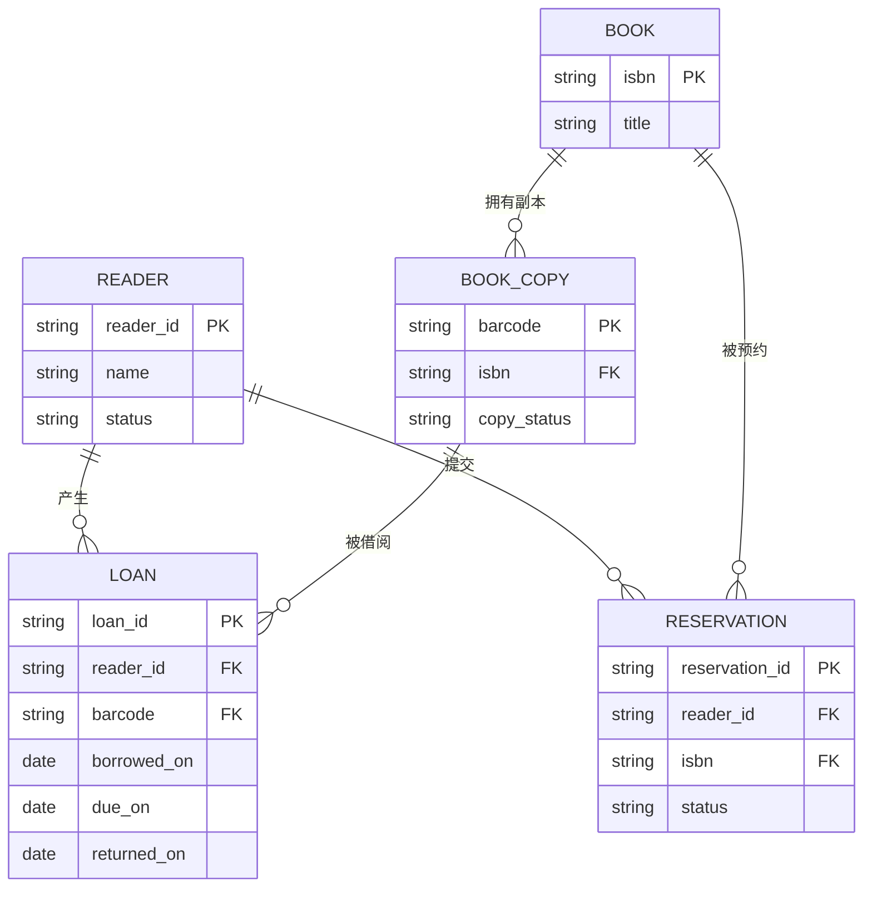
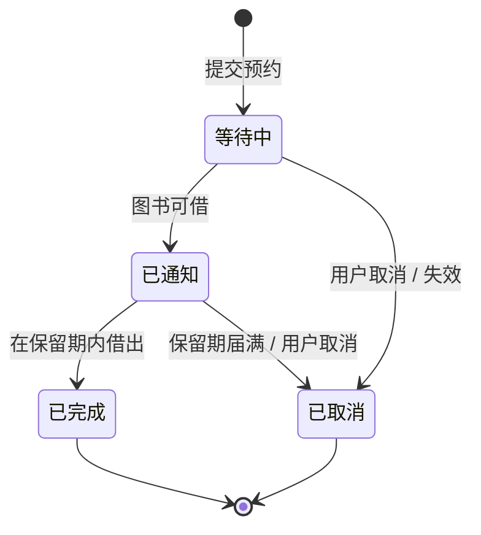

+++
date = '2026-11-20T09:04:00+08:00'
draft = false
title = '需求规格补全：数据字典、E-R 图、状态图与一致性检查'
+++

DFD 擅长说明数据在系统中的流动，却没有精确定义数据的内部组成，也不擅长表示实体之间的基数关系和对象状态变化。因此，结构化需求分析不能只交一张 DFD；它需要数据字典、E-R 图、状态转换图和必要的处理说明相互约束。它们不是互相替代的画图题，而是从不同角度描述同一份需求。

## 一、数据字典：给 DFD 中的名字下定义

数据字典（Data Dictionary，DD）记录数据流、数据存储、数据项和处理的定义。教材常使用以下记号：

| 记号 | 含义 | 示例 |
| ---- | ---- | ---- |
| `=` | 由……组成 | `借书请求 = 读者号 + 图书号 + 借书日期` |
| `+` | 顺序连接 | `姓名 + 手机号` |
| `[]` | 可选 | `读者资料 = 读者号 + 姓名 + [邮箱]` |
| `{}` | 重复 | `借阅清单 = {借阅条目}` |
| `()` | 任选其一 | `证件类型 = (身份证号 \| 校园卡号)` |
| `..` | 值范围 | `罚金金额 = 0..9999.99` |

不同教材的符号可能略有区别，试卷若给出记法应服从题目；但定义必须清楚表达结构、类型、取值范围和业务约束。

### 1. 一份可用于答题的定义

```text
数据流名称：借书请求
别名：借阅申请
组成：读者号 + 图书条码 + 借书日期
来源：读者 / 管理员
去向：1.0 办理借还
说明：一次请求只对应一册图书；借书日期为系统受理日期。

数据存储名称：D3 借阅记录
组成：{借阅记录}
借阅记录 = 借阅号 + 读者号 + 图书条码 + 借出日期 + 应还日期
           + [归还日期] + 状态 + 罚金金额
主键：借阅号
约束：状态 ∈ {借出, 已还, 遗失处理}；归还日期仅在已还时存在。
```

“借阅记录包含读者信息”这种描述过于宽泛，无法用于数据库设计、接口校验或测试。相反，明确字段和约束可以立即导出：缺少图书条码应拒绝请求，状态为“借出”的记录不应已有归还日期。

### 2. 数据字典与 DFD 的一致性

DFD 出现的每个非平凡数据流和数据存储都应在 DD 中有定义；DD 中定义的数据流也应能在 DFD 找到来源和去向。若 DFD 写“读者信息”，DD 却只定义“读者号”，说明粒度不一致。可以把“读者信息”定义为一个复合项，也可以在图上改用更准确的“读者号”。

## 二、E-R 图：描述长期保存的业务事实

实体—联系图（E-R 图）描述实体、属性及实体间联系。它关心的是“谁和谁有什么稳定关系”，而不是数据在某次操作中如何流动。对于图书系统，读者、图书副本、借阅记录、预约记录都是候选实体。



### 1. 基数与联系属性

“一名读者可以有多条借阅记录，一条借阅记录只属于一名读者”是 `1:N`。读者与图书若直接看，可能是 `M:N`：一名读者可借多本书，一本书在不同时间可被多位读者借。将联系提升为“借阅记录”实体后，借出日期、应还日期、归还日期等**属于这一次联系本身**的属性就有了位置。

经典错误有两个：

- 将“当前借阅者”直接放在图书实体中，导致无法保存历史借阅，也难表示多册副本。
- 把“借阅日期”放在读者或图书实体中。它属于读者与图书副本的一次借阅联系，应放在借阅记录中。

### 2. 弱实体与主键

弱实体自身的属性不足以唯一标识它，需要依赖拥有者的主键。例如订单项可用“订单号 + 行号”唯一标识，行号离开订单没有独立含义。答题时要说明：部分键是什么，依赖哪个强实体，识别联系的基数是多少。不要因为实体名里有“明细”就机械判为弱实体，判断依据是标识依赖。

## 三、状态图：描述对象生命周期

DFD 不擅长表示“同一个对象在不同阶段允许什么操作”。当题干出现申请、审核、支付、取消、挂起、归还等状态词时，应考虑状态模型。以预约记录为例：



状态图必须写清楚触发事件，必要时写守卫条件和动作。例如“已通知 --[保留期未过] / 创建借阅记录--> 已完成”。如果仅画一串圆圈写“等待、通知、完成”，却没有事件和约束，就无法回答“何时可以转移”。

## 四、需求验证：让模型互相挑错

完成模型后，以同一个规则做交叉验证。例如规则：“读者欠费超过 20 元不得借书。”

- DFD：`验证借阅条件`必须能获得读者欠费信息，并将拒绝结果输出。
- DD：读者资料或罚款记录中必须定义欠费金额，且金额范围非负。
- E-R：罚款若需要逐笔审计，应建为与借阅记录相关的实体，而不是只保留一个不可追溯的总额。
- 状态图：拒绝借书不会把图书副本状态改为借出。
- 测试：应包含 `19.99`、`20.00`、`20.01` 以及金额缺失的边界和异常用例。

这里的 `超过 20` 意味着 `20.00` 仍可借，`20.01` 不可借；若业务希望“达到或超过”，自然语言必须改写。很多所谓代码缺陷，其实是这种未明确的需求边界。

## 五、经典题型：由业务规则选择工具

| 题干线索 | 首选模型 | 原因 |
| -------- | -------- | ---- |
| “数据由哪些字段组成、可以重复几次” | 数据字典 | 精确定义结构与取值 |
| “学生、课程、选课成绩之间如何关联” | E-R 图 | 强调实体和联系基数 |
| “订单经过待支付、已支付、取消、退款” | 状态图 | 强调生命周期与事件 |
| “申请从谁来、经过何处理、写入何处” | DFD | 强调数据流与功能变换 |

能够正确选择模型，往往已经完成案例题最难的一半。再复杂的系统也逃不过数据定义、事实关系、状态约束和数据变换这几种基本问题；把它们混作一张无所不能的图，才会让需求分析变成无法评分的涂鸦。

