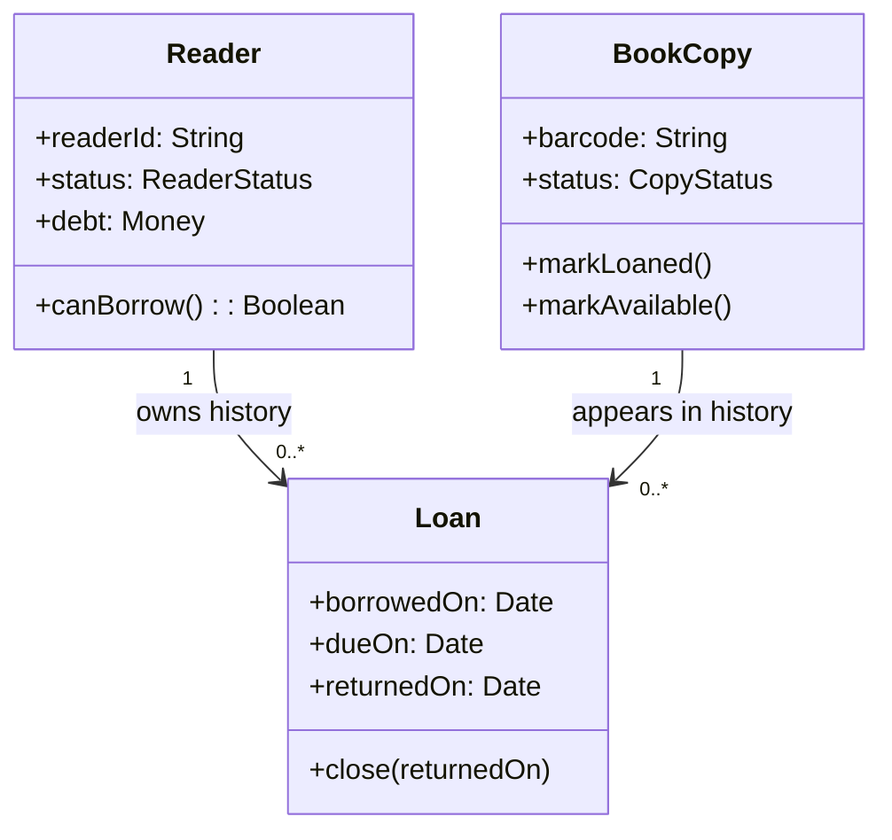
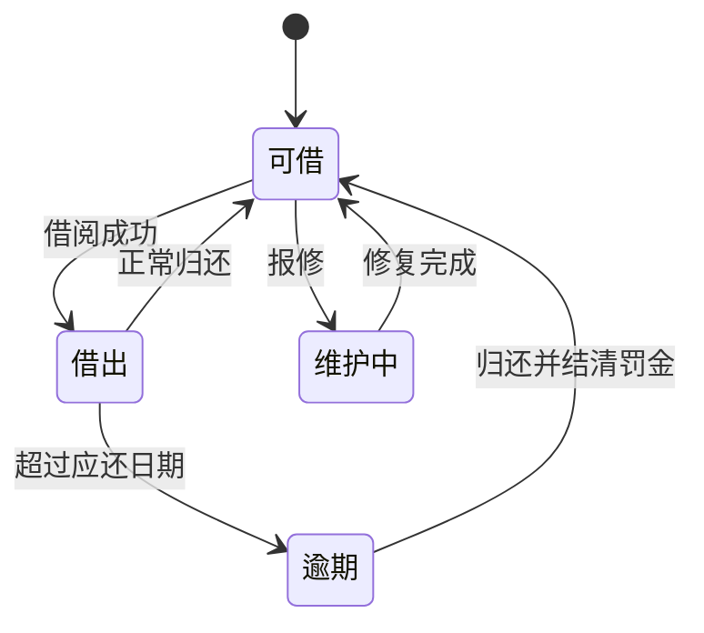
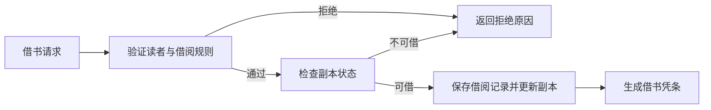

+++
date = '2026-11-25T09:05:00+08:00'
draft = false
title = '面向对象分析：从需求陈述建立对象、动态与功能模型'
+++
面向对象分析（OOA）不是把结构化分析中的每个处理改名为“类”，而是从用户目标和领域概念出发，识别具有状态、行为和协作关系的对象。课程要求建立三种互补模型：**对象模型**说明系统中有哪些对象及其静态关系，**动态模型**说明对象如何响应事件和改变状态，**功能模型**说明输入如何经过处理产生输出。

## 一、从需求陈述识别对象

需求陈述应先写成用户可理解的目标和约束。例如：

> 读者提交借书请求。系统确认读者状态、借阅上限和欠费，检查副本是否可借；条件满足时创建借阅记录并把副本标记为已借出，否则返回明确的拒绝原因。

可按下面的顺序提取候选概念：

1. 圈出长期存在、需要保存身份和属性的名词，如读者、副本、借阅记录。
2. 圈出描述责任或业务规则的动词，如确认、检查、创建、标记。
3. 判断每个候选概念是对象、属性、操作、外部参与者还是仅仅是描述性词语。
4. 为每个对象补充边界：它拥有哪些数据，负责哪些行为，和谁协作。

“借阅日期”通常是 `借阅记录` 的属性，“借阅”是读者与副本之间有生命周期的关系；不能因为名词出现在句子里，就机械地把它们都建成同等重要的类。

## 二、对象模型：静态结构与关系

对象模型通常用类图表示。类应包含有意义的属性和服务，关联要标明方向、角色和多重性；继承只在“是一个”且子类型能够遵守父类型契约时使用。

多重性是需求约束的可视化表达：一位读者可以有零到多条历史借阅，一条借阅记录只指向一个读者和一个副本。若业务规定“同一副本同一时刻最多存在一条未归还记录”，还要把这条不变式写入需求规格或约束说明，不能只依赖图形让读者猜。

## 三、动态模型：事件、状态与场景

动态模型关注“什么时候发生什么”。对象状态图适合描述一个对象的生命周期；顺序图适合描述一个场景中对象之间的消息顺序。

状态转换必须由事件或条件触发，并说明动作和守卫。例如“借阅成功”不是用户点击按钮，而是资格、库存和事务保存均成功后的业务事件。动态模型应覆盖异常路径：身份无效时，读者和副本状态都不应改变。

## 四、功能模型：输入、处理与输出

功能模型可以用活动图、数据流图或带有处理说明的功能分解表示。它回答的是“系统对数据做什么”，与对象模型回答的“谁拥有数据和行为”互相补充。

功能模型中的每个处理都应能追溯到需求陈述；对象模型中的服务也应能在某个功能或场景中找到调用来源。若模型之间出现同名概念却含义不同，应回到术语表和数据字典统一命名。

## 五、三种模型如何相互校验

| 检查关系 | 要问的问题 | 发现的典型问题 |
| -------- | ---------- | -------------- |
| 对象 ↔ 功能 | 每个处理需要哪个对象负责？ | 处理没有数据归属，或出现“万能服务类” |
| 对象 ↔ 动态 | 对象有哪些状态，谁触发转换？ | 类图没有状态属性，顺序图修改了无关对象 |
| 功能 ↔ 动态 | 每个事件是否带来明确输入、输出或状态变化？ | 只画成功流程，遗漏拒绝和恢复路径 |
| 三者 ↔ 需求规格 | 术语、约束、参与者是否一致？ | 图能画出来，但无法验收或测试 |

需求陈述中还要标注社会与工程约束：例如借阅记录的访问角色、个人信息的最小化展示、审计日志的保留期限和无障碍界面要求。这些约束可能表现为对象属性、状态守卫、功能规则或非功能需求，不能被排除在模型之外。

## 六、面向对象分析的常见误区

- 把数据库表直接当作最终类，忽略领域行为和对象生命周期。
- 把每个名词都建成类，把每个动词都建成方法，却没有说明职责和协作。
- 只画成功场景，不说明拒绝、并发、异常和回滚时的状态。
- 让类图、状态图、DFD 使用同一术语却给出不同定义。

完成 OOA 后，应该能交付一份包含需求陈述、对象模型、动态模型、功能模型和术语定义的分析模型。下一单元会在此基础上决定模块、接口、算法和人机交互，而不是重新猜测需求。
