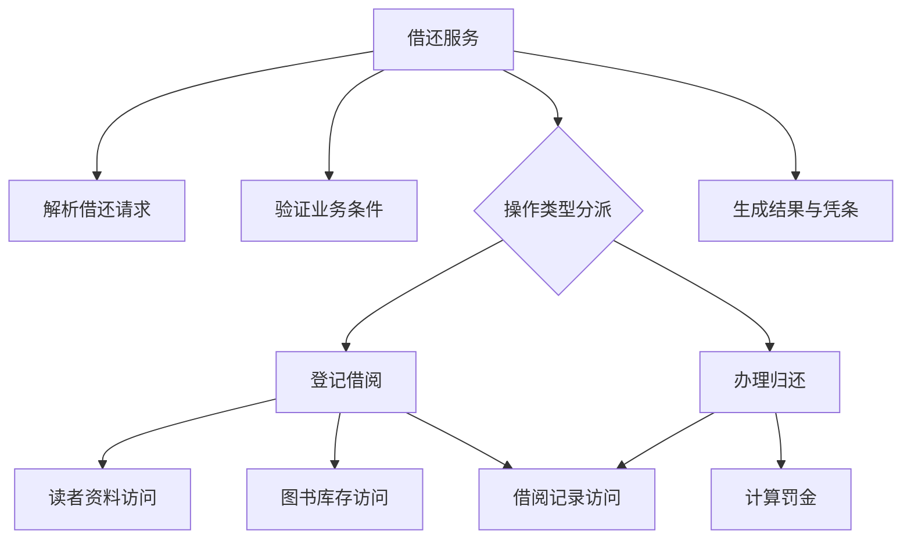

+++
date = '2026-11-20T09:06:00+08:00'
draft = false
title = '总体设计：从 DFD 变换到模块结构图、耦合与内聚'
+++

总体设计把“系统必须完成哪些数据变换”转化为“系统由哪些模块协作完成”。DFD 是需求分析的逻辑模型，模块结构图（Structure Chart）是设计模型；两者有关联，却绝不能把 DFD 中每一个圆照抄成一个程序模块。设计要进一步考虑控制层次、数据边界、复用和变更影响。

## 一、总体设计的主要产物

- 系统分解与模块结构图：谁调用谁、传递什么数据或控制信息。
- 数据设计：逻辑数据模型到表、文件、索引、访问策略的映射。
- 接口设计：外部接口、模块接口、错误和权限契约。
- 部署与安全设计：关键运行约束、备份、权限和故障边界。

本篇重点是经典的结构化设计：从 DFD 的变换流或事务流导出模块结构。

## 二、变换流与事务流

**变换流**中，输入数据经过输入、变换中心、输出三个区域逐步被转换。例如“借书请求 → 格式校验 → 业务规则判断 → 更新记录 → 打印凭条”。

```text
输入流                 变换中心                     输出流
借书请求 -> 解析请求 -> 验证资格与库存 -> 登记借阅 -> 借书凭条
```

**事务流**中，一个事务到达后由中心处理识别类型，再分派到若干动作路径。例如“管理员提交业务请求”可能分派为借书、还书、预约或报表。分派中心不应承揽每种业务细节，而应路由给对应事务模块。

```text
业务请求 -> 事务中心
              ├─ 借书事务 -> 借书处理路径
              ├─ 还书事务 -> 还书处理路径
              ├─ 预约事务 -> 预约处理路径
              └─ 报表事务 -> 报表处理路径
```

选择错误的分析类型会导致结构混乱：把事务流硬当作一条变换流，常产生巨大的条件分支模块；把连续转换硬拆成大量调度模块，则增加无意义控制层。

## 三、从 DFD 到结构图的步骤

以 `1.0 办理借还`为例，可按如下过程设计：

1. 找出输入、变换中心、输出，或找出事务中心和分派路径。
2. 建立顶层控制模块，例如 `借还服务`。
3. 为输入、核心变换、输出建立下属模块，如 `解析请求`、`校验条件`、`登记借阅`、`生成凭条`。
4. 逐层细化，直到每个模块职责明确、接口可定义。
5. 检查每个模块是否必须知道过多其他模块或数据结构细节；若是，重划边界。



这张图使用调用关系近似表示结构图。传统结构图还可画出数据耦合箭头、控制耦合箭头和重复调用标记；答卷应遵循课程要求的符号。本图要表达的核心是：`借还服务`协调，数据访问被封装在访问模块中，借书和还书各自处理自己的业务变化。

## 四、模块独立性：高内聚、低耦合

### 1. 内聚：一个模块内部为何放在一起

内聚通常由弱到强可大致排列为：偶然内聚、逻辑内聚、时间内聚、过程内聚、通信内聚、顺序内聚、功能内聚。不同教材对顺序略有表述差异，但结论一致：**功能内聚最好**，即模块只完成一个明确功能，所有语句共同服务于它。

- 偶然内聚：把“打印凭条、删除读者、备份数据库”塞进“工具类”，没有共同理由。
- 逻辑内聚：一个“处理输入”模块靠参数决定处理键盘、鼠标或扫码器；相关但要靠控制标志选择。
- 通信内聚：多个操作处理同一读者资料。
- 顺序内聚：前一步输出是后一步输入，如“解析 → 校验 → 标准化”。
- 功能内聚：`计算逾期罚金`只负责根据规则计算罚金。

### 2. 耦合：模块之间依赖了多少细节

耦合通常由强到弱包括内容耦合、公共耦合、外部耦合、控制耦合、标记耦合、数据耦合。理想目标是数据耦合：模块仅通过必要、明确的数据参数通信。

| 情况 | 评价 | 改进 |
| ---- | ---- | ---- |
| A 直接修改 B 的局部数据或跳入 B 内部 | 内容耦合，最差 | 公开稳定接口，禁止跨模块改内部状态 |
| 多个模块读写全局 `currentReader` | 公共耦合 | 传递必要参数或封装状态对象 |
| A 传 `mode=7` 控制 B 执行完全不同流程 | 控制耦合 | 拆分操作接口或使用清晰的命令对象 |
| A 传整个巨大记录，B 只用其中一个字段 | 标记耦合 | 传递 B 真正需要的数据 |
| A 向 B 传 `readerId`、`bookId` | 数据耦合，较好 | 保持参数语义明确 |

低耦合不是“模块越多越好”。若把一次原子业务拆成几十个只转发参数的空壳，调用链反而难以理解。划分的标准是职责、变化原因和接口边界，而不是模块数量。

## 五、经典设计题：改造一个坏结构

坏设计：`LibraryManager` 读取 HTTP 请求、校验身份、拼 SQL、计算罚金、写文件、渲染 HTML、发送短信。这个类同时因接口、权限、数据结构、罚金规则、展示样式和通知渠道的变化而改变，属于低内聚的“上帝模块”。

一种结构化改造：

```text
借还应用服务
├─ 请求适配器：解析输入、返回响应
├─ 借阅规则服务：资格、上限、欠费、库存判断
├─ 借阅记录服务：创建/更新借阅事实
├─ 罚金策略：按期限和规则计算金额
├─ 资料访问模块：读者、图书、借阅记录的持久化访问
└─ 通知模块：生成凭条、发送到期/罚金通知
```

这里并不是为了追逐某个框架名词，而是把变化原因隔开：罚金规则变了不应迫使改 SQL；换短信供应商不应影响借阅资格判断。

## 六、总体设计自检

- 控制模块是否只协调下属模块，而没有把全部业务细节塞在自己内部？
- 模块接口是否只传递完成职责所需的数据？
- 是否存在循环调用、共享可变全局数据或跨模块访问内部数据？
- DFD 中每个关键业务处理是否在设计中有明确承担者？
- 异常、权限、事务和并发约束是否在接口与数据设计中被说明？

从 DFD 导出结构图的过程，实质是把“数据怎样变换”翻译成“谁负责哪一段变换”。这一步的质量决定了将来修改一项规则是局部手术，还是牵动整套系统；后者并不会因为它最初画得很快而变得可取。

