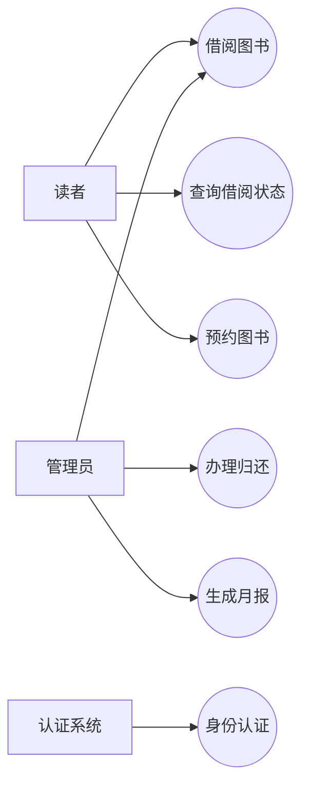
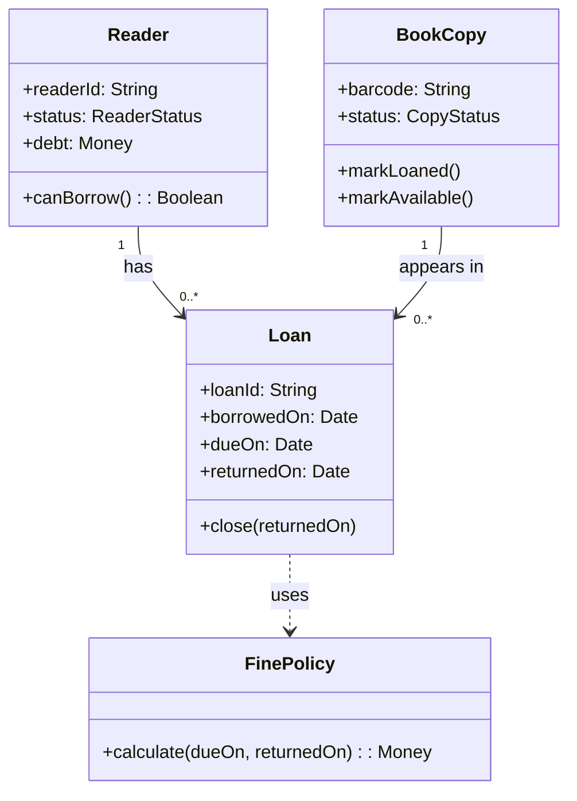
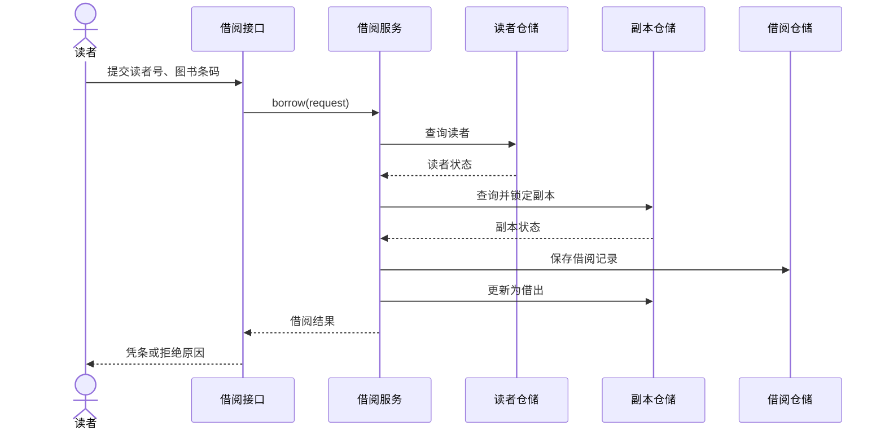

+++
date = '2026-11-20T09:08:00+08:00'
draft = false
title = '面向对象分析与设计：用例、类图、顺序图、状态与设计原则'
+++

结构化分析以数据流为中心，面向对象方法则把系统看成相互协作、封装状态和行为的对象。二者并不互相否定：信息系统既可以有 DFD，也可以在后续采用用例和类来设计。考试中重要的是知道每种图回答的问题，不要把“面向对象”误写成“所有东西都是类”。

## 一、从用例识别系统边界

用例描述参与者为了达到目标与系统发生的可观测交互。用例图用于建立范围，不表现完整的算法顺序。



“读者”与“管理员”是参与者，不是系统内部类；“借阅图书”是用例，不应画成 `BorrowService`。若存在“续借”一定先包含身份认证，可将其作为 `<<include>>`；若“逾期时可能计算罚金”是基用例的条件扩展，可使用 `<<extend>>`。二者区别在于包含是每次必经的复用步骤，扩展是在条件满足时附加行为。

### 用例规约比用例图更能得分

以“借阅图书”为例：

```text
主参与者：读者（管理员可代办）
前置条件：读者已认证；图书副本已登记。
触发器：提交读者号和图书条码。
基本流程：系统校验资格与库存；创建借阅记录；更新副本状态；返回凭条。
备选流程：身份无效、超过上限、欠费超限、图书不可借时，拒绝且不更新记录。
后置条件：成功时存在一条借出状态的记录，副本不可借；失败时持久状态不改变。
```

前置、后置和异常流清楚后，测试用例已有了基本来源。

## 二、分析类、设计类与类图

分析阶段可先识别边界类（界面/API）、控制类（协调用例）和实体类（持久业务概念）；设计阶段再细化接口、仓储和策略。名词是候选类而非必然类：`借阅日期`更像属性，`借阅记录`才是包含身份和生命周期的实体。



关联端的 `1`、`0..*` 是多重性：一条 `Loan` 对应一个读者和一个副本；读者历史上可有零到多条借阅。继承应表示“是一个”的稳定替代关系，例如 `StudentReader is a Reader`；若只是“使用某种规则”，通常应使用关联或依赖，而非为了复用代码强行继承。

## 三、顺序图：谁在何时协作

顺序图特别适合描述一个用例的消息次序。它强调对象交互，不能替代包含状态、持久化约束的类图。



注意“查询并锁定副本”的设计意图：并发下两个请求若都读到“可借”，可能重复借出同一副本。UML 图不自动解决并发问题，但它能迫使设计者写出需要协调的动作和责任边界。

## 四、设计原则的考试化表述

| 原则 | 简明含义 | 反例 |
| ---- | -------- | ---- |
| 单一职责 SRP | 一个模块因一种主要原因变化 | 类同时处理借阅规则、SQL、HTML、短信 |
| 开闭原则 OCP | 对扩展开放，对修改尽量封闭 | 每增加罚金规则都修改一串 `if` |
| 里氏替换 LSP | 子类型应可替换父类型且不破坏约定 | 子类拒绝父类承诺的正常操作 |
| 接口隔离 ISP | 客户端不依赖不需要的方法 | 一个巨型接口强迫只读客户端实现写方法 |
| 依赖倒置 DIP | 高层依赖抽象，不直接依赖具体细节 | 业务服务直接 `new MySqlConnection` |

这些原则不是要求把每个类拆成一个接口。适当抽象的判断依据是变化方向和替换需求；没有变化可能性的简单类，堆叠模式只会增加阅读成本。

## 五、OO 分析题的常见错误

- 把数据库表名不加分析直接变成类，忽略行为和聚合边界。
- 把所有动词变成类，如 `Borrow`、`Validate`、`Print`，却没有说明状态和职责；动词更常提示方法、用例或服务。
- 用类图表达运行顺序，或用顺序图表达长期多重性。
- 忽视异常流。只有“成功借书”的顺序图，不能说明拒绝时状态如何保持不变。

面向对象方法的核心不是画 UML 图，而是把变化封装在拥有相关状态和行为的对象中，并通过清晰协作完成用例。图只是让这种划分可讨论、可验证的语言；若图不能回答谁拥有数据、谁做决定、失败后状态怎样，它就还没有完成设计职责。

