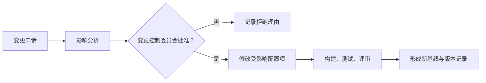

+++
date = '2026-11-20T09:09:00+08:00'
draft = false
title = '软件实现：编程语言、编码规范、评审与配置管理'
+++

实现阶段要把设计结果翻译为可运行、可测试、可维护的程序。课程要求同时掌握编程语言选择、程序设计风格、编码规范、评审、配置管理和变更追踪。代码能运行只是起点；还必须能说明它满足哪条需求、遵循哪个接口、如何被构建和验证。

## 一、编程语言的选择依据

语言选择应由问题约束决定，而不是由个人熟悉度决定。可以比较以下因素：

- 领域与运行环境：是否需要与 JVM、浏览器、嵌入式设备或既有系统集成；
- 类型系统、并发模型、内存管理和生态：是否能降低特定类别的缺陷；
- 团队能力、工具链、部署成本和长期维护能力；
- 安全、性能、可移植性和法规要求。

例如，课程中的借阅系统可以使用 Java 实现业务服务，但这并不意味着需求分析阶段就应把“读者”写成 Java 类。实现决策要保持对分析模型的追踪，并在接口层隔离语言和框架细节。

## 一、实现应保持与设计一致

好的编码实践可以简洁概括为：模块接口清晰、命名表达业务语义、错误路径显式、输入在边界校验、持久化操作具有一致性、测试可重复执行。它们不是一份风格偏好清单，而是降低错误传播和维护成本的机制。

以借阅操作为例，不能只因前端隐藏了“借出”按钮就省略服务端资格校验；外部请求、脚本调用或并发请求都可能绕过界面。界面校验改善体验，服务端校验维护业务不变式，二者职责不同。

## 二、编码规范与实现质量

规范至少应覆盖命名、格式、异常处理、日志、资源释放、输入校验、事务边界和测试命名。业务不变式必须在服务端再次验证，不能只依赖界面按钮是否显示。例如前端隐藏“借出”按钮只能改善体验，服务端仍需检查读者资格、库存和权限。

实现者还应避免把长方法、重复条件和隐式全局状态带入代码。每个模块应有清晰输入、输出和失败契约；外部依赖通过接口注入，便于替换和测试。

## 三、技术评审与走查

| 方式 | 特征 | 适用目标 |
| ---- | ---- | -------- |
| 非正式评审 | 同事快速阅读与讨论 | 早期发现明显问题 |
| 走查 Walkthrough | 作者主讲，团队按场景推演 | 理解逻辑、收集改进意见 |
| 审查 Inspection | 有角色、入口准则、缺陷记录和跟踪 | 系统性发现文档/代码缺陷 |
| 静态分析 | 工具不执行程序即检查 | 类型、空指针、规范、安全模式 |

评审不等于“找作者的错”。高质量审查聚焦产物与清单：需求是否可测、数据字典是否遗漏、接口异常是否定义、边界值是否一致、资源是否释放。评审发现的缺陷越早，返工通常越少；这是前移质量活动的经济理由。

## 四、配置项、基线与版本

配置项（Configuration Item，CI）是需要受控管理的产物，例如需求规格、DFD、数据库脚本、源代码、构建配置、测试用例、部署清单。**基线**是经过正式评审批准、可作为后续工作基础的版本；建立基线并不意味着永远不可改，而是后续修改必须通过变更控制。

影响分析至少要追踪：某条“罚金阈值由 20 改为 10”的需求，影响需求规格、判定表、罚金策略、API 返回信息、测试边界数据、用户说明和可能的数据迁移。只改代码不改用例和文档，会使后续维护者在旧规则下继续工作。

## 五、版本控制回答什么问题

版本控制不只是备份文件。它应支持：

- 给出某一发布版本所含的完整配置项集合；
- 比较两个版本有哪些差异，并能追溯变更原因；
- 在并行开发时处理分支与合并；
- 将缺陷、需求、提交、构建和测试结果关联起来；
- 必要时重建历史版本，而不是依赖某台机器上的“final-final-真的最终版”。

考试中若问“配置状态报告”的内容，可答：当前配置项状态、版本、已批准/已实现的变更、偏差和构建状态。若问“配置审计”，则强调核实实际产物是否符合配置记录和批准的需求。

## 六、变更控制案例

变更：学校将读者最大借阅册数从统一 10 本调整为“本科生 10、本科毕业生 15、教师 20”。

影响分析应包含：

1. 数据模型：读者类别和类别—上限规则的存储位置。
2. 需求与 DD：`允许上限`由常量变为依据类别确定的值。
3. 判定表/PDL：条件由 `loanCount >= 10` 改为 `loanCount >= limit(reader.type)`。
4. 代码与接口：资格服务的规则实现、管理端维护权限。
5. 测试：三类读者的 9/10/11、14/15/16、19/20/21 等边界用例。
6. 数据迁移：已有读者类别缺失时的默认和校验策略。

这正是配置管理比“记住 Git 命令”更重要的原因：它管理的是变更对整个产品集合的影响，而不是某个文件的保存时间。

## 七、实现阶段检查清单

- 需求编号是否能追溯到设计、代码提交和测试用例？
- 可执行构建是否依赖未记录的本地环境、秘密配置或人工步骤？
- 错误处理是否保留了业务状态一致性，而非仅打印日志后继续？
- 评审缺陷是否有关闭标准与复验记录？
- 发布的版本是否可由受控配置项重建？

实现是让设计落地的阶段，不是让设计消失的阶段。没有配置和评审约束，系统也许能在今天运行，却无法回答明天的变更为何发生、影响何处以及哪个版本可靠；这类“能跑”并不值得作为工程结论。
