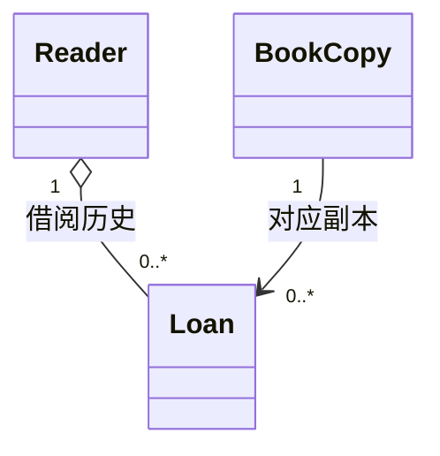
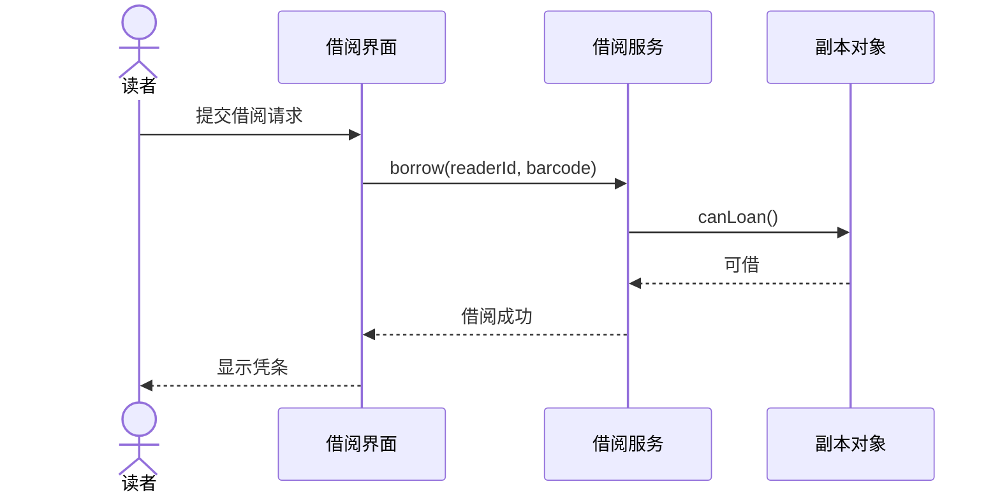

+++
date = '2026-11-25T09:11:00+08:00'
draft = false
title = 'UML 统一建模语言：用静态与动态视图表达系统'
+++
UML（Unified Modeling Language，统一建模语言）是一套用于可视化、说明、构造和文档化软件系统的标准建模语言。它不是生命周期模型，也不是某种编程语言；UML 的价值在于让需求、分析、设计、实现和评审使用一套可沟通的符号。

## 一、先按视图选择图

不要为了“画 UML”而把所有图都画一遍。应先问当前要表达什么：

| 关注点 | 常用图 | 回答的问题 |
| ------ | ------ | ---------- |
| 用户目标与系统边界 | 用例图 | 谁使用系统，系统提供哪些服务 |
| 静态结构 | 类图、对象图、包图 | 有哪些类/对象，它们如何关联 |
| 行为与交互 | 顺序图、通信图、状态机图、活动图 | 消息如何流动，状态如何转换，流程如何分支 |
| 物理实现 | 构件图、部署图 | 软件构件和运行节点如何组织 |

同一需求可以有多个互补视图，但每张图都应有明确目的、范围和读者。图中的名称、角色、多重性和约束必须与需求规格一致。

## 二、静态建模机制

类图是静态建模的核心。类名、属性、操作、关联、聚合/组合、泛化和依赖分别表达不同语义。

聚合与组合不能只凭图标装饰：组合表示部件生命周期依赖整体，整体删除时部件通常不能独立存在；普通关联只表示对象之间存在关系。若业务没有明确生命周期约束，宁可使用普通关联，也不要滥用组合。

包图可以按领域、界面、应用服务和基础设施组织模型，帮助发现循环依赖。对象图则展示某一时刻的实例和链接，适合用来检查类图多重性是否能解释具体场景。

## 三、动态建模机制

顺序图按时间从上到下描述参与者和对象之间的消息；活动图描述控制流、并行和条件分支；状态机图描述一个对象在事件作用下的状态变化。

图中应同时考虑失败分支和并发约束。例如副本不可借时服务应返回原因且不创建记录；两个请求同时到达时，设计还要说明锁定、版本检查或其他一致性策略。UML 能暴露交互责任，但不会自动证明实现正确。

## 四、模型的一致性与追踪

可以建立简单的追踪矩阵：

| 需求 | 用例 | 类/操作 | 动态场景 | 测试 |
| ---- | ---- | ------- | -------- | ---- |
| 借阅资格校验 | 借阅图书 | `Reader.canBorrow`、`BorrowingService.borrow` | 借阅成功/拒绝 | T1–T6 |
| 副本状态更新 | 借阅图书 | `BookCopy.markLoaned` | 可借→借出 | 状态一致性测试 |

如果某条需求没有对应的模型元素或测试，就需要补充；如果某个类或消息没有需求来源，也应说明它是实现约束还是多余设计。追踪关系可以放在建模工具、需求管理系统或普通文档中，关键是可维护和可审查。

UML 的学习重点不是记住全部图形，而是知道每种图的语义边界，并能在软件生命周期中选择合适的图表达问题。下一篇继续讨论物理架构、UML 的扩展和建模实践。
