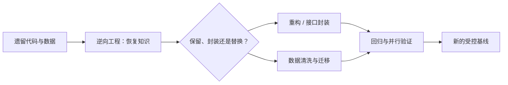

+++
date = '2026-11-20T09:11:00+08:00'
draft = false
title = '软件维护、可靠性与演化：纠错、适应、完善和预防'
math = true
+++

软件交付并不是生命周期的终点。运行环境会变化，法规和业务规则会变化，用户会提出新需求，早期遗漏的缺陷也会显现。维护阶段处理这些变化；它不是“修几个 bug”的同义词，而是系统演化的受控过程。

## 一、四类维护必须会区分

| 类型 | 目的 | 图书系统示例 |
| ---- | ---- | ------------ |
| 改正性维护 Corrective | 修复已发现的缺陷 | 逾期第 8 天罚金算错 |
| 适应性维护 Adaptive | 适配外部环境变化 | 校园认证协议升级、浏览器/数据库版本变化 |
| 完善性维护 Perfective | 改进功能、性能或可用性 | 新增读者自助续借和统计筛选 |
| 预防性维护 Preventive | 降低未来维护风险 | 重构重复规则、补测试、清理废弃依赖 |

“为适应新的税率规则修改计算逻辑”属于适应性维护；“用户希望报表导出 Excel”属于完善性维护；“没有故障但重构巨型模块以防未来修改出错”属于预防性维护。题目往往用这些语义，而不直接给出类别名称。

## 二、维护过程与影响分析

维护应从变更申请开始：记录问题或需求 → 理解现有系统 → 分析影响和成本 → 批准 → 修改 → 回归测试 → 更新文档和配置基线。跳过理解与影响分析，直接在生产代码中“改一行试试”，会把局部变化扩散成隐蔽故障。

例如把罚金阈值从 20 改成 10，影响的不只是比较表达式，还可能影响 DD、判定表、前端提示、管理员配置、测试数据、报表解释和读者通知。若系统没有追溯关系，维护者只能靠搜索和运气；后者不属于可复用的方法。

## 三、可靠性、可用性与安全性

可靠性是软件在规定条件和规定时间内无故障运行的概率或能力。可用性还考虑故障后的恢复，常用稳态近似为：

$$
A = \frac{MTTF}{MTTF + MTTR}
$$

其中 MTTF 是平均无故障时间，MTTR 是平均修复时间。若 MTTF 为 99 小时、MTTR 为 1 小时，则可用性约为 99%。提高可用性既可以提高 MTTF（减少故障），也可以降低 MTTR（监控、自动恢复、清晰运行手册）。

可靠性不等同于安全性：系统可能很少崩溃，却存在越权读取读者信息的漏洞；也可能安全控制很严格，却因频繁超时而不可用。题目描述“未授权访问”“篡改”“审计”时，优先讨论安全属性而不是可靠性。

### 可靠性增长的直观含义

在相同测试条件下，随着缺陷被发现并正确修复，单位时间失效次数通常应下降，这称为可靠性增长。前提很重要：新增功能、环境变化或错误修复本身引入新缺陷，都可能让曲线反弹。因此“修复次数越多，可靠性必然单调增加”不是严谨结论。

## 四、遗留系统与再工程

遗留系统不等于“很旧且必须重写”。它可能承载关键业务数据和规则，替换风险很高。再工程可包括逆向工程（从代码/数据库恢复设计理解）、重构（不改变外部可观察行为地改善结构）、数据再工程（清洗迁移数据）和正向工程（在理解后重新构建）。

直接“大爆炸重写”看似干净，却容易丢失多年沉淀的边界规则。更稳妥的做法是先建立现有行为的测试基线，逐步替换或封装，并在新旧系统间核对关键结果。是否重写取决于维护成本、业务风险、技术可行性和迁移能力，而非代码年龄。

## 五、经典维护案例

问题：系统每逢闰年 2 月末会将应还日期算错。修复不能仅加一个特殊 `if` 后上线，应回答：

1. 这是改正性维护，因为它修复既有功能缺陷。
2. 影响范围包括日期计算模块、借阅与续借流程、罚金计算、历史数据显示和相关测试。
3. 应添加平年/闰年、月末、跨年、时区等回归用例。
4. 若日期规则散落在多个模块，应将它收敛为明确的日期策略，这是预防性改进。
5. 应更新版本记录和缺陷关联，确保以后可追溯修复引入的行为变化。

## 六、维护阶段检查清单

- 变更属于修缺陷、适应环境、增加价值还是预防风险？
- 修改是否有可复现的问题说明、影响分析和批准记录？
- 是否验证了既有关键行为仍成立，即完成回归测试？
- 设计、测试和运维文档是否随代码更新？
- 可用性指标中的 MTTF、MTTR 是否被正确理解，而非把它们都说成“故障次数”？

软件能够被维护，不是因为维护者足够勇敢，而是因为前期需求、设计、测试和配置留下了足够可信的线索。工程活动之间的关系到这里才完全显现：早期省下的一页说明，往往会在维护时变成数天的猜测。

