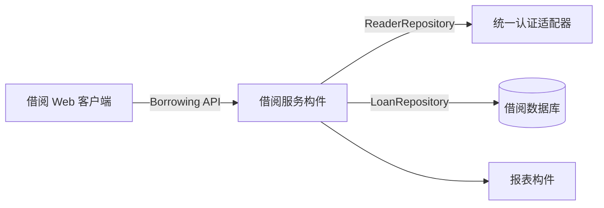
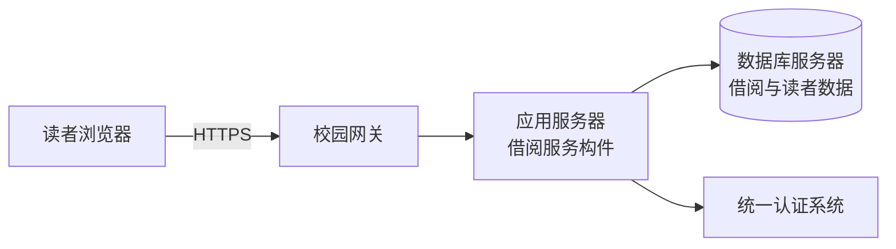

+++
date = '2026-11-25T09:12:00+08:00'
draft = false
title = 'UML 架构建模与扩展：构件、部署、用例关系与工程权衡'
+++
UML 的后半部分用于描述系统如何落地到可部署的物理架构，并允许团队在不破坏语义的前提下扩展模型。课程要求掌握描述物理架构的机制，以及 UML 的使用和扩展；因此要把逻辑模型和运行环境联系起来，而不是把部署图当作网络拓扑装饰。

## 一、构件图：可替换的软件单元

构件代表可独立部署、替换或复用的软件单元，例如借阅服务、认证适配器、报表生成器和数据库访问组件。接口描述构件提供或需要的契约。

构件图应说明依赖方向和接口责任：业务服务依赖抽象仓储接口，具体数据库驱动实现该接口；更换数据库时，业务规则不应被迫修改。若图上只画出“前端—后端—数据库”三个盒子，却没有接口和约束，通常还不足以支持设计评审。

## 二、部署图：运行节点与环境约束

部署图把软件构件映射到处理节点、容器、设备或外部系统，并标出通信路径、安全边界和关键运行约束。

设计时至少应追问：个人信息是否只在受控网络传输；数据库是否需要备份和审计；认证系统不可用时系统如何反馈；是否存在容量、延迟、可用性和无障碍要求。部署图不是运维文档的替代品，但它能让安全、性能和法律约束在设计阶段显形。

## 三、用例关系与 UML 扩展

用例图中的 `<<include>>` 表示每次执行都必经的复用行为，`<<extend>>` 表示满足条件时才插入的可选行为，泛化表示参与者或用例之间的类型替换关系。关系名称必须服务于需求理解，不能为了让图看起来复杂而滥用。

例如，所有借阅操作都需要身份认证，可将“身份认证”作为被包含用例；“逾期时计算罚金”只在特定条件发生，更适合作为扩展行为。最终仍要在用例规约中写清前置条件、基本流程、异常流和后置条件。

UML 允许使用构造型（stereotype）、标记值（tagged value）和约束（constraint）扩展模型。例如可以用 `<<external>>` 标识外部系统，用 `{readOnly}` 标识只读接口，用约束说明“同一副本最多存在一条未归还借阅”。扩展必须有团队约定和文档，否则不同读者会把同一符号理解成不同含义。

## 四、建模中的工程权衡

UML 不是越详细越好。模型粒度应由风险、读者和决策成本决定：

- 对安全关键接口，宁可补充状态、异常、权限和审计约束；
- 对简单 CRUD 页面，使用一张清晰的用例/类图可能已经足够；
- 对高并发场景，补画顺序图、部署图和资源边界，说明锁、超时和重试；
- 对经常变化的外部系统，用接口和适配器隔离变化，并在构件图中保留替换点。

不要把 UML 图直接当成代码生成承诺。自动生成的骨架仍需经过实现、评审和测试；代码演化后，过时的图也必须更新，否则模型会成为误导。

## 五、单元五检查清单

- 能根据问题选择用例、类、顺序、状态、活动、构件或部署图。
- 能区分逻辑结构、运行行为和物理部署，不把不同语义混在一张图中。
- 能正确解释 `include`、`extend`、泛化、关联、聚合与组合。
- 能用接口、构造型、标记值和约束表达项目特定语义，并记录团队约定。
- 能让 UML 模型与需求、代码、测试保持追踪，并在架构权衡中考虑安全、法律、文化和环境因素。

至此，五个教学单元的主线闭合：过程模型确定工作如何组织，需求模型说明系统做什么，设计和实现说明如何构造，UML 则提供跨阶段沟通和记录这些决策的统一语言。
