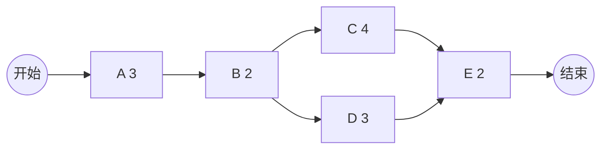

+++
date = '2026-11-20T09:12:00+08:00'
draft = false
title = '软件项目管理：规模估算、COCOMO、Gantt、PERT/CPM 与风险'
math = true
+++

项目管理把范围、时间、成本、质量、人员和风险协调为可执行计划。它不能保证计划永远不变，但可以让变化的影响被看见。考试题通常要求根据活动依赖画网络图、找关键路径、计算工期和时差，或根据规模模型进行基本估算；这些都有明确的计算规则。

## 一、工作分解结构与估算边界

工作分解结构（WBS）将项目逐层拆为可管理、可估算、可验收的工作包。例如“图书系统”可分为需求、借还、预约、报表、测试、上线；借还又可分为规则、数据访问、接口、用例。WBS 不是简单的组织部门列表，而是要交付的工作范围分解。

估算应区分：

- **规模**：代码行、功能点、用例点等；
- **工作量**：人月或人日；
- **工期**：日历时间；
- **成本**：人力、设备、软件、培训等货币支出。

“投入 6 人月”不必然意味着“一个人做 6 个月”或“6 个人做 1 个月”。任务依赖、沟通开销和可并行程度限制了人力可替换性；把人月与工期直接相除，是进度题里很常见的误解。

## 二、COCOMO 基本模型

Basic COCOMO 使用估计的 KLOC（千行代码）计算工作量：

$$
E = a \times (KLOC)^b
$$

工期可估为：

$$
T = c \times E^d
$$

平均人员数约为 $E/T$。系数 $a,b,c,d$ 随项目模式（有机、半嵌入、嵌入）不同而不同，答题必须采用题目给出的参数；不要背错一组系数后套到所有题。

假定某题给定 $E=2.4\times KLOC^{1.05}$，规模 10 KLOC，则：

$$
E=2.4\times10^{1.05}\approx26.9\text{ 人月}
$$

若后续给定 $T=2.5\times E^{0.38}$，应继续带入计算工期，再算平均人数。最后写清单位和取整原则；只报一个无单位的小数没有实际意义。

## 三、Gantt 图与网络计划的职责

Gantt 图（甘特图）用时间条展示任务起止、重叠和进度，直观但复杂依赖不够突出。PERT/CPM 网络图用节点和箭头表示活动依赖，适合计算关键路径和时差。题目问“哪些任务可以并行、哪个延误会延误全项目”，网络计划更合适。

### 1. 经典 CPM 计算题

活动及持续时间如下：

| 活动 | 前置活动 | 工期（天） |
| ---- | -------- | ---------- |
| A：需求调研 | 无 | 3 |
| B：需求评审 | A | 2 |
| C：数据设计 | B | 4 |
| D：接口设计 | B | 3 |
| E：集成测试 | C、D | 2 |

网络关系可画为：

前推计算最早开始 ES、最早完成 EF：A 为 `0/3`，B 为 `3/5`，C 为 `5/9`，D 为 `5/8`，E 必须等 C、D 都完成，所以 ES 为 `max(9,8)=9`，EF 为 11。总工期 11 天。

后推计算最迟完成 LF、最迟开始 LS：E 为 `11/9`；C 的 LF 为 E 的 LS=9，所以 LS=5；D 的 LF 同为 9，所以 LS=6。D 的总时差：

$$
Slack = LS - ES = 6 - 5 = 1\text{ 天}
$$

因此关键路径是 `A → B → C → E`，长度为 11 天。D 可以延迟 1 天而不影响总工期；这不代表 D 不重要，只代表在当前依赖和估算下有一日缓冲。

### 2. PERT 三点估算

当活动工期不确定时，PERT 使用乐观时间 $a$、最可能时间 $m$、悲观时间 $b$：

$$
t_e=\frac{a+4m+b}{6}
$$

方差为：

$$
\sigma^2=\left(\frac{b-a}{6}\right)^2
$$

例如 $a=2,m=5,b=8$，期望时间为 $(2+20+8)/6=5$ 天，方差为 1。注意 PERT 的 $a,m,b$ 不是前三个活动的工期，而是**同一活动**的三种估计。

## 四、风险管理

风险管理包括识别、分析、计划、监控和应对。常见风险类别：需求风险（范围频繁变化）、技术风险（新框架/接口不可用）、人员风险（关键人员离开）、进度风险（依赖延期）、外部风险（政策、供应商）。风险暴露常近似为：

$$
Risk\ Exposure = Probability \times Loss
$$

这能帮助排序，但不是精确物理定律；概率和损失的估计范围应记录。风险表应写出触发器和措施，而非只有“加强管理”。

## 五、案例题作答模板

题目要求“给出项目计划与控制措施”时，可按以下逻辑：

1. 用 WBS 明确范围和工作包，避免遗漏测试、迁移、培训。
2. 标出依赖关系，计算关键路径和非关键活动时差。
3. 为高风险项定义预警信号、责任人、缓解与应急方案。
4. 使用里程碑检查需求基线、设计基线、测试通过和上线准备。
5. 对变更重新评估范围、工期、成本和风险；不能假装新增功能不影响计划。

## 六、易错点

- 关键路径是总工期最长的依赖路径，不是“活动最多”或“最贵”的路径。
- 有多个前置活动时，后续活动 ES 取前置 EF 的最大值；不是相加，也不是最小值。
- 总时差为零的活动通常在关键路径上，但计算必须基于正确的前推和后推结果。
- PERT 的期望时间对最可能值权重为 4，不是简单平均。

项目管理不是把不确定性消灭掉，而是把它变成可讨论的规模、依赖、时间、风险和决策。没有计划的项目仍会被现实管理，只不过管理者变成了最后期限和事故本身，这种方式显然谈不上高明。

