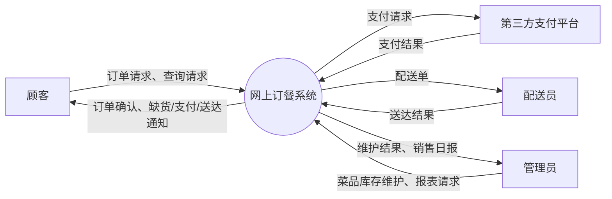
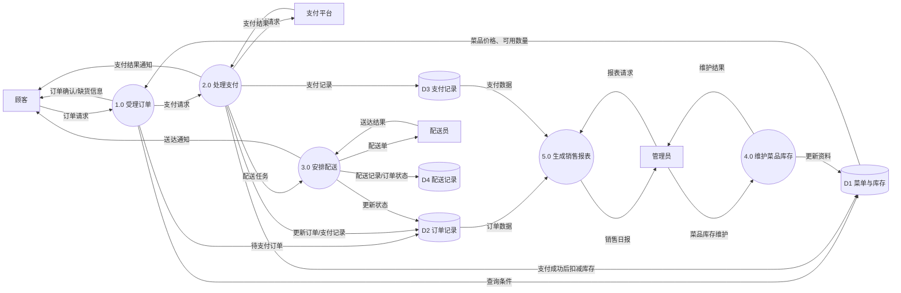
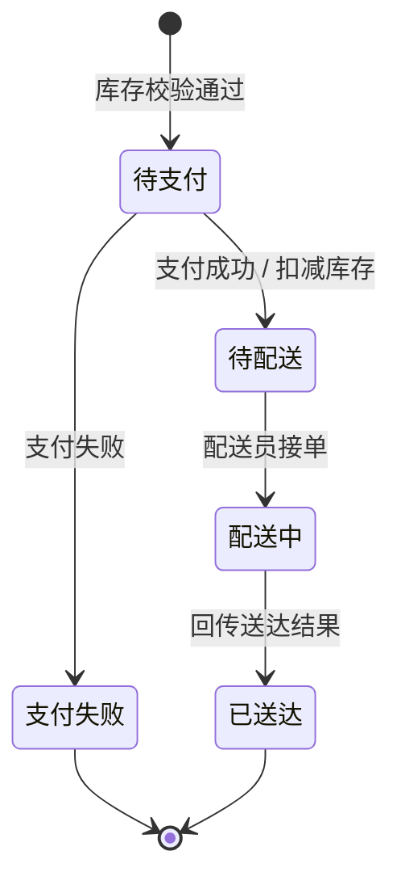

+++
date = '2026-11-20T09:13:00+08:00'
draft = false
title = '软件工程综合案例：从需求陈述到 DFD、UML、实现与测试'
+++

这一篇把五个教学单元放回同一道典型综合题中。重点不在记住“网上订餐”这个业务，而在于看到任意案例时，都能从过程选择、需求分析、软件设计、实现测试和 UML 表达五个角度给出相互一致的工程产物。考试或项目中的系统可能换成医院挂号、仓库出入库、酒店预订或工资管理；模型的推导方式并不会因此改变。

开始前先做一个过程决策：需求中支付接口和库存并发存在风险，适合采用**增量交付 + 原型验证关键接口**的组合，并为每个增量建立评审、配置基线和测试证据。下面的分析以第一期“下单—支付—配送”核心增量为范围。

## 一、题干

> 某餐厅需要网上订餐系统。顾客提交订单，包含联系方式、送餐地址和菜品数量。系统查询菜单和库存，计算订单金额；库存不足时返回缺货信息，库存足够时创建待支付订单并请求第三方支付平台。支付平台返回成功或失败结果。支付成功后系统扣减库存、将订单改为待配送，并把配送单发送给配送员；配送员回传送达结果，系统通知顾客。餐厅管理员维护菜品和库存，并查看每日销售报表。

题目可分别要求：画上下文图/0 层 DFD；写数据字典；列出实体及 E-R 关系；设计模块结构；给出测试用例。不要一上来写数据库表；先做逻辑分析。

## 二、第一步：元素识别表

| 类型 | 结果 | 依据 |
| ---- | ---- | ---- |
| 外部实体 | 顾客、支付平台、配送员、管理员 | 位于订餐系统边界外 |
| 处理 | 受理订单、处理支付、安排配送、维护菜品、生成报表 | 接收数据后产生/更新其他数据 |
| 数据存储 | 菜单与库存、订单记录、支付记录、配送记录 | 需要跨操作保存并被读取/更新 |
| 外部数据流 | 订单请求、订单结果、支付请求/结果、配送单、送达结果、维护信息、日报 | 在边界上传递的数据 |

“支付平台”是外部实体，即使系统保存支付记录，也不等于支付平台变成数据存储；这是 DFD 题的高频陷阱。

## 三、第二步：上下文图



这里系统只有一个处理，内部的库存、订单记录都不出现。若题目只要顶层图而画出五个内部处理，答案层次就错了；画得更多并不会得到更多分数。

## 四、第三步：0 层 DFD 与平衡说明



严谨作答时，应把“查询库存”和“扣减库存”分成清楚的数据流，并说明扣减只在支付成功后发生。上图将扣减操作放在 `2.0` 的支付成功分支；若改由 `1.0` 在创建待支付订单时立即扣减，就需要与题干确认是否存在“库存预占”策略。发现这种时序与业务规则冲突，正是分析的意义。

平衡检查：上下文图的顾客订单请求在 0 层进入 `1.0`；支付请求/结果仍与支付平台交换；配送单/送达结果仍与配送员交换；管理员维护和日报也保留。0 层增加的 D1—D4 是内部细节，不破坏平衡。

## 五、第四步：数据字典与业务规则

```text
订单请求 = 顾客信息 + 送餐地址 + {订单项}
订单项 = 菜品编号 + 数量
订单记录 = 订单号 + 顾客号 + 下单时间 + 订单状态 + 总金额 + {订单项}
订单状态 = (待支付 | 支付失败 | 待配送 | 配送中 | 已送达 | 已取消)
支付结果 = 订单号 + 支付流水号 + 支付状态 + 支付时间 + [失败原因]
配送单 = 订单号 + 送餐地址 + 联系方式 + {订单项}
```

关键规则应写为处理规格或判定表：库存必须对订单每个菜品项均足够；支付成功才允许转为待配送并扣减库存；支付失败不得生成配送单；配送员的送达结果只能更新处于配送中的订单。最后一条可用状态图更清楚地约束。



## 六、第五步：设计与测试答案

### 1. 一个合理的模块划分

```text
订餐应用服务
├─ 订单接口适配器：接收订单、返回状态
├─ 菜单与库存服务：查询、预占/扣减、并发保护
├─ 订单服务：计算金额、维护订单状态
├─ 支付网关适配器：发送请求、校验支付回调
├─ 配送服务：生成配送单、接收送达事件
├─ 报表服务：汇总日报
└─ 数据访问模块：菜单、订单、支付、配送记录
```

这体现了高内聚：支付协议变化集中在网关适配器，配送渠道变化集中在配送服务；订单服务不应直接拼接第三方请求。模块之间应传订单号、金额、状态等必要数据，而非共享可写全局订单对象。

### 2. 高价值测试用例

| 用例 | 输入/前置 | 预期结果 |
| ---- | --------- | -------- |
| 库存刚好足够 | 菜品 A 库存 2，订单数量 2，支付成功 | 创建订单、库存变 0、生成配送单 |
| 库存不足 | 库存 1，订单数量 2 | 返回缺货；不创建待支付订单；库存不变 |
| 支付失败 | 库存足够，平台返回失败 | 订单为支付失败；库存不扣减；不生成配送单 |
| 重复支付回调 | 同一支付流水号成功回调两次 | 订单只扣减一次、只生成一张配送单 |
| 非法送达回传 | 订单仍待支付 | 拒绝状态迁移并记录异常 |
| 并发抢最后一份库存 | 两笔订单都请求库存 1 的菜品 | 至多一笔成功，库存不可为负 |

### 3. UML 视图与追踪

可以用用例图把顾客、管理员、支付平台和配送员放在系统边界外；用类图表达 `Order`、`OrderItem`、`Payment`、`Delivery` 的静态关系；用顺序图表达下单、支付回调和配送状态迁移；用构件图和部署图说明订单服务、支付适配器、数据库及其运行节点。每个视图只解决一个问题，但名称和状态必须与 DFD、数据字典一致。

例如，`待支付 → 待配送` 的状态迁移必须同时出现在状态图、订单服务的实现契约和支付成功测试中；若 UML 画了“支付成功即扣库存”，而代码在创建订单时扣库存，就应在评审阶段提出并修正，而不是把矛盾留给测试人员。

最后两例表明测试并不只验证正常功能。重复回调考察幂等性，并发抢库存考察一致性；它们都由前面定义的状态和不变式推导而来，而不是凭空罗列“异常情况”。

## 七、综合题作答顺序总结

1. 先划系统边界，列外部实体与对外数据流。
2. 从动词识别处理，从长期数据识别存储，画上下文图和 0 层 DFD。
3. 检查 DFD 的平衡、黑洞/奇迹和非法直连。
4. 用数据字典精确定义核心流和存储；用 E-R、状态图、判定表补足关系、生命周期和条件组合。
5. 从业务责任划分模块，写清接口数据与一致性边界。
6. 从规则、边界、状态迁移和并发不变式导出测试。

这套顺序的好处是每一步都有上一步的依据：测试不再是随意猜数据，结构图不再是凭喜好分层，DFD 也不再只是画几个圆。软件工程案例题真正考察的，就是这种从模糊叙述逐步收敛为可实现、可验证设计的能力。
