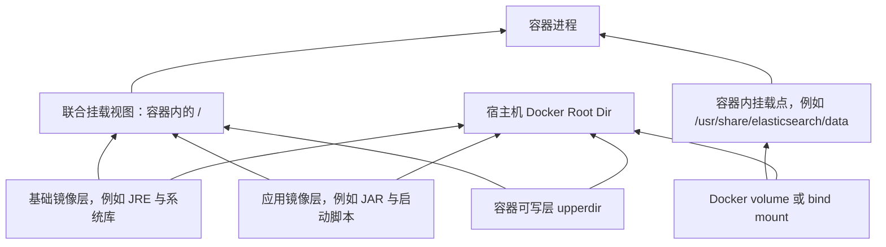

+++
date = '2026-10-24T21:25:00+08:00'
draft = false
title = 'Docker 存储模型：镜像层、容器可写层、数据卷、日志与构建缓存'
+++

Docker 容器不是一台拥有独立硬盘的轻量虚拟机。它在宿主机内核上运行，镜像层、容器可写层、命名卷、日志和构建缓存最终都需要占用宿主机文件系统。理解这一点，是排查“ES 索引很小但服务器磁盘已经 97%”的必要前提。

本文从 Docker 的存储结构解释空间究竟去了哪里，并以 `hebust-forum-backend` 的历史镜像清理为例，说明如何只删除明确无用的镜像。

## 容器的文件系统是如何拼出来的

一个 Docker 容器看到的根目录并不是某块新硬盘。它通常由只读镜像层、一个可写容器层，以及额外挂载的数据卷组合而成。



在常见的 `overlay2` 存储驱动下：

- **lowerdir**：镜像的只读层，可被多个镜像和容器共享。
- **upperdir**：容器自己的可写层，容器写入或覆盖文件时写到这里。
- **merged**：Docker 挂载给容器进程看到的联合目录视图。
- **workdir**：OverlayFS 内部执行复制与合并所需的工作目录。

容器修改一个原本来自只读镜像层的文件时，OverlayFS 使用 copy-on-write：先把文件复制到容器的 `upperdir`，再在上层修改。这样能让镜像层共享，但也意味着频繁向容器文件系统写大文件会扩大容器可写层。

因此，容器删除后它自己的可写层会消失；但命名卷、日志和镜像层是否保留，是另一套规则。

## 五类 Docker 空间，风险完全不同

排查前必须先分类。`docker system df -v` 能同时给出镜像、容器、卷和构建缓存的概览。

```bash
docker system df -v
```

| 类型 | 实际内容 | 生命周期 | 是否可直接当垃圾删除 |
| ---- | -------- | -------- | -------------------- |
| Images | 镜像只读层与标签 | 标签或引用存在时保留 | 否，要先确认没有容器引用且无需回滚。 |
| Containers | 容器元数据和可写层 | 容器删除后消失 | 否，停止容器也可能有排障或迁移价值。 |
| Local Volumes | 数据库、ES、上传文件等持久化数据 | 独立于容器生命周期 | 通常不可以，应默认视为业务数据。 |
| Build Cache | Dockerfile 各步骤生成的中间缓存 | 与构建器缓存策略相关 | 可清理，但会增加下次构建时间。 |
| Container Logs | 默认 JSON 日志驱动写出的标准输出 | 容器持续运行时不断增长 | 可处理，但应通过日志轮转根治。 |

在 Linux 上先确认 Docker 自己的数据根目录：

```bash
docker info --format '{{.DockerRootDir}}'
```

默认通常是：

```text
/var/lib/docker
```

在默认目录下，常见内容位置是：

```text
/var/lib/docker/overlay2      镜像层和容器可写层
/var/lib/docker/volumes       命名卷数据
/var/lib/docker/containers    容器元数据和默认 JSON 日志
/var/lib/docker/buildkit      BuildKit 构建缓存
```

目录实现会随 Docker 版本和存储驱动变化，排查时应优先使用 Docker 命令获得逻辑视图，再用 `du` 验证物理目录：

```bash
du -xhd1 /var/lib/docker 2>/dev/null | sort -h
```

其中 `-x` 使 `du` 不跨越到其他文件系统，避免统计范围被额外挂载点污染。

## 镜像：标签、层、共享层和实际可回收空间

镜像并不是一个单独的大文件，而是一组内容寻址的只读层。多个版本的 Java 后端镜像通常会共享操作系统层、JRE 层和 Maven/JAR 依赖层，仅应用包或少量构建层不同。

查看后端镜像：

```bash
docker image ls hebust-forum-backend
```

更适合人工审计的格式是：

```bash
docker image ls hebust-forum-backend \
  --format 'table {{.Repository}}\t{{.Tag}}\t{{.ID}}\t{{.CreatedSince}}\t{{.Size}}'
```

`docker image ls` 中的 `SIZE` 不能逐行相加，因为共享层会被重复展示。判断删除某一镜像会释放多少空间，应看 `docker system df -v`：

| 字段 | 含义 |
| ---- | ---- |
| `SHARED SIZE` | 被其他镜像共同引用的层。删除当前镜像但其他引用仍在时，空间不会释放。 |
| `UNIQUE SIZE` | 只被该镜像使用的层。所有引用移除后，通常可以回收。 |
| `CONTAINERS` | 当前有多少容器引用此镜像。`0` 是进入清理候选清单的必要条件，不是唯一业务判断。 |

镜像 ID 是内容标识，标签只是一个容易阅读的名字。重新给同一镜像打标签通常不会复制层；删除一个标签也未必立即释放任何数据，因为相同镜像 ID 或相同层可能仍被其他标签引用。

## 案例：精确清理 `hebust-forum-backend` 历史镜像

本次 `docker system df -v` 的结果显示：

```text
REPOSITORY             TAG      IMAGE ID       CONTAINERS
hebust-forum-backend   v1.1.4   2646ac2df286   1
hebust-forum-backend   v1.1.2   7035bd31fa78   0
hebust-forum-backend   v1.0.19 fafb8cadc9e3   0
```

并且运行中的论坛后端容器使用的是：

```text
hebust-forum-backend:v1.1.4
```

因此，本次安全边界是：保留 `v1.1.4`，只把 `CONTAINERS: 0` 的历史标签作为候选。执行删除之前，再以容器视角确认一次：

```bash
docker ps -a --format 'table {{.ID}}\t{{.Image}}\t{{.Status}}' \
  | grep hebust-forum-backend
```

若输出仍只包含当前版本，那么可以显式列出已确认的旧标签：

```bash
docker image rm \
  hebust-forum-backend:v1.1.2 \
  hebust-forum-backend:v1.1.1 \
  hebust-forum-backend:v1.1.0 \
  hebust-forum-backend:v1.0.19
```

实际清理时，应把所有经过确认的旧版本逐条列在命令中。使用标签而不是宽泛筛选条件，优点是删除目标可审计、可复核，也不会误伤同机上的 `mysql`、`redis`、`elasticsearch`、其他项目镜像或私有仓库镜像。

`CONTAINERS: 0` 表示没有容器正在或曾以当前状态引用该镜像，但它不等于“必然不值得保留”。例如尚未部署的候选版本、正在灰度验证的版本、约定用于快速回滚的版本，都可能暂时没有容器引用。删除前要明确版本保留策略，例如：

- 保留正在运行的版本。
- 保留上一个已验证稳定版本，以支持快速回滚。
- 如有待发布版本，保留待发布版本直到部署完成。
- 只清理超出保留窗口且没有容器引用的版本。

本次所有未引用论坛后端镜像按 `UNIQUE SIZE` 粗略累计约有 9GB 的清理潜力，但最终释放量必须以 Docker 的真实层引用关系为准。完成后检查：

```bash
docker image ls hebust-forum-backend
```

```bash
docker system df
```

```bash
df -h /
```

### 为什么不直接执行 `docker image prune -a`

`docker image prune -a` 会删除所有未被容器使用的镜像，而不只针对论坛后端。它可能移除其他项目下次启动、构建或回滚所需的镜像。`docker system prune --volumes` 的范围更大，还会尝试清理未被引用的卷；对于不熟悉整台服务器业务的场景，这种做法过于粗暴。

精确删除一个仓库的明确标签，虽然多写几行，却把影响范围限制在已审阅目标内。磁盘已满时更需要这种克制，而不是把恢复建立在侥幸上。

## Volume：为什么删除容器不等于删除数据

命名卷是 Docker 管理的持久化存储。例如项目中的 ES 数据卷可以挂载为：

```yaml
volumes:
  - elasticsearch-data:/usr/share/elasticsearch/data
```

容器删除时，镜像和容器可写层可能仍在或可清理，但 `elasticsearch-data` 卷会保留。数据库和搜索引擎正是依赖这一点避免“容器重建即数据丢失”。

查看卷：

```bash
docker volume ls
```

查看指定卷的驱动、挂载位置和引用信息：

```bash
docker volume inspect hebust-forum-es-data
```

本次检查中，`hebust-forum-es-data` 只有约 `566KB`、`hebust-forum-mysql-data` 约 `358MB`，并不是根分区接近写满的主因。这个事实必须由 `docker system df -v` 之类的证据确认，不能因为目录名里有 `mysql` 或 `elasticsearch` 就先入为主地删除。

## 容器日志：最容易被忽略的持续增长源

默认 `json-file` 日志驱动会把容器的标准输出和标准错误写入 Docker 数据目录。应用把异常堆栈反复打印到控制台时，日志文件会不断增长，即使容器的业务可写层只有几十 KB。

找出超过 100MB 的 Docker JSON 日志：

```bash
find /var/lib/docker/containers -type f -name '*-json.log' -size +100M \
  -printf '%s %p\n' 2>/dev/null | sort -n | numfmt --field=1 --to=iec
```

把结果路径中的容器 ID 替换到下面命令中，确认它属于谁：

```bash
docker ps -a --no-trunc | grep CONTAINER_ID
```

临时清空日志并不是最佳方案，因为应用继续输出后问题会再出现。更可持续的做法是为 Docker 配置日志轮转，例如为容器设置 `json-file` 驱动的 `max-size` 与 `max-file`，或将结构化日志输出到专门的日志系统。配置改变前要先确认现有部署方式、日志采集链路和容器重建策略。

## Build Cache：镜像清理不会处理它

BuildKit 会缓存 Dockerfile 中每一步的结果，以避免每次构建都重新下载依赖或编译代码。它与最终镜像有关，但并不是某个已发布镜像的一部分。

查看构建缓存：

```bash
docker builder df
```

本次检查中 Build Cache 占用了约 `3.398GB`。删除历史后端镜像不会自动回收这部分空间。是否清理构建缓存取决于两件事：

- 当前磁盘是否需要紧急释放空间。
- 是否接受下一次构建变慢、重新下载依赖或重新执行构建步骤。

将镜像、卷、日志和构建缓存分开治理，才能既释放空间，又不把持久化数据或回滚能力一并删掉。

## 小结

- 容器共享宿主机磁盘；隔离的是进程和文件系统视图，不是凭空生成硬盘。
- 镜像、容器层、卷、日志和 Build Cache 的清理风险不同，必须先分类。
- `CONTAINERS: 0` 是历史镜像清理的技术前提，但还要结合发布和回滚策略。
- 镜像大小不能直接求和，应关注共享层和唯一层。
- 精确执行 `docker image rm 仓库:标签` 比全局 prune 更适合生产服务器。
- Volume 默认应当被视为业务数据；日志与缓存才更常是容量治理对象。
