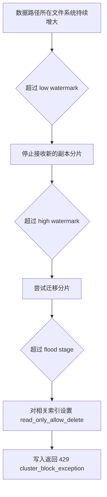

+++
date = '2026-10-24T21:15:00+08:00'
draft = false
title = 'Elasticsearch 磁盘水位线、分片分配与索引只读'
+++

Elasticsearch 不是按“索引里有多少篇文档”决定是否还能写入，而是按**数据路径所在文件系统还剩多少空间**决定。这个边界在开发阶段常常不明显，直到应用收到下面这样的错误：

```text
HTTP 429 Too Many Requests
cluster_block_exception
disk usage exceeded flood-stage watermark
index has read-only-allow-delete block
```

这不是普通的接口限流，也不是“第 1000 篇帖子超过了 ES 的文档上限”。它表示 ES 发现底层磁盘已经接近写满，因此主动锁住索引的写操作，避免 Lucene 文件损坏和节点整体不可用。

本文只讨论 ES 在这件事中做了什么、怎样诊断和怎样恢复。即使不了解 Docker 或 Linux 的内部实现，也可以据此完成 ES 侧的故障判断与恢复。

## 事故判断：小索引也会因为整块盘满而锁定

本次业务库 `t_post` 只有 1058 条帖子。同步服务向 `forum_post_search` 写入文档时，失败请求路径是：

```text
/forum_post_search/_doc/1111?refresh=false
```

其中 `1111` 是文档 ID，不是 ES 的容量计数器。真正关键的数据来自两个不同视角：

```text
# 容器内，ES data path 所在文件系统
Filesystem      Size  Used Avail Use% Mounted on
/dev/vda1        99G   91G  3.1G  97% /usr/share/elasticsearch/data
```

```text
# ES 的分片分配视图
disk.indices = 484.5kb
disk.used    = 95gb
disk.avail   = 3gb
disk.percent = 96
```

`disk.indices` 与 `disk.used` 不能混为一谈：

| 字段 | 它统计什么 | 本次结论 |
| ---- | ---------- | -------- |
| `disk.indices` | 节点上 ES 分片文件的体积 | 索引本身只有约 484.5KB。 |
| `disk.used` | ES 从操作系统获取的整个文件系统使用量 | 约 95GB 已被根分区中的所有内容占用。 |
| `disk.avail` | 该文件系统可用空间 | 只有约 3GB。 |

所以这次问题不是一千多篇帖子撑爆了 ES。ES 数据目录和 Docker 镜像、数据库、日志、上传文件等位于同一个临近写满的文件系统；ES 只需要知道 data path 所在文件系统的总可用空间，并不关心空间由哪个应用消耗。

## 三层水位线分别阻止什么

ES 的 disk-based shard allocator 会周期性检查数据节点上数据路径所在的文件系统。常见默认水位线如下；它们可被集群设置覆盖，新版本还会以最大可用空间余量约束百分比设置，因此应以当前集群的真实配置为准。

| 水位线 | 常见默认值 | 主要行为 |
| ------ | ---------- | -------- |
| `low` | 85% | 不再向该节点分配新的副本分片。 |
| `high` | 90% | 尝试把该节点上的分片迁移到其他有空间的数据节点。 |
| `flood_stage` | 95% | 给受影响节点上拥有分片的索引加写保护。 |



本次 `96%` 到 `97%` 已经越过通常的 `95% flood_stage`。ES 的拒写是最后一道保护措施，而不是一个可以靠无限重试消失的临时错误。

查看当前配置时，可使用：

```bash
docker exec hebust-forum-es curl -s \
  'http://localhost:9200/_cluster/settings?include_defaults=true&flat_settings=true'
```

官方对设置细节的说明见 [Disk-based shard allocation settings](https://www.elastic.co/docs/reference/elasticsearch/configuration-reference/cluster-level-shard-allocation-routing-settings)。

### 单节点为什么特别脆弱

超过 `high watermark` 后，ES 的理想策略是把分片迁移到另一台有空间的数据节点。单节点部署没有第二个节点，因此无法通过迁移消除压力；如果根分区继续增长，就只能进入 `flood_stage` 并锁定写入。

单节点中看到 `UNASSIGNED` 也不应立即断言是磁盘问题。若某索引的 `number_of_replicas` 为 `1`，副本不能与主分片落在同一个节点，副本会天然长期未分配。应使用分配解释 API 获取真正原因：

```bash
docker exec hebust-forum-es curl -s -X POST \
  'http://localhost:9200/_cluster/allocation/explain?pretty'
```

## `read_only_allow_delete` 到底是什么

达到 `flood_stage` 后，ES 会为受影响索引维护如下设置：

```json
{
  "index.blocks.read_only_allow_delete": "true"
}
```

它不是一般意义上的“只读但允许随意删除文档”。此保护块会拒绝新增、更新、Bulk 写入和单文档删除；删除整个索引仍被允许，以便在极端情况下快速释放空间。

原因来自 Lucene 的不可变 Segment。删除一个文档通常只是写入删除标记，实际释放空间要等后续 merge；而 merge 在执行时可能需要额外临时空间。临界磁盘上继续执行单文档删除，并不一定能立刻减少占用，反而可能放大风险。相关底层机制可参阅 [Elasticsearch 内部是如何存数据的](./Elasticsearch内部是如何存数据的.md)。

先检查保护块：

```bash
docker exec hebust-forum-es curl -s \
  'http://localhost:9200/forum_post_search/_settings?filter_path=*.settings.index.blocks.read_only_allow_delete'
```

## 正确恢复：容量在前，解锁在后

恢复顺序不能颠倒。

1. 先暂停或降低反复失败的同步重试，避免错误日志继续消耗最后的空间。
2. 找出并清理无用数据，或扩容/迁移数据路径。不要把“手动解除只读”误当成扩容。
3. 确认 data path 的使用率已经回到安全水位，通常应低于 `high watermark`，而不仅仅是低于 `flood_stage`。
4. 检查 ES 是否已自动去除保护块；只有空间已经恢复、保护仍存在时才手动清除。
5. 验证分片、健康状态和业务写入，并补偿事故期间失败的同步事件。

先确认空间：

```bash
docker exec hebust-forum-es sh -c 'df -h /usr/share/elasticsearch/data'
```

```bash
docker exec hebust-forum-es curl -s \
  'http://localhost:9200/_cat/allocation?v'
```

空间已经稳定恢复后，若保护块仍在，才处理当前业务索引：

```bash
docker exec hebust-forum-es curl -X PUT \
  'http://localhost:9200/forum_post_search/_settings' \
  -H 'Content-Type: application/json' \
  -d '{"index.blocks.read_only_allow_delete": null}'
```

接着验证集群与分片：

```bash
docker exec hebust-forum-es curl -s \
  'http://localhost:9200/_cluster/health?pretty'
```

```bash
docker exec hebust-forum-es curl -s \
  'http://localhost:9200/_cat/shards?v'
```

本项目中 MySQL 是业务事实源，ES 是搜索索引。事故期间失败的写入不会因为索引重新可写而自动补回，必须依赖 outbox 重试、定时补偿或全量重建索引，重新建立 MySQL 与 ES 的一致性。

## 不要通过削弱保护机制“修复”磁盘

把 `flood_stage` 从 95% 改成 99%，或者禁用 `cluster.routing.allocation.disk.threshold_enabled`，没有创造任何磁盘容量。它只是要求 ES、Docker、数据库和操作系统继续争抢所剩无几的块，风险包括：

- translog、Segment merge 或日志写入失败。
- Docker daemon、数据库和系统日志同时异常。
- 节点重启后的索引恢复失败或显著变慢。
- 真正写满后增加文件系统和数据损坏风险。

同样，直接删除 ES 数据卷也不是常规修复。开发环境中，若索引明确可由 MySQL 重建，这可以是经过确认后的恢复策略；生产环境中应先有 ES 快照、数据源、重建时长和业务影响的明确预案。

## 小结

- ES 的磁盘保护针对的是**文件系统整体空间**，不是单个索引的文档数。
- `429` 加 `flood-stage watermark` 表示磁盘保护，不是普通限流。
- 单节点无法迁移分片，必须依靠清理、扩容或存储隔离恢复容量。
- 永远先恢复空间，再考虑解除 `read_only_allow_delete`。
- 搜索索引应始终具备重试、补偿或重建路径。
