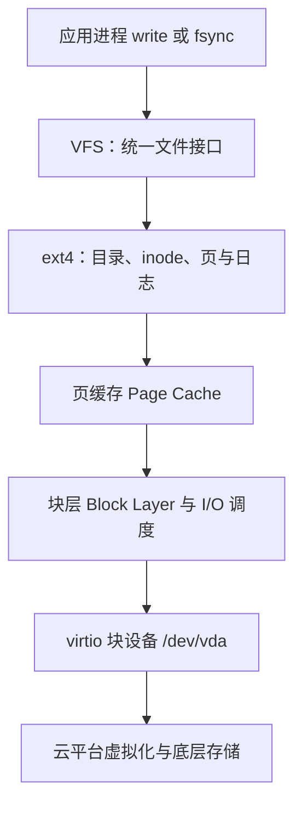

+++
date = '2026-10-24T21:20:00+08:00'
draft = false
title = 'Linux 存储栈：从虚拟磁盘、分区、ext4 到挂载和磁盘排查'
+++

当 Elasticsearch 报出磁盘水位错误时，许多人的第一反应是去看索引大小。这个方向并不总是错，却常常不够底层：ES 最终面对的是 Linux 文件系统报告的可用空间，而 Linux 文件系统又建立在分区、块设备、虚拟化存储和驱动之上。

这篇文章从一次真实的服务器结构出发，解释“`/dev/vda1` 已满”到底意味着什么，并建立一条能够用于排障的存储心智模型。

## 先看结论：本机的存储拓扑

服务器执行：

```bash
lsblk -o NAME,SIZE,TYPE,FSTYPE,FSVER,LABEL,UUID,MOUNTPOINTS
```

得到：

```text
NAME     SIZE TYPE FSTYPE  MOUNTPOINTS
loop0  931.4M loop iso9660 /mnt
vda      100G disk
└─vda1   100G part ext4   /
```

这不是一堆互不相干的名字，而是一条存储栈：

```text
云平台的块存储
        ↓
/dev/vda                 100GB 虚拟磁盘
        ↓
/dev/vda1                第一个分区
        ↓
ext4                     文件系统
        ↓
/                        挂载到 Linux 的根目录
        ↓
/var/lib/docker、/var/log、/opt、/root 等目录
```

因此，这台机器上如果没有额外挂载数据盘，Docker、MySQL、Elasticsearch、日志、上传文件和备份都会竞争同一个 100GB 根分区。容器内看到 `/dev/vda1` 使用率很高，并不代表某一个容器独占了它，而是该容器的数据最终也落到了这套宿主机存储栈上。

`loop0` 则是挂载到 `/mnt` 的 ISO 镜像文件系统。它是一个 loop device，不是根分区，也不是本次根分区接近写满的直接原因。

## 从文件到磁盘，数据经过了哪些层

应用写一行日志或 ES 写一个 Lucene 文件时，数据并不会直接“写进硬盘”。简化后的路径如下：



这张图不是为了把名词堆得漂亮。它解释了几个重要现象：

- `write()` 成功通常表示内核已接收数据，不必然代表数据已经落到物理介质。
- 脏页可以暂存在 Page Cache，内核随后异步回写；`fsync()` 才会要求文件数据和必要元数据持久化。
- 文件系统要同时管理数据块、目录项、inode、空闲空间和一致性，因此“写 1MB 业务数据”不等于只消耗 1MB 的底层空间。
- 虚拟机中的 `/dev/vda` 是虚拟块设备；它背后还可能经过宿主机、网络块存储和云盘副本机制。

### 块设备：`/dev/vda` 不是目录，也不是文件系统

块设备以固定大小的扇区或块提供随机读写能力。Linux 将磁盘、SSD、虚拟云盘等统一抽象为 `/dev` 下的设备文件，例如：

```text
/dev/sda    常见 SATA/SCSI 磁盘
/dev/nvme0n1 NVMe 磁盘
/dev/vda    KVM/virtio 环境中的虚拟磁盘
```

对本机而言，`/dev/vda` 表示整块云盘。它本身没有“目录结构”或“文件名”；这些是上层文件系统的职责。可以用下面的命令查看块设备层级：

```bash
lsblk -o NAME,SIZE,TYPE,FSTYPE,MOUNTPOINTS
```

### 分区：在一块盘上划分边界

分区表记录磁盘空间如何被切分。传统 MBR 分区表最多只能寻址约 2TiB，GPT 则更现代、支持更多分区和更大的磁盘。Linux 会把第一个分区命名为 `/dev/vda1`、第二个命名为 `/dev/vda2`。

在本机：

```text
/dev/vda   整块 100GB 磁盘
└─/dev/vda1 唯一的 100GB 分区
```

分区只定义“从哪个扇区到哪个扇区属于谁”，仍然不会告诉操作系统文件应当如何保存。为分区创建 `ext4`、XFS 等文件系统后，才可以按路径使用它。

### 文件系统：为什么 `ext4` 能保存目录和文件

文件系统将连续的块设备空间组织成可操作的文件与目录。以本机的 `ext4` 为例，几个核心概念是：

- **superblock**：记录文件系统大小、块大小、状态等全局元数据。
- **inode**：文件的身份证，保存权限、所有者、时间、大小和数据块位置；文件名通常不直接存放在 inode 中。
- **directory entry（dentry）**：目录中“文件名 → inode”的映射。
- **data block**：实际保存文件内容的块。
- **journal**：元数据等更新的日志机制，用于降低异常掉电导致文件系统结构不一致的风险。

因此，路径 `/var/log/app.log` 的解析并不是把整串文字直接交给磁盘：内核会从根目录 inode 开始，依次查询目录项，最终找到 `app.log` 对应 inode，再根据 inode 找到数据块。

`ext4` 的 journal 主要保证文件系统元数据一致性，不等同于数据库事务，也不等同于应用调用 `fsync()` 后的完整业务一致性。不同层的“可靠”解决的是不同问题，不能混用。

### 挂载：把一个文件系统接入一棵目录树

Linux 不使用 Windows 那样的盘符模型。它只有一棵从 `/` 开始的目录树；一个文件系统需要被挂载到树上的某个目录才能被访问。

本机中：

```text
/dev/vda1 --ext4--> /
```

意味着根文件系统挂载在 `/`。若没有额外挂载点，`/home`、`/var`、`/opt` 都是根文件系统的一部分。

用下面命令精确确认一个目录来自哪个设备：

```bash
findmnt /
```

典型输出：

```text
TARGET SOURCE    FSTYPE OPTIONS
/      /dev/vda1 ext4   rw,relatime
```

若以后单独挂载一块数据盘到 `/data`，那么 `/data` 下的文件将不再消耗 `/dev/vda1`，而会消耗新数据盘。挂载点是容量隔离的边界，也是排查时必须首先确认的事实。

## `lsblk`、`df`、`du` 为什么会给出不同答案

四个命令观察的是不同层，不能互相替代：

| 命令 | 观察层 | 它回答的问题 |
| ---- | ------ | ------------ |
| `lsblk` | 块设备和分区 | 有哪些盘、分区、文件系统，它们如何连接？ |
| `findmnt` | 挂载关系 | 某个目录到底挂在哪个设备上？ |
| `df -hT` | 已挂载文件系统 | 这个文件系统总量、已用量、可用量和类型是什么？ |
| `du -xhd1 /` | 目录树中的可见文件 | 是哪个目录消耗了空间？ |

本次判断根分区危险的直接依据是：

```bash
df -hT /
```

输出中的 `Use%` 表示整个 `/dev/vda1` 文件系统使用率。继续定位大目录时使用：

```bash
du -xhd1 / 2>/dev/null | sort -h
```

`-x` 要求 `du` 不跨越到其他挂载点，防止把另一块数据盘也统计进根分区。然后按层继续向下，例如：

```bash
du -xhd1 /var 2>/dev/null | sort -h
```

```bash
du -xhd1 /var/lib 2>/dev/null | sort -h
```

### `df` 已满而 `du` 看不见大文件

这是一种经典现象。进程打开一个文件后，即使另一个操作删除了它的目录项，只要进程仍保持文件描述符，内核就不能回收它占用的数据块：

```text
进程打开 app.log
        ↓
管理员 rm app.log
        ↓
目录中已经看不见文件，du 不再统计它
        ↓
进程仍然持有文件描述符，df 仍显示空间已用
        ↓
进程关闭文件或重启后，内核才回收块
```

检查这种“已删除但仍被占用”的文件：

```bash
lsof +L1
```

常见于 Java 服务、Nginx 和容器日志。正确处理方式是让相应进程安全地重新打开日志文件或重启，而不是只反复执行 `rm`。

## Page Cache、`fsync` 与“为什么磁盘写满会影响整个系统”

内核用 Page Cache 缓存文件页以减少真实 I/O。普通写入通常先修改内存中的页，随后由回写线程批量写入块设备；这让吞吐更高，但也意味着应用返回成功与数据真正落到介质之间可能存在时间差。

`fsync()` 会要求内核将指定文件的脏数据和必要元数据同步到稳定存储。数据库、Elasticsearch 的 translog 等组件会用它在性能和崩溃恢复之间做权衡。

磁盘接近写满时，不仅“新文件无法创建”这么简单：

- 文件系统需要写入 inode、目录项、journal 等元数据。
- 日志、临时文件、数据库事务日志和 Segment merge 都可能需要额外空间。
- 系统服务无法写日志，Docker 无法维护运行时状态，排障依据也会继续减少。
- 留给扩容、迁移和清理的操作空间越来越少。

因此应在使用率 70% 到 80% 时告警，而不是把 95% 当作正常运行区间。ES 的 `flood_stage` 只是它开始自保的时点，不是系统仍然舒适的容量线。

## 小结

- `/dev/vda` 是块设备，`/dev/vda1` 是分区，`ext4` 是文件系统，`/` 是挂载点；四者不是同一个概念。
- 一个目录是否消耗系统盘，取决于它是否位于该系统盘的挂载树中。
- `df` 看文件系统总账，`du` 看目录账，二者不一致时应检查已删除但仍被打开的文件。
- 磁盘空间是操作系统级共享资源；一个小索引也会因为同分区上的其他服务占满空间而被 ES 保护机制锁定。
