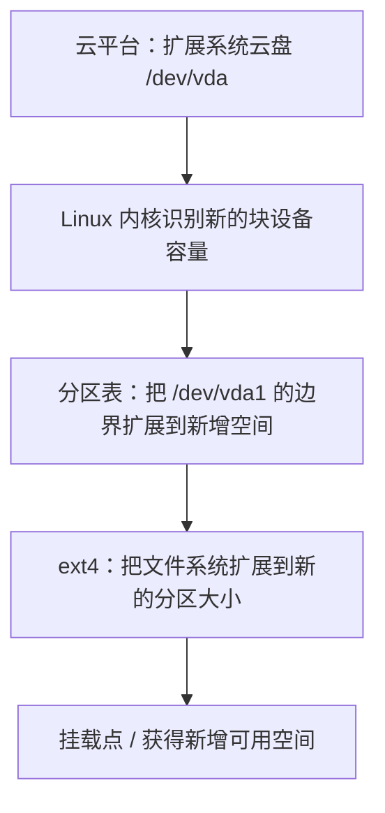

+++
date = '2026-10-24T21:30:00+08:00'
draft = false
title = '云服务器磁盘扩容：从云盘容量到分区和 ext4 文件系统'
+++

“在云控制台把系统盘从 100GB 改成 200GB”并不等于 Linux 已经能使用 200GB。云盘、分区和文件系统是三层独立对象；只扩第一层时，根目录 `/` 的可用空间可能完全不变。

本机已经确认的存储结构是：

```text
/dev/vda      100G   整块云服务器系统盘
└─/dev/vda1   100G   ext4 文件系统，挂载到 /
```

这篇文章讲清楚在这一种确定结构下如何安全扩容，以及为什么每一步都不可省略。文中会从块设备、分区和文件系统三层建立必要的判断依据。

## 扩容实际上要跨越三层

从 100GB 扩到 200GB，完整数据路径如下：



这四层中，云平台通常只负责第一层；Linux 并不会自动把已有分区和文件系统扩大。若漏掉后两步，`df -h /` 仍会显示原来的容量。

可以把它类比为：云盘扩容是在买更大的仓库，扩展分区是在把围栏向外移动，扩展文件系统才是把新的场地登记进库存管理系统。只完成第一步，应用自然还用不到新场地。

## 扩容前先确认结构，而不是背命令

先执行：

```bash
lsblk -o NAME,SIZE,TYPE,FSTYPE,MOUNTPOINTS
```

```bash
findmnt /
```

```bash
df -hT /
```

本机应对应：

```text
NAME   SIZE TYPE FSTYPE MOUNTPOINTS
vda    100G disk
└─vda1 100G part ext4   /
```

这三个事实共同决定了后文命令：

- 被扩容的整块块设备是 `/dev/vda`。
- 需要扩展的是第一个分区 `/dev/vda1`。
- 文件系统类型是 `ext4`，扩展工具应为 `resize2fs`。
- 根分区是唯一分区，也是磁盘最后一个分区，因此可以向后占用新增的连续空间。

如果其中任何一项不成立，就不应直接照抄 `growpart /dev/vda 1` 与 `resize2fs /dev/vda1`。使用 LVM、LUKS、RAID、XFS、Btrfs、ZFS，或根分区后还有其他分区时，扩容路径不同。

## 第一步：在云平台扩展系统盘

在云服务商控制台选择这台实例对应的**系统盘**，先创建快照，再将容量从 100GB 扩展到目标大小，例如 200GB。云盘通常只能向上扩容，不能原地缩小，因此容量规划也应考虑未来的日志、镜像、数据库、索引重建和备份空间。

是否支持在线扩容取决于云厂商、磁盘类型和实例规格：

- 支持在线扩容时，云平台完成后通常无需重启实例。
- 仅支持离线扩容时，需要按云平台要求停止或重启实例，内核才会看到新容量。

快照能在分区表误操作时提供回退选项，但它不是数据库备份、ES 快照或业务恢复演练的替代品。系统盘扩容前仍应知道关键服务的数据来源与恢复方式。

## 第二步：确认内核已经看到新的 `/dev/vda`

云平台显示任务成功后，立即在系统内检查：

```bash
lsblk -o NAME,SIZE,TYPE,FSTYPE,MOUNTPOINTS
```

若把云盘从 100GB 扩到 200GB，**扩容尚未完成**时的典型中间状态是：

```text
NAME   SIZE TYPE FSTYPE MOUNTPOINTS
vda    200G disk
└─vda1 100G part ext4   /
```

这表示新容量已经到达块设备层，但分区和文件系统还停留在旧边界。只有看到 `vda` 已变成新容量，才可以继续下一步。

若 `vda` 仍为 100GB，停止后续操作，先检查云平台扩容任务、设备是否为目标系统盘，以及该云平台是否要求重启。不要在尚未获得新增块空间时尝试反复调整分区。

## 第三步：扩展分区边界

`growpart` 的职责是修改分区表，让指定分区占用磁盘末尾新增加的空闲空间；它不会改变 ext4 文件系统大小。

本机结构已经确认，因此执行：

```bash
growpart /dev/vda 1
```

参数的含义是：

```text
/dev/vda  要操作的整块磁盘
1         要扩展第 1 个分区，也就是 /dev/vda1
```

若系统没有该命令，在 Debian/Ubuntu 上安装提供它的工具：

```bash
apt-get update
apt-get install -y cloud-guest-utils
```

然后重新执行：

```bash
growpart /dev/vda 1
```

扩展后先验证分区大小：

```bash
lsblk -o NAME,SIZE,TYPE,FSTYPE,MOUNTPOINTS
```

预期变为：

```text
NAME   SIZE TYPE FSTYPE MOUNTPOINTS
vda    200G disk
└─vda1 200G part ext4   /
```

`growpart` 适合“待扩展分区位于磁盘最后、其后空间连续”的情形。本机满足该条件。若分区之后还有其他分区，不能向后直接扩大；需要重新规划分区、迁移数据，或使用新的数据盘，而不是强行改边界。

## 第四步：扩展 ext4 文件系统

此时 `/dev/vda1` 已经变大，但 ext4 自己仍按旧大小管理数据块。因此还需要：

```bash
resize2fs /dev/vda1
```

`resize2fs` 会读取 ext4 元数据，在新增分区空间中建立新的块组并扩展文件系统可用容量。对现代 Linux 的 ext4 而言，扩容通常可以在挂载状态下在线完成，不必卸载根目录 `/`。

它和 `growpart` 的职责不能混淆：

| 命令 | 改变的层 | 不会改变什么 |
| ---- | -------- | ------------ |
| `growpart /dev/vda 1` | 分区表中 `/dev/vda1` 的结束边界 | 不会扩展 ext4 文件系统。 |
| `resize2fs /dev/vda1` | ext4 的可用块与元数据 | 不会让底层分区超出自身大小。 |

若文件系统是 XFS，扩容命令则是针对挂载点的：

```bash
xfs_growfs /
```

这也正是必须先用 `lsblk -f` 或 `df -hT` 确认文件系统类型的原因。不要对 XFS 执行 `resize2fs`，也不要对 ext4 凭印象执行 `xfs_growfs`。

## 第五步：从挂载点验证真正可用空间

最终验证必须看文件系统，而不能只看云控制台或 `lsblk`：

```bash
df -hT /
```

扩到 200GB 后，预期结果近似为：

```text
Filesystem     Type  Size  Used Avail Use% Mounted on
/dev/vda1      ext4  197G   91G   97G  49% /
```

容量略小于云盘标称大小是正常的：单位换算、文件系统元数据和 ext4 保留块都会带来差异。真正的成功标准是：

- `/dev/vda` 显示新的云盘容量。
- `/dev/vda1` 显示新的分区容量。
- `df -hT /` 显示根文件系统容量增长、使用率显著下降。
- Docker 和 Elasticsearch 数据目录看到的底层文件系统空间也随之恢复。

若本次是为恢复 ES 写入，完成扩容后还应确认：

```bash
docker exec hebust-forum-es sh -c 'df -h /usr/share/elasticsearch/data'
```

若这次扩容用于恢复容器化的 ES，磁盘使用率下降后还应检查索引是否仍处于只读状态，并在确认根因消除后恢复业务写入。

## 为什么扩容不是存储治理的终点

扩容能够立即恢复余量，却不能解释旧空间为什么被用掉。若所有服务继续堆在系统盘，镜像、Build Cache、数据库日志、应用日志和上传文件仍会持续增长，下一次事故只是时间问题。

更长期的策略是：

- 根分区只保留操作系统和必要运行环境。
- 将数据库、ES、Docker data-root、上传文件或备份有计划地迁移到独立数据盘。
- 为日志配置轮转、保留期限和集中采集。
- 为根分区和关键数据盘在 70% 到 80% 使用率建立告警。
- 把索引重建、数据库备份和磁盘扩容纳入演练，而不是只在故障时第一次执行。

新增数据盘与迁移 Docker/数据库数据属于另一项需要停机窗口、复制校验、挂载设计和回滚预案的工作。绝不能直接移动仍被写入的数据目录，然后期待文件系统替我们兜底。

## 小结

- 云平台扩的是块设备；Linux 分区和文件系统还需要分别扩展。
- 对确认的 `vda → vda1 → ext4 → /` 结构，核心命令依次是 `growpart /dev/vda 1`、`resize2fs /dev/vda1`。
- 先确认设备大小变化，再改分区；先确认分区变大，再扩文件系统；最后用 `df -hT /` 验证。
- 快照是操作回退手段，不是业务备份和恢复策略的替代品。
