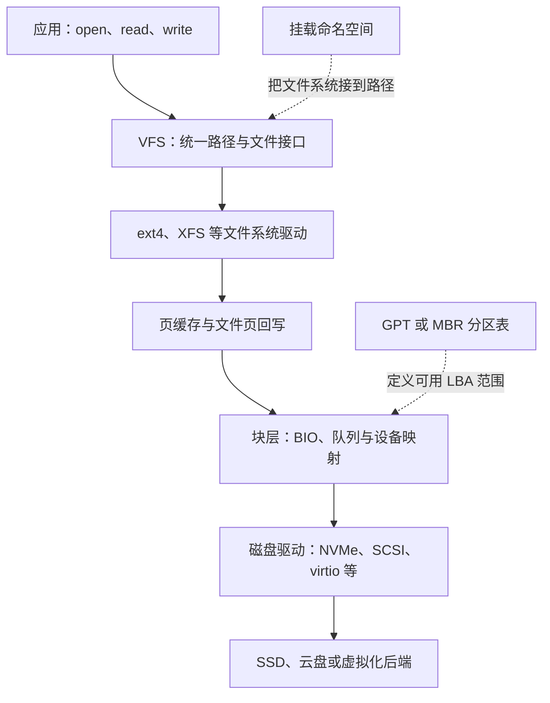

+++
date = '2026-10-25T14:00:00+08:00'
draft = false
title = '块设备、分区与挂载点：谁在管理它们，根目录和盘符又从哪里来'
+++

“磁盘有分区，分区格式化成文件系统，再挂载到目录”这句话很常见，却很容易让人误以为一切都由文件系统管理。其实不是。**块设备、分区、文件系统、挂载关系，以及图形界面中的盘符显示，分属存储栈中不同的层和不同的管理者**。

例如，在 Linux 中，`/dev/nvme0n1p2`、`ext4`、`/home` 和文件管理器里显示的“500 GB 卷”并不是同一种对象；在 Windows 中，`C:` 也不是 NTFS 这个文件系统自己“创建”的名字。若把它们混为一谈，扩容、排障、容器挂载和双系统磁盘识别都会变得莫名其妙——这当然不是磁盘在故弄玄虚，而是对象边界没有先分清。

本文以 Linux 为主线，并用 Windows 的 `C:` 盘作对照，回答四个问题：

- 块设备、分区和文件系统分别是什么，属于哪个子系统？
- 挂载点由谁建立、由谁记录，文件系统到底管不管它？
- 根目录 `/` 与 Windows 的根盘符 `C:` 是怎样出现的？
- 应当分别用哪些命令观察这些层，而不是让一个命令承担它并不负责的事情？

## 先给结论：不是一个组件在管理一切

假设一台 Linux 主机有一块 NVMe 磁盘，根分区使用 ext4：

```text
/dev/nvme0n1       整块磁盘
└─/dev/nvme0n1p2   磁盘上的第二个分区
  └─ext4           分区中的文件系统格式
    └─/            把该文件系统接入目录树的位置
```

可以把各层的职责先压缩成下面这张表。后文会展开其中的细节。

| 对象或现象 | 主要管理者 | 所属层/子系统 | 它解决的问题 |
| ---------- | ---------- | ------------- | ------------ |
| 磁盘、SSD、云盘、虚拟磁盘 | 设备驱动、Linux 块层 | 内核块设备子系统 | 提供按扇区或逻辑块随机读写的介质 |
| `/dev/sda`、`/dev/nvme0n1` | 内核设备模型与 `devtmpfs`，`udev` 补充命名信息 | 设备模型、块层、用户态设备管理 | 把内核识别到的块设备暴露为可打开的设备节点 |
| GPT、MBR 与 `/dev/sda1` | 分区表格式；内核分区扫描器解析；分区工具修改 | 块层中的分区管理 | 在一块盘的 LBA 地址范围上定义若干边界 |
| ext4、XFS、Btrfs、NTFS | 相应文件系统驱动 | 文件系统子系统 | 把一段可读写块空间组织为文件、目录、元数据与空闲空间 |
| `/data`、`/home` 作为挂载位置 | VFS 与挂载命名空间；`mount`/systemd 等配置它 | VFS 的挂载机制 | 把一个已挂载文件系统接到统一路径树 |
| Linux 的 `/` | 启动时的根文件系统挂载 | VFS、挂载命名空间、启动流程 | 整棵 Linux 路径树的起点 |
| Windows 的 `C:`、资源管理器中的磁盘图标 | Windows Mount Manager 与资源管理器等用户态程序 | Windows 卷挂载/命名和 Shell UI | 给卷分配访问路径，并把它展示给用户 |

最重要的一句是：**文件系统管理“已交给它的那段字节/块空间内部如何形成文件和目录”；它通常不管理磁盘是否存在、分区如何划分、自己被接到哪个路径，更不管理桌面上是否显示成一个盘符图标。**

## 先建立一条分层链路

应用写入 `/var/log/app.log` 时，它面对的是路径和文件，而不是扇区号。内核则需要一路向下，把这次写入交给实际或虚拟的存储设备：



分区表影响“哪些逻辑块交给哪个分区”；文件系统决定“文件的内容块和元数据块放在哪里”；挂载关系决定“通过哪个路径进入这个文件系统”。图中三者处在不同方向，因此不能互相替代。

### 块、扇区与块设备并不等于文件系统块

存储设备通常以逻辑扇区（常见为 512 B 或 4 KiB）为寻址单位。Linux 将支持随机访问的磁盘、SSD、USB 存储、云盘和虚拟磁盘抽象为**块设备**。设备驱动向块层报告容量、逻辑块大小、队列能力和读写操作，块层再把请求送到驱动。

`/dev/sda`、`/dev/vda`、`/dev/nvme0n1` 是这种块设备的设备节点。它们看起来像普通文件，是因为 Unix 用“打开文件”的统一接口来访问设备；但它们不是保存目录和文件的普通文件，也不是文件系统。

还应区分三种容易同名的“块”：

- **设备逻辑扇区/逻辑块**：设备接口使用的寻址单位。
- **文件系统块**：ext4、XFS 等为分配文件空间选用的单位，常见为 4 KiB，但并非必须与设备逻辑扇区相同。
- **内存页**：内核管理内存与页缓存的单位，许多系统中也是 4 KiB，但概念仍不同。

它们的大小碰巧相同，并不意味着职责相同。工程上最危险的误解，往往就从这种“看起来都是 4 KiB”开始。

## 块设备：由驱动和块层管理

### 内核怎样发现一块盘

在 Linux 中，PCIe 枚举、USB 热插拔、virtio 总线发现等机制先发现硬件或虚拟设备；对应驱动（例如 NVMe 驱动、SCSI 磁盘驱动、virtio-blk 驱动）注册块设备。之后，内核设备模型会在 `/sys/block/` 和 `/sys/class/block/` 暴露属性。

`devtmpfs` 根据内核设备事件创建基础的 `/dev` 设备节点，`systemd-udevd` 或传统 `udevd` 再根据规则补充权限、稳定的符号链接和属性。因此你常会同时看到：

```text
/dev/nvme0n1
/dev/disk/by-id/nvme-...
/dev/disk/by-uuid/9c2e...
```

第一个名字依赖设备发现顺序；后两个链接更适合在运维配置中作为稳定标识。它们都只是“通往一个块设备或分区的入口名称”，不是该设备中的文件系统目录。

### 块层还会看到不是真实磁盘的设备

块设备层并不只服务物理磁盘。下面这些对象也可能表现为块设备：

- `loop`：把一个普通镜像文件映射成块设备，例如 ISO 文件。
- `dm-*`：device-mapper 创建的映射设备；LVM、dm-crypt 加密、某些多路径配置都依赖它。
- `md*`：Linux 软件 RAID 创建的阵列设备。
- 网络或云存储暴露出的 iSCSI、virtio、NVMe-oF 等设备。

所以“看见 `/dev/dm-0` 就一定看见了一块物理盘”同样不成立。应该用 `lsblk` 的树状关系继续向下追溯，而不是对着一个名称猜来猜去。

## 分区：由分区表描述，文件系统并不负责划边界

### 分区表存在哪里

GPT 或 MBR 是写在**整块磁盘特定 LBA 位置**的元数据。它描述了每个分区的起止 LBA、类型 GUID 或类型码、标识符等信息。可把它理解为一张“地址范围分配表”：

```text
磁盘 /dev/nvme0n1 的可寻址 LBA
├─ 分区 1：LBA 2048 到 1050623       -> EFI System Partition
├─ 分区 2：LBA 1050624 到 210763775  -> Linux root
└─ 分区 3：LBA 210763776 到 ...      -> data
```

内核在识别整盘后会扫描分区表，并将其中范围呈现为 `/dev/nvme0n1p1`、`/dev/nvme0n1p2` 等分区设备。`fdisk`、`parted`、`gdisk` 或图形分区工具修改的是这张分区表；修改后内核需要重新读取分区表，某些情况下必须重启或先停用相关分区。

分区本身只是一段连续的逻辑块范围。它可以装文件系统，也可以作为 LVM 的物理卷、RAID 成员、交换分区、加密容器，甚至暂时没有任何上层格式。因此下面两种说法都不准确：

- “一个分区就是一个文件系统。”——常见，但只是最常见的组合。
- “文件系统决定分区大小。”——相反，文件系统通常是在已有分区或其他块设备上创建，能使用的边界由下层设备给出。

### 分区不是唯一的切分方案

文件系统也能直接创建在整盘 `/dev/sdb` 上，而无需传统分区；反过来，一个分区也可再交给 LVM、加密层或 RAID，再在它们生成的逻辑设备上创建文件系统。典型的复杂链路可能是：

```text
/dev/sdb2（GPT 分区）
  -> LUKS 加密容器
    -> /dev/mapper/crypt-data
      -> LVM 逻辑卷 /dev/vg0/data
        -> XFS
          -> 挂载到 /data
```

这里的 XFS 只知道自己下面是一个可读写的块设备，并不需要理解 GPT、LUKS 或 LVM 的内部格式。这种层间解耦正是存储栈可以组合的原因。

## 文件系统：管理内部的文件、目录和空间，不负责“挂到哪里”

### 文件系统真正保存什么

对 ext4 而言，格式化（`mkfs.ext4`）会在目标块设备范围内建立 superblock、块组、inode 表、位图、日志等结构。此后 ext4 的职责包括：

- 从空闲空间分配和回收数据块；
- 维护 inode、目录项、文件权限、时间戳与链接关系；
- 把文件偏移转换为底层块位置；
- 维护元数据一致性和日志恢复所需的信息；
- 通过文件系统驱动向 VFS 提供统一的打开、查找、读写、创建和删除操作。

换言之，文件系统使“第 872349 个逻辑块”成为“`/reports/2026.csv` 的第若干个数据块”。没有文件系统时，块设备仍然可以读写，但对操作系统来说只是一串没有目录层次和文件名的字节。

### 为什么说文件系统通常不管理挂载点

假设 `/dev/sdb1` 上已经有一个 ext4 文件系统。它本身会保存一个名为 `lost+found` 的目录，也可能保存大量项目文件；但它不会在自己的 superblock 中规定“我必须显示在 `/data`”。同一个文件系统可以在不同时间挂到不同位置：

```bash
sudo mount /dev/sdb1 /data
sudo umount /data
sudo mount /dev/sdb1 /mnt/recovery
```

在未挂载时，其内部数据没有消失；只是当前路径树没有入口可走进去。挂到 `/data` 还是 `/mnt/recovery` 是**当前操作系统实例的挂载配置**，而不是 ext4 数据结构的属性。

有少数文件系统支持“卷标签”“UUID”等内部标识，`/etc/fstab` 可以据此选择要挂载的来源。这也只是让挂载配置更可靠，并不表示 UUID 决定了挂载目录。

## 挂载点：VFS 和挂载命名空间管理的一条路径连接

### 挂载点首先只是一个目录

在执行挂载前，`/data` 通常只是当前根文件系统内的普通目录：

```bash
sudo mkdir -p /data
sudo mount /dev/sdb1 /data
```

第二条命令把 `/dev/sdb1` 上识别出的文件系统实例接到 `/data` 这个路径位置。此后，访问 `/data/report.txt` 会进入新挂入的文件系统。原来根文件系统中的 `/data` 目录及其内容并未被删除，只是暂时被这次挂载覆盖而不可见；卸载后又会露出来。

这解释了一个常见事故：先往 `/data` 写了文件，后来才挂载数据盘到 `/data`，于是“文件不见了”。它们通常仍在根分区的那个目录里，只是被新的挂载遮住了。应先卸载，再检查原目录；不要贸然格式化磁盘，毕竟让问题从“看不见”升级为“真的没了”并不高明。

### VFS 如何处理跨文件系统路径

Linux 的 **VFS（Virtual File System，虚拟文件系统）** 向应用提供统一的路径和文件接口。VFS 维护 dentry、inode、superblock 与挂载对象之间的关系。当路径解析走到一个挂载点时，VFS 会切换到被挂入文件系统的根目录，继续解析余下路径。

```text
解析 /data/project/readme.md

根文件系统中的 /
        ↓
查到目录 data；发现此处是挂载点
        ↓
切换到 /dev/sdb1 上 ext4 的根目录
        ↓
在该 ext4 中继续查 project/readme.md
```

因此，挂载不是把两个文件系统的目录“复制”或“合并”到一起，而是在路径解析时建立一个跳转边界。

### 挂载关系还属于挂载命名空间

更精确地说，Linux 的挂载表不是全机只有一份。它属于**挂载命名空间**。不同命名空间可以把同一文件系统挂到不同位置，或根本看不见某个挂载；容器正是这种隔离的常见使用者。

这也是为什么 Docker 容器中看到的 `/`、`/proc`、`/tmp` 和宿主机不一定对应同一套挂载关系。容器不是重新发明 ext4，而是拥有不同的进程、挂载、网络等命名空间视图，并在其中组合自己的根文件系统和 bind mount。

查看当前 shell 所在命名空间的真实挂载关系，优先使用：

```bash
findmnt
```

或者查看内核提供的原始视图：

```bash
cat /proc/self/mountinfo
```

`self` 很重要：它指当前进程所属的挂载命名空间。若你要排查容器，应在容器内执行，或进入该容器进程的挂载命名空间后再看，而不是只在宿主机猜测。

## `/` 是怎样成为根目录的

Linux 只有一棵从 `/` 开始的目录树，没有天生分离的 `C:`、`D:`。启动时，内核先挂载临时根文件系统（常见为 initramfs 中的 rootfs），再由 initramfs 找到真正的根设备；它可能需要加载驱动、解锁 LUKS、组装 RAID 或激活 LVM。

找到目标后，启动流程会把目标文件系统挂到临时位置，并通过 `switch_root` 或 `pivot_root` 等机制把它变成后续进程看到的 `/`。然后 PID 1（通常是 systemd）根据 `/etc/fstab`、systemd mount unit、自动挂载规则等继续挂载 `/home`、`/boot`、`/data`、`/proc`、`/sys`、`/dev` 等位置。

可把简化过程记为：

```text
固件/引导器
  -> Linux 内核 + initramfs
  -> 找到根设备（分区、LVM、RAID、网络根等）
  -> 挂载根文件系统并成为 /
  -> PID 1 挂载其余文件系统
```

所以 `/` 是“某个文件系统被挂为当前挂载命名空间根”的路径角色，不是一个独立的磁盘格式。根文件系统可以是 ext4、XFS、Btrfs、NFS，甚至临时内存文件系统；同样，根下的 `/home` 默认也不必是独立分区，只有它另被挂载时才会落到另一个文件系统。

## `C:`、磁盘图标和“根盘符显示”从哪里来

### Windows 的盘符不是 NTFS 分配的

Windows 常用卷（volume）来提供可访问的存储空间。卷可以基于分区，也可能来自更复杂的存储结构。Windows 的 Mount Manager 负责保存卷与访问路径的关联；访问路径既可以是驱动器号，如 `C:`、`D:`，也可以是挂到一个 NTFS 目录下的卷挂载点。

NTFS 管理自己卷中的文件、目录、MFT、位图和日志；它并不决定“我叫 `C:`”。同一块 NTFS 卷在另一台机器上可能显示为 `E:`，也可以完全没有盘符，却仍能通过挂载目录或系统 API 访问。盘符是操作系统的卷命名/挂载策略，不是文件系统内部属性。

资源管理器显示“本地磁盘 (C:)”“新加卷 (D:)”以及容量条，又是更上层的 Shell 用户界面行为。它会查询卷、标签、文件系统、可用空间与图标策略来呈现项目。你在资源管理器中隐藏某盘、改卷标或自定义图标，改变的是显示或挂载配置，并没有改变 NTFS 如何分配文件数据块。

### Linux 的 `/` 与 Windows 的 `C:` 不应机械类比

两者都提供路径入口，但模型不同：

| 对比项 | Linux | Windows 常见模型 |
| ------ | ----- | ---------------- |
| 顶层路径模型 | 一棵从 `/` 开始的树 | 多个卷根，常用 `C:\`、`D:\` |
| 额外卷的接入方式 | 挂载到任意已有目录，如 `/data` | 分配盘符，或挂到 NTFS 目录 |
| 根入口由谁决定 | 启动流程在挂载命名空间中选择根文件系统 | 系统卷通常分配为 `C:`，由卷挂载管理决定访问路径 |
| 文件系统是否决定入口名称 | 否 | 否 |

Windows 也支持“挂载到文件夹”，Linux 也可在文件管理器中显示“磁盘”图标。因此差异不在于能不能显示成图标，而在默认路径模型和用户界面习惯。

## 用正确的工具看正确的层

同一台机器上，`lsblk`、`findmnt`、`df` 和 `du` 的输出可能不同。那不是谁“显示错了”，而是它们的问题不同。

| 命令 | 主要观察对象 | 适合回答的问题 |
| ---- | ------------ | -------------- |
| `lsblk -f` | 块设备、分区、文件系统签名及挂载点摘要 | 有哪些盘？分区树怎样？设备上识别到什么文件系统？ |
| `blkid` | 块设备中的 UUID、LABEL、TYPE 签名 | 这个分区/卷的稳定标识和格式是什么？ |
| `findmnt /路径` | 当前命名空间的挂载关系 | 这个目录实际来自哪个挂载源？ |
| `df -hT /路径` | 某已挂载文件系统的容量与类型 | 这个路径所在的文件系统还剩多少空间？ |
| `du -xhd1 /路径` | 当前可见目录树中的文件 | 是哪个目录占用了空间？ |
| `cat /proc/self/mountinfo` | 内核导出的详细挂载表 | 嵌套挂载、命名空间和复杂挂载选项到底是什么？ |

下面是一套由上至下的排查顺序：

```bash
# 1. 先确认设备、分区和文件系统签名
lsblk -o NAME,TYPE,SIZE,FSTYPE,UUID,MOUNTPOINTS

# 2. 再确认某个路径进入的是哪个挂载
findmnt -T /var/lib/app

# 3. 最后看该文件系统的容量
df -hT /var/lib/app
```

假如 `findmnt -T /var/lib/app` 显示源为 `/dev/mapper/vg0-data`，就不应根据 `/var` 这个名字断言它属于根盘；反之，目录名叫 `/data` 也不保证它已挂到数据盘。**名称只是线索，挂载表才是事实。**

### 不要只看 `lsblk` 的 MOUNTPOINT

`lsblk` 很方便，但它读取的是设备与文件系统信息的综合视图；当存在 bind mount、overlayfs、容器命名空间或多个挂载位置时，单列 `MOUNTPOINT` 很容易省略信息。优先使用 `MOUNTPOINTS` 列，并在需要确认一个具体目录时以 `findmnt -T` 为准。

例如 bind mount 可以让同一目录树在多个路径可见：

```bash
sudo mount --bind /srv/shared /opt/app/shared
```

这里没有创建新的文件系统，也没有复制数据，却多出了一条路径入口。它进一步说明：路径入口属于 VFS 挂载关系，不属于文件系统自身。

## 一个完整例子：为什么 `/home` 不一定来自根盘

假设 `lsblk` 输出如下：

```text
NAME        TYPE  FSTYPE  MOUNTPOINTS
nvme0n1     disk
├─nvme0n1p1 part  vfat    /boot/efi
├─nvme0n1p2 part  ext4    /
└─nvme0n1p3 part  ext4    /home
```

访问 `/home/alice/code/demo.txt` 的逻辑不是“根文件系统一路管理到 `demo.txt`”，而是：

```text
/ 由 nvme0n1p2 上的 ext4 提供
  -> 路径解析遇到 /home 挂载点
  -> 切换到 nvme0n1p3 上的另一套 ext4
  -> 在第二套 ext4 内解析 alice/code/demo.txt
```

两个 ext4 文件系统可以使用相同格式，却有各自独立的 inode 编号空间、空闲块位图、journal 和容量统计。因此：

```bash
df -hT / /home
```

会显示两条可能容量不同的文件系统记录。`/home` 是一个路径前缀，不是“必然属于根盘”的证据。

## 常见误解与正确表述

### “格式化就是分区”

不对。分区是在整盘的地址空间上写 GPT/MBR 边界；格式化通常是对一个分区或逻辑设备写入文件系统结构。先后顺序常常相邻，职责却完全不同。

### “挂载点是文件系统创建的目录”

不对。挂载点目录通常先由当前已挂载的父文件系统提供；`mount` 再把另一个文件系统附着在它上面。被挂入的文件系统并不要求这个目录名是什么。

### “`/dev/sda1` 就是 ext4”

不对。`/dev/sda1` 是分区设备节点；它**可能包含** ext4，也可能是 swap、LUKS、LVM PV 或任何其他格式。请用 `lsblk -f` 或 `blkid` 验证，不要从名称臆测。

### “根目录 `/` 就是根分区”

通常相关，但不是同一个概念。`/` 是路径树的根挂载位置；“根分区”是口语上承载根文件系统的下层分区。它也可能不是物理分区，而是逻辑卷、RAID、网络根或内存根。

### “盘符由文件系统管理”

不对。Windows 的盘符由卷挂载管理分配，资源管理器负责展示；Linux 的 `/` 和 `/data` 则由挂载命名空间中的挂载关系决定。文件系统只在这些入口之后负责自己的文件和目录。

## 总结

- **块设备**由设备驱动和内核块层提供，负责稳定地读写一段可寻址的存储空间。
- **分区**由 GPT/MBR 等分区表定义，内核解析后把范围呈现为分区设备；它只划边界，不提供目录和文件名。
- **文件系统**管理其底层设备范围内的文件、目录、inode、空闲空间和一致性；它不天然决定挂载路径或盘符。
- **挂载点**是 VFS 与挂载命名空间维护的路径连接。它原本是一个目录，挂载后成为进入另一文件系统的入口。
- Linux 的 **`/`** 是启动流程选定的根文件系统在当前命名空间中的根入口；Windows 的 **`C:`** 是卷挂载管理分配的访问路径。二者都不是文件系统自己命名出来的。
- 排查时，先用 `lsblk` 看设备和分区，再用 `findmnt -T` 确认路径的挂载来源，最后用 `df` 看容量、用 `du` 找目录占用。不要让一个看起来熟悉的命令替你推断整条存储链路。
