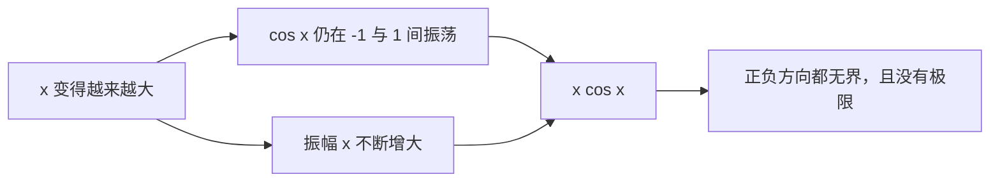

+++
date = '2026-10-24T10:00:00+08:00'
draft = false
title = '无穷大乘以余弦无穷：为什么 x cos x 是无界震荡'
math = true
+++

把 $\infty\cdot\cos\infty$ 直接当作一个可以计算的式子，往往会得到“无界震荡”这一印象；结论的方向不算错，表述却还差关键一步。$\infty$ 不是一个普通实数，$\cos\infty$ 也没有定义，因此它们不能像两个数一样相乘。严谨的问题应当是：**当 $x\to\infty$ 时，函数 $x\cos x$ 的极限和取值范围如何？**

结论是：$x\cos x$ 没有极限；它既不趋于某个有限实数，也不趋于 $+\infty$ 或 $-\infty$。更准确地说，它是一个**振幅不断增大、没有上下界的震荡函数**。

## 先把“无穷”还原为变量的趋势

在极限中，$x\to\infty$ 的意思是 $x$ 能取到任意大，而不是让 $x$ 最后等于一个叫“无穷”的数。因此：

$$
\lim_{x\to\infty}x\cos x
$$

研究的是所有足够大的 $x$ 所产生的函数值，不能把它简化为“$\infty$ 乘以 $\cos\infty$”。

同样，$\cos x$ 在 $x\to\infty$ 时并不趋向一个固定值。它会持续在 $-1$ 与 $1$ 之间往复取值：

$$
-1\leq\cos x\leq1.
$$

乘子 $x$ 却越来越大，于是每一次正向或负向的摆动都会被放大。注意，这里的“不确定”不是一个可套用的四则运算规则，而是要回到具体函数的行为来判断。

## 图像的骨架：夹在两条发散的包络线之间

由 $|\cos x|\leq1$ 可得：

$$
|x\cos x|\leq x.
$$

也就是：

$$
-x\leq x\cos x\leq x.
$$

这两条直线不是在证明函数有界，恰好相反：随着 $x$ 增大，允许的摆动范围 $[-x,x]$ 也不断扩张。$x\cos x$ 在这两条包络线之间来回摆动，峰值和谷值的绝对值可以越来越大。

“震荡”只说明函数反复改变方向；“无界”说明它的值可以超过任何预先指定的正数，也可以小于任何预先指定的负数。二者不能混为一谈：$\cos x$ 同样震荡，却始终有界；$x$ 无界，却不震荡；$x\cos x$ 才同时具有这两种性质。

## 用两列数严格证明极限不存在

若 $x\cos x$ 在 $x\to\infty$ 时有极限，那么任意趋于 $\infty$ 的数列代入后，都必须得到同一个极限。现在选择余弦恰好等于 $1$ 的数列：

$$
x_n=2n\pi.
$$

当 $n\to\infty$ 时，$x_n\to\infty$，并且：

$$
x_n\cos x_n=2n\pi\cdot1=2n\pi\to+\infty.
$$

再选择余弦恰好等于 $-1$ 的数列：

$$
y_n=(2n+1)\pi.
$$

同样有 $y_n\to\infty$，但：

$$
y_n\cos y_n=(2n+1)\pi\cdot(-1)=-(2n+1)\pi\to-\infty.
$$

两列自变量都趋于无穷，函数值却一列趋于 $+\infty$，另一列趋于 $-\infty$。因此：

$$
\lim_{x\to\infty}x\cos x
$$

不存在。并且这个证明还同时给出更强的结论：函数在正方向和负方向都没有界。

## 为什么不能说它“等于无穷”

有些函数虽然没有有限极限，但确实会稳定地朝一个方向变大。例如：

$$
\lim_{x\to\infty}x^2=+\infty.
$$

这表示：给定任意大的阈值 $M>0$，只要 $x$ 足够大，之后所有的 $x^2$ 都大于 $M$。

对 $x\cos x$ 而言，这个“之后所有”无法成立。即使在某个很大的 $x$ 处函数值为正且很大，只要再走到附近余弦为 $-1$ 的位置，函数值又会变成很大的负数。因此：

$$
x\cos x\not\to+\infty,
\qquad
x\cos x\not\to-\infty.
$$

它不是“在正方向无穷大”，而是在正负两边都可达到任意大的绝对值。这正是“无界震荡”比“发散到无穷”更准确的地方。

## 乘上趋于零的因子，结果可能完全改变

看到“振荡函数乘一个量”时，不能只凭余弦在震荡便宣布极限不存在。真正关键的是振幅因子增长还是衰减。

| 函数 | 振幅变化 | 当 $x\to\infty$ 的结果 |
| --- | --- | --- |
| $\cos x$ | 始终不超过 $1$ | 震荡，无极限，但有界 |
| $x\cos x$ | 随 $x$ 增大 | 无界震荡 |
| $\dfrac{\cos x}{x}$ | 随 $1/x$ 缩小 | 趋于 $0$ |
| $\dfrac{\sin x}{x^2}$ | 随 $1/x^2$ 缩小 | 趋于 $0$ |

例如，由 $|\cos x|\leq1$ 得：

$$
\left|\frac{\cos x}{x}\right|\leq\frac1x.
$$

右侧趋于 $0$，故由夹逼定理：

$$
\lim_{x\to\infty}\frac{\cos x}{x}=0.
$$

这说明“振荡”不自动否定极限；若振幅被压缩到零，函数仍可收敛。反过来，振幅不断放大时，则要检查是否像 $x\cos x$ 一样能沿不同子序列达到相反的大值。

## 用上极限和下极限描述它的长期行为

普通极限无法概括 $x\cos x$ 的长期取值，但上极限与下极限可以记录它反复抵达的最高、最低层级：

$$
\limsup_{x\to\infty}x\cos x=+\infty,
\qquad
\liminf_{x\to\infty}x\cos x=-\infty.
$$

这里不需要把它理解成函数“某一刻等于无穷”。它表示不论把观察起点放得多远，后面仍能找到函数值任意大的正峰，也能找到绝对值任意大的负谷。若只说“极限不存在”，虽然正确，却会丢失这层更具体的结构信息。

## 小结

- $\infty$ 不是普通数，$\cos\infty$ 也没有定义；应研究 $x\to\infty$ 时具体函数的极限。
- $x\cos x$ 被 $-x$ 与 $x$ 两条发散包络线夹住，振幅随 $x$ 增长。
- 沿 $2n\pi$ 取值时它趋于 $+\infty$，沿 $(2n+1)\pi$ 取值时它趋于 $-\infty$，所以极限不存在。
- $x\cos x$ 是正负两侧都无界的震荡函数；它不趋于单一的正无穷或负无穷。
- 对“振荡函数乘一个因子”，应检查振幅：振幅趋于零可使函数收敛，振幅增长则可能造成无界震荡。
