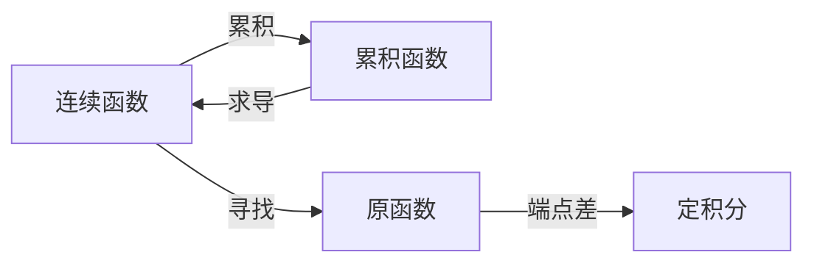

+++
date = '2026-10-23T14:00:00+08:00'
draft = false
title = '复合函数求导与四类积分：从变量、定义到连续可导的关系'
math = true
+++

复合函数求导时的“对谁求导”，以及不定积分、定积分、变限积分和反常积分的区别，表面上是符号问题，实质上是在问：**现在研究的对象是什么，变量是谁，结果是一个数、一个函数，还是一族函数？** 若这三件事没有先分开，公式即使记得再熟，也很容易在不该约分的地方约分，或者把一个数误当成函数。

本文只讨论单变量实函数，并以初等微积分中常用的黎曼积分为背景。核心结论先写在前面：复合函数的 $dy/du$ 与 $dy/dx$ 描述不同的变化率，二者由链式法则相连；不定积分是在寻找原函数，定积分是一个区间上的累积数值，变限积分是由累积定义出的新函数，反常积分则是把普通定积分的区间或被积函数的异常情形交给极限处理。

## 一、复合函数求导：先分清函数关系和自变量

设：

$$
y=F(u),\qquad u=g(x).
$$

于是 $y=F(g(x))$。这里有三个量：外层输出 $y$、中间变量 $u$ 和最初的自变量 $x$。同一个 $y$ 可以相对于不同变量讨论变化率，但它们不是同一件事。

| 写法 | 正在把谁看作自变量 | 它表示什么 |
| --- | --- | --- |
| $\dfrac{dy}{du}=F'(u)$ | $u$ | 外层函数 $F$ 对中间变量的变化率 |
| $\dfrac{du}{dx}=g'(x)$ | $x$ | 中间变量 $u$ 对 $x$ 的变化率 |
| $\dfrac{dy}{dx}=\bigl(F(g(x))\bigr)'$ | $x$ | 整个复合函数对 $x$ 的变化率 |

在满足可导条件时，链式法则给出：

$$
\frac{dy}{dx}
=\frac{dy}{du}\frac{du}{dx}
=F'(g(x))g'(x).
$$

### 外层求导与整体求导，差的正是内层变化率

取：

$$
y=e^u,\qquad u=x^2+1.
$$

把 $u$ 暂时当作独立变量，外层函数的导数是：

$$
\frac{dy}{du}=e^u.
$$

再代回 $u=x^2+1$，得到的是外层导数在当前中间变量处的取值：

$$
F'(g(x))=e^{x^2+1}.
$$

但问题若是“整个 $y=e^{x^2+1}$ 对 $x$ 求导”，还必须考虑 $u$ 随 $x$ 的变化：

$$
\frac{du}{dx}=2x,
$$

因此：

$$
\frac{dy}{dx}=e^{x^2+1}\cdot2x.
$$

$e^{x^2+1}$ 与 $2xe^{x^2+1}$ 显然不是同一个函数。在 $x=0$ 时，前者等于 $e$，后者等于 $0$；这已经足够说明“先对 $u$ 求导”与“整体对 $x$ 求导”并不等价。它们只有在 $du/dx=1$ 的特定情形下才恰好相同，不能把这种偶然当成规则。

### 两个容易混淆的撇号

下面两种写法外观相近，含义却不同：

$$
F'(g(x))
\qquad\text{与}\qquad
\bigl(F(g(x))\bigr)'.
$$

前者是“先对函数 $F$ 的自变量求导，再把 $u=g(x)$ 代入”，所以结果还没有乘 $g'(x)$。后者的撇号作用于整个表达式 $F(g(x))$，默认是对 $x$ 求导，因此：

$$
\bigl(F(g(x))\bigr)'=F'(g(x))g'(x).
$$

撇号本身不把“相对于哪个变量”写出来，所以在复合函数中，写出 $u=g(x)$、$dy/du$、$du/dx$ 往往更诚实。数学并不喜欢含混，只是它通常不会替你指出来而已。

### 为什么链式法则是相乘

当 $x$ 有小增量 $\Delta x$ 时，$u$ 的一阶变化近似为：

$$
\Delta u\approx \frac{du}{dx}\Delta x.
$$

而 $u$ 的小变化又使 $y$ 发生：

$$
\Delta y\approx \frac{dy}{du}\Delta u.
$$

代入即可得到：

$$
\Delta y
\approx
\frac{dy}{du}\frac{du}{dx}\Delta x.
$$

所以 $y$ 相对 $x$ 的局部变化倍率是两个倍率的乘积。把 $dy/du$、$du/dx$ 当作可以约分的普通分数是一种很有用的记忆方式；严格地说，它们各自是导数，链式法则才保证了这种“约分式”书写所表达的乘积关系。

## 二、四类积分：它们各自定义的对象是什么

先把四个概念放在同一张表中。它们都使用积分号，却不能因此被视为同义词。

| 名称 | 典型记号 | 结果的类型 | 核心定义 |
| --- | --- | --- | --- |
| 不定积分 | $\int f(x)\,dx$ | 一族函数 | 寻找导数等于 $f$ 的原函数 |
| 定积分 | $\int_a^b f(x)\,dx$ | 一个数 | 区间上小贡献之和的极限 |
| 变限积分 | $\int_a^x f(t)\,dt$ | 关于 $x$ 的函数 | 将累积的终点设为变量 |
| 反常积分 | $\int_a^\infty f(x)\,dx$ 等 | 极限存在时为一个数 | 用极限定义异常区间或无界被积函数的积分 |

### 不定积分：原函数的全体，而不是一个确定数

若在区间 $I$ 上有：

$$
F'(x)=f(x),
$$

则称 $F$ 是 $f$ 的一个**原函数**。该区间上的不定积分记作：

$$
\int f(x)\,dx=F(x)+C.
$$

其中 $C$ 是任意常数。若 $F$ 与 $G$ 都是 $f$ 在同一区间上的原函数，则 $(F-G)'=0$，所以 $F-G$ 在该区间上为常数；这正是不定积分必须保留 $+C$ 的原因。

例如：

$$
\int 2x\,dx=x^2+C.
$$

它并没有给出一个唯一函数，而是给出了所有纵向平移后的抛物线。还要注意“在同一区间上”这个限定：像 $1/x$ 这样的函数在 $(-\infty,0)$ 和 $(0,\infty)$ 上要分开讨论，不能穿过 $0$ 把常数不加区分地揉成一团。

### 定积分：区间上的带符号累积

对 $[a,b]$ 作越来越细的分割，第 $i$ 段长度为 $\Delta x_i$，并在该段选取一点 $\xi_i$。若无论怎样细分、怎样选取这些点，下列和都有同一个极限：

$$
\lim_{\max\Delta x_i\to0}
\sum_{i=1}^n f(\xi_i)\Delta x_i,
$$

就称 $f$ 在 $[a,b]$ 上可积，并把该极限定义为：

$$
\int_a^b f(x)\,dx.
$$

因此定积分的结果是一个数，表示总的**带符号累积**。当 $f\ge0$ 时，它等于曲线下的几何面积；当函数跨过 $x$ 轴时，正负贡献会抵消。它不是一个“带上下限的不定积分”，更不应写 $+C$。

### 变限积分：把累积终点变成变量，得到新函数

固定起点 $a$，令上限随 $x$ 改变：

$$
A(x)=\int_a^x f(t)\,dt.
$$

这时 $A$ 是一个函数，而非一个数。积分号中的 $t$ 是**哑变量**：它只负责在积分过程中跑遍区间，积分完成后便消失；外面的 $x$ 才是决定区间终点、也决定 $A$ 取值的变量。写成 $\int_a^x f(x)\,dx$ 在形式上也能被人猜到意思，却让同一个 $x$ 同时扮演两种角色，不值得保留这种模糊。

#### 为什么上限是 $x$，被积函数却写 $f(t)$

在：

$$
A(x)=\int_a^x f(t)\,dt
$$

中，两个字母的职责并不相同。

- **$x$ 是外部变量**：它决定累积到哪个终点。积分完成后，结果仍依赖 $x$，故记为 $A(x)$。
- **$t$ 是积分变量（哑变量，也称绑定变量）**：它只在积分号内部表示“从 $a$ 走到 $x$ 时当前经过的位置”。完成累加后，$t$ 不再出现在结果中。

因此，固定一个 $x$ 后，$t$ 才在区间 $[a,x]$ 内变化。把上式读成“让 $t$ 从 $a$ 变化到 $x$，累加每个位置的 $f(t)$ 的微小贡献”最不容易出错。

例如：

$$
A(x)=\int_0^x t^2\,dt
=\left.\frac{t^3}{3}\right|_0^x
=\frac{x^3}{3}.
$$

当 $x=2$ 时，$A(2)=\int_0^2t^2\,dt=8/3$。这里 $t$ 在计算时确实跑过 $0$ 到 $2$ 的全部位置；计算结束后，它被端点 $x$ 取代，留下的函数是 $x^3/3$。

哑变量的名字可以任意更换，不改变积分：

$$
\int_a^x f(t)\,dt
=\int_a^x f(u)\,du
=\int_a^x f(s)\,ds.
$$

$t$ 在这里不是复合函数中特殊的中间变量，只是一个局部名称。相反，外部的 $x$ 不能随意改成积分变量；若把同一个字母同时用作上限和积分变量，就会遮蔽它原本作为终点的角色。

更重要的是，下面两个式子并不相同：

$$
\int_a^x f(t)\,dt
\qquad\text{与}\qquad
\int_a^x f(x)\,dt.
$$

左式累加的是区间内每个位置的函数值。右式中 $x$ 对积分变量 $t$ 而言是常数，故 $f(x)$ 在整个累积过程中并不变化：

$$
\int_a^x f(x)\,dt
=f(x)\int_a^x1\,dt
=(x-a)f(x).
$$

取 $a=0$、$f(z)=z^2$，便有：

$$
\int_0^x t^2\,dt=\frac{x^3}{3},
\qquad
\int_0^x x^2\,dt=x^3.
$$

前者累加的是每个位置的平方，后者却是在长度为 $x$ 的区间内反复累加终点的平方；数值不同并不奇怪。于是，$\int_a^x f(x)\,dx$ 既让变量角色含混，也会掩盖这种本质差异。变限积分中把内部变量写成 $t$、$u$ 或 $s$，并非排版洁癖，而是为了把“终点”和“累加位置”明确分开。

若 $f$ 在 $x$ 附近连续，则微积分基本定理的第一部分说明：

$$
A'(x)=\frac{d}{dx}\int_a^x f(t)\,dt=f(x).
$$

其原因也能从变量角色看出来。上限由 $x$ 增加到 $x+h$ 时，新增的累积量为：

$$
A(x+h)-A(x)=\int_x^{x+h}f(t)\,dt.
$$

当 $h$ 很小时，连续性使这段短区间内的 $f(t)$ 近似为 $f(x)$，于是 $A(x+h)-A(x)\approx f(x)h$。除以 $h$ 再令 $h\to0$，便得到 $A'(x)=f(x)$。此时 $t$ 已完成积分过程并消失，留下的自然只能是外部变量 $x$。

若上下限都依赖 $x$，例如：

$$
H(x)=\int_{\varphi(x)}^{\psi(x)} f(t)\,dt,
$$

在 $f$ 连续、$\varphi$ 与 $\psi$ 可导时，应先把两个端点的变化分别算入：

$$
H'(x)=f(\psi(x))\psi'(x)-f(\varphi(x))\varphi'(x).
$$

上限贡献为正，下限贡献为负；这其实又是链式法则在端点上的体现。

### 反常积分：先做普通积分，再取极限

普通定积分要求积分区间有界，且被积函数在该区间上没有需要绕开的无界点。若区间无限长，或函数在端点、内部点无界，就需要用**反常积分**的极限定义，而不是直接套牛顿—莱布尼茨公式。

无穷区间的情形定义为：

$$
\int_a^\infty f(x)\,dx
=\lim_{b\to\infty}\int_a^b f(x)\,dx.
$$

例如：

$$
\int_1^\infty\frac1{x^2}\,dx
=\lim_{b\to\infty}\left[-\frac1x\right]_1^b
=1.
$$

端点无界的情形，例如 $f(x)=1/\sqrt{x}$ 在 $0$ 处无界，定义为：

$$
\int_0^1\frac1{\sqrt{x}}\,dx
=\lim_{\varepsilon\to0^+}
\int_{\varepsilon}^1\frac1{\sqrt{x}}\,dx
=2.
$$

极限存在且有限时称反常积分收敛，否则发散。若无界点位于区间内部，例如 $x=0$ 位于 $[-1,1]$ 中，必须拆成左右两个反常积分，并要求它们**分别**收敛。于是：

$$
\int_{-1}^{1}\frac1x\,dx
$$

作为反常积分发散；左右两侧各自发散，不能因为对称截断时看起来相消，就宣称它等于 $0$。后者讨论的是柯西主值，是另一个概念。

## 三、它们怎样连接：微积分基本定理不是一句口号

对连续函数，积分与求导构成两条方向相反、但条件不同的通路。

第一条是“积后求导”：若 $f$ 连续，则：

$$
\frac{d}{dx}\int_a^x f(t)\,dt=f(x).
$$

第二条是“导后积分”：若 $F'=f$，并满足初等微积分中常用的连续性条件，例如 $f$ 在 $[a,b]$ 连续，则：

$$
\int_a^b f(x)\,dx=F(b)-F(a).
$$

它们说明积分和微分互为逆过程，但这个说法要补上两点限定。

- 不定积分恢复原函数时只能恢复到 $+C$，因为求导会抹掉常数。
- 定积分还需要区间端点，结果是数值；变限积分才会把“累积”恢复成一个可再求导的函数。

例如 $f(t)=|t|$ 在整个实数轴连续。令：

$$
A(x)=\int_0^x|t|\,dt
=\frac{x|x|}{2}.
$$

虽然 $|x|$ 在 $0$ 处不可导，$A$ 仍在 $0$ 处可导，且 $A'(0)=|0|=0$。这里不要求被积函数 $f$ 自身可导；要求的是它在该点连续。反过来，$A$ 并非二阶可导，因为 $A'=|x|$ 在 $0$ 处不可导。这正好把“函数连续”“函数可导”与“其积分函数可导”分开了。

## 四、连续、可导、可微与可积：先限定语境，再谈推论

下面的结论针对定义域内部的一点 $a$；在闭区间端点，连续和导数要改用相应的单侧定义。

### 三个局部定义

函数 $f$ 在 $a$ 处**连续**，指：

$$
\lim_{x\to a}f(x)=f(a).
$$

函数 $f$ 在 $a$ 处**可导**，指差商有有限极限：

$$
f'(a)=\lim_{h\to0}\frac{f(a+h)-f(a)}h.
$$

对单变量函数，$f$ 在 $a$ 处**可微**，指存在一个线性主部，使：

$$
f(a+h)-f(a)=f'(a)h+o(h).
$$

此时把 $df=f'(a)\,dx$ 称为微分。在单变量情形，可微与可导等价；“微分”不是另一次独立运算，而是函数增量的一阶线性近似。在多元函数中，可微比“各偏导数存在”更强，但那已超出本文范围。

### 基本逻辑关系

在闭区间 $[a,b]$ 上讨论黎曼积分时，最安全的关系可以概括为：

$$
\text{可导}
\Longrightarrow
\text{连续}
\Longrightarrow
\text{黎曼可积}.
$$

这里第二个箭头是指函数在整个闭区间连续时，它在该闭区间黎曼可积。两个逆命题都不能成立。

| 已知条件 | 可以推出什么 | 不能反推什么 | 典型例子 |
| --- | --- | --- | --- |
| $f$ 在一点可导 | $f$ 在该点连续 | 连续不必可导 | $|x|$ 在 $0$ 连续但不可导 |
| $f$ 在 $[a,b]$ 连续 | $f$ 在该区间可积 | 可积不必连续 | 阶跃函数在闭区间可积但有跳跃 |
| $f$ 连续 | $A(x)=\int_a^x f(t)dt$ 可导且 $A'=f$ | $f$ 不必可导 | $f(x)=|x|$ |
| $F$ 可导 | $F$ 连续 | $F'$ 不必连续 | $F(x)=x^2\sin(1/x)$，且 $F(0)=0$ |

最后一行的例子在 $x\ne0$ 时有：

$$
F'(x)=2x\sin(1/x)-\cos(1/x),
$$

而 $F'(0)=0$。因此 $F$ 在 $0$ 处可导，但 $F'$ 在 $0$ 附近振荡，不能连续延拓到 $0$。所以“可导函数的导数一定连续”同样是错误的加强版结论。

可积也不保证存在原函数。定义阶跃函数：

$$
s(x)=
\begin{cases}
0,&x<0,\\
1,&x\ge0.
\end{cases}
$$

它在 $[-1,1]$ 黎曼可积，但不连续。其变限积分：

$$
S(x)=\int_0^x s(t)\,dt
=\begin{cases}
0,&x<0,\\
x,&x\ge0,
\end{cases}
$$

在 $0$ 处不可导。因此不能仅凭“$s$ 可积”便把 $\dfrac{d}{dx}\int_0^x s(t)\,dt$ 写成 $s(x)$；微积分基本定理的简单版本在这里缺少连续性条件。更进一步，阶跃函数也不可能在整个区间上是某个可导函数的导数，因为导数具有介值性质，不能出现这样的跳跃。

还应区分“$F$ 可导”与“$F'$ 可积”。$F$ 可导只能保证 $F$ 自己连续，不能自动保证其导函数具有初等黎曼积分所需的良好性质。初等题目中若要直接使用：

$$
\int_a^b F'(x)\,dx=F(b)-F(a),
$$

通常会给出或默认 $F'$ 连续；在更高层次的积分理论中可用更一般的条件，但不能把结论从前提中擅自拿走。

## 五、解题时如何避免把概念混在一起

遇到求导或积分题，可以依次问下面几件事。

1. **谁是自变量？** 若写了 $u=g(x)$，先分别求 $dy/du$ 与 $du/dx$，最后才得到 $dy/dx$。
2. **积分结果应是什么类型？** 有固定上下限得到数；有变量上限得到函数；没有上下限且在找原函数，结果要写 $+C$。
3. **积分号中的变量是否只是哑变量？** 对 $A(x)=\int_a^x f(t)dt$，$t$ 可以换成 $r$，但外部的 $x$ 不能随意换走。
4. **能否使用微积分基本定理？** 先检查连续性或题目给出的更强条件；反常积分还必须先检查相应极限是否收敛。
5. **“可导”“导数连续”“可积”分别说的是谁？** $F$ 的可导性、$F'$ 的连续性、以及 $f$ 的可积性是不同层次的命题，不能因为字面相近就互相替代。

## 总结

- 对 $y=F(u)$、$u=g(x)$，$dy/du$ 是外层对中间变量的导数，$dy/dx$ 是复合函数整体对 $x$ 的导数；二者由 $dy/dx=(dy/du)(du/dx)$ 联系，但不等价。
- 不定积分给出原函数族，定积分给出区间累积的数值，变限积分给出新的累积函数，反常积分则以极限定义无穷区间或无界函数的累积。
- 对连续函数，变限积分可通过求导恢复被积函数；对原函数，定积分可通过端点差计算。这就是积分与微分相互连接的准确形式。
- 在单变量中，可导与可微等价，且可导必连续；连续函数在闭区间上必黎曼可积，但连续不必可导、可积也不必连续，更不能仅凭可积就断言变限积分处处可导。
