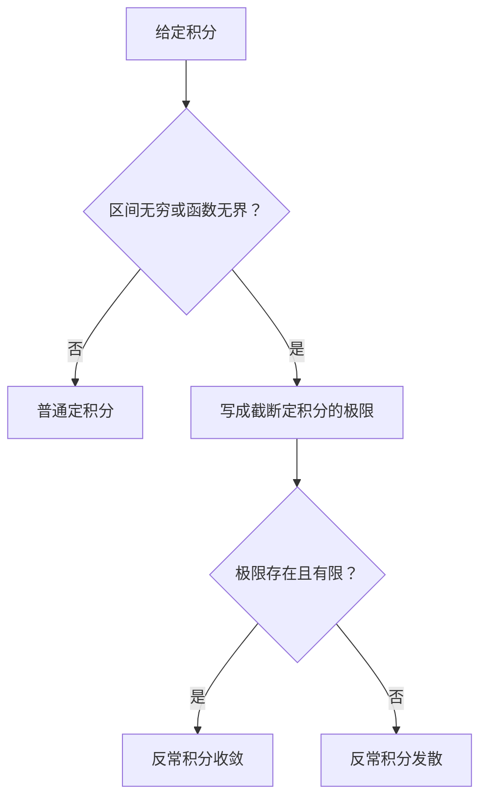

+++
date = '2026-10-24T10:20:00+08:00'
draft = false
title = '反常积分的敛散性：定义、判别与常见陷阱'
math = true
+++

普通定积分研究的是有限区间上、没有无界点的累积量；而“积分的敛散性”通常研究的对象是**反常积分**。当积分区间延伸到无穷，或被积函数在端点、内部点无界时，积分符号不再能直接代表一个普通定积分，必须先把它定义为极限。

核心结论很简单：**反常积分收敛，当且仅当定义它的相应极限存在且为有限实数；极限不存在或为无穷大时，反常积分发散。** 先确认是哪一种反常情形，再选择判别方法。直接把原函数代入“无穷”或奇点，既不严谨，也很容易得出看似漂亮但错误的答案。

## 普通定积分与反常积分的边界

普通定积分：

$$
\int_a^b f(x)\,dx
$$

要求区间 $[a,b]$ 有界，且 $f$ 在该区间上满足可积条件。若出现以下任一情形，就需要转入反常积分：

- 上限或下限是 $+\infty$、$-\infty$；
- 被积函数在端点附近无界；
- 被积函数在区间内部某点无界。

所谓“敛散”，不是在问被积函数 $f(x)$ 本身是否趋于零，而是在问不断扩展或不断避开奇点的**截断积分值**，能否稳定地趋于一个有限数。

## 无穷区间：先截断，再让端点走向无穷

对上限无穷的积分，定义是：

$$
\int_a^{\infty}f(x)\,dx
=\lim_{b\to\infty}\int_a^b f(x)\,dx.
$$

例如：

$$
\begin{aligned}
\int_1^{\infty}\frac1{x^2}\,dx
&=\lim_{b\to\infty}\int_1^b\frac1{x^2}\,dx\\
&=\lim_{b\to\infty}\left[-\frac1x\right]_1^b\\
&=\lim_{b\to\infty}\left(1-\frac1b\right)=1.
\end{aligned}
$$

因此该积分收敛。与之对照：

$$
\int_1^{\infty}\frac1x\,dx
=\lim_{b\to\infty}\ln b=+\infty,
$$

所以它发散。被积函数 $1/x$ 的确趋于零，但“每一小段贡献趋于零”并不足以保证总贡献有限；衰减得不够快时，无穷多个小量仍会累加到无穷大。

下限为 $-\infty$ 时同理：

$$
\int_{-\infty}^a f(x)\,dx
=\lim_{b\to-\infty}\int_b^a f(x)\,dx.
$$

若区间是整个实轴，不能把两个端点一起粗略写成“从 $-\infty$ 到 $+\infty$”。应选定一个有限分点 $c$，分别要求两段收敛：

$$
\int_{-\infty}^{\infty}f(x)\,dx
=\int_{-\infty}^{c}f(x)\,dx
+\int_c^{\infty}f(x)\,dx.
$$

右侧两项必须各自收敛。这一要求防止正负两端的发散量被人为拼成“抵消”。

## 端点奇异：靠近奇点时取单侧极限

若 $f$ 在左端点 $a$ 附近无界，定义为：

$$
\int_a^b f(x)\,dx
=\lim_{\varepsilon\to0^+}\int_{a+\varepsilon}^b f(x)\,dx.
$$

例如 $1/\sqrt{x}$ 在 $0$ 处无界，但其积分收敛：

$$
\begin{aligned}
\int_0^1\frac1{\sqrt{x}}\,dx
&=\lim_{\varepsilon\to0^+}\int_\varepsilon^1x^{-1/2}\,dx\\
&=\lim_{\varepsilon\to0^+}\left[2\sqrt{x}\right]_\varepsilon^1\\
&=2.
\end{aligned}
$$

函数在一点无界，不等于“面积一定无限大”。真正决定敛散的是它在奇点附近增长的速度。

## 内部奇点必须拆开，不能依赖对称抵消

若 $f$ 在 $c\in(a,b)$ 处无界，定义应拆成左右两段：

$$
\int_a^b f(x)\,dx
=\int_a^c f(x)\,dx+\int_c^b f(x)\,dx,
$$

其中：

$$
\int_a^c f(x)\,dx
=\lim_{u\to c^-}\int_a^u f(x)\,dx,
\qquad
\int_c^b f(x)\,dx
=\lim_{v\to c^+}\int_v^b f(x)\,dx.
$$

两侧必须**分别收敛**。考虑：

$$
\int_{-1}^{1}\frac1x\,dx.
$$

左侧积分趋于 $-\infty$，右侧积分趋于 $+\infty$，故作为反常积分它发散。若人为采用对称截断：

$$
\int_{-1}^{-\varepsilon}\frac1x\,dx
+\int_{\varepsilon}^{1}\frac1x\,dx=0,
$$

得到的 $0$ 称为**柯西主值**，它是另一种特殊的对称极限，不是这一定义下的反常积分值。两个发散量不能因视觉上对称就被准许相加，数学并没有那么容易被哄骗。

## 最基本的 $p$-积分判别

最常用的基准是幂函数积分。对 $p\in\mathbb R$：

$$
\int_1^{\infty}\frac1{x^p}\,dx
\begin{cases}
\text{收敛},&p>1,\\
\text{发散},&p\leq1;
\end{cases}
$$

而在 $0$ 的右侧：

$$
\int_0^1\frac1{x^p}\,dx
\begin{cases}
\text{收敛},&p<1,\\
\text{发散},&p\geq1.
\end{cases}
$$

两个判别的阈值都在 $p=1$，方向却相反：远处需要衰减得足够快，故 $p$ 要大于 $1$；奇点附近需要增长得不太快，故 $p$ 要小于 $1$。

| 考察位置 | 典型积分 | 收敛条件 | 直觉 |
| --- | --- | --- | --- |
| $x\to\infty$ | $\int_1^\infty x^{-p}\,dx$ | $p>1$ | 尾部必须衰减得快 |
| $x\to0^+$ | $\int_0^1x^{-p}\,dx$ | $p<1$ | 奇点不能增长得太猛 |

例如：

$$
\int_1^\infty\frac1{x^{3/2}}\,dx
$$

收敛，因为 $3/2>1$；而：

$$
\int_0^1\frac1{x^{3/2}}\,dx
$$

发散，因为在零点附近 $3/2\geq1$。同一个被积函数，换一个考察区间，结论便可能相反；只背“$p$ 大于一收敛”显然不够。

## 正函数的比较判别与等价无穷小

设在考察区间的尾部或奇点附近有 $0\leq f(x)\leq g(x)$。

- 若 $\int g(x)\,dx$ 收敛，则 $\int f(x)\,dx$ 也收敛。
- 若 $\int f(x)\,dx$ 发散，则 $\int g(x)\,dx$ 也发散。

这就是正函数的比较判别法。它只能沿着这两个方向使用：小于一个收敛的大函数能推出收敛；大于一个发散的小函数能推出发散。反向推理没有依据。

### 比较判别法为什么成立：直接回到反常积分定义

以无穷区间为例。设从某个 $A$ 开始，$0\leq f(x)\leq g(x)$，并定义截断积分：

$$
F(b)=\int_A^b f(x)\,dx,
\qquad
G(b)=\int_A^b g(x)\,dx
\quad(b>A).
$$

由定积分的保序性可知：

$$
0\leq F(b)\leq G(b).
$$

又因为 $f,g\geq0$，随着上限 $b$ 增大，$F(b)$、$G(b)$ 都单调不减。反常积分的定义正是研究这些截断积分在 $b\to\infty$ 时的极限。

**第一种方向：大函数收敛，推出小函数收敛**。若 $\int_A^\infty g(x)\,dx=L<\infty$，则对任意 $b>A$ 有 $G(b)\leq L$，从而：

$$
0\leq F(b)\leq L.
$$

$F(b)$ 单调不减且有上界，故它有有限极限。按定义：

$$
\int_A^\infty f(x)\,dx
=\lim_{b\to\infty}F(b)
$$

收敛。这就是“可积的大罩住更小的非负函数，小函数也可积”。

**第二种方向：小函数发散，推出大函数发散**。若 $\int_A^\infty f(x)\,dx$ 发散到 $+\infty$，任给正数 $M$，总能找到某个 $b_M$ 使 $F(b_M)>M$。此时：

$$
G(b_M)\geq F(b_M)>M.
$$

而 $G$ 单调不减，所以当 $b\geq b_M$ 时都有 $G(b)>M$。这对任意 $M$ 都成立，故 $G(b)\to+\infty$，即 $\int_A^\infty g(x)\,dx$ 发散。

证明中没有使用任何神秘技巧，只有三件事：把反常积分写回截断积分的极限、利用非负性得到单调性、利用 $f\leq g$ 得到截断积分的不等式。也因此，若函数变号，不能省略绝对值就生搬这一证明。

端点奇异的情形完全同理。例如在 $a$ 的右侧研究 $\int_a^c f(x)\,dx$，应先写：

$$
F(\varepsilon)=\int_{a+\varepsilon}^{c}f(x)\,dx,
\qquad \varepsilon\to0^+.
$$

若 $0\leq f\leq g$ 在 $a$ 附近成立，则每个足够小的 $\varepsilon$ 都有 $F(\varepsilon)\leq G(\varepsilon)$。随着 $\varepsilon$ 减小，非负函数对应的截断积分单调不减，因而同样得到“上界函数收敛则下界函数收敛、下界函数发散则上界函数发散”。所谓比较判别法，本质上就是定义里的极限不等式没有在取极限时失效。

### 用定义和比较判断一个例子

考虑：

$$
\int_1^\infty\frac{2x+3}{x^3+x}\,dx.
$$

这里的函数为正，且当 $x\geq1$ 时有：

$$
0\leq\frac{2x+3}{x^3+x}
\leq\frac{5x}{x^3}
=\frac5{x^2}.
$$

因为 $\int_1^\infty5x^{-2}\,dx$ 收敛，按刚刚从定义证明的第一种方向，原积分收敛。这个论证并没有计算原函数；它只需要在决定敛散的尾部给出一个足够好的可积上界。

极限比较判别更适合渐近形式相似的函数。若 $f(x),g(x)>0$，且在相应考察位置有：

$$
\lim\frac{f(x)}{g(x)}=L,
\qquad 0<L<\infty,
$$

则两个反常积分同敛散。例如当 $x\to\infty$：

$$
\frac{x+1}{x^3+2x}
\sim\frac{x}{x^3}=\frac1{x^2},
$$

因此：

$$
\int_1^\infty\frac{x+1}{x^3+2x}\,dx
$$

与 $\int_1^\infty x^{-2}\,dx$ 同敛散，故收敛。

这里的 $\sim$ 不是说两个函数处处相等，而是比值趋于 $1$，说明在决定敛散的“远处”或“奇点附近”，它们拥有同一数量级。

## 含振荡函数时：绝对收敛与条件收敛

当被积函数会变号时，比较正函数前应先观察绝对值。若：

$$
\int_a^\infty|f(x)|\,dx
$$

收敛，则称 $\int_a^\infty f(x)\,dx$ **绝对收敛**，并可推出原积分收敛。

例如：

$$
\left|\frac{\sin x}{x^2}\right|\leq\frac1{x^2},
$$

所以：

$$
\int_1^\infty\frac{\sin x}{x^2}\,dx
$$

绝对收敛。

不过原积分收敛，并不总是绝对收敛。经典例子是：

$$
\int_1^\infty\frac{\sin x}{x}\,dx.
$$

它依靠正负振荡的抵消而收敛，但：

$$
\int_1^\infty\frac{|\sin x|}{x}\,dx
$$

发散，因此前者称为**条件收敛**。证明这种振荡积分收敛通常可用分部积分、Dirichlet 判别等方法；不能因为 $\sin x$ 有界，就把它忽略为“差不多等于零”。有界不等于绝对可积，这个区别相当重要。

## 解题顺序与常见误区

面对一个要判敛散的积分，可按下面的顺序处理。

1. 找出异常位置：无穷端点、零点、分母为零点、对数的边界等。
2. 在每个异常位置分别写成截断积分的极限；内部奇点必须拆段。
3. 若能直接求原函数，先计算截断积分，再判断极限。
4. 若不宜直接积分，对正函数尝试比较、极限比较与 $p$-积分；对振荡函数先检查绝对收敛，再考虑专门判别。
5. 所有需要的分段极限都有限，才能下结论为收敛。

以下错误最常见：

- **把 $f(x)\to0$ 当成积分收敛的充分条件**：$1/x\to0$，但 $\int_1^\infty1/x\,dx$ 发散。
- **不拆内部奇点**：$\int_{-1}^1 1/x\,dx$ 的对称截断为零，却不是收敛的反常积分。
- **把 $\infty$ 直接代入原函数**：应先写极限；原函数在无穷处的“值”本身不是普通代入。
- **比较方向用反**：由 $f\leq g$ 与 $\int g$ 发散，不能推出较小的 $\int f$ 发散；由 $f\leq g$ 与 $\int f$ 收敛，也不能推出较大的 $\int g$ 收敛。
- **忽略符号变化**：有正负号时，正函数比较法不能直接套在 $f$ 上，通常要先处理 $|f|$ 或使用振荡判别。

## 小结

- 反常积分的敛散性由截断定积分的极限是否有限决定。
- 无穷区间、端点奇异和内部奇异都要用相应的单侧极限定义；内部奇点必须分开检查两边。
- $p$-积分的阈值是 $p=1$：在无穷远处要求 $p>1$，在零点附近要求 $p<1$。
- 对非负函数可用比较与极限比较；对振荡函数要区分绝对收敛和条件收敛。
- 被积函数趋于零只是必要信号，不是积分收敛的保证。
