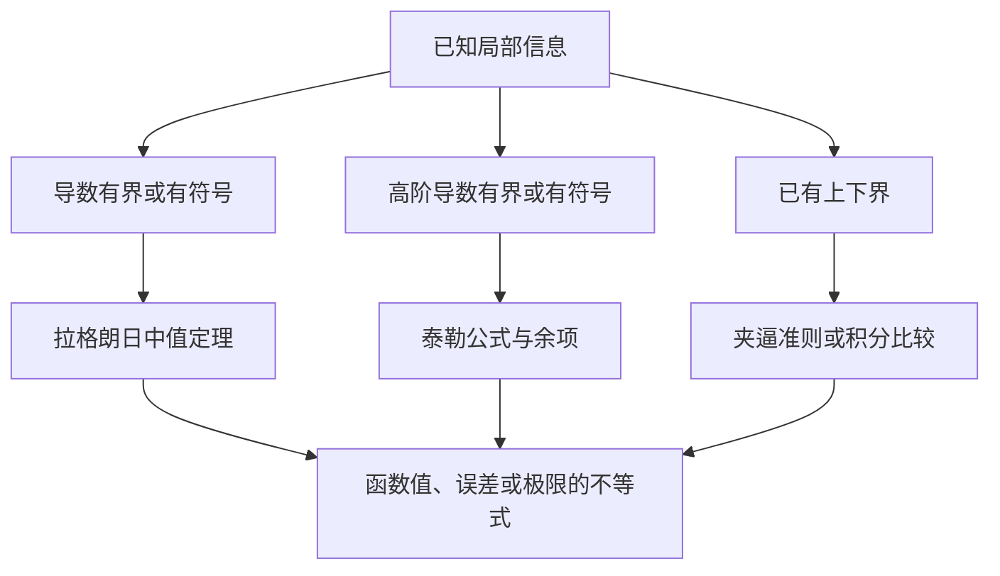

+++
date = '2026-10-25T16:00:00+08:00'
draft = false
title = '积分拆分、变限积分与微积分定理：从线性到不等式'
math = true
+++

学习积分时，最容易造成混乱的并不是计算技巧，而是同一个积分号在不同场景中承担了不同职责：它有时表示一族原函数，有时表示一个数，有时又定义出一个新函数；一旦积分区间延伸到无穷或碰到奇点，它还必须先被理解为极限。若不先分清对象与条件，就很容易把“可以拆”误读成“怎样拆都不会出事”。显然，数学不会因为式子看起来整齐就放宽定义。

本文围绕四个问题建立一条主线：积分何时可以拆分；变限积分、定积分和反常积分分别是不是函数；它们如何与导数、原函数相连；拉格朗日中值定理、泰勒公式和夹逼准则又为何能反复用于不等式。核心思想只有一个：**所有公式都在特定结构与条件下，把局部信息、累积信息或大小关系安全地传递到另一个结论。**

## 一、先分清三种不同的“拆分”

设 $f$、$g$ 是函数。下面三个式子外观相近，逻辑却不同：

$$
\int (f+g),
\qquad
\int_a^b f,
\qquad
\int_a^x f(t)\,dt+\int_x^b f(t)\,dt.
$$

- 第一种是把**被积函数**拆成两项。
- 第二种是把**积分区间**在某个点切成两段。
- 第三种把分点 $x$ 设为变量，于是右侧的两项都是函数，但它们的和仍是固定的定积分。

先确认自己正在使用哪一种，后面的规则才不会混在一起。

### 普通定积分：线性与区间可加性

若 $f$ 与 $g$ 都在有限闭区间 $[a,b]$ 上可积，则定积分具有线性：

$$
\int_a^b\bigl(f(x)+g(x)\bigr)\,dx
=\int_a^b f(x)\,dx+\int_a^b g(x)\,dx.
$$

常数倍也可以提出：

$$
\int_a^b\bigl(\lambda f(x)+\mu g(x)\bigr)\,dx
=\lambda\int_a^b f(x)\,dx+\mu\int_a^b g(x)\,dx.
$$

这并不是“把积分号当括号拆开”的视觉规则，而是黎曼和的线性所保证的性质：每一个小区间上的贡献本来就满足加法，取极限后仍保持加法。

若 $c\in[a,b]$，并且 $f$ 在 $[a,b]$ 上可积，则区间也可以拆开：

$$
\int_a^b f(t)\,dt
=\int_a^c f(t)\,dt+\int_c^b f(t)\,dt.
$$

因此，对任意 $x\in[a,b]$，都有：

$$
\int_a^b f(t)\,dt
=\int_a^x f(t)\,dt+\int_x^b f(t)\,dt.
$$

右侧第一项记为 $A(x)$，第二项记为 $B(x)$。它们确实都是变限积分函数；但相加后总是同一个常数：

$$
A(x)+B(x)=\int_a^b f(t)\,dt.
$$

若 $f$ 连续，求导可进一步验证这一点：

$$
A'(x)=f(x),\qquad B'(x)=-f(x),\qquad \bigl(A(x)+B(x)\bigr)'=0.
$$

所以“一个定积分能拆成两个变限积分”可以成立，但准确说法是：**固定定积分可表示成两个随分点变化、且变化恰好相互抵消的变限积分之和。**

### 反常积分：先写成极限，才能讨论能否拆

考虑上限为无穷的情形：

$$
\int_a^{\infty}f(x)\,dx
=\lim_{R\to\infty}\int_a^R f(x)\,dx.
$$

若两个反常积分都分别收敛：

$$
\int_a^{\infty}f(x)\,dx,
\qquad
\int_a^{\infty}g(x)\,dx,
$$

那么极限的线性允许我们写：

$$
\int_a^{\infty}\bigl(f(x)+g(x)\bigr)\,dx
=\int_a^{\infty}f(x)\,dx
+\int_a^{\infty}g(x)\,dx.
$$

这给出一个很实用的**充分条件**：分别证明两项都收敛，就能证明和的反常积分收敛，而且数值可以相加。

但它不是必要条件。请看一个并非恒等于零的例子：

$$
\int_1^{\infty}\left(\frac1x-\frac1{x+1}\right)\,dx.
$$

拆开的两项分别发散：

$$
\int_1^{\infty}\frac1x\,dx=+\infty,
\qquad
\int_1^{\infty}-\frac1{x+1}\,dx=-\infty.
$$

但先把被积函数合并，便有：

$$
\frac1x-\frac1{x+1}=\frac1{x(x+1)}.
$$

截断积分为：

$$
\int_1^R\left(\frac1x-\frac1{x+1}\right)\,dx
=\ln\frac{2R}{R+1}\longrightarrow\ln2.
$$

也就是说，若先把原式拆开，右侧出现了没有定义为有限数的“$+\infty+(-\infty)$”，这个式子不能用；原来的积分却仍然收敛。**一个和收敛，并不自动推出两个加项分别收敛。**

反过来，若已知 $\int(f+g)$ 与 $\int f$ 都收敛，则可以通过差得到 $\int g$ 收敛。这只是有限实数之间的减法，并没有让两个发散量做危险的抵消。

### 非负函数是可以放心拆开的特殊情形

若在考察的尾部或奇点附近始终有：

$$
f(x)\geq0,
\qquad g(x)\geq0,
$$

那么不存在正负抵消。此时在允许取值 $+\infty$ 的意义下：

$$
\int (f+g)=\int f+\int g,
$$

并且：

$$
\int(f+g)\text{ 收敛}
\iff
\int f\text{ 与 }\int g\text{ 都收敛}.
$$

理由很直接：$0\leq f\leq f+g$、$0\leq g\leq f+g$。若总量有限，两部分不可能各自无限大；若其中一部分已经无限大，总量也不可能有限。这正是比较判别法能够工作的底层秩序。

### 内部奇点与整条实轴：分段不是可选项

若反常点在区间内部，例如 $c\in(a,b)$，标准反常积分的定义就是：

$$
\int_a^b f(x)\,dx
=\int_a^c f(x)\,dx+\int_c^b f(x)\,dx,
$$

其中左右两项都要各自收敛。例子：

$$
\int_{-1}^{1}\frac1x\,dx
$$

在 $0$ 处分成左右两段后，一段趋于 $-\infty$，另一段趋于 $+\infty$，所以它发散。对称地删去 $(-\varepsilon,\varepsilon)$ 后恰好算出 $0$，得到的是**柯西主值**，不是通常定义下的反常积分。

同样地：

$$
\int_{-\infty}^{\infty}f(x)\,dx
$$

应在任意有限点 $c$ 分为 $\int_{-\infty}^{c}f$ 与 $\int_c^{\infty}f$，并要求两段分别收敛；不能让左右无穷远处的发散量彼此“抵消”。

### 拆分时的判断表

| 情形 | 能否直接写成两项之和 | 需要的条件与结论 |
| --- | --- | --- |
| 有限区间的普通定积分 | 可以 | 相应函数可积时，线性与区间可加性成立 |
| 反常积分的被积函数 $f+g$ | 可以，但有条件 | $\int f$、$\int g$ 分别收敛时才能安全相加 |
| 反常积分且 $f,g\geq0$ | 可以 | 收敛当且仅当两项都收敛 |
| 内部奇点或全实轴 | 必须先分段定义 | 每个异常位置两侧都要单独收敛 |
| 两个发散项相加 | 不可以 | $+\infty-\infty$ 没有定义，不能当作零 |

因此，比较判别法难找对象时，尝试拆分是一种合理策略；只是它只能在你能证明每个拆出部分都收敛时，作为充分证明使用。若拆后有发散项，结论并不是“原式发散”，而是“这条拆分路线没有给出结论”。

## 二、四类积分：结果究竟是函数还是数

积分符号并不决定结果的类型；上下限和极限过程才决定。下面先把对象放在同一张表中。

| 名称 | 典型形式 | 结果 | 最核心的理解 |
| --- | --- | --- |
| 不定积分 | $\int f(x)\,dx$ | 一族函数 | 所有原函数 |
| 定积分 | $\int_a^b f(t)\,dt$ | 一个数 | 有限区间上的带符号累积 |
| 变限积分 | $\int_a^x f(t)\,dt$ | 一个函数 | 累积终点随 $x$ 改变 |
| 反常积分 | $\int_a^{\infty}f(t)\,dt$ | 收敛时是一个数 | 截断定积分的极限 |

### 不定积分：寻找原函数的全体

若在区间 $I$ 上：

$$
F'(x)=f(x),
$$

则 $F$ 是 $f$ 的一个原函数，记作：

$$
\int f(x)\,dx=F(x)+C.
$$

这里的 $+C$ 不可省略：同一导数对应一族彼此相差常数的函数。它是“逆求导”的答案，不是面积，也不是一个唯一数值。

### 变限积分：由累积定义出的函数

固定起点 $a$，定义：

$$
A(x)=\int_a^x f(t)\,dt.
$$

$t$ 是积分内部的哑变量，只负责跑过累积区间；$x$ 才是函数的自变量。若 $f$ 连续，微积分基本定理给出：

$$
A'(x)=f(x).
$$

于是 $A$ 不只是一个函数，还是 $f$ 的一个特定原函数，并且由初值：

$$
A(a)=0
$$

唯一地选定。相比 $F(x)+C$ 的整个家族，变限积分选择了“在 $a$ 处取零”的那一个成员。

变限积分当然可以“求”。若已知 $f$ 的一个原函数 $G$，在牛顿—莱布尼茨公式适用的通常条件下：

$$
A(x)=\int_a^x f(t)\,dt=G(x)-G(a).
$$

例如：

$$
\int_0^x t^2\,dt=\frac{x^3}{3}.
$$

不过“可定义”不等于“一定能用初等函数写出来”。有些连续函数的积分没有初等表达式，例如：

$$
\int_0^x e^{-t^2}\,dt.
$$

它仍是完全良好的函数，也能求导、估计和数值计算；只是不能期待每个答案都恰好长成有限个初等符号。符号计算并不是函数存在的许可证。

若只知道 $f$ 在 $[a,b]$ 上黎曼可积，$A(x)=\int_a^x f(t)\,dt$ 仍是连续函数；更精确地说，$A$ 在 $f$ 的连续点满足 $A'(x)=f(x)$。因此，要在整个区间上无条件地把 $A$ 称为 $f$ 的原函数，常用且足够的假设仍是 $f$ 连续。

还可以再问一步：“$A$ 本身有原函数吗？”既然可积函数生成的 $A$ 连续，那么它有原函数：选定 $d$ 后令：

$$
K(x)=\int_d^x A(s)\,ds,
$$

便有 $K'(x)=A(x)$。这只是再积一次，不应和“$A$ 是谁的原函数”混为一谈。

### 定积分与收敛的反常积分：它们本身是数

在：

$$
C=\int_a^b f(t)\,dt
$$

中，$a,b$ 都固定，积分完成后 $C$ 是一个数。数本身并不是以 $x$ 为自变量的函数，所以直接问“这个定积分有没有原函数”在类型上并不准确。

若有意把数 $C$ 看成常值函数 $C(x)\equiv C$，它的原函数当然是：

$$
Cx+D.
$$

但这说的是常值函数，不是说定积分突然变成了不定积分。收敛的反常积分也是一样：

$$
\int_a^{\infty}f(t)\,dt=L
$$

一旦极限存在，它就是数 $L$；它没有需要对自变量求导的含义。

若希望从反常积分得到函数，应当把一个端点保留为变量。例如在尾积分对每个 $x\geq a$ 都收敛、且 $f$ 连续时：

$$
R(x)=\int_x^{\infty}f(t)\,dt
$$

是一个函数，并且：

$$
R'(x)=-f(x).
$$

负号来自下限在向右移动：你从总累积中拿走了一小段。它与 $A'(x)=f(x)$ 正好对应。

### 它们与被积函数的关系

对连续函数 $f$，几种对象可用下面的链条统一理解：

```mermaid
flowchart LR
    f[连续函数 f]
    family[原函数族 G + C]
    accum[变限积分 A(x) = 积分从 a 到 x f(t)dt]
    value[定积分 G(b) - G(a)]
    tail[尾积分 R(x) = 积分从 x 到 无穷 f(t)dt]

    f -->|逆求导| family
    f -->|从 a 累积| accum
    accum -->|求导| f
    family -->|端点相减| value
    tail -->|求导| f
```

最后一条箭头在图中省略了符号：尾积分求导实际是 $R'(x)=-f(x)$。这幅图表达的不是“所有积分都一样”，而是它们经由微积分基本定理共享一条桥梁：原函数描述局部变化率的逆操作，定积分描述区间累积，变限积分把累积重新变成函数。

## 三、除不定积分外，哪些积分可以求导

与其问“积分能不能求导”，不如先问：**积分表达式算完后，是否还留下一个自变量？**

### 上下限固定：对外部变量的导数是零

若：

$$
C=\int_a^b f(t)\,dt,
$$

且没有任何 $x$ 参与上下限或被积函数，那么 $C$ 是常数。若把它视为常值函数，便有：

$$
\frac{d}{dx}C=0.
$$

### 只有端点变化：端点公式

当 $f$ 连续、$\alpha(x)$ 与 $\beta(x)$ 可导时：

$$
H(x)=\int_{\alpha(x)}^{\beta(x)}f(t)\,dt
$$

满足：

$$
H'(x)
=f\bigl(\beta(x)\bigr)\beta'(x)
-f\bigl(\alpha(x)\bigr)\alpha'(x).
$$

它可以看作“变限积分求导”与链式法则的组合：上端增加带来正贡献，下端增加会删去已累积的一段，因此带负号。

### 被积函数也含参数：莱布尼茨积分求导法则

更一般地，令：

$$
H(x)=\int_{\alpha(x)}^{\beta(x)}q(t,x)\,dt.
$$

若 $q$ 与偏导数 $\partial q/\partial x$ 在相关区域连续，并且端点函数可导，则：

$$
\begin{aligned}
H'(x)
={}&q\bigl(\beta(x),x\bigr)\beta'(x)
-q\bigl(\alpha(x),x\bigr)\alpha'(x)\\
&+\int_{\alpha(x)}^{\beta(x)}\frac{\partial q}{\partial x}(t,x)\,dt.
\end{aligned}
$$

前两项来自区间边界的移动，最后一项来自每个位置的函数值本身随 $x$ 改变。它回答了“固定上下限的定积分能否有非零导数”：如果被积函数还依赖参数 $x$，答案可以是可以。

例如：

$$
H(x)=\int_0^1 xt^2\,dt=\frac{x}{3},
$$

所以：

$$
H'(x)=\int_0^1 t^2\,dt=\frac13.
$$

对于反常积分，也能在额外条件下对参数求导，但条件比有限区间严格得多；通常需要某种一致收敛或可积的控制函数，才能合法地把求导换进无穷积分号。仅仅“形式上能求导”不构成证明，正如两个发散积分并排写出来也不会自动变得有意义。

## 四、为什么中值定理、泰勒公式与夹逼准则能反复使用

它们并不是“任何题目都能硬套的万能招式”。它们之所以经常出现，是因为微积分的大量问题都在处理三类信息：

- **变化率**：导数告诉我们局部怎么变；
- **累计误差**：函数值与近似式相差多少；
- **大小与极限**：一个量能否被另两个量夹住。

中值定理、泰勒公式和夹逼准则恰好分别提供了这些信息的传递规则。

### 拉格朗日中值定理：把整体增量交给某处的导数

若 $f$ 在 $[p,q]$ 连续、在 $(p,q)$ 可导，则存在 $\xi\in(p,q)$，使得：

$$
f(q)-f(p)=f'(\xi)(q-p).
$$

它不是说每一点的导数都等于平均变化率，而是说至少存在一个中间点实现了这个平均斜率。其证明来自罗尔定理；罗尔定理又依赖连续函数在闭区间取到最值，以及内点极值处导数为零。这些条件不是装饰，而是结论得以落地的支架。

若在区间上已知：

$$
m\leq f'(x)\leq M,
$$

对 $x>a$ 使用中值定理，便得到：

$$
m(x-a)
\leq f(x)-f(a)
\leq M(x-a).
$$

这就是导数界转化为函数不等式的基本机制。特别地，若 $|f'(x)|\leq M$，则：

$$
|f(x)-f(a)|\leq M|x-a|.
$$

局部变化率被控制，就能控制任意两点之间的总变化；这类估计称为 Lipschitz 型估计，也是分析中反复出现的骨架。

例如在 $x\geq0$ 上，$e^u$ 单调递增，且对 $u\in[0,x]$ 有 $1\leq e^u\leq e^x$。对 $e^x-e^0$ 使用中值定理，可得某个 $\xi\in(0,x)$ 使：

$$
e^x-1=xe^{\xi}.
$$

从而：

$$
x\leq e^x-1\leq xe^x.
$$

中值定理在这里没有直接“算出” $e^x$，却给出了足够锋利的大小估计。

### 泰勒公式：把函数写成近似多项式加可控余项

若 $f\in C^{n+1}$，则在 $a$ 附近：

$$
f(x)
=\sum_{k=0}^{n}\frac{f^{(k)}(a)}{k!}(x-a)^k
+\frac{f^{(n+1)}(\xi)}{(n+1)!}(x-a)^{n+1},
$$

其中 $\xi$ 位于 $a$ 与 $x$ 之间。最后一项称为拉格朗日余项。它说明泰勒公式的重点不仅是“展开”，更是**误差能被高阶导数控制**。

例如，对 $0<x\leq\pi/2$ 的 $\sin x$ 在 $0$ 处展开到二次项：

$$
\sin x=x-\frac{\cos\xi}{6}x^3,
\qquad \xi\in(0,x).
$$

因为 $0\leq\cos\xi\leq1$，立即得到：

$$
x-\frac{x^3}{6}\leq\sin x\leq x.
$$

看起来像三角函数不等式的结论，本质上是在给余项定符号、定大小。泰勒公式可以理解为把拉格朗日中值定理重复、更精细地使用：前者把有限增量压缩成一阶导数，后者逐层剥离低阶变化，把剩余误差交给更高阶导数。

### 夹逼准则：由顺序关系传递极限

若在某个去心邻域内有：

$$
g(x)\leq f(x)\leq h(x),
$$

并且：

$$
\lim_{x\to a}g(x)
=\lim_{x\to a}h(x)=L,
$$

则：

$$
\lim_{x\to a}f(x)=L.
$$

它背后的逻辑并不神秘：$f(x)$ 到 $L$ 的偏差被两侧函数的偏差限制，而两侧偏差都能任意小，中间者自然无处可逃。夹逼准则不需要可导性；它只依赖邻域内的不等式与两端的极限。

积分比较判别与它同属一种“顺序传递”。对有限区间上可积的函数，若：

$$
f(t)\leq g(t),
$$

则：

$$
\int_a^b f(t)\,dt\leq\int_a^b g(t)\,dt.
$$

对非负反常积分，这个关系经过截断、再取极限，便成为比较判别法。由此可见，极限夹逼、函数不等式和积分敛散并不是各自孤立的技巧；它们都依赖实数大小关系在极限与累积过程中的稳定性。

### 一张图看清三类定理如何服务于不等式



所以解不等式时，常见的提问方式应当是：我已知的是导数、二阶导数、函数的上下界，还是某个极限？然后选择能把这类信息搬运到目标结论的定理，而不是先从记忆库里随机抽一个名字。

## 五、使用这些工具前，先检查条件与对象

微积分中的错误通常不是算错一行，而是第一步就把对象认错。以下检查顺序足够实用。

1. **这是普通定积分还是反常积分？** 是否有无穷端点、分母为零或内部无界点；若有，先写截断极限并分段。
2. **拆的是函数还是区间？** 函数相加的反常积分需要分别收敛才可线性相加；区间经过奇点时需要左右分别检查。
3. **积分结果还含有自变量吗？** 有变量端点或参数才谈导数；上下限与被积函数都固定时，结果只是数。
4. **要用微积分基本定理时，连续性够吗？** 连续是最常用、最安全的充分条件；仅可积时，变限积分的导数结论只保证在被积函数的连续点成立。
5. **要用中值定理或泰勒公式时，连续与可导条件满足吗？** 拉格朗日中值定理要求闭区间连续、开区间可导；带拉格朗日余项的泰勒公式还需要相应阶数的导数条件。
6. **不等式在哪个区间成立？** 余项的符号、导数的上下界、三角函数的正负性都依赖区间。脱离区间的“恒成立”往往只是尚未检查过的愿望。

## 小结

- 有限区间可积函数可按被积函数线性拆分，也可按区间分段；固定定积分还能写成两个变限积分之和。
- 对反常积分，分别收敛的加项可以相加；但原式收敛不代表拆出的各项收敛。非负函数没有抵消时，才有“和收敛当且仅当各项收敛”。
- 不定积分给出原函数族；变限积分给出函数，并在被积函数连续时是一个固定初值的原函数；定积分和收敛的反常积分本身是数。
- 积分表达式是否能求导，取决于是否仍有变量以及变量出现在哪里。端点变化、被积函数含参数时，分别使用微积分基本定理与莱布尼茨公式。
- 拉格朗日中值定理把导数界转成函数增量界，泰勒公式把高阶导数界转成近似误差界，夹逼准则与积分比较把大小关系转成极限或敛散结论。

当这些概念各自回到“函数、数、极限、条件”四个位置后，积分题不再是不断换符号的记忆游戏。真正需要守住的并不多：先定义对象，再检查条件，最后才允许公式出场。 
