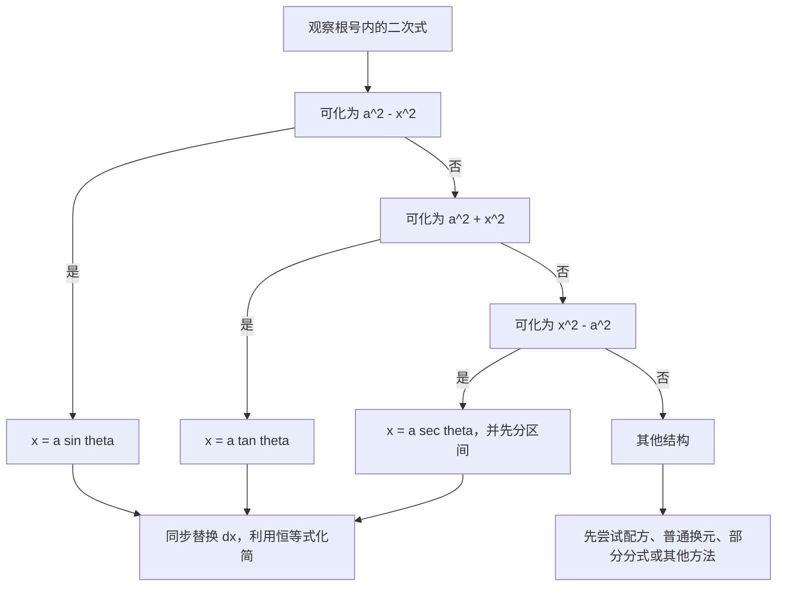

+++
date = '2026-10-27T22:00:00+08:00'
draft = false
title = '三角函数代换：用三角恒等式处理根式积分'
math = true
+++

含有 $\sqrt{a^2-x^2}$、$\sqrt{a^2+x^2}$ 或 $\sqrt{x^2-a^2}$ 的积分，常常让人误以为需要某个很巧的变形。其实三角函数代换的核心非常固定：把根号中的二次式变成三角恒等式里的平方，从而让根号消失。

它不是看到根号就立刻把 $x$ 换成三角函数的机械动作。先辨认根号的符号结构，再选择与之匹配的恒等式，并为角度限定一个区间，整个计算才会同时在代数上正确、在符号上干净。若省略这些条件，最后常会莫名多出或少掉绝对值——数学不会替这种含糊负责。

## 一、为什么三角函数能消去这三类根式

三角函数代换依赖的不是三角形画法，而是三条平方恒等式：

$$
1-\sin^2\theta=\cos^2\theta,
$$

$$
1+\tan^2\theta=\sec^2\theta,
$$

$$
\sec^2\theta-1=\tan^2\theta.
$$

设 $a>0$。只要把 $x$ 缩放为 $a$ 的倍数，三种常见的根式就恰好可以对应到上面的三条恒等式：

| 根式结构 | 代换 | 根号化简 | 一个方便的角度范围 |
| -------- | ---- | -------- | ------------------ |
| $\sqrt{a^2-x^2}$ | $x=a\sin\theta$ | $a\cos\theta$ | $-\pi/2\le\theta\le\pi/2$ |
| $\sqrt{a^2+x^2}$ | $x=a\tan\theta$ | $a\sec\theta$ | $-\pi/2<\theta<\pi/2$ |
| $\sqrt{x^2-a^2}$，且 $x\ge a$ | $x=a\sec\theta$ | $a\tan\theta$ | $0\le\theta<\pi/2$ |

以第一行为例，令 $x=a\sin\theta$，则：

$$
\begin{aligned}
a^2-x^2
&=a^2-a^2\sin^2\theta\\
&=a^2\cos^2\theta.
\end{aligned}
$$

所以严格地说：

$$
\sqrt{a^2-x^2}=a|\cos\theta|.
$$

我们选择 $-\pi/2\le\theta\le\pi/2$，正是为了保证 $\cos\theta\ge0$，从而写成 $a\cos\theta$。表中的每个角度范围都承担同一职责：固定三角函数的符号，避免把 $\sqrt{u^2}$ 草率地写成 $u$。

## 二、先判断能否使用，再选择代换

三角函数代换擅长处理的是**二次式平方根**，尤其当根号整体或根号与多项式、分式相乘时。它不是对任意根式都自然有效。

### 先配方，而不是执着于标准外形

根号内不一定一开始就是 $a^2\pm x^2$。例如：

$$
x^2+6x+13=(x+3)^2+2^2.
$$

令 $u=x+3$ 后，它就变成 $\sqrt{u^2+2^2}$，可再使用 $u=2\tan\theta$。这实际上是“平移换元 + 三角函数代换”的组合；先把二次式配成平方，是合理的第一步。

反过来，若根号中的表达式本身就是某个内层函数，且其导数已经出现，普通换元通常更短。例如：

$$
\int x\sqrt{x^2+1}\,dx
$$

应取 $u=x^2+1$，而不是急着取 $x=\tan\theta$。后者并非必然错误，只是把一个两行能结束的问题绕远了。

## 三、完整操作：变量、微分和根号必须一起换

写 $x=a\sin\theta$ 后，不能只替换根号；还必须同时写出：

$$
dx=a\cos\theta\,d\theta.
$$

这不是形式上的附属品。积分变量从 $x$ 变为 $\theta$，原式中所有 $x$、$dx$ 都必须消失，才能得到一个真正关于 $\theta$ 的积分。一个稳定的执行顺序是：

1. 将根号内的二次式整理为三种标准形之一，并确认 $a>0$。
2. 选定代换和角度范围，写出 $x$、$dx$，以及根号化简后的结果。
3. 将被积式中的每个 $x$ 与 $dx$ 全部换成 $\theta$；化简后不应残留 $x$。
4. 完成三角积分，再用所选角度范围把 $\sin\theta$、$\cos\theta$ 或 $\tan\theta$ 换回 $x$。
5. 对结果求导检查。复杂代换尤其值得做这一步，它比凭感觉相信符号可靠得多。

## 四、三种基本形的代表计算

### $\sqrt{a^2-x^2}$：反正弦从哪里来

计算：

$$
I=\int\frac{dx}{\sqrt{a^2-x^2}}
\qquad(a>0,\ |x|<a).
$$

令 $x=a\sin\theta$，并取 $-\pi/2<\theta<\pi/2$。此时：

$$
dx=a\cos\theta\,d\theta,
\qquad
\sqrt{a^2-x^2}=a\cos\theta.
$$

代入后根号与微分因子恰好抵消：

$$
\begin{aligned}
I
&=\int\frac{a\cos\theta\,d\theta}{a\cos\theta}\\
&=\theta+C.
\end{aligned}
$$

由 $\sin\theta=x/a$，且所选区间正是 $\arcsin$ 的主值范围，得到：

$$
\boxed{\int\frac{dx}{\sqrt{a^2-x^2}}
=\arcsin\frac{x}{a}+C.}
$$

这也解释了反三角函数为何会出现在这类积分的答案中：它不是额外记忆的结果，而是代换变量 $\theta$ 换回 $x$ 的必然结果。

### $\sqrt{a^2-x^2}$：根号留在分子时如何处理

再计算：

$$
J=\int\sqrt{a^2-x^2}\,dx.
$$

仍令 $x=a\sin\theta$，于是：

$$
J=a^2\int\cos^2\theta\,d\theta.
$$

此时要用降幂公式：

$$
\cos^2\theta=\frac{1+\cos2\theta}{2}.
$$

因此：

$$
\begin{aligned}
J
&=\frac{a^2}{2}\int(1+\cos2\theta)\,d\theta\\
&=\frac{a^2}{2}\theta+\frac{a^2}{4}\sin2\theta+C.
\end{aligned}
$$

又因为 $\sin\theta=x/a$，$\cos\theta=\sqrt{a^2-x^2}/a$，所以：

$$
\sin2\theta
=2\sin\theta\cos\theta
=\frac{2x\sqrt{a^2-x^2}}{a^2}.
$$

最终有：

$$
\boxed{
\int\sqrt{a^2-x^2}\,dx
=\frac{x}{2}\sqrt{a^2-x^2}
+\frac{a^2}{2}\arcsin\frac{x}{a}+C.}
$$

### $\sqrt{a^2+x^2}$：正切代换得到反正切

计算：

$$
K=\int\frac{dx}{a^2+x^2}
\qquad(a>0).
$$

令 $x=a\tan\theta$，取 $-\pi/2<\theta<\pi/2$。则：

$$
dx=a\sec^2\theta\,d\theta,
\qquad
a^2+x^2=a^2\sec^2\theta.
$$

于是：

$$
\begin{aligned}
K
&=\int\frac{a\sec^2\theta\,d\theta}
{a^2\sec^2\theta}\\
&=\frac1a\theta+C\\
&=\frac1a\arctan\frac{x}{a}+C.
\end{aligned}
$$

因此：

$$
\boxed{
\int\frac{dx}{a^2+x^2}
=\frac1a\arctan\frac{x}{a}+C.}
$$

这类题也经常被直接作为反正切积分公式使用；三角代换提供的是公式背后的来路。理解过一次之后，考试或计算中直接调用公式并不丢人，盲目把所有题都重新推一遍才是没有效率的坚持。

### $\sqrt{x^2-a^2}$：割函数代换与定义域

最后看：

$$
L=\int\frac{dx}{x^2\sqrt{x^2-a^2}}
\qquad(a>0,\ x>a).
$$

由于 $x>a$，取 $x=a\sec\theta$ 且 $0<\theta<\pi/2$。在此区间，$\sec\theta$ 与 $\tan\theta$ 都为正，因此：

$$
dx=a\sec\theta\tan\theta\,d\theta,
$$

$$
\sqrt{x^2-a^2}=a\tan\theta.
$$

代入：

$$
\begin{aligned}
L
&=\int
\frac{a\sec\theta\tan\theta}
{a^2\sec^2\theta\cdot a\tan\theta}
\,d\theta\\
&=\frac1{a^2}\int\cos\theta\,d\theta\\
&=\frac1{a^2}\sin\theta+C.
\end{aligned}
$$

由 $\sec\theta=x/a$ 可知 $\cos\theta=a/x$。又因本区间中 $\sin\theta>0$：

$$
\sin\theta
=\sqrt{1-\cos^2\theta}
=\frac{\sqrt{x^2-a^2}}{x}.
$$

故：

$$
\boxed{
\int\frac{dx}{x^2\sqrt{x^2-a^2}}
=\frac{\sqrt{x^2-a^2}}{a^2x}+C
\qquad(x>a).}
$$

这里限制 $x>a$ 不是装饰。原函数可以分别在 $x>a$ 与 $x<-a$ 的区间上讨论；若跨过 $[-a,a]$，原被积函数根本没有实数意义。对于 $x<-a$，需要选取符号相容的代换区间，或在最后恢复绝对值与分段表达，而不能不加说明地沿用上面的 $\sin\theta=\sqrt{x^2-a^2}/x$。

## 五、定积分：变量换了，上下限也必须换

计算半圆面积常见的积分：

$$
\int_0^a\sqrt{a^2-x^2}\,dx
\qquad(a>0).
$$

令 $x=a\sin\theta$。当 $x=0$ 时，$\theta=0$；当 $x=a$ 时，$\theta=\pi/2$。因此：

$$
\begin{aligned}
\int_0^a\sqrt{a^2-x^2}\,dx
&=a^2\int_0^{\pi/2}\cos^2\theta\,d\theta\\
&=\frac{a^2}{2}
\int_0^{\pi/2}(1+\cos2\theta)\,d\theta\\
&=\frac{\pi a^2}{4}.
\end{aligned}
$$

结果正好是半径为 $a$ 的四分之一圆面积，这提供了独立的几何校验。定积分中有两种合法写法：要么像这里一样将上下限同步换成 $\theta$ 的值，要么先把原函数完全换回 $x$ 再代入原上下限。变量已经写成 $\theta$，上下限却还留着 $0,a$，则两种坐标体系被混在了一行里，答案自然无从保证。

## 六、常见错误与更稳妥的修正

### 将 $\sqrt{\cos^2\theta}$ 直接写成 $\cos\theta$

永远应先写：

$$
\sqrt{\cos^2\theta}=|\cos\theta|.
$$

只有选择了 $\cos\theta\ge0$ 的角度范围，才可去掉绝对值。这就是为什么代换必须附带区间。类似地，$\sqrt{\tan^2\theta}=|\tan\theta|$；在 $x=a\sec\theta$ 的题中，若不限定 $\theta$，根号的符号会立刻失控。

### 忘记缩放系数 $a$

若 $x=a\tan\theta$，则 $dx=a\sec^2\theta\,d\theta$，而不是只写 $\sec^2\theta\,d\theta$。这个 $a$ 会决定最后答案是 $\arctan(x/a)$ 还是 $(1/a)\arctan(x/a)$；遗漏它通常会使量纲和求导都不对。

### 代换后仍残留 $x$

若令 $x=a\sin\theta$ 后写出 $\sqrt{a^2-x^2}=a\cos\theta$，却把分子中的 $x$ 留在原处，那么积分并没有完成变量替换。应继续使用 $x=a\sin\theta$，直到被积式只含 $\theta$ 与 $d\theta$。

### 对每一个根式都使用三角代换

三角代换是工具，不是仪式。对于：

$$
\int\frac{2x}{\sqrt{x^2+5}}\,dx,
$$

令 $u=x^2+5$ 即可得到 $\sqrt{x^2+5}+C$。若改用三角代换，计算会变长，却没有增加任何理解。优先选能让表达式最快降为基本积分的变换，这与前文的普通换元法并不冲突；它只是更具体的一种备选路线。

## 七、总结：记住“形状—恒等式—区间”这条链

三角函数代换最值得掌握的不是三张孤立的公式表，而是它们共同的推理链：

- 遇到 $a^2-x^2$，用 $x=a\sin\theta$，让 $1-\sin^2\theta$ 变为 $\cos^2\theta$。
- 遇到 $a^2+x^2$，用 $x=a\tan\theta$，让 $1+\tan^2\theta$ 变为 $\sec^2\theta$。
- 遇到 $x^2-a^2$，在合适的定义区间用 $x=a\sec\theta$，让 $\sec^2\theta-1$ 变为 $\tan^2\theta$。
- 代换时必须同步处理 $x$、$dx$、根号和定积分上下限；每次都要明确角度区间，以正确处理绝对值。
- 若普通换元已经能消去根号，就不必强行三角化。方法的价值在于减少问题，而不是增加表演步骤。

掌握这条链后，三角函数代换就不再是需要临时回忆的“技巧题”。它只是把二次根式送回最适合它的恒等式中；至于该不该走这条路，先看结构，通常比先背答案更可靠。
