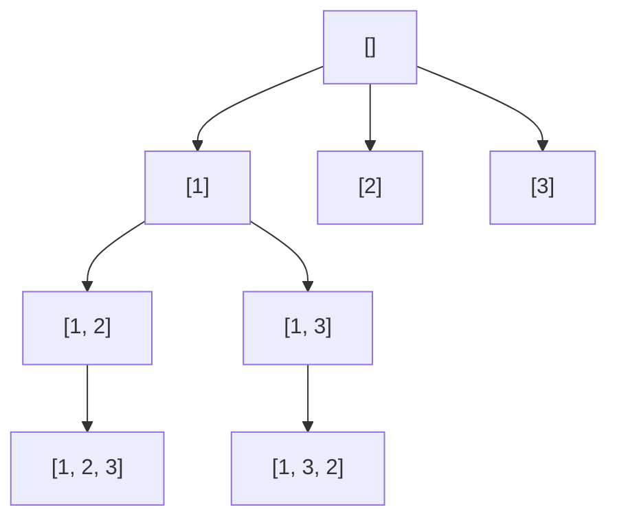

+++
date = '2026-10-16T19:15:00+08:00'
draft = false
title = '力扣 46：全排列的回溯模板与 C++ 实现'
math = true
+++

力扣第 46 题“全排列”要求：给定一个**元素互不相同**的整数数组 `nums`，返回它的所有排列。比如输入 `[1, 2, 3]`，应得到 6 个长度为 3 的序列：`[1, 2, 3]`、`[1, 3, 2]`、`[2, 1, 3]` 等。

这题的重点不是记住一段递归代码，而是把它还原成稳定的回溯结构：在每一层选择一个尚未使用的数，递归填下一个位置；该分支结束后，撤销刚才的选择。答案自然会出现在搜索树的叶子上。把状态恢复好，问题便没有看上去那么神秘——否则只是递归在替你掩盖混乱而已。

## 一、先明确：排列和组合的区别

全排列使用数组中的每个元素，且**位置顺序不同就算不同答案**。因此 `[1, 2, 3]` 与 `[2, 1, 3]` 是两个结果；数组长度为 $n$ 时，结果数为：

$$
n! = n \times (n - 1) \times \cdots \times 1.
$$

对 `[1, 2, 3]` 而言，第一个位置有 3 种选择，第二个位置还剩 2 种，第三个位置剩 1 种，所以共有 $3\times2\times1=6$ 种结果。

回溯的每一层恰好对应“决定排列中的一个位置”。`path` 已经保存的元素就是已确定的前缀；当 `path` 长度等于 `nums.length` 时，一个完整排列就构造完成了。

## 二、回溯的通用模板

先记住下面这个模板。几乎所有回溯题都会有相同的骨架，变化的只是“选择列表”“合法性判断”和“结束条件”。

```cpp
void backtrack(/* 路径与选择状态 */) {
    if (isComplete()) {
        result.push_back(path);
        return;
    }

    for (int i = 0; i < candidates.size(); ++i) {
        if (!isValid(i)) {
            continue;
        }

        choose(i);
        backtrack(/* 路径与选择状态 */);
        undo(i);
    }
}
```

不要把“撤销选择”当作可有可无的仪式。`path` 和 `used` 都被同一层的后续分支共享；若不恢复现场，后一个分支会带着前一个分支的状态继续搜索，结果必然错误。

将模板映射到本题，四个部分如下：

| 模板位置 | 全排列中的含义 |
| -------- | -------------- |
| 路径 | `path`，已经放入排列前缀的数字 |
| 选择列表 | `nums` 的全部下标 |
| 合法性判断 | `used[i]` 为 `false`，表示 `nums[i]` 尚未使用 |
| 结束条件 | `path.size() == nums.length` |
| 做选择 | `used[i] = true`，再把 `nums[i]` 加入 `path` |
| 撤销选择 | 从 `path` 删除末尾元素，并令 `used[i] = false` |

这里用 `used[i]` 标记**下标**而不是值。第 46 题保证数值互异，按值判断也许暂时能跑通；但回溯状态本质上是在选择输入位置，下标模型才能平滑扩展到含重复值的题目。

## 三、搜索树如何展开

以 `[1, 2, 3]` 为例，根节点的 `path` 为空。第一层可选 `1`、`2`、`3`；如果先选择 `1`，下一层只能选 `2` 或 `3`；直到路径长度为 3，才把当前路径加入答案。



图中只画出了以 `1` 开头的两条完整分支；以 `2`、`3` 开头的分支完全对称。根到任意叶子的一条路径，就是一个排列。

例如，程序从 `[1, 2]` 返回到 `[1]` 时，要做两步恢复：先执行 `path.remove(path.size() - 1)` 删除 `2`，再执行 `used[1] = false`。这样才能继续尝试 `[1, 3]`。恢复的顺序最好与做选择时相反，这会让状态变化保持清晰且可验证。

## 四、力扣可提交的 C++ 代码

下面的实现严格对应前面的模板。`result` 作为参数传入递归函数，因此每次调用 `permute` 都会使用全新的答案列表，不会依赖可复用对象中的遗留状态。

```cpp
#include <vector>

using namespace std;

class Solution {
public:
    vector<vector<int>> permute(vector<int>& nums) {
        vector<vector<int>> result;
        vector<int> path;
        vector<bool> used(nums.size(), false);

        backtrack(nums, used, path, result);
        return result;
    }

private:
    void backtrack(
            const vector<int>& nums,
            vector<bool>& used,
            vector<int>& path,
            vector<vector<int>>& result) {

        // 结束条件：路径长度达到 n，说明一个排列已构造完成。
        if (path.size() == nums.size()) {
            result.push_back(path);
            return;
        }

        // 遍历本层的全部候选位置。
        for (int i = 0; i < static_cast<int>(nums.size()); ++i) {
            // 剪枝：同一个下标在一个排列中只能使用一次。
            if (used[i]) {
                continue;
            }

            // 做选择。
            used[i] = true;
            path.push_back(nums[i]);

            // 进入下一层，决定下一个位置。
            backtrack(nums, used, path, result);

            // 撤销选择：恢复到进入本轮循环前的状态。
            path.pop_back();
            used[i] = false;
        }
    }
};
```

### 为什么 `result.push_back(path)` 能保存当前答案

结束条件中必须写：

```cpp
result.push_back(path);
```

`path` 会持续执行 `push_back` 和 `pop_back`，因此收集答案时必须保存它在当前时刻的内容。所幸 C++ 的 `vector` 具有值语义：`result.push_back(path)` 会把 `path` **复制**到 `result` 中，而不是保存同一个可变对象的引用。后续回溯继续修改 `path`，已经保存的排列不会变化。

### 一次分支的状态变化

下面以选择 `1` 后再选择 `2` 为例。`T`、`F` 分别表示已用和未用：

| 时刻 | `path` | `used` | 含义 |
| ---- | ------ | ------ | ---- |
| 初始 | `[]` | `[F, F, F]` | 尚未确定任何位置 |
| 选 `1` | `[1]` | `[T, F, F]` | 第一个位置固定为 `1` |
| 选 `2` | `[1, 2]` | `[T, T, F]` | 第二个位置固定为 `2` |
| `2` 的分支返回 | `[1]` | `[T, F, F]` | 撤销 `2`，可继续尝试 `3` |
| `1` 的分支返回 | `[]` | `[F, F, F]` | 撤销 `1`，可从根尝试 `2` |

每一次递归调用结束时，状态都与调用前一致。这正是回溯正确性的核心不变量。

## 五、为什么不会漏掉或重复答案

设任意一个目标排列为 $(p_1,p_2,\ldots,p_n)$。

- 在第一层，循环会尝试 `p_1` 所在的下标；
- 该下标被标记后，第二层仍会尝试 `p_2` 所在的、尚未使用的下标；
- 依次进行到第 $n$ 层，就会到达这个目标排列。

因此不会遗漏。另一方面，两条不同的递归路径必然在某一层首次选择了不同的元素。由于输入元素互不相同，两个最终序列在该位置不同，不可能得到同一个排列。因此也不会重复。

这个结论依赖题目的“元素互不相同”条件。若输入是 `[1, 1, 2]`，两个 `1` 的下标不同，却可能生成相同值序列；那是力扣第 47 题，需要排序并跳过同层的等价选择，可参阅[重复元素的全排列：计数公式与去重生成](04-重复元素的全排列：计数公式与去重生成.md)。

## 六、复杂度与边界

长度为 $n$ 的互异数组有 $n!$ 个排列，每个排列都需要复制长度为 $n$ 的列表。因此：

- 时间复杂度：$O(n\cdot n!)$。即使不考虑递归控制，写出全部答案也需要这么多时间。
- 额外空间：不计返回结果时为 $O(n)$，其中 `path`、`used` 和递归调用栈各至多为 $O(n)$；计入返回结果则为 $O(n\cdot n!)$。

这也解释了为什么全排列题的输入规模通常很小。不是代码写得还不够巧，而是答案本身已经呈阶乘增长；只要求数量、判断是否存在，或求第 $k$ 个排列时，都不应该无差别地枚举所有结果。

## 七、最常见的错误

- 忘记 `path.pop_back()`：路径会不断累积，后续分支不再表示正确前缀。
- 忘记 `used[i] = false`：该元素会被错误地永久禁用，导致大量答案缺失。
- 把 `path` 以指针或引用形式存入结果：后续回溯会改变已保存答案；应直接使用 `result.push_back(path)` 完成值复制。
- 把结束条件写成 `path.size() == nums.length - 1`：会提前收集不完整的排列。
- 误以为 `used` 可以省略：全排列每层都从全部元素中选，若没有使用标记，同一个元素会在一个路径中被重复选中。
- 将本题代码直接用于重复数组：会得到重复排列；需要使用去重版本。

## 八、总结

- 力扣第 46 题的状态是 `path + used`：前者表示当前排列前缀，后者表示哪些下标已被占用。
- 回溯模板的顺序固定为：判断结束、遍历选择、做选择、递归、撤销选择。
- 完整排列时使用 `result.push_back(path)`；`vector` 的值复制会保留当前路径快照。
- 对 $n$ 个互异元素，枚举全排列的时间和结果空间都是 $O(n\cdot n!)$；这是输出规模决定的边界。

掌握这一题后，不必急着把每道 DFS 都叫作回溯。先找出“路径、候选、约束、结束条件、恢复动作”这五件事；它们齐全时，模板才真正有用。
