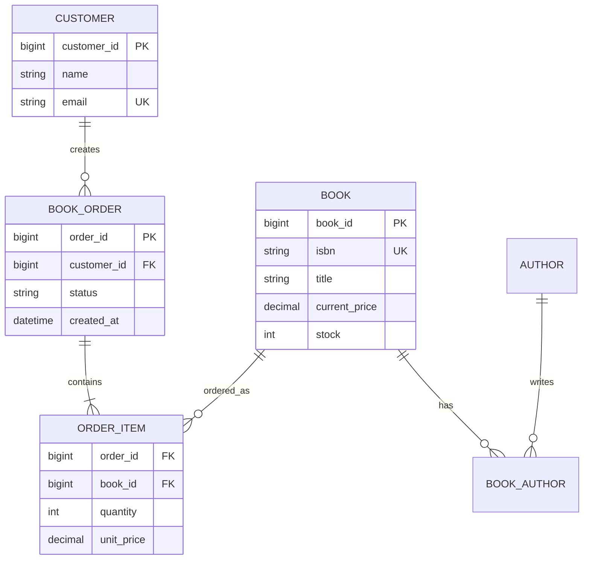

+++
date = '2026-10-19T20:00:00+08:00'
draft = false
title = 'ER 建模到关系模式：把在线书店需求变成可执行的 Schema'
+++

SQL 建表并不是建模的起点。若直接根据页面字段创建一张“大订单表”，初期似乎最快：客户姓名、书名、作者、数量、地址、价格全部塞进一行。但一本订单有多本书、一本书有多名作者、用户会搬家、图书会调价时，重复、更新矛盾和无法表达的情况就会迅速出现。ER（Entity-Relationship，实体—联系）模型的任务，是先从业务语言抽取稳定的对象与规则，再把它们转换为关系模式。

本篇产出的不是一次性写死的“唯一正确表结构”，而是一份足以承接后续 SQL、范式和事务文章的在线书店 schema 草案。真实项目还会受支付、促销、发货、税务、审计和历史兼容性影响；建模的关键能力是让每个取舍都能说清楚，而不是背下一张 ER 图。

## 从需求语句抽取候选概念

先把自然语言需求写成可验证的业务规则，而非立即给字段命名：

- 客户可以浏览图书并创建订单；一个订单只属于一个客户。
- 一本图书可以由多位作者合著；一位作者也可以写多本图书。
- 订单至少包含一条订单项；每项购买一种图书和一定数量。
- 图书有当前价格和当前库存；订单项要保留下单时的成交价。
- 订单只有在支付成功后才扣减库存；取消未支付订单不应扣库存。

名词往往是实体候选项：客户、图书、作者、订单、订单项；动词往往揭示联系：客户“创建”订单、订单“包含”订单项、作者“创作”图书。可不能机械地“一个名词一张表”。“订单状态”是订单属性，“购买”在这里由订单项表达；“库存扣减”是一个带事务语义的业务动作，不必立刻建成实体。反过来，若购买本身需要退款、发票或物流跟踪，订单与订单项就必须有独立身份，不能只做一张图书—客户关联表。

| 候选项 | 建模判断 | 理由 |
| ------ | -------- | ---- |
| 客户 `Customer` | 强实体 | 可独立注册和存在 |
| 图书 `Book` | 强实体 | 可独立上架、调价、管理库存 |
| 作者 `Author` | 强实体 | 会跨图书复用，姓名也非可靠主键 |
| 订单 `BookOrder` | 强实体 | 有生命周期、状态、时间和归属 |
| 订单项 `OrderItem` | 依赖实体 | 只在某张订单内有意义，但有数量、成交价 |
| 撰写 `Writes` | 多对多联系 | 一本书与一位作者均可对应多条记录 |

## 实体、属性与联系

实体代表可区分的业务对象，实体集代表同类对象的集合；属性描述对象特征。属性可分为简单属性（`name`）、复合属性（地址可拆成省市街道）、多值属性（一本书的多个作者）和派生属性（订单总额可由订单项计算）。在关系数据库中，多值属性通常不能简单地用逗号拼成一个字段；它应转换为独立关系，便于约束和查询。

联系有自己的基数（cardinality）。客户到订单是 1:N：一个客户可有多张订单，每张订单恰好归属一个客户。订单到订单项也是 1:N。图书到作者则是 M:N，必须通过关联实体/中间表 `book_author` 表示；在 `book` 表中放 `author_ids = '1,2,3'` 会破坏原子性，使连接、约束和索引都变得困难。



图中 `||` 表示恰好一个，`o{` 表示零到多个，`|{` 表示一到多个。它表达的是业务规则，不是页面初始状态：客户现在还没有订单仍然合法，所以客户到订单是 0..N；一张已正式创建的订单必须含至少一项，因此订单到订单项可设为 1..N。是否允许“购物车式空订单”，则是另一个业务决定，不能由符号替你决定。

### 参与约束与弱实体

**参与约束**说明一个实体是否必须参与某个联系。订单对“由客户创建”的参与是全参与：没有客户的订单不应存在。图书对“出现在订单项”的参与是部分参与：新上架图书尚未卖出完全正常。数据库中，这通常对应外键是否可空：`book_order.customer_id NOT NULL` 表示订单必须引用客户；订单项的 `book_id NOT NULL` 表示每项必须指向图书。

**弱实体**不能只凭自己的属性在整个系统中被唯一标识，它依赖拥有者实体及部分键。订单项若采用 `(order_id, line_no)` 作为键，`line_no=1` 只在某张订单内部有意义，便是经典弱实体式建模；`order_id` 是其拥有者引用，`line_no` 是部分键。也可使用全局 `order_item_id` 作为代理主键，但仍应保留 `UNIQUE(order_id, line_no)` 或其他业务唯一性。使用代理键不会自动消除依赖关系，只是改变了标识方式。

## 从 ER 模型转换为关系表

常用转换规则并不复杂，但每条都对应约束含义：

1. 每个强实体转换为一张表，实体标识符成为主键。
2. 1:N 联系把“1”的主键作为外键放入“N”的表；若 N 端必须参与，则外键设 `NOT NULL`。
3. M:N 联系转换为中间表，包含双方外键；二者通常共同构成主键，并可放置联系自身属性。
4. 弱实体的表包含拥有者主键和部分键，二者共同构成主键；删除拥有者时通常级联删除弱实体。
5. 多值属性单独成表；派生值一般按需计算，除非为性能或历史语义明确存储。

书籍与作者的多对多联系正适合第 3 条。`book_author` 不只保存两个 ID，还可存 `author_order`，以稳定表示封面署名顺序。这是一个重要提醒：中间表不是“为了连接而多出来的麻烦”，它是关系本身的落点，可以拥有自己的业务属性。

```sql
CREATE TABLE book_author (
    book_id BIGINT NOT NULL,
    author_id BIGINT NOT NULL,
    author_order INT NOT NULL,
    PRIMARY KEY (book_id, author_id),
    UNIQUE KEY uk_book_author_order (book_id, author_order),
    CONSTRAINT fk_book_author_book
        FOREIGN KEY (book_id) REFERENCES book(book_id),
    CONSTRAINT fk_book_author_author
        FOREIGN KEY (author_id) REFERENCES author(author_id)
);
```

这里联合主键防止同一作者被重复关联到同一本书，第二个唯一约束防止两位作者占用同一署名顺序。外键把引用完整性落实给数据库：除非先创建对应图书与作者，否则无法插入关联；这比仅靠应用代码约定更可靠。

## 可用于后续课程的 schema 草案

下面给出核心表的 MySQL 8.0 草案。金额使用 `DECIMAL` 而非 `FLOAT`，避免二进制浮点在货币计算中出现近似误差；状态使用受控字符串与 `CHECK`，便于阅读。实际系统的状态机可能更复杂，但原则是将合法取值明确化。

```sql
CREATE TABLE customer (
    customer_id BIGINT PRIMARY KEY AUTO_INCREMENT,
    name VARCHAR(100) NOT NULL,
    email VARCHAR(255) NOT NULL UNIQUE,
    created_at DATETIME NOT NULL DEFAULT CURRENT_TIMESTAMP
);

CREATE TABLE book (
    book_id BIGINT PRIMARY KEY AUTO_INCREMENT,
    isbn CHAR(13) NOT NULL UNIQUE,
    title VARCHAR(300) NOT NULL,
    current_price DECIMAL(10, 2) NOT NULL CHECK (current_price >= 0),
    stock INT NOT NULL CHECK (stock >= 0),
    created_at DATETIME NOT NULL DEFAULT CURRENT_TIMESTAMP
);

CREATE TABLE book_order (
    order_id BIGINT PRIMARY KEY AUTO_INCREMENT,
    customer_id BIGINT NOT NULL,
    status VARCHAR(20) NOT NULL DEFAULT 'PENDING',
    created_at DATETIME NOT NULL DEFAULT CURRENT_TIMESTAMP,
    CONSTRAINT ck_order_status
        CHECK (status IN ('PENDING', 'PAID', 'CANCELLED')),
    CONSTRAINT fk_order_customer
        FOREIGN KEY (customer_id) REFERENCES customer(customer_id)
);

CREATE TABLE order_item (
    order_id BIGINT NOT NULL,
    line_no INT NOT NULL,
    book_id BIGINT NOT NULL,
    quantity INT NOT NULL CHECK (quantity > 0),
    unit_price DECIMAL(10, 2) NOT NULL CHECK (unit_price >= 0),
    PRIMARY KEY (order_id, line_no),
    CONSTRAINT fk_item_order
        FOREIGN KEY (order_id) REFERENCES book_order(order_id),
    CONSTRAINT fk_item_book
        FOREIGN KEY (book_id) REFERENCES book(book_id)
);
```

`order_item.unit_price` 看似违反“同一事实只存一处”，实际存的是**下单瞬间的成交价**，而 `book.current_price` 存的是当前挂牌价，二者语义不同，因而应同时存在。与之相反，`customer.name` 不应每次都复制到订单项；如确有开票或收货快照要求，应明确命名 `shipping_name`、`shipping_address` 并说明其历史语义，而非含混复制。

订单总额可以用 `SUM(quantity * unit_price)` 在查询时计算。若将 `total_amount` 冗余存到 `book_order` 以优化读取，则必须明确由谁在同一事务中维护，并用测试或约束保证它与订单项一致。没有维护策略的“性能字段”最容易成为账目不一致的来源。

## 常见误解与建模检查

第一种误解是“每张表必须有一个叫 `id` 的自增列”。代理主键很实用，但 `order_item(order_id, line_no)` 这样的复合键能直接表达订单内行号唯一；选择要看身份语义、引用便利性和约束需求。第二种是“外键影响性能，所以不该使用”。外键确实带来校验成本和迁移安排，却能防止孤儿记录；若因分库等原因不能使用，也必须在应用或服务边界实现同等强度的完整性策略，而不是放弃规则。

第三种是把 ER 图当成数据库全部设计。ER 图主要处理实体与联系；字段类型、索引、时间精度、删除策略、审计、敏感数据、分区与事务边界仍需后续设计。比如删除一个客户是否应该级联删除历史订单？对在线书店而言通常不应该，因为订单涉及财务和审计；可禁删、软删除或匿名化，但每种方案都要符合业务与法规要求。

建模评审时可以逐项验证：每个实体是否有稳定标识？每个 1:N、M:N 关系是否被正确表达？必需关系是否由 `NOT NULL` 外键保证？可变的当前值与应保留的历史快照是否区分？删除、取消、并发支付会如何影响记录？若这些问题能逐一回答，schema 才是后续 SQL 的可信起点。

## 本篇小结

- ER 建模从可验证的业务规则开始，实体、属性和联系都应有清晰语义。
- 1:N 联系通常通过 N 端外键表示，M:N 联系必须落为中间表；弱实体依赖拥有者键。
- 主键、唯一约束、非空、检查和外键共同把业务规则变成数据库可执行的边界。
- 当前价格与订单成交价不是重复，而是不同时间语义的事实；冗余设计必须说明一致性维护责任。

至此，后续文章已有可操作的对象：`customer`、`book`、`author`、`book_author`、`book_order` 与 `order_item`。接下来可以围绕这份 schema 练习 DDL、插入数据、连接查询、聚合统计，以及最终的事务下单流程。
