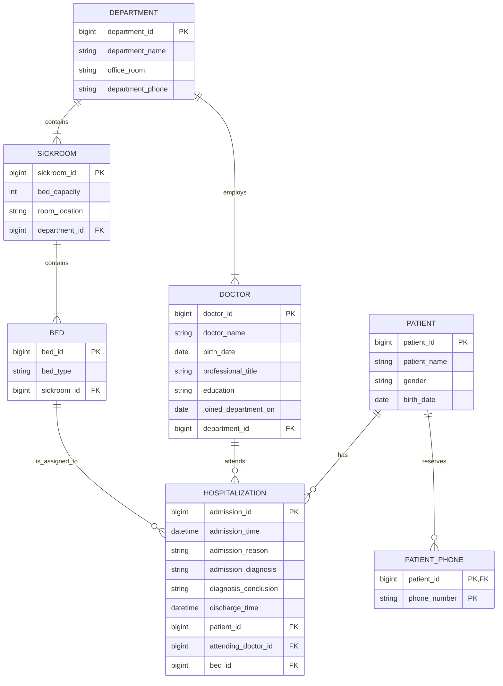

+++
date = '2026-11-16T22:12:33+08:00'
draft = false
title = '医院病房管理系统 ER 图设计：从需求分析到关系模式与完整性约束'
+++

医院病房管理这类题目表面上是在考“画几张表”，实际上考查的是把自然语言中的业务事实分层：哪些是可独立存在的实体，哪些只是实体的属性，哪些是实体之间的联系，以及哪些规则不能只靠一列字段表达。若一开始就把题目给出的所有字段都塞进“患者表”，那么患者第二次住院时，旧床位、旧主治医生和旧诊断会被覆盖；这种设计即使能建表，也不能保存正确的医疗事实。

本篇以 Silberschatz、Korth、Sudarshan 的 [*Database System Concepts*, 7th Edition](https://www.db-book.com/index.html) 中“使用 E-R 模型进行数据库设计”的基本思想为线索，完整解答题目：先说明 E-R 设计规则，再给出 E-R 模型、关系模式、主外键和 MySQL 8.0 的 DDL。为使模型能表达“每次住院”，本文引入**住院记录**实体；这不是无端增加字段，而是题干中“每次住院”必然要求的历史事实。

## 先建立正确的建模顺序

E-R（Entity-Relationship，实体—联系）模型是**概念模型**。它先回答“业务世界里有什么、它们如何关联”，再转换为关系表；它不是把 Excel 表头直接画成方框的工具。一个可靠的顺序通常如下：

```text
需求语句
  -> 抽取实体、属性、联系和基数
  -> 判断键、可选性、多值属性与派生属性
  -> 将 ER 模型转换为关系模式
  -> 用 PRIMARY KEY、FOREIGN KEY、NOT NULL、CHECK 等实现约束
```

### 实体：能够被单独识别和长期管理的对象

实体是现实中需要分别记录的对象集合，例如“科室”“医生”“患者”。实体应有能唯一识别其个体的标识符，即键属性。题干中的“科室 ID”“医生 ID”“患者 ID”就是非常明确的主键候选。

但不能见名词就机械建实体。例如“职称”“床位类型”只是对医生或病床的描述，属于属性；“所属科室”描述病房、医生与科室的归属联系，转换为关系模型后通常会成为外键。

判断一个候选概念是否应成为实体，可问三件事：

- 它能否脱离当前这一条业务记录独立存在？
- 它是否有自己的标识、属性或生命周期？
- 以后会不会被多个其他对象引用或需要保留历史？

“住院记录”满足后两项：一次住院有入院、诊断、出院等自身属性，同一患者还可能在不同时间再次住院。因此它不能只是患者表里一组会被覆盖的列。

### 属性：描述实体或联系的事实

属性描述实体的特征。按建模时最常用的几种分类：

| 类型 | 含义 | 本题例子 | 转换提示 |
| ---- | ---- | -------- | -------- |
| 简单属性 | 不能或无需继续拆分 | 医生姓名、病床类型 | 成为一列 |
| 标识属性 | 能唯一识别实体 | `department_id`、`doctor_id` | 成为主键或候选键 |
| 多值属性 | 一个实体可拥有多个值 | 患者联系电话 | 另建关系，不能用逗号拼接 |
| 派生属性 | 可由其他事实计算 | 住院天数 | 一般查询或视图计算 |

患者的多个联系电话是典型的**多值属性**。把它写成 `phone1`、`phone2`、`phone3` 会人为限制数量；把它存为 `'138..., 139...'` 则不满足列值原子性，也无法对单个号码建立唯一性或查询。因此应建立 `patient_phone` 表。

住院天数则是**派生属性**。在统一的计时口径下，它由入院时间与出院时间计算，不能独立决定新的业务事实。若同时保存“出院时间”和一个可手工修改的“住院天数”，两者迟早会不一致。若医院规定“住院天数按自然日且入、出院日都计入”，公式可能是 `DATEDIFF(discharge_time, admission_time) + 1`；若按经过的完整时间计算，公式又会不同。无论选哪一种，必须先写清口径。

### 联系、基数和参与约束

联系描述实体集之间的业务关联；基数说明一侧的一个实体可以对应另一侧多少实体。题干直接给出了以下联系：

| 联系 | 基数 | 含义 |
| ---- | ---- | ---- |
| 科室—病房 | 1:N | 一个科室有多个病房；一个病房仅属于一个科室 |
| 科室—医生 | 1:N | 一个科室有多个医生；一个医生仅属于一个科室 |
| 病房—病床 | 1:N | 一个病房有多个病床；一个病床仅属于一个病房 |
| 患者—联系电话 | 1:N | 一个患者可预留多个联系电话；每个号码记录属于一个患者 |
| 患者—住院记录 | 1:N | 一个患者可有多次住院；每次住院只对应一个患者 |
| 医生—住院记录 | 1:N | 一位医生可主管多次住院；每次住院有一位主治医生 |
| 病床—住院记录 | 1:N（按时间） | 一张床可服务多次住院；每次住院只占用一张床 |

“1:N”并不自动表示“至少有一条”。例如新登记的患者还没有住院记录，所以患者到住院记录通常是 `0..N`；但一条已经存在的住院记录必须有一位患者、一名主治医生和一张病床，所以住院记录一侧是“恰好 1”。这种“是否必须参加联系”的规则称为**参与约束**，在表中常由 `NOT NULL` 外键体现。

### ER 模型转换为关系模式的规则

以下规则足以处理本题，且比背诵一张固定答案更可靠。

1. 每个强实体转换为一个关系；其标识属性成为主键。
2. 对 1:N 联系，将“1”端主键放到“N”端作为外键。若 N 端必须参加联系，外键设为 `NOT NULL`。
3. 对 M:N 联系，建立独立的联系关系，包含两端的外键；联系本身的属性也放在这张关系中。本题没有必须独立落表的 M:N 联系。
4. 多值属性建立独立关系，关系主键通常是“所属实体主键 + 属性值”。
5. 弱实体或具有生命周期的业务事件要有自己的键。这里的住院记录可用人工主键 `admission_id`，并用 `(patient_id, admission_time)` 建立业务唯一约束。
6. 派生属性通常不存储；若因报表性能而冗余存储，必须定义同一事务内的维护责任。

## 本题的 E-R 模型

### 为什么“患者”和“住院记录”必须分开

题目罗列的“床位、入院时间、入院原因、诊断结论、主治医生、出院时间、住院天数”并不描述患者这个人本身，而是描述**该患者某一次住院**。例如患者王某 2026 年 3 月因肺炎入院、同年 10 月因复查再次入院，两次的床位与诊疗信息都必须保留。

因此，本题的核心实体是：

- `Department`（科室）：`department_id`、名称、办公地址、科室电话。
- `Sickroom`（病房）：`sickroom_id`、床位数、房间位置；且必须隶属一个科室。
- `Bed`（病床）：`bed_id`、床位类型；且必须隶属一个病房。
- `Doctor`（医生）：`doctor_id`、姓名、出生日期、职称、学历、入科日期；且必须隶属一个科室。
- `Patient`（患者）：`patient_id`、姓名、性别、出生日期。
- `Hospitalization`（住院记录）：`admission_id`、入院诊断、入院原因、入院时间、诊断结论、出院时间；且关联一个患者、一名主治医生和一张病床。
- `PatientPhone`（患者联系电话）：患者的多值电话属性转换得到的关系。

下图使用 Crow's Foot 风格表示 E-R 模型。`||` 表示“恰好一个”，`o{` 表示“零到多个”，`|{` 表示“一到多个”。Mermaid 的属性区只为阅读便利列出键和主要属性；在传统 Chen 图中，实体画矩形、联系画菱形、属性画椭圆，`stay_days` 应画为虚线椭圆以表示派生属性。



图中的“病床—住院记录”看似 1:N，但它是**随时间发生的 1:N**：同一病床能在先后不重叠的时间段服务多条住院记录，而同一时刻不能有两位仍在院患者占同一张床。后者是时间区间约束，普通外键无法独立表达，后文会单独分析。

## 将 E-R 模型转换为关系模式

使用下列记法：`PK` 为主键，`FK → T(x)` 表示引用 `T` 表的 `x` 列，`UK` 为候选键/唯一约束。为便于实际系统引用住院记录，采用新引入的技术主键 `admission_id`；同时保留 `(patient_id, admission_time)` 的唯一性，避免同一患者在同一时间被重复登记。

```text
DEPARTMENT(
  department_id PK,
  department_name,
  office_room,
  department_phone
)

SICKROOM(
  sickroom_id PK,
  bed_capacity,
  department_id FK → DEPARTMENT(department_id),
  room_location,
  UK(department_id, room_location)
)

BED(
  bed_id PK,
  sickroom_id FK → SICKROOM(sickroom_id),
  bed_type
)

DOCTOR(
  doctor_id PK,
  doctor_name,
  birth_date,
  professional_title,
  education,
  department_id FK → DEPARTMENT(department_id),
  joined_department_on
)

PATIENT(
  patient_id PK,
  patient_name,
  gender,
  birth_date
)

PATIENT_PHONE(
  patient_id PK, FK → PATIENT(patient_id),
  phone_number PK
)

HOSPITALIZATION(
  admission_id PK,
  patient_id FK → PATIENT(patient_id),
  attending_doctor_id FK → DOCTOR(doctor_id),
  bed_id FK → BED(bed_id),
  admission_time,
  admission_reason,
  admission_diagnosis,
  diagnosis_conclusion,
  discharge_time,
  UK(patient_id, admission_time)
)
```

题目若限定“不得新增 ID”，也可让 `HOSPITALIZATION` 使用复合主键 `(patient_id, admission_time)`，其余属性不变。二者都可以由同一 E-R 模型转换而来；前者更便于被检查、费用、检验等后续表引用，后者更贴近最小化的课本式模式。关键不是选单列键还是复合键，而是不能把一次住院错误地当作患者的永久属性。

### 主键与外键汇总

| 关系 | 主键 | 外键 |
| ---- | ---- | ---- |
| `department` | `department_id` | 无 |
| `sickroom` | `sickroom_id` | `department_id → department.department_id` |
| `bed` | `bed_id` | `sickroom_id → sickroom.sickroom_id` |
| `doctor` | `doctor_id` | `department_id → department.department_id` |
| `patient` | `patient_id` | 无 |
| `patient_phone` | `(patient_id, phone_number)` | `patient_id → patient.patient_id` |
| `hospitalization` | `admission_id` | `patient_id → patient.patient_id`；`attending_doctor_id → doctor.doctor_id`；`bed_id → bed.bed_id` |

`patient_phone` 的复合主键有两个作用：同一患者可以有多个号码，而同一号码不能被该患者重复登记。它没有采用单独自增 ID，是因为“患者 + 电话号码”本身已能识别一条电话记录；若未来要管理号码类型、验证状态、启停历史，再增加 `patient_phone_id` 也可以，但仍应保留业务唯一性约束。

## 完整性约束：哪些规则由什么机制保证

完整性约束不是建表后的装饰，它们把题干的中文规则变成数据库拒绝非法数据的边界。可分为以下几类。

| 类别 | 本题规则 | 推荐实现 |
| ---- | -------- | -------- |
| 实体完整性 | 每个科室、病房、病床、医生、患者、住院记录均可唯一识别 | `PRIMARY KEY`、`NOT NULL` |
| 参照完整性 | 病房必须属于已有科室；住院记录必须引用已有患者、医生和病床 | `FOREIGN KEY` |
| 值域完整性 | 床位数大于 0；性别只取规定代码；出院时间不得早于入院时间 | 类型、`NOT NULL`、`CHECK` |
| 业务唯一性 | 同一科室中房间位置不重复；同一患者同一入院时刻不重复 | `UNIQUE` |
| 多值属性 | 患者允许多个电话，但同一患者不能重复同一号码 | 独立 `patient_phone` + 复合主键 |
| 派生一致性 | 住院天数与入、出院时间一致 | 不冗余存储，使用查询或视图计算 |
| 跨行/时间约束 | 一张床同一时段不能分配给两条在院记录 | 事务 + 触发器/占床状态表，不能仅靠普通外键 |

有两个常见但不能擅自假定的规则值得单独说明。

- 题目只说医生属于一个科室、病床属于一个病房，并**没有说**主治医生必须与病床所在科室相同。医院可能允许会诊或跨科治疗，所以本解不强加这个约束。若业务明确要求相同科室，需要在一次住院登记时比较“医生科室”和“病床所属病房的科室”，通常通过触发器或服务层事务实现。
- `bed_capacity` 被解释为病房的**核定床位容量**，而不是从 `bed` 表实时数出的床位数量。实际登记的病床数不得超过容量属于跨表聚合约束；若字段含义只是“现有病床数量”，则它应被删除并通过 `COUNT(bed_id)` 派生，避免两份同一事实。

## 用 MySQL 8.0 创建关系模式

以下 DDL 以 MySQL 8.0 和 InnoDB 为例。ID 采用无符号自增整数作为内部技术标识；如果医院已有带编码规则的病案号、医生工号或床号，可将对应列改为 `VARCHAR`，但不要把“看起来是数字的标识符”误当作需要参与算术的数值。

```sql
CREATE DATABASE IF NOT EXISTS hospital_management
  CHARACTER SET utf8mb4
  COLLATE utf8mb4_0900_ai_ci;

USE hospital_management;

CREATE TABLE department (
  department_id BIGINT UNSIGNED NOT NULL AUTO_INCREMENT,
  department_name VARCHAR(100) NOT NULL,
  office_room VARCHAR(100) NOT NULL,
  department_phone VARCHAR(32) NOT NULL,
  PRIMARY KEY (department_id)
) ENGINE = InnoDB;

CREATE TABLE sickroom (
  sickroom_id BIGINT UNSIGNED NOT NULL AUTO_INCREMENT,
  department_id BIGINT UNSIGNED NOT NULL,
  room_location VARCHAR(100) NOT NULL,
  bed_capacity SMALLINT UNSIGNED NOT NULL,
  PRIMARY KEY (sickroom_id),
  UNIQUE KEY uk_sickroom_department_room (department_id, room_location),
  CONSTRAINT ck_sickroom_bed_capacity CHECK (bed_capacity > 0),
  CONSTRAINT fk_sickroom_department
    FOREIGN KEY (department_id) REFERENCES department (department_id)
    ON UPDATE RESTRICT ON DELETE RESTRICT
) ENGINE = InnoDB;

CREATE TABLE bed (
  bed_id BIGINT UNSIGNED NOT NULL AUTO_INCREMENT,
  sickroom_id BIGINT UNSIGNED NOT NULL,
  bed_type VARCHAR(30) NOT NULL,
  PRIMARY KEY (bed_id),
  KEY idx_bed_sickroom (sickroom_id),
  CONSTRAINT fk_bed_sickroom
    FOREIGN KEY (sickroom_id) REFERENCES sickroom (sickroom_id)
    ON UPDATE RESTRICT ON DELETE RESTRICT
) ENGINE = InnoDB;

CREATE TABLE doctor (
  doctor_id BIGINT UNSIGNED NOT NULL AUTO_INCREMENT,
  department_id BIGINT UNSIGNED NOT NULL,
  doctor_name VARCHAR(100) NOT NULL,
  birth_date DATE NOT NULL,
  professional_title VARCHAR(60) NOT NULL,
  education VARCHAR(60) NOT NULL,
  joined_department_on DATE NOT NULL,
  PRIMARY KEY (doctor_id),
  KEY idx_doctor_department (department_id),
  CONSTRAINT fk_doctor_department
    FOREIGN KEY (department_id) REFERENCES department (department_id)
    ON UPDATE RESTRICT ON DELETE RESTRICT
) ENGINE = InnoDB;

CREATE TABLE patient (
  patient_id BIGINT UNSIGNED NOT NULL AUTO_INCREMENT,
  patient_name VARCHAR(100) NOT NULL,
  gender CHAR(1) NOT NULL,
  birth_date DATE NOT NULL,
  PRIMARY KEY (patient_id),
  CONSTRAINT ck_patient_gender CHECK (gender IN ('M', 'F', 'U'))
) ENGINE = InnoDB;

CREATE TABLE patient_phone (
  patient_id BIGINT UNSIGNED NOT NULL,
  phone_number VARCHAR(32) NOT NULL,
  PRIMARY KEY (patient_id, phone_number),
  CONSTRAINT fk_patient_phone_patient
    FOREIGN KEY (patient_id) REFERENCES patient (patient_id)
    ON UPDATE RESTRICT ON DELETE CASCADE
) ENGINE = InnoDB;

CREATE TABLE hospitalization (
  admission_id BIGINT UNSIGNED NOT NULL AUTO_INCREMENT,
  patient_id BIGINT UNSIGNED NOT NULL,
  attending_doctor_id BIGINT UNSIGNED NOT NULL,
  bed_id BIGINT UNSIGNED NOT NULL,
  admission_time DATETIME NOT NULL,
  admission_reason VARCHAR(500) NOT NULL,
  admission_diagnosis VARCHAR(500) NULL,
  diagnosis_conclusion TEXT NULL,
  discharge_time DATETIME NULL,
  PRIMARY KEY (admission_id),
  UNIQUE KEY uk_hospitalization_patient_time (patient_id, admission_time),
  KEY idx_hospitalization_doctor_time (attending_doctor_id, admission_time),
  KEY idx_hospitalization_bed_time (bed_id, admission_time),
  CONSTRAINT ck_hospitalization_time
    CHECK (discharge_time IS NULL OR discharge_time >= admission_time),
  CONSTRAINT fk_hospitalization_patient
    FOREIGN KEY (patient_id) REFERENCES patient (patient_id)
    ON UPDATE RESTRICT ON DELETE RESTRICT,
  CONSTRAINT fk_hospitalization_doctor
    FOREIGN KEY (attending_doctor_id) REFERENCES doctor (doctor_id)
    ON UPDATE RESTRICT ON DELETE RESTRICT,
  CONSTRAINT fk_hospitalization_bed
    FOREIGN KEY (bed_id) REFERENCES bed (bed_id)
    ON UPDATE RESTRICT ON DELETE RESTRICT
) ENGINE = InnoDB;
```

这里刻意没有使用 `ON DELETE CASCADE` 删除科室、医生、病床、患者或住院记录。医疗记录通常涉及审计和法定保存，删除一个科室不应顺带删除全部病房、医生和历史住院数据；应先显式迁移、归档或按制度做逻辑删除。`patient_phone` 是患者的从属多值属性，才适合在删除患者时级联删除。真实医疗系统往往甚至不物理删除患者，而改用停用状态或匿名化流程。

### 以视图计算住院天数

为避免冗余，在出院时间存在时从两个时间直接算出住院天数。下例采用“两个日期的差值”口径；若学校或医院规定入、出院日都算一天，将表达式改为 `DATEDIFF(...)+1` 即可。未出院患者的住院天数保持 `NULL`，而不是伪造为 0。

```sql
CREATE VIEW v_hospitalization_detail AS
SELECT
  h.admission_id,
  h.patient_id,
  p.patient_name,
  h.attending_doctor_id,
  d.doctor_name AS attending_doctor_name,
  h.bed_id,
  h.admission_time,
  h.discharge_time,
  CASE
    WHEN h.discharge_time IS NULL THEN NULL
    ELSE DATEDIFF(h.discharge_time, h.admission_time)
  END AS stay_days,
  h.admission_reason,
  h.admission_diagnosis,
  h.diagnosis_conclusion
FROM hospitalization AS h
JOIN patient AS p ON p.patient_id = h.patient_id
JOIN doctor AS d ON d.doctor_id = h.attending_doctor_id;
```

### 普通约束无法独立保证的时间规则

外键只能保证“引用的床存在”，不能保证“同一张床同一时段没有两位患者”。这类约束比较的是多行记录的时间区间：

```text
[新入院时间, 新出院时间) 与 [既有入院时间, 既有出院时间)
不应重叠；NULL 出院时间表示仍在院，区间上界视为无穷远。
```

MySQL 没有 PostgreSQL 那样可直接用于时间范围排斥的声明式 `EXCLUDE` 约束。可选实现是：在“登记入院”事务中锁定目标病床及其未出院住院记录，检查没有冲突后再插入；也可以维护一张以 `bed_id` 为主键的“当前占床”表，使数据库利用主键保证一张床至多一条未出院记录。触发器能把检查集中到数据库端，但仍需与事务和正确的锁策略配合，不能只写一个无锁的 `SELECT COUNT(*)` 就假定并发下安全。

同理，患者是否允许在同一时刻存在两条未出院记录，是一条应该由医院流程明确的时间规则。若要求不允许，应采用相同的事务性检查。将这些跨行约束诚实地区分出来，比把无法执行的业务愿望伪装成一个 `CHECK` 约束更符合数据库设计的基本原则。

## 作业答案的收束与易错点

这道题的标准回答可以压缩为下面四点：

1. E-R 模型包含科室、病房、病床、医生、患者、住院记录和患者联系电话；科室分别与病房、医生为 1:N，病房与病床为 1:N，患者、医生、病床分别与住院记录为 1:N，患者与电话为 1:N。
2. 1:N 联系在 N 端放外键，因此 `sickroom.department_id`、`doctor.department_id`、`bed.sickroom_id` 与住院记录中的三个外键均落在从属端；患者电话单独成表。
3. 每张实体表以各自 ID 为主键；`patient_phone` 使用 `(patient_id, phone_number)` 复合主键；住院记录使用 `admission_id` 主键，并以 `(patient_id, admission_time)` 约束业务重复。
4. 主键、外键、非空、唯一和检查约束可保障大部分静态规则；床位时间冲突、容量与实际病床数等跨表或跨行规则，需要事务、触发器或额外状态模型。

最需要避免的错误有三个：第一，把“主治医生、床位、入院/出院时间”直接放在 `patient` 中，导致无法保存多次住院历史；第二，把多个电话塞进一个字符串字段，导致多值属性失去结构；第三，认为外键可以自动阻止同一张床被同时占用。数据库会严格执行你真正定义的约束，却不会替你猜测那些只存在于题目文字中的时间语义。

理解这组转换规则后，下一步可结合[函数依赖、规范化与模式分解](03a-functional-dependencies-and-normalization.md)检查哪些属性不应重复存储，再阅读 [SQL 定义数据与完整性约束](04-sql-ddl-constraints.md)，把更多业务规则落实为可维护的数据库边界。
