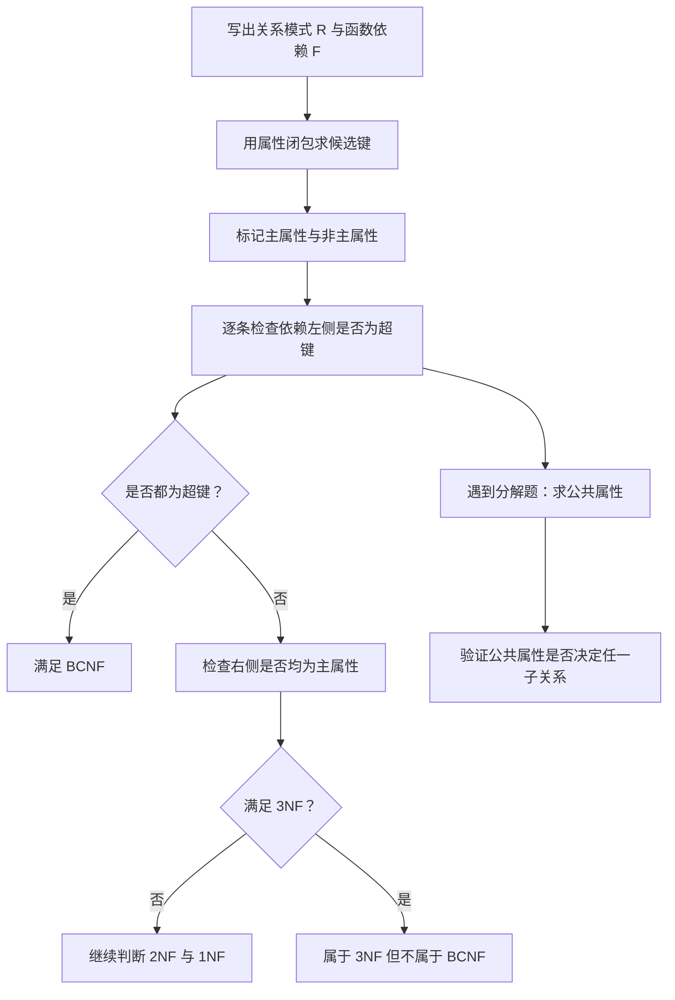

+++
date = '2026-11-20T19:30:00+08:00'
draft = false
title = '关系数据库理论题精讲：函数依赖、候选键、范式与无损分解'
+++

关系数据库理论题看起来总是在更换字母：这一次是 `A、B、C、D、E`，下一次又变成了员工、部门和订单。但题目真正考查的链路很稳定：**由函数依赖求属性闭包，借闭包找候选键，再用候选键判断范式和分解是否正确**。弱实体关系则属于 ER 建模部分，判断依据也同样明确。

本文围绕这类题目出现的知识点，给出一套可以手工执行的解题方法。重点不是记住某一题的选项；把选项背下来只会让字母换一组时再次手足无措，这一点实在没有必要。

## 一、先建立统一语言

设关系模式为：

```text
R(A, B, C, D, E)
```

函数依赖 `X → Y` 的含义是：在任意合法关系实例中，只要两行元组的 `X` 属性值相同，它们的 `Y` 属性值也必须相同。

例如：

```text
学号 → 姓名, 专业
课程号 → 课程名
```

这里的箭头不是一次查询的结果，而是数据设计所承诺的约束。若同一个学号能够对应两个不同姓名，那么 `学号 → 姓名` 就不成立。

### 属性闭包：所有判断的计算工具

属性集 `X` 在函数依赖集 `F` 下的闭包记为 `X+`。它表示：已知 `X` 的值，依据 `F` 最终能推出哪些属性。

手工算法只有四步：

1. 把 `X` 本身放入闭包。
2. 检查每条函数依赖；若左侧全部已在闭包中，就把右侧加入闭包。
3. 重复检查，直到没有新属性可以加入。
4. 将最终集合与关系模式的全部属性比较。

例如，给定：

```text
R(A, B, C, D, E)
F = { A → B, B → C, AC → D, D → E }
```

求 `A+`：

```text
初始：A+
     = {A}

由 A → B：
     = {A, B}

由 B → C：
     = {A, B, C}

由 AC → D：
     = {A, B, C, D}

由 D → E：
     = {A, B, C, D, E}
```

因此 `A+` 覆盖了 `R` 的全部属性，`A` 是一个超键。又因为它只有一个属性，无法再删去任何属性，所以 `A` 同时是候选键。

### 三种“键”不要混为一谈

| 名称 | 判定条件 | 关系 |
| ---- | -------- | ---- |
| 超键 | `K+` 包含关系中的全部属性 | 可以有冗余属性 |
| 候选键 | 是超键，且删除任一属性后不再是超键 | 最小超键 |
| 主键 | 从候选键中选定的一把键 | 是实现层面的选择 |

例如 `A` 是候选键时，`AB` 当然也能唯一标识元组，所以 `AB` 是超键；但 `B` 对唯一标识没有贡献，`AB` 不是候选键。

候选键题中常见的错误说法是“键表示行在表中的物理位置”。这不对。关系模型的元组本来就没有固定顺序；候选键描述的是**逻辑身份**，而不是第几行或磁盘上的哪个位置。

## 二、如何快速寻找候选键

### 先找必须出现的属性

一个很有用的观察是：**从未出现在任何函数依赖右侧的属性，必定属于每一个候选键。**

原因很简单：它无法被其他属性推导出来。若一个键不包含它，闭包就永远无法得到它，更不可能覆盖整个关系模式。

例如：

```text
R(A, B, C, D, E)
F = { A → D, B → C, D → AC }
```

属性 `B` 和 `E` 从未出现在右侧。因此每个候选键都必须先包含 `B`、`E`。但：

```text
(BE)+ = {B, E, C}
```

还缺少 `A、D`。补入 `A` 后：

```text
(ABE)+ = {A, B, E}
       = {A, B, C, D, E}
```

所以 `ABE` 是候选键。验证最小性也很直接：删去 `A` 得不到 `A、D`；删去 `B` 得不到 `B`；删去 `E` 得不到 `E`。故三者都不能删。

这里有两个边界需要留意：

- “没有出现在右侧”只能告诉我们该属性**必须在键中**，不能保证这些属性合起来已经是键。
- 出现在右侧的属性也可能属于候选键；当它是形成其他依赖左侧所必需的起点时，就需要把它补入尝试集合。

### 用闭包验证候选键，而不是凭直觉

题目给出：

```text
R(A, B, C, D, E)
F = { A → DE, B → CD, D → AC }
```

从 `B` 开始：

```text
B+
= {B}
= {B, C, D}       （B → CD）
= {A, B, C, D}    （D → AC）
= {A, B, C, D, E} （A → DE）
```

因此 `B` 已经决定全部属性，是候选键。单属性集合不可能再缩小，所以无须额外做最小性试验。

这类题的顺序应该固定为：**先算闭包，再宣布结论**。看到某个属性“看上去能推出很多东西”就直接勾选，通常正是失分的开端。

### 候选键的完整判定清单

若题目问“候选键必须满足什么，哪一项不是条件”，可按下面三点检查：

- 能唯一标识一个元组，即它是超键。
- 能函数确定关系模式中的每个属性，即 `K+ = R`。
- 具有最小性，删掉其中任何一个属性后都不再是超键。

“标识元组的物理位置”不是候选键的条件。并且，候选键不等于必须由单个属性构成；`(学生号, 课程号)` 这样由多个属性组成的复合候选键非常常见。

## 三、从候选键走到范式

范式题的核心不是看依赖写得复杂不复杂，而是逐条检查**非平凡函数依赖** `X → Y`：左侧是不是超键？右侧是否只含主属性？

其中，主属性是“至少出现在一个候选键中的属性”。

### 1NF、2NF、3NF 与 BCNF 的关系

| 范式 | 核心要求 |
| ---- | -------- |
| 1NF | 属性值不可再按当前模型拆分为重复组或多值列表 |
| 2NF | 在 1NF 基础上，非主属性不部分依赖于候选键的真子集 |
| 3NF | 在 2NF 基础上，非主属性不传递依赖于候选键；等价判定更通用 |
| BCNF | 对每一条非平凡依赖 `X → Y`，`X` 必须是超键 |

严格的包含关系是：

```text
BCNF ⊆ 3NF ⊆ 2NF ⊆ 1NF
```

也就是说，BCNF 一定是 3NF；但 3NF 不一定是 BCNF。不要把“出现函数依赖”误当作“不属于 BCNF”：候选键决定其他属性的依赖完全正常。

### 2NF：关注复合键的部分依赖

2NF 的问题只能出现在候选键含多个属性时。

例如：

```text
选课(学号, 课程号, 学生姓名, 成绩)
(学号, 课程号) → 成绩
学号 → 学生姓名
```

候选键是 `(学号, 课程号)`，但非主属性 `学生姓名` 只依赖候选键的一部分 `学号`，所以不满足 2NF。应拆为：

```text
学生(学号, 学生姓名)
选课(学号, 课程号, 成绩)
```

若候选键只有一个属性，便不存在“依赖候选键真子集”的可能。因此，单属性候选键的题目一旦不满足 3NF，通常仍至少满足 2NF。

### 3NF：允许一种 BCNF 不允许的例外

对每条非平凡依赖 `X → A`，3NF 的判定是：

- `X` 是超键；或
- `A` 是主属性。

BCNF 更严格：它只接受第一条，即 `X` 必须是超键。右侧是否为主属性并不能挽救 BCNF。

考虑：

```text
R(A, B, C, D, E)
F = { A → BCD, CD → E }
```

先求 `A+`：

```text
A+ = {A, B, C, D}
   = {A, B, C, D, E}  （CD → E）
```

故 `A` 是候选键，且是唯一候选键。`CD+` 只能得到 `{C, D, E}`，并不能得到 `A、B`，所以 `CD` 不是超键。

依赖 `CD → E` 的左侧不是超键，右侧 `E` 又不是主属性，因此：

- 不满足 BCNF；
- 不满足 3NF；
- 候选键 `A` 为单属性，不存在部分依赖，所以满足 2NF。

这种结构正是选择题中“该关系属于 2NF，但不属于 3NF”的标准推导。结论不是因为字母 `CD` 看起来像组合，而是因为 `CD` 既不是超键，`E` 也不是主属性。

### 判断 BCNF 的固定动作

面对“`R` 是否在 BCNF”这一问，请不要只检查候选键相关的那条依赖。按下面顺序完成：

1. 找出候选键或至少能判断每个依赖左侧是否为超键。
2. 列出所有非平凡依赖。
3. 只要有一条依赖的左侧不是超键，就立刻不是 BCNF。

仍用上例：`A → BCD` 合法，因为 `A` 是候选键；`CD → E` 不合法，因为 `CD` 不是超键。因此关系不在 BCNF。依赖本身并不“错误”，不满足的是把它们放在同一张关系表中的范式要求。

## 四、BCNF 分解：怎样拆，为什么这样拆

当 `X → Y` 违反 BCNF 时，一个标准分解是：

```text
R1 = X ∪ Y
R2 = R - (Y - X)
```

它的直观含义是：

- 在 `R1` 中保存“`X` 决定 `Y`”这一事实；
- 在 `R2` 中保留原关系的其余属性，并让 `X` 留在两张表中作为连接桥梁。

对前节的：

```text
R(A, B, C, D, E)
CD → E
```

取 `X = CD`、`Y = E`，得到：

```text
R1(C, D, E)
R2(A, B, C, D)
```

这正是针对 `CD → E` 的 BCNF 分解。检查两张子关系：

- 在 `R1(C, D, E)` 中，`CD → E` 且 `CD` 决定全部属性，所以 `CD` 是超键。
- 在 `R2(A, B, C, D)` 中，`A → BCD` 且 `A` 是超键。

二者均满足 BCNF。

### BCNF 分解并不等于“任意拆两张表”

分解至少要关心两个性质：

| 性质 | 要解决的问题 |
| ---- | ------------ |
| 无损连接 | 自然连接子关系后，能否恢复原来的元组，且不产生伪元组 |
| 保持依赖 | 是否只在各子关系内部就能检查原来的全部依赖 |

标准 BCNF 分解保证无损连接，但不总保证保持依赖。3NF 合成法通常能保持依赖，却未必达到 BCNF。它们是在不同目标之间取舍，不能把“BCNF”机械地理解为所有方面都最好。

## 五、无损连接分解：一条足够应付二表题的判定式

将 `R` 分解为 `R1`、`R2`。令公共属性集为：

```text
Z = R1 ∩ R2
```

二元分解是无损连接，当且仅当函数依赖集能够推出下面之一：

```text
Z → R1
```

或：

```text
Z → R2
```

也就是说，公共属性必须能唯一确定至少一张子关系的所有属性。共同属性若只是“碰巧都出现在两张表中”，却不能确定任何一边，连接时就可能把原本无关的行配到一起，产生伪元组。

### 例：根据公共属性判定无损性

设：

```text
R(A, B, C, D, E)
F = { A → BCD, CD → E }

R1(A, B, C)
R2(A, D, E)
```

公共属性为：

```text
R1 ∩ R2 = {A}
```

由 `A → BCD`，可推出 `A → ABC`，所以 `A → R1`。公共属性 `A` 能决定 `R1` 的全部属性，故该分解无损。

注意，判定式中的右侧是 `R1` 或 `R2` 的**全部属性**。只证明 `A → B` 或 `A → D` 并不够；必须能覆盖其中一整张子关系。

### 为什么 BCNF 的标准分解一定无损

在 `R1 = X ∪ Y`、`R2 = R - (Y - X)` 这一构造中：

```text
R1 ∩ R2 = X
```

而违反 BCNF 的依赖就是 `X → Y`，再加上平凡依赖 `X → X`，可得：

```text
X → X ∪ Y = R1
```

公共属性 `X` 能决定 `R1`，恰好符合二元无损分解判定式。这里没有什么神秘的记忆技巧，公式本身已经把无损性安排好了。

## 六、弱实体与识别关系：不要把“弱”理解为不重要

弱实体的特征不是业务上地位较低，而是它**不能只靠自身属性被唯一标识**。它需要依赖一个所有者实体的主键，再加上自身的部分键，才能确定一条实例。

例如：

```text
订单(Order)
订单明细(OrderItem)
```

`OrderItem` 中的“行号”只在同一订单内唯一。要定位一条订单明细，必须使用：

```text
(订单号, 行号)
```

其中：

- `订单号` 来自所有者实体 `Order`；
- `行号` 是弱实体的部分键；
- 连接二者的关系是**识别关系（identifying relationship）**。

在 ER 图中，弱实体通常使用双矩形，识别关系使用双菱形。题目若问“弱实体与其所有者之间应使用哪一种关系”，答案是识别关系，而不是普通的一对一、非识别关系或所谓“weak relationship”。

还需要区分两个容易混淆的概念：

| 概念 | 含义 |
| ---- | ---- |
| 弱实体 | 自身没有完整主键，标识依赖所有者 |
| 非识别关系 | 子实体有自己的独立主键；即使它引用父实体外键，父键也不是子主键的一部分 |

因此，“子表中有外键”并不能自动推出“它是弱实体”。关键要看父实体的键是否参与子实体的主键标识。

## 七、将选择题变成可复用的解题流程

拿到一组关系模式和函数依赖时，可以按这条顺序做。顺序看似朴素，却能避免绝大多数误判。



### 一组综合练习

设：

```text
R(A, B, C, D, E)
F = { A → BCD, CD → E }
```

可以依次得到：

1. `A+ = {A, B, C, D, E}`，所以 `A` 是候选键。
2. 唯一候选键为 `A`，故只有 `A` 是主属性。
3. `A → BCD` 的左侧是超键，不违反 BCNF。
4. `CD+ = {C, D, E}`，`CD` 不是超键。
5. `CD → E` 的右侧 `E` 不是主属性，故不满足 3NF；候选键是单属性，故满足 2NF。
6. 依据 `CD → E` 分解为 `R1(C, D, E)` 与 `R2(A, B, C, D)`。
7. 公共属性是 `CD`，并且 `CD → R1`，所以分解无损。

只要每一步都写出“闭包”或“哪个依赖满足、哪个不满足”的理由，类似的单选题、判断题和简答题都会有可核对的依据。只给出“是/否”却不说明 `CD` 为什么不是超键，恰好遗漏了这类题真正评分的部分。

## 八、易错点速查

- **候选键不等于任意唯一列。** 它必须在给定函数依赖下决定整个关系模式，并且不可再删属性。
- **超键不一定是候选键。** 有冗余属性的超键不是最小超键。
- **只出现单属性候选键，不会有部分依赖。** 因而不能仅凭它不在 3NF 就断言它不在 2NF。
- **BCNF 检查左侧，3NF 还允许右侧为主属性的例外。** 两条规则不可混用。
- **无损分解看交集能否决定一张子关系。** 不是看两张表是否“都有一个相同字段”。
- **弱实体的识别来自所有者键与部分键的组合。** 有外键的实体不必然是弱实体。
- **分解后不应凭感觉说“数据能连回来”。** 应明确写出 `(R1 ∩ R2) → R1` 或 `(R1 ∩ R2) → R2`。

## 九、总结

这组题目实际上只要求掌握四个稳定动作：

- 用属性闭包验证候选键，并检查最小性。
- 用“依赖左侧是否为超键、右侧是否为主属性”判断 BCNF 和 3NF。
- 用公共属性能否决定一张子关系，判断二元分解是否无损。
- 用“所有者键加部分键才能标识”识别弱实体及其识别关系。

字母可以更换，业务名称也可以更换，但推导步骤不会改变。把每一步写清楚，数据库理论题就不再是一组等待猜测的选项，而是一套可以验证的结论。
