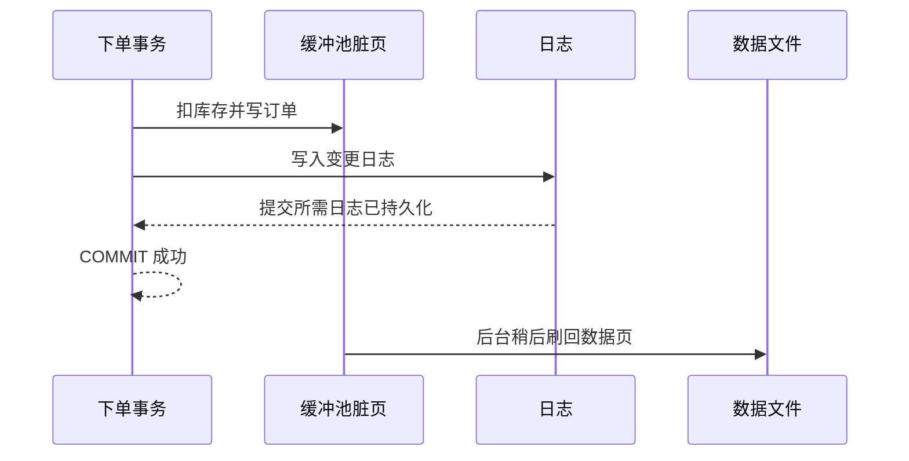

+++
date = '2026-10-19T20:00:00+08:00'
draft = false
title = '磁盘、缓冲池与记录存储：一行数据从页到内存'
+++

写出正确的 SQL 后，另一个问题随即出现：数据库究竟在读取什么？不是一条条“订单对象”，而是磁盘或 SSD 上的一批固定大小的页面，再由内存中的缓冲池反复利用。理解这层机制，才能解释为什么全表扫描有时并不慢、为什么随机查许多行会变慢，以及索引、事务日志为何都绕不开页面。

本文用 MySQL 8 的 InnoDB 作为具体参照。页、缓存和预写日志是许多数据库共有的思想；页大小、记录编码、刷盘策略和术语则属于具体实现，不能把 InnoDB 的细节当成所有产品的标准。订单表沿用前文的在线书店模型：`customer_order` 保存订单头，`order_item` 保存订单项，`book` 保存图书与库存。

## 存储介质决定了访问代价

HDD 需要移动磁头并等待盘片转到目标位置，连续读取相邻区域通常比散落读取许多位置更友好。SSD 没有机械寻道，随机访问改善明显，但仍通过块、控制器、队列和闪存擦写来工作；它并不意味着随机 I/O 没有代价。操作系统缓存、数据库缓冲池、并发负载和设备状态都会改变实际表现，因此不能脱离机器和工作负载背诵某个“固定延迟”。

数据库不直接以“单行”为单位向设备发起读取。它将表和索引组织为**页**（page），一次把页读入内存。这样做有两个理由：设备和文件系统适合批量 I/O；一页中相邻记录可被一次读取复用。一次按主键查订单也可能把同页的其他订单带入缓存；稍后的访问若命中该页，就不必再次触发存储 I/O。

```text
持久化存储
  表空间 / 数据文件
    数据页：记录、页目录、可用空间等
    索引页：键与子页指针
  日志文件：描述变更，用于恢复
          ↓ 读入
缓冲池（内存中的页副本）
          ↓
SQL 执行器按记录和索引访问数据
```

## 页内怎样放记录

把页想成一个可管理的容器比把它想成 Excel 行号更准确。许多实现使用类似**槽页**（slotted page）的组织：页的一端依次放实际记录，另一端维护槽目录；槽目录指向记录的位置。记录因为更新、删除或空间整理而移动时，只需更新槽位，外部在页内仍能通过槽定位。这一结构也允许变长列、空值位图和记录头等元数据存在。

概念示意如下，字段的准确字节布局由存储引擎决定：

```text
页头 | 记录 A | 记录 B | 可用空间 ... | 槽 2 | 槽 1 | 页尾
                                  ↑              ↑
                         新记录可使用的空间   槽指向记录位置
```

例如，订单项中的 `unit_price DECIMAL(10,2)` 是历史成交价，`quantity` 是数量；记录还可能保存事务可见性所需信息。`VARCHAR`、可空字段与行格式会影响一行占用空间。大字段是否完全放在页内、是否使用页外存储，也取决于引擎和行格式。因而“表有 N 行”不能直接推得读取必须发生 N 次 I/O：真正决定读取量的是页数、过滤条件、索引和缓存命中。

## 缓冲池：数据库自己的工作集

**缓冲池**（buffer pool）是数据库用来缓存数据页和索引页的内存区域。查询要访问一个页时，若它已经在缓冲池中，是缓存命中；否则数据库读取该页并放入缓冲池，必要时选择较少使用的页淘汰。InnoDB 会管理自己的缓冲池，不能简单把操作系统文件缓存等同于数据库缓存；两层都可能存在，但职责和可观测方式不同。

一次按订单号查询的逻辑看似只返回一行：

```sql
SELECT order_id, customer_id, status, ordered_at
FROM customer_order
WHERE order_no = 'SO202610200001';
```

若 `order_no` 有合适索引，执行过程通常先访问若干索引页，再取到目标记录所在的数据页；这些页恰好已在缓冲池时，查询主要消耗 CPU 和内存访问。冷启动、工作集大于内存、报表扫描大量历史订单，都会降低命中率，使存储读取重新成为瓶颈。扩充内存有帮助，但若 SQL 每次都扫描不需要的巨大范围，缓存也不能把无效工作变成正确设计。

写入也不是立刻逐页写回数据文件。被更新的内存页会成为**脏页**；后台线程在合适时机把它们刷回持久化存储。延后、合并写回能提高吞吐，却必须和崩溃恢复配合，否则断电时内存中的成功更新会消失。

## 顺序访问、随机访问与表布局

顺序扫描以页为单位连续推进，适合“统计本月已支付订单”这类确实要处理大部分行的任务。若选择性很低，先经索引找到几乎所有行、再对每行随机取数据页，反而可能比扫描整张表更差。反之，按高选择性条件找少数订单时，合适索引能避免读取大量无关页。优化目标从来不是“永远不用全表扫描”，而是让读取页数与所需结果相称。

聚簇组织进一步影响局部性。以 InnoDB 为例，表的聚簇索引按主键组织，整行数据存放在主键叶子页中；按相近主键范围读取，往往比按零散二级索引键取大量行更集中。具体的 B+ 树与二级索引回表将在下一篇展开。若使用另一个数据库，其“heap table”、聚簇键或主键存储策略可能不同，分析前应先核实该产品的表组织方式。

## WAL 为什么属于存储问题

事务一旦 `COMMIT` 返回，就需要能在崩溃后恢复。若每次修改都等待对应数据页立即安全写回，写入会被大量离散页 I/O 拖慢。**预写日志**（WAL，write-ahead logging）的原则是：与某次页修改有关、足以恢复该修改的日志记录，应先于该脏页持久化。提交时优先保证日志到达稳定存储，数据页可以之后批量刷回；故障恢复再根据日志重做已提交修改，撤销未完成修改。



在 InnoDB 中，redo log 是实现崩溃恢复的重要组成；undo 等结构还与事务回滚、多版本可见性有关。它们的内部格式和刷写配置是实现细节，但“日志先于数据页”的约束是理解持久性的关键。WAL 不是备份：日志损坏、误删数据或整机介质丢失仍需要备份与恢复方案。

## 常见误解与排查起点

- “SSD 所以不用索引”是错的。SSD 缩小了随机访问差距，却不能消除大量无关页读取、CPU 比较和并发竞争。
- “缓存命中所以 SQL 没问题”也不成立。偶然的热缓存会掩盖低选择性扫描；重启、流量变化后问题会重现。
- 不要根据单次耗时臆测 I/O。应结合执行计划、扫描行数、缓冲池/读写指标和真实数据分布判断。
- 不要把事务日志当备份，或把文件备份当作自动可恢复。恢复链路还要求可用备份、日志保留及演练。

## 小结

- 数据库以页而不是单行管理持久化数据，页内的记录和槽目录支持高效定位与空间管理。
- 缓冲池缓存数据页和索引页；命中率、访问局部性与工作集共同决定存储压力。
- 顺序扫描和索引随机访问各有适用范围，应以读取页数和结果选择性判断。
- 脏页延迟写回依赖 WAL 提供崩溃恢复基础；日志保证不是备份的替代品。

下一篇[索引、B+ 树与哈希：从访问路径到索引设计](09-indexes-b-plus-tree-and-hash.md)将把“如何少读页”落实为具体索引结构和在线书店的设计推导。
