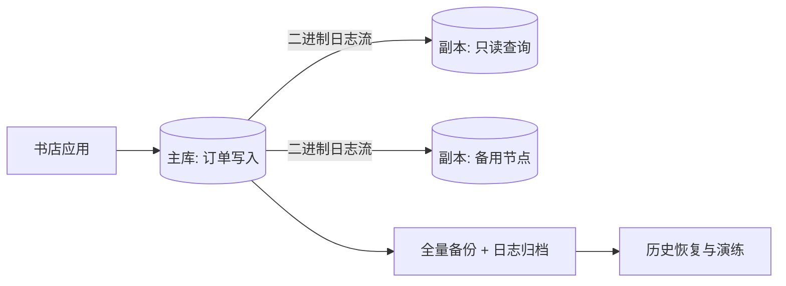

+++
date = '2026-10-19T20:00:00+08:00'
draft = false
title = '复制、备份与高可用基础'
+++

订单库即使事务和并发控制都设计正确，仍会面对另一类问题：机器损坏、误执行 `DELETE`、机房故障，以及读流量超过单机能力。此时最容易犯的错误是把“有副本”当成“有备份”，或者把“能切换”当成“不会丢数据”。它们解决的目标不同，必须分别设计、分别演练。

本篇以在线书店的 MySQL 8/InnoDB 主库与副本为例，建立恢复点目标（RPO）、恢复时间目标（RTO）、逻辑/物理备份、日志复制和故障切换的基本框架。具体的 MySQL 命令、权限和版本差异较多，执行生产变更应以所用版本官方文档及团队运行手册为准；本站已有更专门的[MySQL 主从复制](../04-replication-and-operations/MySQL%20主从复制.md)可配合阅读。

## 一、先把“可恢复”量化为 RPO 与 RTO

恢复设计不能只写“每天备份”。应先问两个业务问题：

| 指标 | 含义 | 书店示例 |
| ---- | ---- | -------- |
| RPO（Recovery Point Objective） | 灾难后最多容忍丢失多少已确认数据 | 支付订单最多丢 0 或几秒？ |
| RTO（Recovery Time Objective） | 从故障到服务恢复最多允许多久 | 大促期间能否接受两小时只读？ |

若每天凌晨一份全量备份，最坏可丢接近一天的数据，RPO 就接近 24 小时；恢复一个很大的备份还可能让 RTO 超标。相反，降低 RPO 往往需要更频繁备份、保留可用二进制日志或更同步的复制，成本会增加。目标应由业务风险决定：订单和付款事实通常比商品浏览统计要求更严格。

## 二、备份回答“回到过去”，复制回答“继续服务”

**备份**是在某个时间点保存可独立恢复的数据副本，用于介质损坏、误删、勒索软件、长期留存和回到历史时刻。**复制**把一个服务器已产生的变更持续传给其他服务器，常用于读扩展、热备和快速故障切换。复制会把错误也快速传播：主库误删订单后，副本通常也会删掉；因此副本不能代替备份。



图中副本让服务在主库故障时有机会切走；独立备份让团队在逻辑错误发生后还能找回正确时间点。两条链都需要监控、权限保护和定期恢复演练。

## 三、逻辑备份与物理备份的选择

逻辑备份导出表结构与 SQL 数据，例如 `mysqldump` 输出；它便于按库、表或对象粒度迁移，也较容易审阅，但对大库的导出和导入耗时较长。一个示意命令如下：

```bash
mysqldump \
  --single-transaction \
  --routines --events --triggers \
  --databases bookstore > bookstore-2026-10-20.sql
```

`--single-transaction` 对支持一致性读的 InnoDB 表可在尽量不阻塞写入的情况下取得一致视图，但它不保证所有非事务表或外部对象也一致；触发器、存储过程、事件、账户权限是否在范围内也要明确。更重要的是，备份文件必须被加密、访问受控并在不同故障域保存，不能只放在同一台数据库服务器的另一个目录。

物理备份复制的是数据文件及其相关元数据，常由 MySQL 企业工具或社区生态工具完成，通常更适合大容量实例的快速恢复。它对版本、文件格式和操作过程更敏感，不能把“直接拷贝正在运行的数据目录”当作通用安全方案。无论逻辑还是物理，恢复可用性都必须用实际恢复来证明。

## 四、恢复演练与备份校验

一份从未恢复过的备份，只是一种希望。书店团队至少应周期性在隔离环境完成以下流程：

1. 校验备份文件的大小、清单和校验和，确认传输与存储没有损坏。
2. 从空实例恢复全量备份，记录真实耗时并与 RTO 对照。
3. 验证表、索引、触发器、字符集和关键行数；抽查订单、订单项与库存的一致关系。
4. 若策略支持日志前滚，演练恢复到误删前的目标时刻，而不是只恢复到上一次全量备份。
5. 检查应用是否能用最小权限账号连接恢复环境，并记录所有步骤为可执行的 runbook。

例如逻辑恢复的形式可能是：

```bash
mysql --database=bookstore_restore < bookstore-2026-10-20.sql
mysql --database=bookstore_restore -e "SELECT COUNT(*) FROM customer_order;"
```

生产事故中不要直接在原库试错。先隔离、保留证据，在恢复实例验证数据与切换方案；对于误删，常见安全做法是恢复到旁路实例、导出需要找回的行，再经过审计写回生产。

## 五、复制的日志流与延迟

MySQL 的传统复制可概括为：主库把已执行的更改写入二进制日志；副本连接主库接收日志并在本地重放。术语从“主从”逐步转向“源库/副本”或“主库/副本”，重点不在名称，而在谁接受写入、谁应用变更、延迟如何被观测。

```text
客户端提交事务
  -> 主库记录二进制日志
  -> 副本接收并保存日志
  -> 副本 SQL/应用线程重放
  -> 副本数据逐步追上主库
```

异步复制下，主库提交不会等待副本应用完成。因此用户刚提交订单，立即路由到副本查询，可能暂时看不到自己的订单，称为“读己之写”问题。可按业务选择：订单确认页在一段时间内固定读主库；把主库提交位置或版本传给读取端并等待副本追到该位置；或在明确性能和可用性代价后使用半同步、组复制等更强机制。读写分离只是路由策略，不自动提供一致性。

复制延迟还会让报表、库存展示或取消订单判断滞后。不要把副本用于必须读取当前写入结果的强一致路径；监控副本延迟、接收状态、重放错误和磁盘空间，并为延迟超阈值制定摘流或降级策略。

## 六、故障切换要先定义“谁有资格写”

高可用的核心不是拥有多个服务器，而是在主库不可用时让一个健康副本接管写入，同时防止两个节点同时接受写入，即**脑裂**。一次切换通常包含：判断故障与隔离旧主；确认候选副本的日志进度和数据健康；提升候选节点；更新代理、服务发现或应用连接；限制旧主写入；验证订单关键路径；最后修复并重新加入原节点。

非计划切换有数据丢失风险：若已提交事务尚未复制到候选副本，提升后它可能消失，这正是 RPO 的具体体现。半同步可以缩小部分窗口，却不等同于跨故障域绝对零丢失；自动切换工具也不能替团队决定“网络分区时哪一边应该停止写入”。这些决策要写进演练过的运行手册。

计划维护则更温和：先停止或排空写流量、确认副本追平、按流程切换、验证，再维护旧主。无论自动还是人工切换，都应记录当前主节点、复制拓扑、账号、日志保留周期和回切条件。没有这些事实的“高可用”在事故时只是更复杂的不可用。

## 七、常见误区

- **“副本就是备份。”** 错。副本会同步误操作和逻辑损坏，备份需有独立保留与恢复能力。
- **“备份成功日志等于可恢复。”** 错。必须校验并定期在隔离环境完整恢复。
- **“读写分离天然一致。”** 错。异步副本存在延迟，订单确认等路径要设计读己之写。
- **“切换后自然不会双写。”** 错。需要隔离旧主、写入仲裁和明确的拓扑控制。
- **“把备份存在同机就够了。”** 错。同机磁盘、权限失陷和勒索事件可能同时摧毁主数据与备份。

## 八、小结

- RPO 定义可丢多少数据，RTO 定义多久恢复；二者应由订单业务风险量化。
- 备份负责回到过去，复制负责扩展读取和缩短故障恢复；二者必须同时建设。
- 逻辑与物理备份各有速度、粒度和兼容性取舍，关键是加密、异地保存和可恢复验证。
- 异步复制会产生延迟，读写分离必须明确哪些请求可接受旧数据。
- 切换的难点是防脑裂和确认数据进度；自动化只能执行规则，不能代替故障域与一致性决策。
