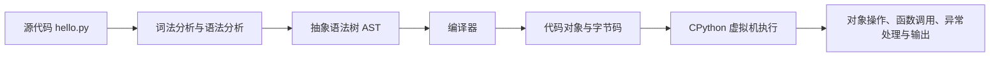

+++
date = '2026-10-13T20:00:00+08:00'
draft = false
title = 'Python 解释器如何运行代码：从源码、字节码到 __pycache__'
+++

写下并运行一行 Python 代码时，表面上像是“解释器逐行读取并执行”。这个说法便于入门，却遗漏了真正有用的过程：Python 会先确定运行入口和导入路径，读取源代码，解析并编译为可执行的代码对象，再由运行时执行其中的字节码；导入模块时，还会在内存和磁盘上使用两类不同的缓存。

理解这条链路，很多看似零散的问题就有了答案：为什么 `import` 会执行模块顶层代码？为什么同一模块多次导入通常只初始化一次？`__pycache__` 能不能删？`.pyc` 能不能提交到 Git？为什么改完代码后，正在运行的服务没有立刻变成新逻辑？

本文以最常见的 **CPython** 为主线。CPython 是官方参考实现，也是大多数人通过 `python` 命令运行到的实现；PyPy、Jython 等其他实现同样遵循 Python 语言规则，但内部执行和缓存细节未必相同。因此，`__pycache__`、`.pyc` 文件名和字节码指令等细节，都应理解为 CPython 的实现行为，而不是 Python 语法本身的承诺。

## 一、先分清：Python 语言、解释器与 CPython

Python 是一门编程语言，规定了例如 `if`、函数、异常、导入语义应当如何表现；**解释器**则是执行这些规则的程序。

当你在命令行输入下面的命令时：

```bash
python app.py
```

操作系统启动的是某个 Python 解释器可执行文件。这个解释器负责创建 Python 进程、准备标准库和模块搜索路径，读取 `app.py`，并在此后的生命周期中管理对象、函数调用、异常和模块导入。

常见入口方式的差别很值得知道：

| 方式 | 示例 | 适合的场景 | 重要特点 |
| ---- | ---- | --------- | -------- |
| 交互式解释器 | `python` | 试验表达式、排查环境 | 每次输入的代码立即执行 |
| 执行脚本 | `python app.py` | 简单脚本 | 该文件作为 `__main__` 执行 |
| 按模块执行 | `python -m package.module` | 包内命令、项目入口 | 保留包上下文，适合相对导入 |
| 执行一段命令 | `python -c "print('hello')"` | 临时自动化 | 不适合承载复杂程序 |

`python` 具体指向哪个解释器同样很重要。虚拟环境、系统 Python、IDE 选择的解释器可能不是同一个；它们拥有不同的版本、第三方包目录和配置。遇到“终端能运行而 IDE 报 `ModuleNotFoundError`”时，先比较两个环境的解释器路径，通常比急着改代码更有效。

```python
import sys

print(sys.executable)  # 当前实际运行的解释器
print(sys.version)     # Python 版本与构建信息
```

## 二、从 `.py` 到结果：一次执行的大致链路

把下面的程序保存为 `hello.py`：

```python
name = "Yukino"
print(f"Hello, {name}")
```

CPython 执行它时，可以抽象为下面几层：



这不是把源代码机械地翻译成某一台 CPU 的机器指令。CPython 会先检查代码是否符合语法，把它组织成内部语法结构，再编译为**代码对象**（`code object`）。代码对象中包含字节码、常量、局部变量名、函数参数等信息。

随后，CPython 的执行循环读取字节码并完成操作，例如加载常量、读取名字、调用函数、跳转到分支。运行时对象仍然是 Python 对象：整数、字符串、列表、函数和自定义实例都带着类型与引用等运行时信息。也正因如此，Python 通常不像 C 那样直接把一份源码预先编译为某平台的原生可执行文件。

这里的“字节码”应当理解为解释器内部使用的中间指令，不是给人手工维护的语言。可以用标准库 `dis` 观察它：

```python
import dis


def add(left, right):
    return left + right


dis.dis(add)
```

输出会展示 `add` 对应的字节码指令。不要把某个教程中的指令名称和顺序当作固定规则：CPython 会持续优化解释器，尤其是 3.11 之后字节码与内部执行策略变化更频繁；不同 Python 版本的 `dis` 输出不同是正常现象。你真正需要掌握的是：**源代码会被编译为字节码形式，再由解释器运行**。

## 三、函数定义不等于函数调用

解释器按模块顶层代码的执行顺序工作，但“执行一行”也不总意味着完成该行中所有业务。

```python
print("before")


def greet(name):
    print(f"Hello, {name}")


print("after definition")
greet("Yukino")
```

结果是：

```text
before
after definition
Hello, Yukino
```

执行 `def greet(...)` 时，CPython 会创建函数对象，并让它关联到编译好的函数代码；函数体里的 `print` 并不会在定义时运行。直到执行 `greet("Yukino")`，解释器才建立这次调用所需的局部命名空间并运行函数体。

类定义也类似：执行 `class` 语句会运行类体以建立类对象；创建实例、调用方法则发生在后续。理解“定义阶段”和“调用阶段”的区别，是理解装饰器、默认参数、模块初始化和导入副作用的基础。

## 四、`import` 并非复制代码，而是一套加载协议

假设项目结构如下：

```text
project/
  main.py
  backend/
    __init__.py
    inpaint/
      __init__.py
      engine.py
```

`main.py` 中有：

```python
from backend.inpaint.engine import InpaintEngine
```

为了完成这条导入，Python 大致会做以下事情：

1. 先查进程内的 `sys.modules`，看 `backend`、`backend.inpaint` 和 `backend.inpaint.engine` 是否已经加载。
2. 若没有，按模块搜索规则找到包或模块。顶层模块通常会结合 `sys.path` 搜索；子模块则在父包的 `__path__` 中搜索。
3. 创建模块对象，并且**先**把它登记到 `sys.modules`。
4. 编译并执行模块的顶层代码，将函数、类、常量等写入模块对象的命名空间。
5. 将所需的模块或名字绑定到当前文件的作用域中。

第三步发生在模块代码执行之前，是为了让循环导入不至于无限递归。但这也解释了循环导入中的“部分初始化模块”：A 正在加载时导入 B，B 又试图从尚未执行完的 A 中取某个名字，那个名字可能还没有创建。

```text
main.py
  -> 导入 backend
    -> 导入 backend.inpaint
      -> 导入 backend.inpaint.engine
        -> 创建模块对象并登记到 sys.modules
        -> 执行 engine.py 顶层代码
        -> 绑定 InpaintEngine
```

因此，导入确实会执行模块顶层代码：

```python
# engine.py
print("load inpaint engine")


class InpaintEngine:
    pass
```

第一次导入时会打印 `load inpaint engine`。如果模块顶层直接连接数据库、读取大型模型或启动线程，那么这些动作也会随导入发生。框架有时会有意利用这种机制完成注册，但普通业务模块的顶层应尽量只放定义和轻量配置，避免隐藏的初始化成本与副作用。

## 五、两种缓存：`sys.modules` 与 `.pyc` 完全不是一回事

“Python 有模块缓存”这句话本身没错，但常常把两个层次混在一起。它们解决的是不同问题。

| 缓存 | 所在位置 | 生命周期 | 缓存的内容 | 主要作用 |
| ---- | -------- | -------- | ---------- | -------- |
| `sys.modules` | 当前 Python 进程内存 | 进程结束即消失 | 已加载的模块对象 | 避免同一进程反复加载、执行模块 |
| `.pyc` / `__pycache__` | 磁盘 | 可跨进程保留 | 源模块编译后的字节码缓存 | 减少下次导入时的编译工作 |

例如：

```python
import sys
from backend.inpaint import engine

print(sys.modules["backend.inpaint.engine"])
```

同一个进程里再次执行 `import backend.inpaint.engine` 时，通常会直接复用 `sys.modules` 中的模块对象，不会再次执行 `engine.py` 的顶层代码。这是**内存模块缓存**。

相反，结束程序后，`sys.modules` 消失。下一次启动时，Python 仍需要重新导入模块；此时它才可能使用磁盘上的 `.pyc`。所以删掉 `__pycache__` 并不会让一个已经运行的 Python 服务加载新代码；它影响的是后续进程的导入编译，而不是当前进程内存中的模块对象。

## 六、`__pycache__` 与 `.pyc`：它到底保存了什么

对可从源码导入的模块，CPython 通常会把编译后的字节码缓存写到源文件同目录的 `__pycache__` 下。以 `backend/inpaint/engine.py` 为例，常见文件名是：

```text
backend/inpaint/__pycache__/engine.cpython-312.pyc
```

各部分的含义如下：

| 部分 | 含义 |
| ---- | ---- |
| `__pycache__` | 存放 Python 字节码缓存的目录 |
| `engine` | 对应源模块 `engine.py` |
| `cpython-312` | 由 CPython 3.12 生成的缓存标记 |
| `.pyc` | Python 字节码缓存文件，不是源代码 |

它不是模型文件、用户图片、数据库数据或图像修复结果。在源代码仍存在的普通项目中，删除 `backend/inpaint/__pycache__/` 不会删除实际业务数据，也不会改变功能；下一次导入相应模块时，CPython 可以重新编译并写出新的缓存。它的角色更接近草稿纸：保留它可以少做一次重复的编译工作，丢掉它也不会让原稿消失。

但这句话有一个必要边界：**前提是对应的 `.py` 源文件仍在。** 极少数发布物可能只分发 `.pyc`，或由特殊加载器加载字节码；在这种场景中，删除唯一的 `.pyc` 当然会让模块无法加载。日常应用仓库里，`__pycache__` 几乎都是可再生的派生文件，但不要把“通常可删”误读为“任何 `.pyc` 都无条件可删”。

另外，直接执行的入口脚本与“被导入的模块”也应区分：字节码缓存主要服务于**导入**。`python app.py` 执行的主脚本会被编译后运行，但一般不会仅因此在旁边生成 `app.pyc`；而 `app.py` 导入的其他源码模块通常会写入缓存。

## 七、缓存如何知道自己过期了

`.pyc` 并不是一旦存在就永远可信。CPython 在加载缓存字节码之前，会先验证它与源文件是否匹配。

默认情况下，缓存中会记录源文件的修改时间和大小；运行时再与当前 `.py` 的元数据比较。若不一致，CPython 会重新编译源文件，并更新缓存。CPython 也支持基于源文件内容哈希的缓存模式：它以源代码的哈希值来验证缓存是否仍匹配。

因此，正常开发中通常不需要为了“让修改生效”手动删除 `__pycache__`。更常见的原因是当前进程仍在运行旧模块对象，或者启动的根本不是你以为的解释器、工作目录或代码副本。

确实怀疑缓存或构建产物异常时，可以先停止相关 Python 进程，再删除项目内相关目录的 `__pycache__`，然后重新启动。例如在 PowerShell 中：

```powershell
Remove-Item -LiteralPath 'backend\inpaint\__pycache__' -Recurse -Force
```

这里应当只删除已经确认的项目子目录，不要把清理命令写成模糊的全盘匹配。缓存能重建，不代表删除范围可以不经思考。

## 八、什么时候会生成、何时不写，以及如何查看缓存位置

下列代码可以根据当前解释器和源码路径推导缓存文件名：

```python
import importlib.util
import sys


source = "backend/inpaint/engine.py"
print(sys.implementation.cache_tag)
print(importlib.util.cache_from_source(source))
```

在 CPython 3.12 中，第一行通常是 `cpython-312`；第二行通常会得到类似 `backend/inpaint/__pycache__/engine.cpython-312.pyc` 的路径。不同实现、版本、优化选项和操作系统路径形式都可能让结果不同，所以排查时让当前解释器自己给出答案，比手猜文件名可靠。

你也可以通过以下方式影响字节码缓存行为：

- 使用 `python -B ...`，或设置环境变量 `PYTHONDONTWRITEBYTECODE`，阻止 Python 写入 `.pyc`。这不会阻止源码被编译和运行，只是不把编译结果落到默认缓存位置。
- 设置 `PYTHONPYCACHEPREFIX`，把缓存写到指定的集中目录，适合某些只读源码目录或构建环境。
- 使用 `python -m compileall <目录>`，在部署或构建阶段预先编译目录中的 Python 文件。
- `python -O` 会启用优化模式并产生带优化标记的缓存；它会影响 `assert` 等语义，不应为了“提速”而在不了解影响时随意开启。

对大多数应用开发而言，最合理的默认值往往是什么都不设置：让 CPython 自动管理缓存即可。它带来的收益通常只是避免重复编译，并不会把一次耗时的模型推理、网络请求或数据库查询变快；别把 `.pyc` 当作性能灵药，那会高估一张草稿纸的工作能力。

## 九、为什么不应把 `__pycache__` 提交到 Git

`.pyc` 是由源代码、解释器实现和版本共同导出的产物。不同 Python 版本可能生成不同的缓存文件名与内容；它没有表达人工维护的业务意图，还会制造无意义的变更和合并冲突。

项目通常应在 `.gitignore` 中忽略它：

```gitignore
__pycache__/
*.py[cod]
```

第一条忽略所有名为 `__pycache__` 的目录；第二条覆盖常见的 Python 编译文件扩展名。若缓存已经被 Git 跟踪，仅新增 `.gitignore` 不会自动停止跟踪，需要在确认目标后把它从 Git 索引中移除；这一步与“删除本机缓存”是两件事，处理前应先检查仓库状态和团队约定。

## 十、排查“旧代码没有生效”的正确顺序

当你怀疑 Python 仍在执行旧代码时，先按影响最大的层次排查，通常比先删除所有缓存更快：

1. 确认文件已保存，并打印或检查实际加载路径：`print(module.__file__)`。
2. 确认启动命令、当前工作目录和 `sys.executable`，避免运行到了另一个虚拟环境或另一份项目副本。
3. 重启进程、开发服务器、任务 worker 或 Notebook 内核。运行中的 `sys.modules` 才是最常见的“旧模块”来源。
4. 若工具有自己的热重载、容器镜像、打包产物或挂载目录，再检查它们是否更新。
5. 最后才在关闭进程后清理相关 `__pycache__`，让解释器重建。

`importlib.reload()` 可以在交互式调试中重新执行模块，但它不是通用热更新方案。其他模块可能仍持有旧函数、旧类或旧实例的引用，重载后状态关系容易变得复杂。对服务程序而言，清晰的重启或受框架管理的重载机制通常更可靠。

## 十一、把整条链路串起来

以最初的导入为例：

```python
from backend.inpaint.engine import InpaintEngine
```

可以这样理解它：

```text
解释器启动
  -> 执行当前入口模块
  -> import 查找 sys.modules
  -> 未命中时按导入路径定位 backend.inpaint.engine
  -> 尝试读取有效的 .pyc；没有或失效则编译 engine.py
  -> 创建模块对象，预先放入 sys.modules
  -> 执行 engine.py 顶层代码
  -> 将 InpaintEngine 绑定到当前模块
  -> 后续同进程 import 通常直接复用 sys.modules 中的模块对象
```

这也说明了几个容易混淆的结论：

- Python 不是“完全不编译”的语言；CPython 会把源码编译为字节码再执行。
- `.pyc` 是跨进程保留的磁盘缓存，`sys.modules` 是当前进程的模块对象缓存。
- `__pycache__` 不是项目源代码，也不是图像修复模块的模型、输入或输出数据。
- 源文件存在时，删除普通项目中的 `__pycache__` 是安全的；下次导入会自动重建。
- 改了源码却仍是旧行为，优先检查运行中的进程和实际解释器，而不是迷信缓存。
- 缓存文件应保留在本机以节省重复编译，但通常不应提交到 Git。

理解解释器并不要求记住每一条字节码指令。更重要的是建立一条稳定的因果链：**源码被解析和编译，模块被加载和执行，模块对象被进程缓存，字节码可以被磁盘缓存。** 以后再看到 `__pycache__`，就不必把它当成神秘文件；它只是在提醒你，解释器已经替你做过一次可以重复的准备工作而已。
