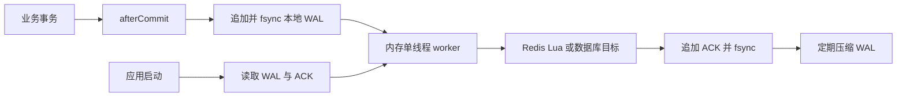

+++
date = '2026-11-08T21:45:00+08:00'
draft = false
title = 'Spring 事件做最终一致性计数时，如何用本地 WAL 避免静默丢失'
+++

许多业务为了减少数据库的高频写入，会先把浏览数、点赞数、用户发帖数这类派生元数据累加到 Redis，再由定时任务批量刷回 MySQL。这个思路本身没有问题；问题通常出在“把 Spring 的异步事件当成可靠消息队列”。它不是。

本文以“删帖后用户发帖数没有减少”为例，说明这类问题为什么会发生，如何区分 Spring 事件丢失与 Redis write-behind 竞态，以及如何在**不引入消息中间件、不把队列状态放进 MySQL 或 Redis**的条件下，用一个简单的本地文件 WAL 改善可靠性。

## 先给结论

下面三件事要一起做，缺一件都会留下明显的丢数窗口：

- Redis 中“累加 delta”和“加入待刷集合”必须是一条原子命令，最简单的实现是 Lua。
- 关键计数不能再由裸 `@Async @EventListener` 承担投递责任；事务提交后先写本地 WAL，再异步消费。
- 对可重算的派生计数保留低频校准任务。它是最终一致性的最后一道防线，不是失败设计的借口。

本地 WAL 能把大量“短暂 Redis 故障或进程退出导致的永久丢失”变成“可持久重试”。但它不能在没有 outbox、MQ 或分布式事务的条件下承诺 exactly-once；这一点应当坦诚，而不是用一个漂亮的名词掩盖事实。

## 原来的链路为什么不可靠

典型链路如下：

```mermaid
flowchart LR
    A[删帖事务] --> B[publishEvent]
    B --> C[@Async EventListener]
    C --> D[Redis 增量]
    D --> E[定时任务]
    E --> F[MySQL 批量更新]
```

假设删帖事务已经提交。`publishEvent` 只是把对象交给 Spring 的应用事件机制；如果监听器使用了 `@Async`，它随后进入的是 JVM 内存中的线程池队列。这个队列没有持久化、没有确认、没有失败重放，也没有死信队列。

因此，以下任一情况都能使一次计数变更永久消失：

- Redis 超时、断开或命令执行异常；
- 异步任务开始前，应用被重启、OOM 或被容器终止；
- 监听器抛出异常；
- 线程池拒绝任务或任务没有来得及完成；
- 事件在线程中执行成功前进程崩溃。

很多项目会配置 `AsyncUncaughtExceptionHandler` 并写一条错误日志。日志只能解释失败，不能让事件重新出现。若调用方已经返回、业务事务已经提交，那条 delta 就已经丢了。

### 事务提交前发布还有反向问题

如果业务方法带有 `@Transactional`，却在事务体内直接 `publishEvent`，异步监听器可能在主事务提交前就写了 Redis 或数据库。主事务之后如果回滚，就会产生“帖子没有保存成功，但计数已经改变”的幽灵数据。

`@TransactionalEventListener(phase = AFTER_COMMIT)` 可以修复这个事务时序问题，但不能解决进程崩溃、Redis 不可用和监听器异常后的可靠投递问题。因此它是必要的语义改进，却不是可靠队列。

## 一个更隐蔽的 Redis 竞态

即使 Spring 事件从未丢失，下面这段常见实现仍然会丢增量：

```java
redisTemplate.opsForSet().add("pending:user-profile-delta", userId);
redisTemplate.opsForHash().increment("user:profile:delta:" + userId, "postCount", -1);
```

第一条命令表示“这个用户有待刷增量”，第二条命令才真正写 delta。二者之间不是原子的。若定时任务正好插入，时序可能是：

```text
业务线程                         定时任务
SADD pending userId
                                 claim userId
                                 pending -> processing
                                 发现 delta hash 还不存在
HINCRBY delta hash postCount -1
```

如果 `claim` 对空 hash 的处理又只是过滤并返回，而没有把 ID 放回 pending，那么 `-1` 会留在 Redis hash 中，却没有任何 pending 标记。定时任务以后再也扫描不到它。这种问题特别危险，因为 Redis 没有报错，日志也未必有异常。

它还能解释一种很有迷惑性的现象：第一次删帖无效，之后创建一篇再删除又“恢复正常”。第一次留下的 `-1` 可能与后来创建时的 `+1` 合并为 `0`，随后再次删除才把新的 `-1` 正常刷入数据库。

## 生产事故复盘：2026 年 11 月 7 日的删帖计数

这一节记录一次真实的生产排查。目标不是事后把每一种可能都归咎于“异步不可靠”，而是把日志实际能证明的事实、源码能证明的漏洞，以及不能仅凭现有日志断言的部分分开。否则复盘只会变成一种看似严谨的猜测游戏。

排查范围为 `2026-11-07` 的应用滚动日志，服务器时区为 `Asia/Shanghai`。全程只读取日志和配置，没有修改线上 Redis、数据库、容器或日志文件。

### 事故时间线

当天有三个直接相关的删帖请求。`userId=2` 是发生异常现象的账号；`userId=23` 的请求可作为同一时段链路正常工作的对照。

| 时间 | 动作 | 日志结果 |
| ---- | ---- | -------- |
| `00:22:38.821` | `userId=2` 删除帖子 `1117` | `DELETE /api/v1/posts/1117` 返回 `200`，耗时 `35ms`。主删帖事务成功。 |
| `00:22:42.010` | 用户资料计数调度执行 | 调度任务开始、结束，但没有 `claimedIds:[[2]]` 的成功刷库日志。 |
| `00:22:52` 至 `00:25:52` | 后续调度执行 | 每十秒正常运行，仍没有账号 `2` 的成功刷库记录。 |
| `16:13:29.852` | `userId=2` 创建帖子 | `POST /api/v1/posts` 返回 `200`。 |
| `16:13:35.903` | 用户资料计数调度执行 | 出现 `update user profile success，claimedIds：[[2]]`。 |
| `16:13:56.165` | `userId=2` 删除帖子 `1139` | `DELETE /api/v1/posts/1139` 返回 `200`。 |
| `16:14:05.913` | 用户资料计数调度执行 | 再次出现账号 `2` 的成功刷库日志。 |
| `16:21:53.051` | `userId=23` 删除帖子 `1100` | 请求返回 `200`。 |
| `16:21:55.970` | 用户资料计数调度执行 | 两秒后成功刷新 `claimedIds:[[23]]`。 |

凌晨请求之后的第一次调度恰好发生在 `00:22:42`。它在不足一毫秒内结束，也没有账号 `2` 的成功记录。此后连续数分钟的调度也没有处理到该账号。相比之下，下午创建和再次删除时，该账号都在下一次调度中正常出现；这说明定时任务整体没有停摆。

### 当天没有发现 Redis 异常证据

对 11 月 7 日整天以及 `00:22` 前后的日志，检索了下列关键字：

- `Redis command timed out`
- `RedisCommandTimeoutException`
- `RedisConnectionFailureException`
- `Unable to connect to Redis`
- `update user profile failed`
- `AsyncUncaughtExceptionHandler`
- `user-profile-event`

均没有命中。因此，**不能把这次事故定性为“11 月 7 日 Redis 报错，异步事件因此丢失”**。裸 Spring 异步事件确实有这种风险，其他日期也出现过 Redis 超时日志，但那不是这次操作的直接日志证据。

同样需要承认边界：旧版本没有记录单条事件的投递、`SADD`、`HINCRBY` 与 claim 结果，所以日志无法还原微秒级的 Redis 命令顺序。它能证明的是“删帖成功后没有对应刷库成功记录”；精确的竞态顺序来自日志时序与源代码状态机的相互印证。

### 为什么这条时间线高度吻合双命令竞态

旧实现先写 pending 集合，再写增量 hash。若异步监听线程在两条 Redis 命令之间被调度器抢占，凌晨那次操作会形成如下状态：

```text
00:22:38  删帖事务提交，异步监听器开始处理 userId=2 的 -1
           SADD pending:user-profile-delta 2

00:22:42  调度器 claim 账号 2
           从 pending 移除 2，并加入 processing
           此时 active delta hash 尚不存在，因此得到空 hash
           旧代码过滤空 hash 后直接返回，没有 ACK，也没有 release

随后       HINCRBY user:profile:delta:2 postCount -1
           -1 留在 active hash，但账号 2 已不在 pending 集合
```

结果就是“Redis 中有 delta，调度器却永远不会再发现它”。这不是 Redis 写入报错，而是正常命令在错误的并发边界中完成。

下午的行为进一步增强了这个判断。创建帖子产生 `+1` 后，账号 `2` 再次被加入 pending；原来悬空的 `-1` 与新写入的 `+1` 合并为 `0`，于是 `16:13:35` 的刷库虽然记录成功，数据库计数却没有变化。随后删除帖子 `1139` 产生一个新的 `-1`，并在 `16:14:05` 被正常刷入数据库，展示值便重新与实际帖子数一致。

如果凌晨事件完全没有执行，下午的创建会单独写入 `+1`，之后的删除再写入 `-1`，最终数据库仍会保留第一次未扣减造成的偏差。它不会像这次一样自然回到正确值。因此，就证据强度而言，**双命令竞态比“事件从未执行”更能解释完整现象**。

### 这次事故暴露的两个独立缺陷

第一，写入端把一个逻辑动作拆成了两条 Redis 命令。第二，领取端把空 hash 对应的 ID 留在 processing 集合：即使不考虑写入竞态，任何陈旧 pending 标记、手工遗留数据或未来代码缺陷都可能让该 ID 永久卡住。两者不能只修一个。

针对 11 月 7 日问题的最小修复清单如下：

1. 写入端将 `HINCRBY` 与 `SADD pending` 合并为同一个 Lua 脚本，保证调度器不可能看见半完成状态。
2. claim 脚本只有在 active delta hash 存在时，才把 ID 标记进 processing；若发现空 hash，必须清理 processing 标记，不能让调用方过滤后遗留状态。
3. 对历史遗留状态做一次只读核查：检查 processing 集、pending 集与 active delta hash 是否存在“hash 有增量但 ID 不在 pending”的组合。确认后，应通过受控运维脚本重新入队或按权威数据校准，不能靠下一次用户操作碰运气。
4. 对用户发帖数执行一次低频权威校准，修复已经落库的历史偏差。后文的校准策略仍然适用。

前两项修复的是本次直接根因；本地 WAL 修复的是“事件执行前崩溃、Redis 暂不可用、异步消费异常”这一条不同但同样危险的链路。不要用 WAL 替代 Redis 原子性，也不要以为 Lua 原子写入就已经获得可靠投递；它们处理的是两个正交的问题。

### 用 Lua 将两个动作变成一个原子动作

解决方法不是调整两行代码的先后顺序，而是让它们在 Redis 的同一次脚本执行中完成：

```lua
-- KEYS[1] = pending set
-- KEYS[2] = delta hash
-- ARGV[1] = entity id
-- ARGV[2] = field
-- ARGV[3] = delta

redis.call('HINCRBY', KEYS[2], ARGV[2], tonumber(ARGV[3]))
redis.call('SADD', KEYS[1], ARGV[1])
return 1
```

这样定时任务只能看到两种状态：delta 与 pending 都不存在，或者二者都已经存在。它不可能在中间领取一个空任务。

同一个修复应同时用于用户资料、帖子属性、评论属性等所有 write-behind 缓存。只修用户发帖数，而让帖子点赞数继续使用双命令，并不是修复，只是把事故换了一个落点。

## 适合单实例的最简可靠投递：本地 WAL

在不使用消息中间件、也不能依赖数据库和 Redis 保存待投递事件时，本地文件系统是一个合理的最小持久化介质。这里采用 append-only WAL：每条事件先追加到文件并执行 `FileChannel.force(true)`，然后才放进内存队列。



一条计数事件至少应描述清楚这几个字段：

| 字段 | 作用 |
| ---- | ---- |
| `eventId` | 诊断、ACK 与重放标识 |
| `createdAt` | 追踪积压时间 |
| `target` | 用户、帖子、评论或话题 |
| `entityId` | 被修改的实体 ID |
| `field` | 如 `postCount`、`likeCount` |
| `delta` | 正数增加，负数减少 |

例如：

```text
e81ddf30-...|2026-11-08T13:00:00Z|USER_PROFILE|42|cG9zdENvdW50|-1
```

文件格式不必追求华丽。重点是：追加与 ACK 都必须刷盘；启动时能从“事件日志减去 ACK 日志”恢复尚未完成的任务；成功的历史记录需要定期压缩，否则日志会无限增长。

### 事务后的发布器

关键计数的发布入口可以收敛为一个普通服务，而不是再创建另一组 Spring listener：

```java
public void publishAfterCommit(MetadataCounterTarget target,
                               Long entityId,
                               String field,
                               int delta) {
    MetadataCounterEvent event = new MetadataCounterEvent(
        UUID.randomUUID(), Instant.now(), target, entityId, field, delta
    );

    if (TransactionSynchronizationManager.isActualTransactionActive()
        && TransactionSynchronizationManager.isSynchronizationActive()) {
        TransactionSynchronizationManager.registerSynchronization(
            new TransactionSynchronization() {
                @Override
                public void afterCommit() {
                    persistAndEnqueue(event);
                }
            }
        );
        return;
    }
    persistAndEnqueue(event);
}
```

`persistAndEnqueue` 的顺序不可颠倒：先持久化 WAL，成功后才进入内存队列。若 Redis 暂不可用，worker 记录异常并重试；WAL 仍然保留，因此重启也不会遗失任务。

第一期建议使用单消费者。计数增量的吞吐通常很低，单线程能显著降低重放、并发领取和文件状态管理的复杂度。真正出现吞吐瓶颈后，再按 `entityId` 做分片，而不是一开始实现一个半成品消息系统。

## 哪些事件应该迁移

不要机械替换所有 Spring 事件。先覆盖影响账面数字、用户展示和搜索排序的关键派生数据：

| 原事件 | WAL 目标 | 消费动作 |
| ---- | ---- | ---- |
| `UserProfileEvent` | `USER_PROFILE` | 写入用户计数的 Redis delta |
| `PostAttributeEvent` | `POST` | 写入帖子计数的 Redis delta |
| `CommentAttributeEvent` | `COMMENT` | 写入评论计数的 Redis delta |
| `TopicEvent` | `TOPIC` | 更新话题帖子数 |

已有数据库 outbox 的 ES 同步不应因为“看起来也是事件”就被替换。它已经具备持久化、扫描和重试能力；Spring 事件只是加速唤醒。通知、浏览历史这类数据可以作为第二阶段迁移对象。

## 部署时别把 WAL 放在容器可写层

容器重建会丢失镜像可写层中的文件，因此 WAL 必须单独挂载到持久卷。一个 Docker Compose 例子：

```yaml
services:
  app:
    environment:
      LOCAL_METADATA_EVENT_QUEUE_DIRECTORY: /app/data/local-event-queue
    volumes:
      - app-local-event-queue:/app/data/local-event-queue

volumes:
  app-local-event-queue:
    name: hebust-forum-local-event-queue
```

不要把它混在滚动清理的 `logs` 目录，也不要把同一目录给多个应用副本同时消费。这个方案适合单个应用实例；水平扩容、跨主机容灾或严格一致性需求出现时，应升级到数据库 outbox 或消息中间件。

## 仍然无法消除的边界

本地 WAL 将可靠性从“尽力而为”提升到“至少一次、可恢复”，但以下极窄窗口仍然存在：

```text
数据库事务已经提交
进程在 afterCommit 回调写入 WAL 之前崩溃
```

此时数据库主数据存在，WAL 没有这条派生事件。反过来，若目标 Redis 已经成功更新、进程在写 ACK 前崩溃，重启后可能重放同一个 delta。

没有共享事务、数据库 outbox、MQ 或消费端幂等存储时，无法同时消除这两个窗口。因此不要宣称 exactly-once。正确的描述是：WAL 提供持久重试和 at-least-once 语义，低频权威校准负责让可重算字段最终回到正确值。

## 校准任务不是可选装饰

用户发帖数和话题帖子数都是派生字段，可以从权威表重算。例如，用户发帖数只统计仍然存在且计入展示的状态：

```sql
UPDATE t_user u
LEFT JOIN (
    SELECT author_id, COUNT(*) AS actual_post_count
    FROM t_post
    WHERE status IN ('PUBLISHED', 'HIDDEN')
    GROUP BY author_id
) p ON p.author_id = u.id
SET u.post_count = COALESCE(p.actual_post_count, 0);
```

生产上不必把这条 SQL 放到高频请求路径。可以按小时、按天或按近期发生帖子状态变化的用户分批执行。它能够修复历史遗留数据、极端宕机窗口以及至少一次重放造成的偶发偏差。

## 上线前检查清单

- Redis delta 与 pending 标记是否已经统一为 Lua 原子写入。
- 关键计数是否已从裸 `@Async @EventListener` 迁移到 after-commit WAL。
- WAL 是否挂载到独立的持久卷，并纳入备份与磁盘容量监控。
- Redis 不可用时，是否能观察到 WAL 积压并在恢复后自动清空。
- 应用重启后，未 ACK 事件是否会重新投递。
- 是否有用户、帖子、评论、话题计数的低频校准任务。
- 是否明确接受 at-least-once，而没有把文件队列误称为 exactly-once。

Spring 事件很适合做进程内解耦和非关键加速，但它不是可靠消息系统。把“关键状态变化”先写进能恢复的介质，再谈异步，才是对最终一致性最基本的尊重。毕竟，所谓侥幸，通常只是尚未轮到它出错而已。
