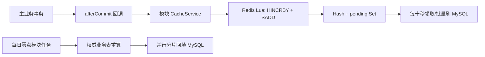

+++
date = '2026-11-09T22:45:00+08:00'
draft = false
title = 'Spring 最终一致性计数：Redis 原子聚合与每日权威校准'
+++

论坛中的浏览数、点赞数、评论数、用户发帖数等字段是派生元数据。它们若在每次请求内同步写 MySQL，会把原本轻量的互动请求变成高频行更新；但若把异步事件误当作可靠消息，也会得到另一种更隐蔽的错误：主业务已经成功，计数却永久漏掉。

本文记录 Hebust Forum 一次真实的删帖计数事故，以及最终采用的简化方案：**Redis 原子聚合 + 十秒批量回写 + 每日权威校准**。不引入消息中间件，不引入本地预写日志，也不把一个本该简单的计数系统写成半套消息平台。

## 结论先行

最终实现有四条约束：

- 高频元数据增量只写 Redis；同一实体的多次变化在 Redis 中合并。
- `HINCRBY` 增量和 `SADD pending` 标记必须在同一个 Lua 脚本中原子完成。
- 计数变更只在业务事务 **成功提交后** 执行，不能由裸 `@Async @EventListener` 承担关键投递。
- 每天零点从 MySQL 权威表重算可重建字段：用户全量，帖子和评论仅近期，话题全量；重算工作分片并行，调度线程不执行重 SQL。

这不是 exactly-once 方案。Redis 写入和 MySQL 业务事务之间没有分布式事务，因此极端宕机窗口仍存在；不过对于可重建的派生计数，每日校准会把偏差收敛回权威值。比起为了消灭一个极窄窗口而在 Spring 进程内实现文件队列、ACK、重放与压缩，这个边界更清楚，也更符合该系统的复杂度预算。

## 2026 年 11 月 7 日事故复盘

生产环境在 `2026-11-07`（`Asia/Shanghai`）发生过一次“删帖成功，但用户发帖数没有减少”的问题。排查仅读取应用日志与部署配置，未修改线上 Redis、MySQL、容器或日志文件。

### 时间线

| 时间 | 动作 | 直接证据 |
| --- | --- | --- |
| `00:22:38.821` | `userId=2` 删除帖子 `1117` | `DELETE /api/v1/posts/1117` 返回 `200`，删帖主事务成功。 |
| `00:22:42.010` | 用户资料计数调度执行 | 调度开始、结束，但没有 `claimedIds:[[2]]` 的成功刷库记录。 |
| `00:22:52` 至 `00:25:52` | 后续多轮调度执行 | 仍未处理账号 `2`。 |
| `16:13:29.852` | 账号 `2` 创建帖子 | `POST /api/v1/posts` 返回 `200`。 |
| `16:13:35.903` | 用户资料调度执行 | 记录 `update user profile success，claimedIds：[[2]]`。 |
| `16:13:56.165` | 账号 `2` 再删除帖子 `1139` | 请求返回 `200`。 |
| `16:14:05.913` | 用户资料调度执行 | 再次成功处理账号 `2`。 |
| `16:21:53.051` | `userId=23` 删除帖子 `1100` | 请求返回 `200`。 |
| `16:21:55.970` | 用户资料调度执行 | 两秒后成功处理账号 `23`，说明调度器整体正常。 |

当天日志中未发现 `RedisCommandTimeoutException`、`RedisConnectionFailureException`、`Unable to connect to Redis`、`update user profile failed`、`AsyncUncaughtExceptionHandler` 或 `user-profile-event` 等相关异常。因此不能把这次事故断言为“Redis 写失败导致 Spring 异步事件丢失”。裸异步事件确实不可靠，但本次有更直接、更符合完整现象的根因。

### 直接根因：两条 Redis 命令之间的竞争

旧代码的一个用户计数变更拆成了两条命令：

```java
redisTemplate.opsForSet().add("pending:user-profile-delta", userId);
redisTemplate.opsForHash().increment("user:profile:delta:" + userId, "postCount", -1);
```

第一条表示“有待刷任务”，第二条才真正写入 `-1`。两条命令之间，十秒级调度器可能恰好领取该用户：

```text
业务线程                              调度器
SADD pending:user-profile-delta 2
                                      claim 账号 2
                                      pending -> processing
                                      active delta hash 尚不存在，读到空值
HINCRBY user:profile:delta:2
        postCount -1
```

旧领取逻辑会过滤空 Hash，却没有把该 ID 从 processing 释放回 pending。于是 `-1` 已经写入 active Hash，但 ID 不再处于 pending Set，调度器之后永远扫描不到它。

这还能解释下午看似“恢复正常”的现象：凌晨遗留 `-1`，下午创建帖子产生 `+1`，再次入队后两者合并为 `0`，第一次刷库日志虽然成功但数据库数值不变；随后的第二次删除产生新的 `-1` 并正常落库，显示值才回到正确状态。这个完整状态变化，比“凌晨异步事件根本没执行”更能解释现象。

## 为什么不继续使用 Spring 异步事件做关键计数

旧链路如下：

```mermaid
flowchart LR
    A[删帖事务] --> B[publishEvent]
    B --> C[@Async EventListener]
    C --> D[Redis 增量]
    D --> E[定时任务]
    E --> F[MySQL 批量更新]
```

`@Async @EventListener` 的队列在 JVM 内存中，没有持久化、确认、失败重放或死信语义。Redis 超时、线程池拒绝、进程重启、OOM、监听器异常，都可能令业务已提交而增量从此消失。

此外，普通 `@EventListener` 在事务方法中发布时，异步监听器甚至可能早于主事务提交开始执行，主事务后续回滚就会产生反向偏差。`@TransactionalEventListener(AFTER_COMMIT)` 能修正时序，却仍不能使它变成可靠消息队列。

因此，用户、帖子、评论和话题的关键计数已不再通过这些事件类型和监听器传递。通知、浏览历史等非关键进程内解耦事件仍可按各自语义使用 Spring 事件；不要因为技术名相同，就把所有事件混为一谈。

## 最终架构



这里没有隐藏的文件队列：Redis 仍然是高频增量的缓冲层，MySQL 仍然是最终展示值的持久层；若 Redis 在提交后的极短窗口不可用，会写错误日志，之后由权威校准确保相关的可重建字段恢复。

### 1. 事务提交后执行

`AfterCommitTaskExecutor` 是很小的事务工具，不是队列：

```java
public void execute(String taskName, Runnable task) {
    if (TransactionSynchronizationManager.isActualTransactionActive()
        && TransactionSynchronizationManager.isSynchronizationActive()) {
        TransactionSynchronizationManager.registerSynchronization(
            new TransactionSynchronization() {
                @Override
                public void afterCommit() {
                    executeSafely(taskName, task);
                }
            }
        );
        return;
    }
    executeSafely(taskName, task);
}
```

`PostApplicationService`、`CommentApplicationService`、`UserApplicationService` 和举报处置服务在业务事务中注册对应动作。例如删帖成功后，用户的 `postCount` 只会在提交成功后调用 `UserProfileCacheService.alterPostCount(userId, -1)`；事务回滚时不会改变 Redis。

若 Redis 调用失败，工具记录“将由每日校准修复”的完整异常。它不在应用内伪造重试协议，不吞掉错误，也不声称具备消息可靠性。

### 2. Redis 数据结构与原子写入

write-behind 使用 **“每个实体一个 Hash + 模块级 Set 索引”**，而不是 Redis List。原因很朴素：同一实体在十秒内发生十次变化时，保留合并后的 delta 比保留十条消息更节省写放大。

这里的“活跃”和“处理中”不是两套永久副本，而是同一批增量在两个互斥状态间迁移。对用户、帖子、评论三个模块都分别存在相同的四类键。

| 状态 | Redis 类型 | Key 的粒度 | 存放的逻辑值 | 用户示例 | 帖子 / 评论对应形式 |
| --- | --- | --- | --- | --- | --- |
| 活跃增量 | Hash | **一个实体一个 Hash** | `field -> delta`；尚未被当前刷库批次领取的合并增量 | `user:profile:delta:42` | `post:single:info:delta:88`、`post:comment:info:delta:501` |
| 待刷标记 | Set | **一个模块一个 Set** | 实体 ID；表示该 ID 的活跃 Hash 有待刷增量 | `pending:user-profile-delta` | `pending:post-info-delta`、`pending:comment-info-delta` |
| 处理中增量 | Hash | **一个实体一个 Hash** | 从活跃 Hash 原子迁移来的 `field -> delta` 快照，等待 MySQL 结果 | `user:profile:delta:processing:42` | `post:single:info:delta:processing:88` 等 |
| 处理中标记 | Set | **一个模块一个 Set** | 实体 ID；表示该 ID 已被某一批次独占领取 | `processing:user-profile-delta` | `processing:post-info-delta`、`processing:comment-info-delta` |

表中“实体 ID”是逻辑含义。Java 的 `RedisTemplate` 会按项目的序列化器写入 Redis；排障时使用程序本身的序列化方式读取即可，不应假定 `redis-cli` 中一定以裸文本 `42` 展示。

#### Hash 中究竟放什么

Hash 是**一个实体、多个可合并计数字段的增量账本**，不是实体详情，也不是数据库中的最终值。它的 field 是 Java 枚举或常量中定义的字段名，value 是有符号整数 delta。

例如，用户 `42` 在同一个十秒窗口内发生了三件事：删一篇帖子、获得两个点赞、收藏一篇帖子。逻辑上的活跃 Hash 会是：

```text
HGETALL user:profile:delta:42

postCount -> -1
likeCount -> 2
favCount  -> 1
```

它表示“数据库中用户 42 的 `post_count` 需要减一、`like_count` 需要加二、`fav_count` 需要加一”，而不是说该用户最终只有 `postCount=-1` 篇帖子。

同一个 field 可以不断累加。例如十秒内连续点赞再取消点赞：

```text
HINCRBY user:profile:delta:42 likeCount  1
HINCRBY user:profile:delta:42 likeCount -1
```

结果只是 `likeCount -> 0`。这正是 Hash 聚合降低 MySQL 写入次数的原因：无论这一窗口内发生多少次变化，刷库时同一用户、同一字段只产生一个合并后的 delta。

不同模块的 field 不同：

| Hash | 典型 field | value 的含义 |
| --- | --- | --- |
| `user:profile:delta:{userId}` | `postCount`、`likeCount`、`favCount`、`followCount`、`fansCount`、`commentCount`、`watchedCount`、`draftCount` | 对 `t_user` 对应列的增减量 |
| `post:single:info:delta:{postId}` | `likeCount`、`commentCount`、`watchCount`、`viewCount` | 对 `t_post` 对应列的增减量 |
| `post:comment:info:delta:{commentId}` | `likeCount`、`replyCount` | 对 `t_comment` 对应列的增减量 |

#### Set 中究竟放什么，为什么 Hash 之外还要 Set

Set 中只放“哪个实体需要处理”的 ID，不放 delta。例如上面的用户 `42` 有活跃 Hash 后，逻辑上：

```text
SMEMBERS pending:user-profile-delta

42
```

不能只扫描 Hash：Redis 没有“列出某个前缀的所有 Hash，并可靠地与写入并发协作”的数据结构；用 `SCAN user:profile:delta:*` 会扫描到 processing Hash、历史/异常键，也会把 Redis 的键空间扫描压力转嫁给高频调度任务。`pending` Set 是显式索引，调度器只需要读取其中的 ID，再按 ID 精确定位对应 Hash。

也不能只用一个 Set 存完整事件。Set 只能去重 member，无法把用户的 `postCount`、`likeCount` 等多个字段及其数值合并保存；若把 `userId|field|delta` 当 member，同一字段的多次变化会成为多条离散记录，退化成队列，失去聚合优势。Hash 保存**数值状态**，Set 保存**待处理索引**，职责不同，缺一个都不成立。

#### 为什么还需要 processing Hash 和 processing Set

若调度器读取 active Hash 后再删除它，读取、MySQL 写入和删除之间会有并发窗口：新请求可能把新 delta 写进同一个 Hash，旧调度器随后删除 Hash 时就会把新 delta 一起删掉。

因此，领取时不复制 Hash，而是将它从 active key **原子改名**为 processing key。以用户 `42` 为例，领取前后的逻辑状态是：

```text
领取前
pending:user-profile-delta              = {42}
user:profile:delta:42                   = {postCount:-1, likeCount:2}

领取后
processing:user-profile-delta           = {42}
user:profile:delta:processing:42        = {postCount:-1, likeCount:2}
```

此后若用户 `42` 又收到一个新点赞，写入端仍只会写 active key：

```text
pending:user-profile-delta              = {42}
user:profile:delta:42                   = {likeCount:1}

processing:user-profile-delta           = {42}
user:profile:delta:processing:42        = {postCount:-1, likeCount:2}
```

新请求不修改正在刷 MySQL 的 processing Hash；旧批次 ACK 时也只删除 processing Hash，不会删除新建 active Hash 或它的 pending 标记。于是旧增量与新增量天然隔离，不会互相覆盖。

`RedisHashBatchService.incrementHashAndMarkPending` 通过 Lua 将“写入 Hash 增量”和“写入 pending 索引”合为一个 Redis 原子操作：

```lua
-- KEYS[1]：pending Set；KEYS[2]：实体 active Hash
-- ARGV[1]：实体 ID；ARGV[2]：字段；ARGV[3]：增量
redis.call('HINCRBY', KEYS[2], ARGV[2], tonumber(ARGV[3]))
redis.call('SADD', KEYS[1], ARGV[1])
return 1
```

脚本执行是关键；不是简单地将两行 Java 交换顺序。Redis 执行一段 Lua 脚本期间不会穿插其他命令，因此调度器只能看到两种完整状态：两者都不存在，或 Hash 和 pending 标记都存在，不能领取半成品任务。

Java 层通过 `RedisTemplate.execute` 调用同一个 `EVAL`，并将 pending Set 与 active Hash 作为 `KEYS[1]`、`KEYS[2]` 传入：

```java
connection.eval(
    INCREMENT_HASH_AND_MARK_PENDING_SCRIPT.getBytes(StandardCharsets.UTF_8),
    ReturnType.INTEGER,
    2,
    keysAndArgs
);
```

这正是修复 2026 年 11 月 7 日事故的关键：旧版本中 `SADD` 与 `HINCRBY` 是两次网络命令，调度器能在中间领取空任务；当前版本中二者是一个不可分割的 Redis 状态转换。

这项修复统一用于：

- `UserProfileCacheService`：发帖、获赞、收藏、关注、粉丝、评论、蹲贴、草稿等用户资料计数；
- `SinglePostCacheService`：帖子点赞、评论、浏览、蹲贴计数；
- `CommentInfoCacheService`：评论点赞与回复计数。

### 3. 领取、回写与恢复

每十秒各模块自己的 Scheduler 执行一次批量刷库：

- `UserProfileScheduler` 刷用户资料计数；
- `PostInfoScheduler` 刷帖子计数；
- `CommentInfoScheduler` 刷评论计数。

调度器使用 Lua claim：只有 active Hash 存在时，才将 ID 从 pending 移到 processing，并将 active Hash `RENAME` 为 processing Hash。若只遇到历史遗留的空标记，会清理该标记，而不会把 ID 卡在 processing。

```text
pending Set + active Hash
        │ claim
        ▼
processing Set + processing Hash
        │ MySQL 成功                     │ MySQL 异常
        ▼                                ▼
ACK：删除 processing 状态             release：合并回 active 并重新入 pending
```

#### 四个 Lua 状态转换如何协作

整个状态机都集中在 `RedisHashBatchService`，不是由多个 Java Redis 调用拼凑而成。

| 阶段 | Lua 中的核心动作 | 解决的问题 |
| --- | --- | --- |
| 写入 | `HINCRBY activeHash` + `SADD pendingSet` | 原子记录增量并建立索引，避免 Hash 有值却无法被扫描。 |
| claim | `SREM pendingSet` 成功后，`SADD processingSet` + `RENAME activeHash processingHash` | `SREM` 的返回值只有一个领取者能拿到 `1`，因此同一批 active Hash 不会被两个调度器并发领取。 |
| ACK | `SREM processingSet` + `DEL processingHash` | 仅在 MySQL 批量更新成功后删除这批已消费 delta；不会触碰领取之后新产生的 active Hash。 |
| release | 逐 field `HINCRBY activeHash` 合并 processing Hash，再 `DEL processingHash` + `SADD pendingSet` | MySQL 失败或应用重启时，把尚未确认的旧 delta 与期间新写入的 active delta 相加，重新等待刷库。 |

claim 先执行 `SREM pendingSet id`。Redis 对单个 Set member 的删除是原子的：多个调度线程或多个应用实例同时 claim 同一 ID 时，最多一个脚本会看到返回值 `1`；其余脚本不会读取或移动该 Hash。随后在**同一个 Lua 脚本**中完成 `SADD processingSet` 和 `RENAME`，所以没有“已经领取但 Hash 仍留在 active”或“Hash 已移动但无人知道在处理”的可观察中间态。

release 的“逐 field 合并”尤其重要。假设 processing 中有 `{likeCount:2}`，处理期间 active 中已积累 `{likeCount:1, commentCount:1}`，release 后 active 会变为 `{likeCount:3, commentCount:1}`；它不会覆盖新值。只有合并与重新入 pending 都完成后，这个实体才再次可领取。

MySQL 通过批量增量 SQL 更新，以 `GREATEST(COALESCE(column, 0) + delta, 0)` 防止计数小于零。应用启动时 `RedisWriteBehindLifecycle` 会将上次中断遗留的 processing 状态执行 release，避免因进程重启永久冻结。

#### “不丢不重”应当如何准确理解

这套 Redis 状态机在 **Redis 内部** 提供的是以下保证：

- 不会出现旧事故中的“delta 已写入 Hash、但没有 pending 索引”的永久悬挂；写入脚本使二者同时出现。
- 同一份 active Hash 不会被两个 consumer 同时领取；claim 中的 `SREM` 是独占门闩。
- 领取后的新 delta 不会被旧批次 ACK 删除；它们位于新建的 active Hash 与 pending Set 中。
- MySQL 调用明确失败或应用在调用前中断时，processing Hash 会通过 release 合并回 active Hash；因此 Redis 中未确认的增量不会凭空丢失。

但它**不等于端到端 exactly-once**，也不能承诺“绝对不重”：

```text
MySQL 已成功提交
应用在 Redis ACK 前崩溃
重启后 processing 被 release，delta 再次刷入 MySQL
```

此时会发生一次重复应用；反过来，业务事务提交后 Redis 完全不可用且进程在恢复前终止时，本次增量也无法仅靠 Redis 状态机持久保存。当前方案的准确语义是：**Redis 状态机内不漏领、单批独占领取、失败可重放；跨 MySQL 与 Redis 的端到端语义为至少一次（at-least-once）**。可重建字段最终由每日权威校准纠正。若某字段不能接受重复或遗漏，就必须使用数据库 outbox、幂等消费记录或消息中间件，不能把“Lua 原子性”误解成分布式事务。

## 每日权威校准

Redis write-behind 解决的是高频写压；每日校准解决的是历史脏数据、极端故障窗口与跨存储 ACK 窗口。它不读取 Redis，而是直接从关系表和主业务表重新计算。

### 任务归属与范围

任务在每天零点开始，但不再有单一“全系统元数据调度器”：

| 所属模块 | 定时方法 | 覆盖范围 | 重算字段 | 权威来源 |
| --- | --- | --- | --- | --- |
| 用户 | `UserProfileScheduler.reconcileUserProfilesDaily` | **全部用户** | 发帖、获赞、收藏、关注、粉丝、评论、蹲贴、草稿数 | `t_post`、互动表、`t_comment`、`t_user_follow` |
| 帖子 | `PostInfoScheduler.reconcileRecentPostsDaily` | 默认近 90 天创建的帖子 | 点赞、评论、蹲贴数、热度 | `t_post_like`、`t_comment`、`t_post_watch` |
| 评论 | `CommentInfoScheduler.reconcileRecentCommentsDaily` | 默认近 90 天创建的评论 | 点赞、回复数、热度 | `t_comment_like`、`t_comment.parent_id` |
| 话题 | `TopicInfoScheduler.reconcileTopicPostCountsDaily` | 全部话题 | 已发布帖子数 | `t_post_topic` 与 `t_post` |

用户必须全量：老用户同样可能携带历史偏差。帖子与评论只处理近期数据，是有意限制每日写入量的取舍；互动天然集中于新内容。话题总量通常很小，因此全量重算。若要修复一篇很久以前的具体内容，应提供受控的单对象回填，而不是每天全表更新。

帖子 `view_count` 刻意不参与校准。系统没有每次浏览的权威明细，只有 Redis 与数据库中的聚合值；把它更新为 `0` 并不是校准，而是制造新的丢失。将来若需要可重建浏览量，必须先建立浏览事件明细或按日聚合的权威数据源。

### 并行方式

`DerivedCounterReconciliationService` 只承担通用分片与线程池执行，不决定业务调度归属：

1. 模块 Scheduler 在零点触发后仅调用对应的 `start...Reconciliation` 方法并立即返回；
2. 专用 `derivedCounterReconciliationExecutor` 查询 ID 上下界，按 500 个 ID 一片切分；
3. 默认四个受控工作线程并行执行更新 SQL；
4. 每个模块有独立运行标记，前一轮尚未结束时跳过同模块下一次触发；
5. 调度器本身使用四线程，仅负责发起四个模块任务，绝不执行长时间更新。

相关配置保持少量且有明确含义：

```yaml
forum:
  derived-counter-reconciliation:
    enabled: true
    worker-count: 4
    user-id-span: 500
    recent-content-id-span: 500
    recent-days: 90
```

调大线程数不一定更快。数据库 CPU、索引命中、锁等待和磁盘写入才是上限；生产上应以校准耗时、慢 SQL 和业务高峰影响为依据逐步调整。默认四线程是受控并行，而不是把调度线程变成另一个压力源。

## 为什么不采用本地预写日志

本地 WAL 能在单实例中缓解“Redis 暂不可用”和“进程在异步消费前崩溃”的丢失，但它会把持久化、fsync、ACK、重放、日志压缩、磁盘监控、容器卷、单实例限制和副本互斥问题全部交给 Spring 应用维护。

更重要的是，它仍无法跨越事务边界：数据库事务提交后、`afterCommit` 写 WAL 前崩溃，事件依旧不存在；Redis 成功后、WAL ACK 前崩溃，又可能重复投递。为了不显著提高保证等级却显著增加运维负担，当前系统不保留这套实现。

若未来计数变为不可重建的财务、库存或审核状态，要求会完全不同：应明确引入数据库 outbox、消费幂等记录或消息中间件。那是另一个问题，不能让“简单计数”提前背负它的复杂度。

## 上线与排障检查

- 确认生产已部署含 Lua 原子写入的版本；仅改 after-commit 不能修复 11 月 7 日竞态。
- 检查用户、帖子、评论的 pending / processing Set 和 delta Hash，重点关注“Hash 有 delta、但 ID 不在 pending”的历史遗留状态。
- 对用户发帖数先执行一次全量权威校准，修复已经落库的历史偏差。
- 观察每十秒任务的 `success`、`failed` 日志；MySQL 批量刷库失败应 release 回 pending。
- 观察每日四个模块的校准完成日志、分片成功数与失败数；若 SQL 长时间运行，先优化索引和分片大小，不要盲目增加线程。
- 不要再把关键计数放回裸 `@Async @EventListener`；Spring 事件适合解耦，不是持久消息通道。

最终一致性并不要求假装没有失败。它要求我们知道失败发生在哪里、用多大的代价修复它，以及哪些数据必须有权威来源。对此保持清醒，比堆叠更多看似可靠的组件更重要。
