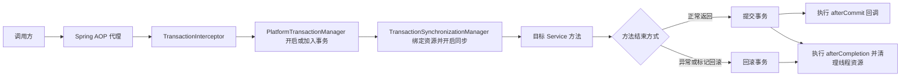

+++
date = '2026-11-10T10:00:00+08:00'
draft = false
title = 'Spring 声明式事务与 TransactionSynchronizationManager：提交后回调的原理和使用场景'
+++

在订单创建后刷新缓存、在删帖成功后累计用户计数、在支付落库后发送通知时，最容易被忽略的问题不是“这段代码能否执行”，而是“它是否只会在**数据库事务真正提交后**执行”。如果主事务最终回滚，派生动作却已更新 Redis、发送邮件或投递消息，系统就亲手制造了一份不一致的数据。

Spring 的 `@Transactional` 很适合表达“这一段数据库操作必须原子完成”。但业务有时还需要观察事务的结局。`TransactionSynchronizationManager` 提供了向当前事务注册生命周期回调的入口，其中 `afterCommit` 能让代码只在提交成功后运行。

不过名称很容易造成误解：**`TransactionSynchronizationManager` 不是用来手动开启、提交和回滚事务的业务 API**。它的核心职责是维护当前线程绑定的事务资源和回调；常规业务代码只应谨慎地注册同步回调，不应自行调用 `initSynchronization()`、绑定 JDBC 连接，或把它当成事务管理器。需要动态地开启和结束事务时，应使用 `TransactionTemplate`，极少数底层场景才直接使用 `PlatformTransactionManager`。

本文从声明式事务的执行链路开始，解释给出的 `AfterCommitTaskExecutor` 为什么成立、适合什么场景，以及它绝对不能承诺什么。

## 一、先建立边界：四种“事务相关操作”不是一回事

下面四类需求经常同时出现，却对应不同工具。若把它们混为一谈，代码即使暂时能跑，也很难拥有清晰的失败语义。

| 需求 | 首选工具 | 解决的问题 | 不解决的问题 |
| ---- | -------- | ---------- | ------------ |
| 一个 Service 方法内的读写要原子完成 | `@Transactional` | 声明事务边界、传播、隔离级别和回滚规则 | 提交后的外部副作用 |
| 事务边界随分支、循环或运行时条件变化 | `TransactionTemplate` | 在代码中精确执行一段事务回调 | 可靠消息投递 |
| 只在当前事务提交成功后做一件事 | `TransactionSynchronizationManager` + `TransactionSynchronization` | 注册 `afterCommit` 回调 | 新事务、跨进程可靠性 |
| 手动 begin / commit / rollback | `PlatformTransactionManager` | 完整控制事务生命周期 | 更少的样板代码与更低的耦合 |

Spring 官方将声明式事务作为多数应用的首选：它通过 AOP 在方法边界织入事务逻辑，业务对象通常不必依赖 Spring 的事务 API。[声明式事务文档](https://docs.spring.io/spring-framework/reference/data-access/transaction/declarative.html) 对此有明确说明。后一节的回调机制只是观察这个生命周期，并没有取代 `@Transactional`。

## 二、声明式事务：`@Transactional` 到底做了什么

最常见的写法如下：

```java
@Service
public class OrderApplicationService {

    private final OrderRepository orderRepository;

    public OrderApplicationService(OrderRepository orderRepository) {
        this.orderRepository = orderRepository;
    }

    @Transactional
    public Long create(CreateOrderCommand command) {
        Order order = Order.create(command.userId(), command.items());
        orderRepository.save(order);
        return order.getId();
    }
}
```

代码表面上只多了一个注解，实际调用链却多了一层 Spring AOP 代理：



以 JDBC 本地事务为例，事务管理器会把当前 `Connection` 等资源绑定到执行该请求的线程；同一事务中的 JDBC、JPA 或 MyBatis 操作因此能取得同一份事务资源。提交或回滚完成后，资源解绑并归还连接池。

### 1. 默认回滚规则不是“遇到任何异常都回滚”

Spring 声明式事务默认会因为 `RuntimeException` 或 `Error` 回滚；受检异常默认不触发回滚。若业务异常也必须回滚，应明确声明规则：

```java
@Transactional(rollbackFor = InventoryNotEnoughException.class)
public void placeOrder(PlaceOrderCommand command) throws InventoryNotEnoughException {
    // 扣库存、保存订单
}
```

异常是否离开事务方法也同样重要。若捕获异常后正常返回，拦截器通常只能看到“方法成功结束”，事务会照常提交；这时要么重新抛出合适的异常，要么在真正需要时调用 `TransactionAspectSupport.currentTransactionStatus().setRollbackOnly()`。不要把捕获异常后打印日志当成回滚策略。

### 2. 代理决定了注解的生效边界

在默认代理模式下，外部调用通过 Spring 代理进入目标方法才会触发 `@Transactional`。同一个对象中 `this.innerMethod()` 的自调用不会再次经过代理，因此内部方法上的独立传播行为不会自动生效。

更稳妥的做法是把需要独立事务语义的操作拆到另一个 Spring Bean，或者使用 `TransactionTemplate` 明确写出边界。关于传播行为、回滚标记和编程式事务的完整讨论，可继续阅读[《Spring TransactionTemplate 用法：编程式事务、回滚与传播行为》](<Spring TransactionTemplate 用法：编程式事务、回滚与传播行为.md>)。

## 三、`TransactionSynchronizationManager` 管理的是什么

`TransactionSynchronizationManager` 是 Spring 传统阻塞式事务模型的线程上下文协调器。它维护两类状态：

- **资源绑定**：例如以 `DataSource` 为 key 绑定当前事务使用的 JDBC `Connection`，以便同一线程后续访问复用它。
- **事务同步回调**：保存一组 `TransactionSynchronization`，由事务管理器在提交、回滚和清理阶段依次调用。

它不是数据库事务本身，也不拥有 `commit()` 或 `rollback()` 这样的业务控制语义。官方 API 甚至直接说明：它主要供资源管理代码使用，而不是普通应用代码；同步的激活与清理由事务管理器负责。[`TransactionSynchronizationManager` Javadoc](https://docs.spring.io/spring-framework/docs/current/javadoc-api/org/springframework/transaction/support/TransactionSynchronizationManager.html)

因此，下面这种写法通常是错误的：

```java
// 不要这样在业务代码中伪造一个“事务”。
TransactionSynchronizationManager.initSynchronization();
try {
    // 执行数据库操作
} finally {
    TransactionSynchronizationManager.clearSynchronization();
}
```

这只是在当前线程打开了“可以登记回调”的开关，既没有向数据库发送 `BEGIN`，也没有让事务管理器接管连接、隔离级别、提交和回滚。它尤其容易留下没有清理的线程状态，在线程池复用时形成诡异错误。这里是机制边界，不是可供业务代码自由搭积木的乐高。

### 1. 两个状态检查为何都需要

注册 `afterCommit` 前通常会同时检查：

```java
TransactionSynchronizationManager.isActualTransactionActive()
    && TransactionSynchronizationManager.isSynchronizationActive()
```

| 检查 | 含义 | 单独使用的缺陷 |
| ---- | ---- | -------------- |
| `isActualTransactionActive()` | 当前线程是否存在真正处于活动状态的事务 | 有真实事务不必然表示当前管理器允许注册同步回调 |
| `isSynchronizationActive()` | 当前线程是否已开启同步回调登记 | 同步可能仅是资源同步环境，不等于有一个可提交的实际事务 |

只有两者都为 `true`，才应把任务挂到当前事务。否则，若该工具的业务约定是“没有事务时立即执行”，就直接同步执行。这个降级语义必须由工具明确规定；它不是 Spring 自动替你作出的决定。

### 2. 回调阶段的含义

`TransactionSynchronization` 提供了多个钩子，常用顺序可简化为：

```text
业务方法返回
  -> beforeCommit(readOnly)
  -> beforeCompletion()
  -> 数据库 commit 或 rollback
  -> afterCommit()                  // 仅成功提交
  -> afterCompletion(status)        // 提交、回滚都会进入
  -> 解除资源绑定、清理线程状态
```

各阶段的用途不同：

- `beforeCommit` 仍处于提交前；它抛出的运行时异常可以阻止提交并导致回滚，适合必须纳入主事务的检查或 flush。
- `afterCommit` 只代表主事务已经成功提交，适合依赖“事实已落库”的派生操作。
- `afterCompletion` 不区分提交和回滚，适合清理临时资源；通过 `STATUS_COMMITTED`、`STATUS_ROLLED_BACK` 和 `STATUS_UNKNOWN` 判断结果。

回调还支持 `Ordered` 排序。没有指定顺序的同步器会处在靠后的默认顺序；除非确实要和某个基础设施资源的清理过程协调，否则业务代码不应依赖某个偶然的执行先后。[`TransactionSynchronization` Javadoc](https://docs.spring.io/spring-framework/docs/current/javadoc-api/org/springframework/transaction/support/TransactionSynchronization.html)

## 四、逐行理解 `AfterCommitTaskExecutor`

下面是一个可复用的轻量执行器。它表达的是“事务提交后的派生任务”，不是通用异步队列，也不是分布式事务协调器。

```java
@Component
public class AfterCommitTaskExecutor {

    private static final Logger log = LoggerFactory.getLogger(AfterCommitTaskExecutor.class);

    /** 在事务提交后执行；没有事务时立即执行。 */
    public void execute(String taskName, Runnable task) {
        if (TransactionSynchronizationManager.isActualTransactionActive()
            && TransactionSynchronizationManager.isSynchronizationActive()) {
            TransactionSynchronizationManager.registerSynchronization(new TransactionSynchronization() {
                @Override
                public void afterCommit() {
                    executeSafely(taskName, task);
                }
            });
            return;
        }
        executeSafely(taskName, task);
    }

    private void executeSafely(String taskName, Runnable task) {
        try {
            task.run();
        } catch (RuntimeException ex) {
            log.error("事务提交后的派生数据操作失败，将由每日校准修复：{}", taskName, ex);
        }
    }
}
```

### 1. 执行语义

该方法只有两条路径：

| 调用上下文 | `task` 何时执行 | 主业务回滚时的结果 |
| ---------- | --------------- | ------------------ |
| 存在可同步的实际事务 | 外层实际事务成功提交后，在同一调用线程执行 | 不执行 |
| 没有事务或不支持同步 | 当前调用点立刻、同步执行 | 不适用 |

若当前方法只是加入一个外层 `REQUIRED` 事务，回调会等到**最外层实际事务**提交后才运行。若调用路径进入了 `REQUIRES_NEW`，那个独立事务成功提交时会触发它自己的回调；外层事务之后即使回滚，也不能撤销已经提交的内层事务及其派生操作。这不是回调的漏洞，而是传播行为已经选择了两个独立的原子单元。

### 2. 为什么将异常捕获在 `afterCommit` 内

`afterCommit` 执行时，主事务已经无法回滚。即使回调异常向外抛出，也只能让调用方感知失败，不能使刚刚提交的订单、帖子或库存记录回到未提交状态。

因此，这个实现记录完整异常并把恢复交给“每日权威校准”。对于浏览数、点赞数、搜索索引、缓存失效标记等**可重新计算的派生数据**，这种失败模型是合理的：主业务正确落库，派生数据暂时滞后，之后由校准收敛。

但请注意，`catch` 不是可靠性魔法。它只防止异常沿当前调用栈扩散，完全没有保存待执行任务、重试、确认或死信能力。任务失败后能否恢复，全靠外部可验证的补偿机制，而不是日志中的一句“将会修复”。

### 3. 一个典型使用例：提交后变更可重建计数

例如，删帖事务成功后才更新用户的派生发帖数：

```java
@Service
public class PostApplicationService {

    private final PostRepository postRepository;
    private final AfterCommitTaskExecutor afterCommitTaskExecutor;
    private final UserProfileCounter userProfileCounter;

    public PostApplicationService(
            PostRepository postRepository,
            AfterCommitTaskExecutor afterCommitTaskExecutor,
            UserProfileCounter userProfileCounter
    ) {
        this.postRepository = postRepository;
        this.afterCommitTaskExecutor = afterCommitTaskExecutor;
        this.userProfileCounter = userProfileCounter;
    }

    @Transactional
    public void deletePost(long postId, long userId) {
        postRepository.deleteById(postId);

        afterCommitTaskExecutor.execute("decrement-post-count", () ->
            userProfileCounter.incrementPostCount(userId, -1)
        );
    }
}
```

若 `deletePost` 后续因异常回滚，Redis 中的用户计数不会提前减少；若提交成功但 Redis 操作失败，则由独立的权威数据校准重新计算。这正是“主数据强一致、派生数据可最终一致”的明确分层。更完整的 Redis 原子聚合、批量回写与每日校准案例见[《Spring 最终一致性计数：Redis 原子聚合与每日权威校准》](<../01-core-and-boot/Spring 最终一致性计数：Redis 原子聚合与每日权威校准.md>)。

## 五、`afterCommit` 的三个重要陷阱

### 1. 它不是异步执行器

`afterCommit()` 默认仍在提交事务的那条线程中执行。若在回调里直接发送慢 HTTP 请求、生成大文件或批量写 ES，用户请求会在数据库已提交之后继续等待，线程也会继续被占用。

如果工作可以丢失后由校准恢复，且只想缩短请求响应时间，可以在 `afterCommit` 中把一个小而明确的任务提交给受控线程池；但线程池拒绝、进程重启、任务执行失败仍要有补偿设计。仅仅在 `afterCommit` 内加上 `@Async`，并不会让 JVM 内存队列变成可靠消息系统。

### 2. 回调内继续写数据库，必须显式开启新事务

`afterCommit` 被调用时，主事务已经提交，但当前线程的资源可能尚未清理。Spring 官方特别提示：此时直接触发的数据访问可能仍会参与原事务资源，然而后面已经没有第二次提交机会。因此，若回调中必须执行新的、要持久化的数据库操作，应调用传播行为为 `REQUIRES_NEW` 的另一个 Bean：

```java
@Service
public class AuditLogService {

    @Transactional(propagation = Propagation.REQUIRES_NEW)
    public void savePostDeleted(long postId) {
        // auditLogRepository.save(...)
    }
}

@Component
public class PostDeletedSynchronization {

    private final AuditLogService auditLogService;

    public PostDeletedSynchronization(AuditLogService auditLogService) {
        this.auditLogService = auditLogService;
    }

    public void register(long postId) {
        TransactionSynchronizationManager.registerSynchronization(new TransactionSynchronization() {
            @Override
            public void afterCommit() {
                auditLogService.savePostDeleted(postId);
            }
        });
    }
}
```

这里同样要通过另一个 Bean 调用，避免自调用绕过 `@Transactional` 代理。`REQUIRES_NEW` 也意味着这条审计日志失败不会影响已经提交的删帖；是否允许这种差异，仍是业务一致性决策，而不是注解选择题。

### 3. 它受线程边界限制

传统 `TransactionSynchronizationManager` 的状态与当前线程绑定。把注册逻辑放进 `CompletableFuture`、普通线程池、`@Async` 方法后，新线程通常没有原线程的事务上下文：

```java
// 错误思路：异步线程里通常看不到调用方的事务。
executor.execute(() -> {
    TransactionSynchronizationManager.registerSynchronization(...);
});
```

正确的顺序是：在事务线程中登记 `afterCommit`；只有确认提交后，才按自己的可靠性要求决定同步处理、提交线程池，或写入 outbox。

响应式事务也不能直接套用这套静态 ThreadLocal API。Reactive Transaction Manager 依赖 Reactor Context；Spring 的响应式编程式事务首选 `TransactionalOperator`，事务绑定事件需要携带相应上下文。[Spring 的事务绑定事件文档](https://docs.spring.io/spring-framework/reference/data-access/transaction/event.html) 对两种模型的差异有专门说明。

## 六、什么时候选择 `@TransactionalEventListener`

若发布方不应该依赖具体处理器，事务绑定事件往往比一个通用 `Runnable` 更易读：

```java
public record PostDeletedEvent(long postId, long userId) {
}

@Service
public class PostApplicationService {

    private final ApplicationEventPublisher eventPublisher;

    @Transactional
    public void deletePost(long postId, long userId) {
        // 删除帖子
        eventPublisher.publishEvent(new PostDeletedEvent(postId, userId));
    }
}

@Component
public class SearchIndexListener {

    @TransactionalEventListener(phase = TransactionPhase.AFTER_COMMIT)
    public void removeFromSearchIndex(PostDeletedEvent event) {
        // 删除搜索索引中的文档
    }
}
```

二者的选择可以很直接：

- 只有一个紧密相关的派生动作，且“无事务立即执行”的回退语义正是你需要的：使用封装好的 `AfterCommitTaskExecutor`。
- 一个领域事件有多个独立订阅者，例如失效缓存、更新搜索索引、发送站内通知：使用 `@TransactionalEventListener(AFTER_COMMIT)`，让依赖关系由事件类型表达。
- 必须跨进程可靠投递，或者“主事务提交成功后绝不能丢失外部动作”：使用数据库 outbox、具备确认与重试能力的消息系统，以及消费者幂等设计。

`@TransactionalEventListener` 默认同样在事务提交后处理；没有事务时默认不触发，只有显式设置 `fallbackExecution = true` 才会立即执行。它解决的是 Spring 容器内的解耦和事务时机，不是可靠消息投递。[官方说明](https://docs.spring.io/spring-framework/reference/data-access/transaction/event.html)

## 七、真正需要“手动事务”时怎么做

若事务边界确实由运行时分支决定，优先使用 `TransactionTemplate`。它让事务管理器接管资源获取、提交、回滚和清理，业务代码只写回调：

```java
@Service
public class ImportService {

    private final TransactionTemplate transactionTemplate;

    public ImportService(TransactionTemplate transactionTemplate) {
        this.transactionTemplate = transactionTemplate;
    }

    public void importOne(ImportRow row) {
        transactionTemplate.executeWithoutResult(status -> {
            // 校验通过后写入多个表
            // 任意运行时异常离开回调，模板会处理回滚
        });
    }
}
```

`TransactionTemplate` 可配置传播行为、隔离级别和超时，且实例可安全共享；若不同场景需要不同配置，分别定义不同的模板实例。[编程式事务文档](https://docs.spring.io/spring-framework/reference/data-access/transaction/programmatic.html)

极少数框架适配或基础设施代码才可能直接操作 `PlatformTransactionManager`：

```java
DefaultTransactionDefinition definition = new DefaultTransactionDefinition();
definition.setPropagationBehavior(TransactionDefinition.PROPAGATION_REQUIRES_NEW);

TransactionStatus status = transactionManager.getTransaction(definition);
try {
    // 数据库操作
    transactionManager.commit(status);
} catch (RuntimeException ex) {
    if (!status.isCompleted()) {
        transactionManager.rollback(status);
    }
    throw ex;
}
```

它确实是手动 begin / commit / rollback，但异常分支、回滚失败、嵌套传播、资源清理和测试负担都会回到调用方。除非正在编写通用事务基础设施，否则这段样板代码通常没有比 `TransactionTemplate` 更好的可维护性。至于 `TransactionSynchronizationManager`，它在这一过程中只负责让事务管理器与资源、同步回调共享上下文，不应该承担生命周期的主导权。

## 八、场景决策与使用边界

可以用下面这条链路快速判断：

```mermaid
flowchart TD
    A[有一个事务相关需求] --> B{数据库读写必须原子吗}
    B -->|是| C{边界是否就是一个 Service 方法}
    C -->|是| D[@Transactional]
    C -->|否| E[TransactionTemplate]
    B -->|否| F{是否只能在提交成功后发生}
    F -->|否| G[普通同步或异步任务]
    F -->|是| H{失败后可由权威数据重建吗}
    H -->|是| I[afterCommit 或 TransactionalEventListener]
    H -->|否| J[Outbox + 消息投递 + 消费幂等]
```

`AfterCommitTaskExecutor` 的适用场景包括：

- 事务提交后失效本地缓存或 Redis 缓存；失败时下一次读取、TTL 或定时任务可恢复。
- 提交后更新搜索索引、标签统计、热度、浏览数等可再构建的派生数据。
- 写入仅用于观测的指标或审计线索，并且接受主数据成功、观测信息暂时缺失。
- 不在事务中调用慢外部服务，但又必须避免“主事务回滚，外部通知已经发出”。

不适合的场景同样需要明确：

- 支付扣款、库存扣减、权益发放等不可轻易重建的关键状态。
- 要求“提交后必达”的跨服务命令或消息。
- 需要独立事务持久化却没有采用 `REQUIRES_NEW` 的回调逻辑。
- 依赖异步线程、Reactive Context 或跨进程传递当前 ThreadLocal 事务状态的代码。

## 九、总结

声明式事务的重点是把数据库原子性边界放在合适的 Service 方法上；`@Transactional` 通过代理和事务管理器处理资源、传播与提交回滚。`TransactionSynchronizationManager` 则是它背后的线程级协调器，业务代码最常见、也最克制的用法，是在已激活的真实事务中登记 `TransactionSynchronization`。

- `afterCommit` 能保证派生动作只发生在主事务成功提交之后，不能保证动作必达。
- 给出的 `AfterCommitTaskExecutor` 对“无事务立即执行”作出了明确约定，适用于可重建的派生数据；它不等同于消息队列。
- 回调默认同步执行；回调内若还要写数据库，应通过另一个 Bean 的 `REQUIRES_NEW` 方法启动独立事务。
- 不要手动调用 `TransactionSynchronizationManager.initSynchronization()` 伪造事务；动态事务边界优先选择 `TransactionTemplate`。
- 当业务要求跨进程可靠投递或不可丢失时，应升级为 outbox、消息确认和幂等消费，而不是给 `afterCommit` 加上一层更漂亮的名字。

事务设计从来不只是“在哪个方法上加注解”。它真正要求你先回答：哪些数据必须同时成功，哪些副作用只能在事实成立后发生，以及失败后究竟由谁、凭什么把状态修复回来。这个顺序若能想清楚，工具的选择反而不会太复杂。
